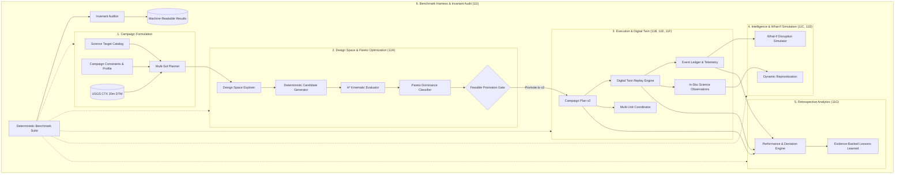

# MarsWalk 2.0 — Milestone 11I System Integration Design
## V2 Integration, Benchmark Harness & Release Acceptance Gate

**Milestone:** 11I (MarsWalk 2.0 V2 Acceptance)  
**Status:** DRAFT / IN IMPLEMENTATION  
**Target Environment:** Mars (IAU 2000 Sphere / USGS CTX DTM 20m Jezero Crater Topography)  
**Contract Dialect:** JSON Schema Draft 2020-12  

---

## 1. System Overview & Integration Architecture

Milestone 11I establishes a unified, deterministic integration test harness and benchmark suite that verifies the complete MarsWalk 2.0 (Milestones 11A through 11H) campaign-level exploration pipeline.



---

## 2. Representative Benchmark Scenario Catalog

The benchmark subsystem (`src/marswalk/core/campaign_benchmark.py`) specifies 8 representative, deterministic scenarios evaluating all core campaign aspects:

| Scenario ID | Name | Category | Key Challenge / Invariant Tested |
|---|---|---|---|
| `BM-NORM-01` | Nominal Multi-Target Feasible Campaign | Baseline Planning | Multi-target feasible campaign across 3 Sols. Verified candidate generation, Pareto frontier non-emptiness, and version promotion ($v_1 \to v_2$). |
| `BM-DURC-02` | Duration-Constrained Campaign | Boundary Conditions | Tight per-sortie duration limit ($18,000\text{ s}$). Verified deferral of lower-priority targets and strict sortie duration compliance. |
| `BM-SCIP-03` | Science-Priority Prerequisite Chain | DAG Dependencies | Strict prerequisite chain ($A \to B \to C$). Verified topological order preservation and maximal scientific yield appetite. |
| `BM-CONS-04` | Conservative High-Margin Campaign | Mobility Profiles | Conservative profile with steep slope derating. Verified higher safety margins and longer calculated traverse times. |
| `BM-INFEAS-05` | Infeasible Candidate Partitioning | Safety Isolation | Candidate configurations violating kinematic envelopes or unreachable waypoints. Verified infeasibles are partitioned, cannot dominate feasible candidates, and are blocked from promotion. |
| `BM-PARETO-06` | Genuine Multi-Objective Pareto Trade-Off | Multi-Objective Optimization | Multiple non-dominated candidates with authentic trade-offs (Science vs Duration vs Distance). Verified pure mathematical non-dominance and zero composite score distortion. |
| `BM-MULTI-07` | Multi-Unit Coordination & Conflict | Multi-Agent Coordination | Multi-unit fleet (EVA astronaut + robotic rover). Verified capability matching, handoffs, and temporal collision detection. |
| `BM-INCOMP-08` | Incomplete & Inconclusive Evidence | Scientific Integrity | Campaigns with incomplete observations and missing sensor readings. Verified honest reporting (`undetermined` causes, neutral weight updates, zero synthetic hallucinations). |

---

## 3. Explicit Correctness Invariants

### 3.1 Design-Space & Pareto Invariants
1. **Canonical Fingerprint Determinism**: Identical candidate inputs produce identical SHA-256 fingerprints across runs.
2. **Deterministic Candidate Generation**: Parameter search yields identical candidate order and configurations on repeated passes.
3. **Feasibility Integrity**: Feasible candidates with missing optional presentation attributes are never misclassified as infeasible.
4. **Dominance Asymmetry**: Candidate $A$ dominates $B$ iff $A$ is at least as good in all 5 objectives, strictly better in $\ge 1$, and $A$ is feasible.
5. **Infeasible Isolation**: Infeasible candidates cannot dominate feasible candidates under any circumstances.
6. **Multi-Objective Dimensionality**: Objective vectors $(\text{Coverage}, \text{Duration}, \text{Distance}, \text{Unallocated Priority}, \text{Conflicts})$ are preserved without undocumented composite scoring.
7. **Search Completeness Accuracy**: Truncation flags (`is_exhaustive`, `limit_reached`) accurately reflect whether computational bounds halted exploration.

### 3.2 Campaign Lifecycle & Persistence Invariants
1. **Baseline Immutability**: Promoting candidate $C_k$ from campaign $v_n$ creates distinct campaign record $v_{n+1}$. Baseline $v_1$ and intervening versions remain bitwise identical on disk.
2. **Hard Gate on Infeasible Promotion**: Attempting to promote an infeasible candidate raises a hard error (`ERR_CANDIDATE_INFEASIBLE`), preventing corrupted campaign creation.
3. **Schema Compliance**: All persisted records validate against JSON Schema Draft 2020-12 specifications.
4. **Atomic Operation Safety**: Failed or invalid operations write nothing to disk and leave zero orphaned temporary files.

### 3.3 Simulation & Analytics Invariants
1. **Simulation Determinism**: Temporal replay produces identical timestamped state vectors across repeated executions.
2. **Provenance Separation**: Planned values, simulated estimates, imported datasets, and in-situ measurements are explicitly separated in all schemas and reports.
3. **Conservative Causal Attribution**: Deviation causes require corroborating event evidence; missing evidence results in `undetermined` rather than speculative claims.
4. **Scientific Integrity Disclosures**: All models include mandatory disclosures stating kinematic calculations and simulated weather are planning models, not certified flight software.

---

## 4. Benchmark Result Schema Contract

Path: `schemas/api/v1/campaign-benchmark.schema.json`  
Dialect: JSON Schema Draft 2020-12  

```json
{
  "$schema": "https://json-schema.org/draft/2020-12/schema",
  "$id": "https://marswalk.nasa.gov/schemas/api/v1/campaign-benchmark.schema.json",
  "title": "MarsWalk Campaign Benchmark Suite Result",
  "type": "object",
  "required": [
    "schema_version",
    "suite_id",
    "timestamp_utc",
    "total_scenarios",
    "passed_scenarios",
    "failed_scenarios",
    "total_candidates_evaluated",
    "execution_time_s",
    "scenarios",
    "system_environment",
    "reproducibility_verified",
    "limitations_disclaimer"
  ]
}
```

---

## 5. Acceptance Gate Criteria

Milestone 11I passes acceptance when:
1. Full repository test suite passes (633+ tests, 100% green).
2. Campaign regression suite passes (11A through 11I).
3. Benchmark suite executes all 8 scenarios and reports 8/8 passed.
4. Reproducibility test confirms zero drift across repeated benchmark runs.
5. End-to-end planning-to-analysis lifecycle test succeeds against real Jezero CTX DTM.
6. Atlas server preflight passes 12/12 checkpoints.
7. Frontend JavaScript passes syntax validation with zero errors.
8. Zero operational datasets, missions, or historical milestones are modified or deleted.
