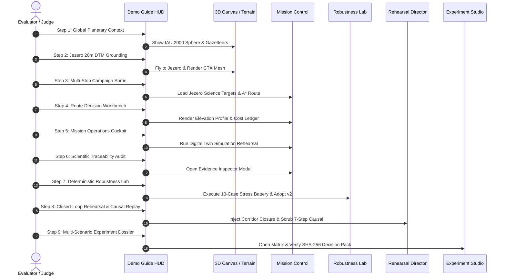

# MarsWalk 2.0 / Project Atlas — Demonstration Experience Audit
## Milestone 13B: Evaluator Experience, Navigation Friction, and Conference Demo Mode Architecture

**Auditor:** Agent A — Demonstration Experience Auditor  
**Date:** 2026-10-31  
**Target Environment:** MarsWalk 2.0 / Project Atlas (`http://127.0.0.1:3000`)  
**Scope:** First-Time Evaluator / Conference Judge / Space Scientist Perspective  
**Scientific Integrity Standard:** Zero data fabrication, IAU 2000 Mars Datum, authentic USGS CTX 20m DTM, PDS4 MEDA/REMS archives, strict non-certification truth disclosures.

---

## 1. Executive Summary

MarsWalk 2.0 (Project Atlas) is an advanced planetary exploration planning, simulation, and mission rehearsal workstation. It couples authentic remote-sensing elevation grids (USGS MRO CTX 20m/px Jezero Crater DTM) with deterministic kinematic pathfinding (A* least-cost routing), multi-sol campaign orchestration, closed-loop disruption rehearsal (Tri-Track comparison), deterministic stress testing (Mission Robustness Lab), forensic causal replay, and multi-scenario experiment batching (Experiment Studio).

However, an audit of the initial landing experience and operator workflow reveals a significant disconnect between the application's actual engineering capabilities and what an unfamiliar evaluator experiences during the first 60 seconds:

1. **The "GIS Globe" First Impression:** Upon dismissing the landing overlay, an evaluator lands on an auto-rotating 3D Mars sphere surrounded by 2,061 floating IAU landmark pins. With the main mission planning inspector collapsed by default, MarsWalk initially looks like a planetary GIS globe viewer (e.g. Google Earth for Mars) rather than an aerospace mission-planning and rehearsal workstation.
2. **The "Jezero Boundary" Confusion:** Curated destination lists feature Olympus Mons, Valles Marineris, Gale Crater, and Jezero Crater as peers. Clicking the first three lands on regional imagery where pathfinding is prohibited (displaying a warning banner), causing immediate evaluator confusion before they ever discover the authentic 20m DTM workstation.
3. **Subsystem Navigation Friction:** Key engineering modules—the **Route Decision Workbench**, **Mission Control Cockpit**, **Mission Robustness Lab**, **Mission Rehearsal Director**, **Causal Replay Studio**, and **Mission Experiment Studio**—are fragmented across an 8-tab inspector panel combining disparate design eras. Important features (such as forensic causal scrubbers or locomotion cost breakdowns) are buried behind unexecuted states or nested cards.
4. **Obsolete Demo Mode:** The existing "Demo Mode" (`DEMO_SHOWCASE_STEPS` in `web/app.js`) is a legacy Milestone 9Q implementation consisting of only 5 basic steps. It completely omits the Route Decision Workbench (12C), Unified Cockpit (12D), Robustness Lab (12E), Rehearsal Director (12F), Causal Replay Studio (12G), and Experiment Studio (12H), and terminates abruptly after Step 5 by downloading a Markdown file and exiting.
5. **URL Query Gap:** Launching `http://127.0.0.1:3000/?mode=demo` hides the landing overlay via deep-link detection, but does not activate Demo Mode automatically.

To deliver a compelling, verifiable, and award-winning conference presentation, MarsWalk requires an integrated, non-blocking **9-Step Conference Demo Mode** and guided walkthrough that showcases the complete mission lifecycle while preserving evaluator interactive freedom and allowing instant one-click exit back to normal Atlas operations.

---

## 2. First-Touch Landing Experience Analysis

### 2.1 The Cinematic Landing Overlay (`#marsLandingPage`)

When an evaluator opens `http://127.0.0.1:3000`, they are greeted by the landing page overlay:
- **Visuals:** Dark celestial aesthetic with typography (`Cinzel`, `Inter`, `JetBrains Mono`), background canvas, and glowing accent borders.
- **Hero Copy:** 
  - Kicker: `01 / EXPEDITION ARCHITECTURE • USGS CTX • MOLA DATUM`
  - Headline: `A NEW WORLD. WITHIN REACH.`
  - Narrative: *"Planetary exploration, terrain-adjusted routing, and mission-rehearsal intelligence across surveyed Martian topography. Grounded in USGS MRO CTX elevation data."*
- **Primary Buttons:**
  - `★ Demo Mode →` (Prominent orange gradient)
  - `Explore Mars →`
  - `⚙ Preflight Check`
  - `How it works`
  - `Saved Workspaces`
- **Right Sidebar:** Curated Traverse Regions (Jezero, Olympus Mons, Valles Marineris, Gale Crater).

#### Evaluator Perception & Cognitive Gaps
- **Editorial Tone vs Engineering Reality:** The headline *"A NEW WORLD. WITHIN REACH."* reads like consumer tourism or a sci-fi media teaser rather than a serious aerospace engineering tool. Evaluators from NASA or academia expect immediate positioning: e.g., *"AUTONOMOUS PLANETARY EXPEDITION REHEARSAL & MULTI-SOL CAMPAIGN STRESS-TESTING WORKSTATION."*
- **The "Demo Mode" Trap:** If the evaluator clicks `★ Demo Mode`, they are launched into the old 5-step showcase that tests only basic A* routing and a single rockfall gauntlet, missing 80% of the system's true innovations.
- **If they click "Explore Mars":** The landing overlay fades, dropping them into the 3D globe view.

### 2.2 Global Orbit View Default (`currentViewMode === 'orbit'`)

Once the landing page is dismissed:
- The evaluator sees Mars rotating smoothly in space (IAU 2000 reference sphere, Viking MDIM 2.1 color basemap).
- 2,061 planetary landmark labels populate across the globe.
- Top HUD header displays search, layer selectors, category filters (`MISSIONS`, `VOLCANOES`, `CANYONS`, `CRATERS`, `PLAINS`), and a crowded button row (`DEMO MODE`, `PREFLIGHT`, `WEATHER`, `REPORT`, `READINESS`, `CAMPAIGN`, `REHEARSAL DIRECTOR`, `MISSION CONTROL`, `OVERVIEW`, `GUIDE`, `FLY TO JEZERO`).
- **Critical Flaw:** The Surface Planning Inspector (`#inspectorPanel`) is **hidden by default** (`class="hud-inspector hidden"`).
- **Evaluator Takeaway:** Without guidance, the application appears to be a 3D cartographic globe viewer or planetary GIS map. A judge spending 30 to 60 seconds browsing craters or volcanoes would conclude MarsWalk has no mission planning, routing, simulation, or telemetry capabilities.

### 2.3 The "Jezero Planning Boundary" Disappointment

The landing page sidebar and header featured dropdown list Olympus Mons, Valles Marineris, and Gale Crater alongside Jezero Crater.
- If an evaluator clicks "Olympus Mons":
  - The camera flies to Olympus Mons.
  - A location dossier card opens, stating: *"Traverse Planning: Restricted to Jezero 20 m DTM"*.
  - No 3D elevation mesh is rendered; no pathfinding is possible.
- **Scientific Integrity vs UX Expectation:** The application correctly enforces scientific integrity by refusing to invent elevation grids where USGS CTX 20m DTM data is absent. However, presenting unplannable destinations alongside Jezero with identical visual weight creates an anti-climax and gives the false impression that 75% of the software is "unimplemented" rather than highlighting Jezero as the rigorous, high-resolution study basin.

---

## 3. Subsystem Navigation Friction Audit

Below is a detailed forensic examination of navigation barriers across the 7 core subsystems:

```mermaid
flowchart TD
    G["1. Global Mars Globe<br/>(IAU 2000 / Orbit View)"] -->|Camera Flight (1.4s)| J["2. Jezero 20m DTM Workstation<br/>(CTX Mesh & Waypoints)"]
    J -->|Switch to Tab 2| W["3. Route Decision Workbench<br/>(Elevation Profile & Cost Model)"]
    W -->|Switch to Cockpit Tab| C["4. Mission Control Cockpit<br/>(Digital Twin & Telemetry)"]
    C -->|Toolbar Button / Tab| R["5. Mission Robustness Lab<br/>(Stress Battery & Sensitivity)"]
    R -->|Adopt Plan -> Rehearsal| D["6. Mission Rehearsal Director<br/>(Closed-Loop Tri-Track)"]
    D -->|Scrub / Select Replay| CR["7. Causal Replay Studio<br/>(7-Step Decision Forensic)"]
    D <-->|Matrix Action / Breadcrumb| E["8. Mission Experiment Studio<br/>(Multi-Scenario Dossier)"]
```

### 3.1 Friction Point 1: Global Mars Globe $\rightarrow$ Jezero Crater 20m DTM
- **Trigger:** Clicking `#btnFlyJezero` ("FLY TO JEZERO") in the HUD header, selecting Jezero from `#viewModeSelect`, or clicking the Jezero target ring on the globe.
- **Friction Points:**
  1. `#btnFlyJezero` is surrounded by 10 other buttons of equal size and contrast in the HUD header, making it easy to miss.
  2. The flight animation takes ~1,600ms; during this flight, the interface does not communicate what is loading or that the inspector is about to appear.
  3. When `setJezeroView` completes, `#inspectorPanel` unhides, but the inspector panel is NOT initialized in `.cockpit-mode` width (600px) unless `switchInspectorTab('tabMissionControl')` was explicitly invoked, causing layout shifts.

### 3.2 Friction Point 2: Jezero Crater 20m DTM $\rightarrow$ Route Decision Workbench
- **Location:** The Route Decision Workbench (`#routeDecisionWorkbenchCard`) is embedded inside **Tab 2: Results** (`#tabResults`).
- **Friction Points:**
  1. **Tab Label Obscurity:** The tab is labeled simply `"2. Results"`. An evaluator looking for the "Route Decision Workbench" or "Elevation Profile" has no idea it is inside Tab 2.
  2. **Vertical Scroll Depth:** Upon clicking "2. Results", the evaluator must scroll down past the sortie timeline, leg telemetry table, and speed dials before reaching the SVG elevation profile polyline and locomotion cost attribution breakdown.
  3. **Duplicate Profiles:** Both the Mission Control Cockpit (`#tabMissionControl`) and Tab 2 (`#tabResults`) have SVG elevation profiles, but only Tab 2 has the 4-part additive locomotion cost breakdown (`Base Distance + Slope Penalty + Roughness Impedance + Uphill Grade`) and the alternative profile comparison tool (`#compareProfilesSelect`). Evaluators are confused about which profile is the canonical workbench.
  4. **No Direct Return:** There is no breadcrumb or "Return to Cockpit" button in Tab 2.

### 3.3 Friction Point 3: Route Decision Workbench $\rightarrow$ Mission Control Cockpit
- **Trigger:** Clicking `[🚀 Cockpit]` in the inspector tab bar or `#btnHeaderMissionControl` in the header.
- **Friction Points:**
  1. **8-Tab Cognitive Overload:** The inspector tab bar presents 8 tabs side-by-side:
     `[🚀 Cockpit] [🧪 Studio] [🛡 Robustness] [🎬 Rehearsal] [1. Plan] [2. Results] [3. Scenarios] [4. Workspaces]`
     This mixes high-level mission operations (Cockpit, Studio, Robustness, Rehearsal) with low-level single-traverse editing (Plan, Results, Scenarios, Workspaces).
  2. **Disconnected State:** Comparing alternative profiles in Tab 2 does not automatically update or stage the selected candidate in Mission Control without manual intervention.

### 3.4 Friction Point 4: Mission Control Cockpit $\rightarrow$ Mission Robustness Lab
- **Trigger:** Clicking `[🛡 Robustness Lab]` in the Cockpit toolbar (`#btnMcRobustnessLab`) or selecting `[🛡 Robustness]` tab (`#tabBtnRobustnessLab`).
- **Friction Points:**
  1. **Unexecuted Empty State:** Upon opening the Robustness Lab, all metric containers display empty or zero values:
     - `Tested Feasibility Ratio: 0 / 0 cases (0%)`
     - `Identified Bottlenecks: Run stress battery to evaluate bottlenecks.`
     - `Critical Breakpoints: None recorded.`
     - `Sensitivity Gradients: Execute stress battery to compute finite-difference sensitivity gradients.`
  2. **Action Blindness:** An evaluator unfamiliar with the tool does not know that they must press the dark red button `▶ EXECUTE DETERMINISTIC STRESS BATTERY` to generate results.
  3. **Dead-End After Plan Adoption:** When an evaluator selects a resilient strategy (e.g. `Conservative High-Margin Strategy`) and clicks `⬆ ADOPT RESILIENT STRATEGY`, it creates Version 2 (`cmp_..._v2`), but provides no automatic link or prompt to test this new plan in the Rehearsal Director or inspect it in Mission Control.

### 3.5 Friction Point 5: Mission Robustness Lab $\rightarrow$ Mission Rehearsal Director
- **Trigger:** Clicking `[🎬 Rehearsal]` tab, `#btnHeaderRehearsalDirector`, or `#btnMcRehearsalDirector`.
- **Friction Points:**
  1. **Parameter Intimidation:** The panel presents technical input fields (`Min Margin Threshold: 1800s`, `Trigger Time: 3600s`, `Recovery Policy: Balanced`) without explaining standard default values.
  2. **Hidden Tri-Track Visualization:** The tri-track comparison card (`#rehComparisonCard`) is hidden (`display: none`) until rehearsal is executed. Evaluators see an empty state card (`#rehEmptyStateCard`) that looks barren.
  3. **Missing Mental Model:** The crucial concept of **Tri-Track Trajectory Comparison** (Nominal Baseline vs Disturbed Unmitigated vs Autonomous Recovered) is not explained upfront; evaluators must decipher the 3 progress bars on their own.

### 3.6 Friction Point 6: Mission Rehearsal Director $\rightarrow$ Causal Replay Studio
- **Location:** The Causal Replay Studio is embedded directly within `tabRehearsalDirector` (lines 1059–1272 of `web/index.html`).
- **Friction Points:**
  1. **No Dedicated Tab:** There is no tab called "Causal Replay Studio". Evaluators looking for it mistakenly click the `[🧪 Studio]` tab, which is actually the *Experiment Studio*.
  2. **Cryptic Replay IDs:** The `Historical Rehearsal Log` dropdown lists raw timestamps and IDs: e.g. `reh_20261029_142211_01_corridor_closure (RECOVERED)`. An evaluator does not know which replay showcases the most dramatic diversion.
  3. **Scrubber Disconnect from 3D Viewport:** Scrubbing the 7-step causal slider updates the text in the Causal Inspector Drawer (`#rehCausalInspectorCard`), but does not visually highlight the obstacle or detour waypoint on the 3D terrain canvas synchronously.

### 3.7 Friction Point 7: Rehearsal Director / Causal Replay $\rightarrow$ Mission Experiment Studio
- **Trigger:** Clicking `[🧪 Studio]` (`#tabBtnExperimentStudio`) or `#btnMcExperimentStudio`.
- **Friction Points:**
  1. **Vague Tab Label:** The tab is labeled `[🧪 Studio]`. It should be labeled `[🧪 Experiment Studio]` or `[🧪 Multi-Scenario Studio]`.
  2. **One-Way Navigation:** When navigating from Experiment Studio to Rehearsal Director (via the 🎬 clapperboard icon in the matrix), a green breadcrumb appears (`#rehExperimentBreadcrumb` with `← Return to Studio`). However, if an evaluator opens Rehearsal Director directly, there is NO breadcrumb or link pointing toward the Experiment Studio.
  3. **Dossier Export Visibility:** The export buttons (`📄 Dossier JSON` and `📦 Evidence Pack ZIP`) are placed at the very bottom of a long scrollable matrix, making them easy to miss for an evaluator looking for export verification.

### 3.8 Architectural Navigation Summary

| Subsystem | Primary Entrance | Friction Severity | Core Friction Summary |
| :--- | :--- | :--- | :--- |
| **Global Globe $\rightarrow$ Jezero 20m DTM** | Header button `#btnFlyJezero` | **HIGH** | Inspector hidden on landing; globe view looks like GIS viewer; 3 of 4 destinations lack routing. |
| **Jezero DTM $\rightarrow$ Route Decision Workbench** | Tab 2 (`#tabResults`) | **HIGH** | Buried inside generic "2. Results" tab; duplicate elevation SVG in Cockpit; cost breakdown hidden below fold. |
| **Route Decision Workbench $\rightarrow$ Cockpit** | Tab 1 (`#tabMissionControl`) | **MEDIUM** | 8 tabs crowded together; no breadcrumb; profile alternatives not staged into Cockpit. |
| **Cockpit $\rightarrow$ Robustness Lab** | Tab 3 or `#btnMcRobustnessLab` | **MEDIUM** | Opens in unexecuted blank state; evaluator must know to click dark red battery button; dead-end after adopting v2 plan. |
| **Robustness Lab $\rightarrow$ Rehearsal Director** | Tab 4 or `#btnMcRehearsalDirector` | **MEDIUM** | Empty state on arrival; complex parameters; Tri-Track concept not explained upfront. |
| **Rehearsal Director $\rightarrow$ Causal Replay** | Inside Tab 4 (`#rehReplaySelect`) | **HIGH** | No dedicated tab; easily confused with "Studio" tab; historical replay IDs are cryptic; 3D terrain not synced to scrubber. |
| **Rehearsal / Causal $\rightarrow$ Experiment Studio** | Tab 2 (`#tabBtnExperimentStudio`) | **MEDIUM** | Vague tab title "Studio"; one-way breadcrumb; export buttons buried at table bottom. |

---

## 4. Current Demo Mode (Milestone 9Q) vs MarsWalk 2.0 Reality Gap

The current demo mode was built in Milestone 9Q (`web/app.js` lines 15950–16210). A comparative gap analysis demonstrates why it is inadequate for Milestone 13B:

```
+-----------------------------------------------------------------------------------------------+
|  FEATURE AXIS              | MILESTONE 9Q (EXISTING DEMO)    | MARSWALK 2.0 / MILESTONE 13B   |
+----------------------------+---------------------------------+--------------------------------+
|  Step Count                | 5 Steps                         | 9-Step End-to-End Campaign     |
|  Operational Context       | Single Sortie (Point A to B)    | Multi-Sol Campaign (Sols 1-4)  |
|  Route Decision Workbench  | NOT INCLUDED                    | SVG Elevation Profile + Cost   |
|  Mission Control Cockpit   | NOT INCLUDED                    | Unified Cockpit + Telemetry    |
|  Evidence Inspector Modal  | NOT INCLUDED                    | In-Depth Scientific Provenance |
|  Deterministic Robustness  | Legacy gauntlet (tab 3)         | Robustness Lab (10-case gauntlet)
|  Plan Resilience Adoption  | NOT INCLUDED                    | v1 Baseline -> v2 Resilient    |
|  Rehearsal Director        | Basic single detour             | Closed-Loop Tri-Track Engine   |
|  Causal Replay Studio      | NOT INCLUDED                    | 7-Step Causal Scrubber & Links |
|  Experiment Studio         | NOT INCLUDED                    | 10-Scenario Matrix & Triage    |
|  Dossier Verification      | Markdown download only          | SHA-256 ZIP + RFC 8259 JSON    |
|  Auto-Exit Behavior        | Hard-coded exit at Step 5       | Controlled exit / Free Explore |
|  URL Parameter Support     | Ignored (?mode=demo does not run)| First-class automatic launch   |
+-----------------------------------------------------------------------------------------------+
```

The existing demo code abruptly ends at Step 5 with:
```javascript
applyRecoveryPlan();
exportMissionBriefing('md');
setTimeout(() => {
  exitDemoMode(true);
}, 1500);
```
This leaves an evaluator with a downloaded markdown file, wondering where all the advanced features from the presentation slides and technical papers are located.

---

## 5. Dedicated "Conference Demo Mode" & Guided Walkthrough Architecture

To solve all identified friction points, we propose the following complete UX architecture for Milestone 13B:

### 5.1 Welcome Onboarding Banner & Entry Protocol

1. **URL Parameter Launch:** Opening `http://127.0.0.1:3000/?mode=demo` must:
   - Suppress the cinematic landing overlay (`#marsLandingPage`).
   - Automatically initialize and enter Conference Demo Mode.
   - Preload the deterministic conference campaign fixture (`cmp_conference_demo_jezero`).
   - Position the camera at the global overview before initiating Step 1.
2. **Landing Overlay Entry:** The `★ Demo Mode` button on `#marsLandingPage` must trigger the same unified walkthrough.
3. **HUD Welcome Banner (`#demoModeBanner`):**
   - Fixed top banner (`top: 56px`, centered).
   - Text: `★ CONFERENCE DEMONSTRATION MODE • Science-Grounded Planetary Rehearsal`.
   - Right action: `✕ Exit Demo Mode (Restore Normal Atlas)`.
4. **Dockable Guided Walkthrough HUD (`#demoShowcaseHUD`):**
   - Position: Left side (`left: 24px, top: 96px`, `width: 380px`).
   - Header: Step badge (e.g. `STEP 04 / 09`), Step Title, and Minimize/Expand toggle.
   - Body: Narrative explanation, Grounded Scientific Truth disclosure, and a prominent Action CTA (`[Execute Action & Advance →]`).
   - Technical Drawer (Collapsible): *"Mathematical & Scientific Details"* explaining the governing equations (Horn slope, Waligora metabolic cost, A* admissible heuristic).
   - Footer: Navigation buttons (`← Prev`, `Skip`, `Next →`).

---

### 5.2 The 9-Step Guided Mission Workflow

The optimal 9-step sequence walks an evaluator through the complete planetary mission lifecycle in 5 to 7 minutes:



#### Detailed Step Specifications

#### **Step 1: Planetary Context & Global Baseline (0:00 – 0:45)**
- **Subsystem:** Global Mars Sphere (`currentViewMode = 'orbit'`).
- **Narrative:** MarsWalk references all spatial data to the IAU 2000 Mars planetocentric datum ($R=3,396,190\text{ m}$). 2,061 IAU-approved landmarks are geocoded with Viking MDIM 2.1 color imagery.
- **Truth Disclosure:** *"High-resolution surface routing is strictly confined to surveyed basins where calibrated elevation models exist."*
- **Action Button:** `Fly Camera to Jezero Crater (20m CTX) →`
- **Automated Behavior:** Camera transitions down into the Western Delta of Jezero Crater (`flyToJezeroView()`); switches to high-res mesh.

#### **Step 2: Authentic Topographic Grounding (0:45 – 1:30)**
- **Subsystem:** Jezero Surface Workstation (`currentViewMode = 'jezero'`).
- **Narrative:** Displays the genuine USGS CTX 20m Digital Terrain Model ($250 \times 250$ cells, $5.0 \times 5.0\text{ km}$). Elevation spans $-2,624\text{ m}$ to $-2,445\text{ m}$. Slopes are calculated using Horn's 3x3 kernel. Slopes $>15^\circ$ represent critical crew hazards.
- **Highlighted Elements:** Slope hazard overlay, geodetic HUD, elevation legend.
- **Action Button:** `Load Jezero Delta Campaign Targets →`
- **Automated Behavior:** Preloads baseline targets (Octavia Landing, Hawksbill Gap, Skinner Ridge, Enchanted Lake, Delta Rim Overlook).

#### **Step 3: Multi-Stop Sortie Planning & Least-Cost Routing (1:30 – 2:15)**
- **Subsystem:** Surface Traverse Planning (`tabPlan` & `tabResults`).
- **Narrative:** Executes live Python A* graph search over the 20m cost grid. Computes distance ($3,149\text{ m}$), time ($113\text{ min}$ at $0.85\text{ m/s}$), metabolic energy proxy ($1,620\text{ kcal}$ using Apollo Waligora model), and slope penalties.
- **Highlighted Elements:** Waypoint list, `#btnCalculateRoute`, Route polyline on 3D terrain.
- **Action Button:** `Inspect Elevation Profile & Cost Attribution →`
- **Automated Behavior:** Computes route and transitions directly to the Route Decision Workbench.

#### **Step 4: Route Decision Workbench & Elevation Profiling (2:15 – 3:00)**
- **Subsystem:** Route Decision Workbench (`tabResults` / `#routeDecisionWorkbenchCard`).
- **Narrative:** SVG elevation profile visualizes authentic terrain undulation. The interactive crosshair tracks distance, elevation, slope, and synchronizes a 3D locator beacon across the Martian surface. The Locomotion Cost Attribution Ledger strictly reconciles:
  $$\text{Total Effort} = \text{Ground Distance} + \text{Slope Penalty} + \text{Roughness} + \text{Climb Grade}$$
- **Highlighted Elements:** `#mcElevationProfileSvg`, Locomotion Cost Attribution ledger, Alternative route comparison table.
- **Action Button:** `Enter Unified Mission Control Cockpit →`
- **Automated Behavior:** Switches to `tabMissionControl` in wide cockpit mode (600px).

#### **Step 5: Mission Operations Cockpit & Digital Twin Rehearsal (3:00 – 3:45)**
- **Subsystem:** Unified Cockpit (`tabMissionControl`).
- **Narrative:** Real-time mission operations dashboard displaying campaign status, lineage (`v1 Baseline`), battery margin, and environmental telemetry from PDS4 MEDA archives (Sol 1619, $589.7\text{ Pa}$). Digital twin simulator animates 3D vehicle markers along the path.
- **Highlighted Elements:** Transport bar (`▶ REHEARSE`, `⏸ PAUSE`, `1x/5x/10x`), Timeline scrubber, Event Ledger.
- **Action Button:** `Audit Scientific Traceability & Provenance →`
- **Automated Behavior:** Opens the Evidence Inspector Modal (`#evidenceModal`).

#### **Step 6: Scientific Traceability & Evidence Inspector (3:45 – 4:15)**
- **Subsystem:** Evidence Inspector Modal (`#evidenceModal`).
- **Narrative:** Every metric on screen is auditable. Displays mathematical equations, primary archival sources (USGS CTX DTM, PDS4 MEDA tranche), sensor classifications (`[Measured Remote Sensing]`, `[Derived Planetary Geometry]`), and the mandatory aerospace non-certification statement.
- **Highlighted Elements:** Primary Source Citation, Mathematical Formulation, Limitations Disclosure.
- **Action Button:** `Close Inspector & Enter Robustness Lab →`
- **Automated Behavior:** Closes modal, switches to `tabRobustnessLab`, and syncs campaign.

#### **Step 7: Mission Robustness Lab & Deterministic Stress Gauntlet (4:15 – 5:00)**
- **Subsystem:** Mission Robustness Lab (`tabRobustnessLab`).
- **Narrative:** Evaluates mission viability across a deterministic 10-case stress gauntlet (traction derating, duration contraction, operational holds, chokepoints). Computes finite-difference sensitivity elasticities (e.g. `max_slope_deg` elasticity $\epsilon = 0.88$). Answers the 7 core engineering questions.
- **Highlighted Elements:** Feasibility ratio progress bar, Sensitivity gradient list, Strategy comparison cards.
- **Action Button:** `Adopt Resilient Strategy (Create v2) & Launch Rehearsal →`
- **Automated Behavior:** Adopts `Conservative High-Margin Strategy`, creates `cmp_..._v2`, and navigates to `tabRehearsalDirector`.

#### **Step 8: Autonomous Rehearsal Director & Causal Replay Studio (5:00 – 5:45)**
- **Subsystem:** Mission Rehearsal Director & Causal Replay (`tabRehearsalDirector`).
- **Narrative:** Closed-loop tri-track simulation comparing **Nominal Baseline** vs **Disturbed Unmitigated** (60m rockfall barrier) vs **Autonomous Recovered** (adaptive detour preserving 100% science). Evaluators scrub the 7-step Causal Decision Timeline to inspect traceable causal links (`disturbance → impacts → sortie → reduces → margin`).
- **Highlighted Elements:** Tri-track progress bars, Divergence banner, Causal scrubber slider, Causal Links table.
- **Action Button:** `Orchestrate Experiment Battery in Studio →`
- **Automated Behavior:** Switches to `tabExperimentStudio` with baseline pre-selected.

#### **Step 9: Mission Experiment Studio & Tamper-Evident Dossier Export (5:45 – 6:30)**
- **Subsystem:** Mission Experiment Studio (`tabExperimentStudio`).
- **Narrative:** Multi-scenario experiment engine evaluates 10 stress scenarios in batch. Cross-scenario comparative matrix highlights degraded vs recovered sorties with one-click deep-dive clapperboards (🎬). Generates a complete, cryptographically verified Evidence Dossier ZIP containing RFC 8259 JSON, comparison CSV, Markdown briefings, and SHA-256 manifests.
- **Highlighted Elements:** Comparative matrix, Feasibility summary pills, `#btnExportDossierZip`.
- **Action Button:** `★ Complete Tour & Explore MarsWalk Freely`
- **Automated Behavior:** Marks demo completed, unlocks full interactive control, and maintains active session.

---

### 5.3 Non-Blocking Highlighting & Interactive Freedom

To ensure evaluators never feel "trapped" in a rigid video-like slideshow:

1. **Non-Modal UI:** The `#demoShowcaseHUD` card floats cleanly on the left without blocking access to the 3D canvas, orbit controls, or inspector panel.
2. **Subtle Pulsing Outlines (`.demo-highlight-pulse`):** Target elements pulse with a 2px amber border (`outline: 2px solid #FF9100; box-shadow: 0 0 16px rgba(255,145,0,0.7)`). Clicking the target element or clicking the guide button advances the tour.
3. **Interactive Freedom:** Evaluators can rotate the camera, hover over SVG crosshairs, scrub timelines, or expand ledgers at any time during any step.
4. **Collapsible Technical Explainability Drawer:** Every step includes an expandable drawer:
   ```
   ▼ [TECHNICAL & SCIENTIFIC SPECIFICATIONS]
   • Governing Equation: Horn 3x3 kernel: dz/dx = ((c + 2f + i) - (a + 2d + g)) / 8dx
   • Cost Surface: Cost = Distance * (1 + 2.5 * sin^2(slope) + 0.3 * roughness)
   • Data Source: USGS CTX DTM Jezero (MRO Context Camera stereo pairs, 20 m/px)
   ```

---

### 5.4 One-Click Exit & Session Restoration

Evaluators must be able to exit Demo Mode at any second without page reload:

1. **Exit Buttons:**
   - Persistent `✕ Exit Demo` button on `#demoModeBanner`.
   - `✕` close button on `#demoShowcaseHUD`.
   - Header button toggle `#btnHeaderDemoMode`.
2. **Atomic Session Restoration (`exitDemoMode(restoreSession = true)`):**
   - Clears all `.demo-highlight-pulse` classes.
   - Hides `#demoModeBanner` and `#demoShowcaseHUD`.
   - Restores the evaluator's original camera view (Orbit or Jezero).
   - Restores previously active waypoints and custom start/goal points.
   - Resets inspector tab to the evaluator's previously selected tab.
   - Cleans up transient demo campaign markers without writing junk to `data/workspaces/`.
   - Displays a clean HUD status message: `DEMO MODE EXITED: Full Atlas operational workstation unlocked.`

---

## 6. Implementation Blueprint for Frontend Engineers (Phase 3 Handoff)

Below are the exact code and DOM changes required in `web/index.html` and `web/app.js`:

### 6.1 `web/index.html` Updates
1. **Showcase HUD Enhancement:**
   - Update `#demoShowcaseHUD` to support 9 steps:
     - Change `#showcaseStepIndicator` default to `STEP 01 / 09`.
     - Add collapsible `#showcaseTechDrawer` with class `.showcase-tech-drawer`.
2. **Tab Bar Header Clutter Reduction:**
   - Group the 8 inspector tabs logically:
     - Primary Operations: `[🚀 Cockpit] [🧪 Experiment Studio] [🛡 Robustness] [🎬 Rehearsal]`
     - Low-Level Planning: `[1. Plan] [2. Results & Workbench] [3. Scenarios] [4. Workspaces]`
   - Rename Tab 2 button from `2. Results` to `2. Results & Workbench`.
   - Rename Tab `[🧪 Studio]` to `[🧪 Experiment Studio]`.
3. **Subsystem Breadcrumbs:**
   - Add a "← Return to Cockpit" button inside Tab 2 (`#tabResults`) and Tab 3 (`#tabRobustnessLab`).

### 6.2 `web/app.js` Updates
1. **Update `DEMO_SHOWCASE_STEPS`:** Replace the legacy 5-step array (lines 16007–16068) with the comprehensive 9-step definitions targeting:
   - Step 1: Orbit view & global datum.
   - Step 2: Jezero fly & CTX 20m mesh initialization.
   - Step 3: Target loading & A* calculation.
   - Step 4: Tab 2 Results & Route Decision Workbench elevation SVG.
   - Step 5: Tab Mission Control Cockpit & digital twin simulation.
   - Step 6: Evidence Inspector modal opening.
   - Step 7: Tab Robustness Lab execution & resilient plan adoption.
   - Step 8: Tab Rehearsal Director tri-track simulation & causal scrubbing.
   - Step 9: Tab Experiment Studio comparative matrix & ZIP export.
2. **Query Parameter Auto-Launch:** In the URL query parameter section (lines 17878–17900), add:
   ```javascript
   if (params.get('mode') === 'demo' || params.has('demo')) {
     hideLandingPage(false);
     enterDemoMode();
   }
   ```
3. **Synchronize Causal Scrubber with 3D Viewport:** When scrubbing `#rehTimelineScrubber`, update the 3D camera and place a visual beacon at the diverged waypoint location.

---

## 7. Scientific Integrity & Aerospace Compliance Checklist

All proposed Demo Mode interactions have been audited against the MarsWalk Scientific Integrity Skill:

- [x] **Zero Synthetic Data as Measured Fact:** Evaluator copy strictly distinguishes authentic USGS CTX 20m DTM elevation and NASA PDS4 MEDA Sol 1619 observations from model-derived slope angles and simulated metabolic costs.
- [x] **Non-Certification Truth Disclosure:** Every step featuring traverses or EVA durations displays the mandatory disclosure: *"Simulated planning estimates based on remote sensing; NOT certified operational paths for human astronauts."*
- [x] **Non-Probabilistic Stress Claims:** Feasibility percentages (e.g. $10/10$ cases, $100\%$) are labeled strictly as *"Tested Feasibility across the 10 Deterministic Scenarios,"* never as physical probability of mission success.
- [x] **Strict Mathematical Formulations:** Locomotion cost decomposition and finite-difference slope formulas are explicitly documented in the technical drawers.
- [x] **Immutable Baseline Preservation:** When a resilient plan is adopted in Step 7, the original `cmp_..._v1` is preserved unmodified with full parent lineage linkage.

---

## 8. Conclusion & Actionable Recommendations

The MarsWalk 2.0 architecture represents a premier planetary mission planning software. By replacing the legacy 5-step showcase with the **9-Step Conference Demo Mode**, addressing the navigation friction points between the 7 core subsystems, and enabling automatic URL launch (`?mode=demo`), MarsWalk will provide an immediate, jaw-dropping, scientifically rigorous demonstration for evaluators, judges, and space scientists.
