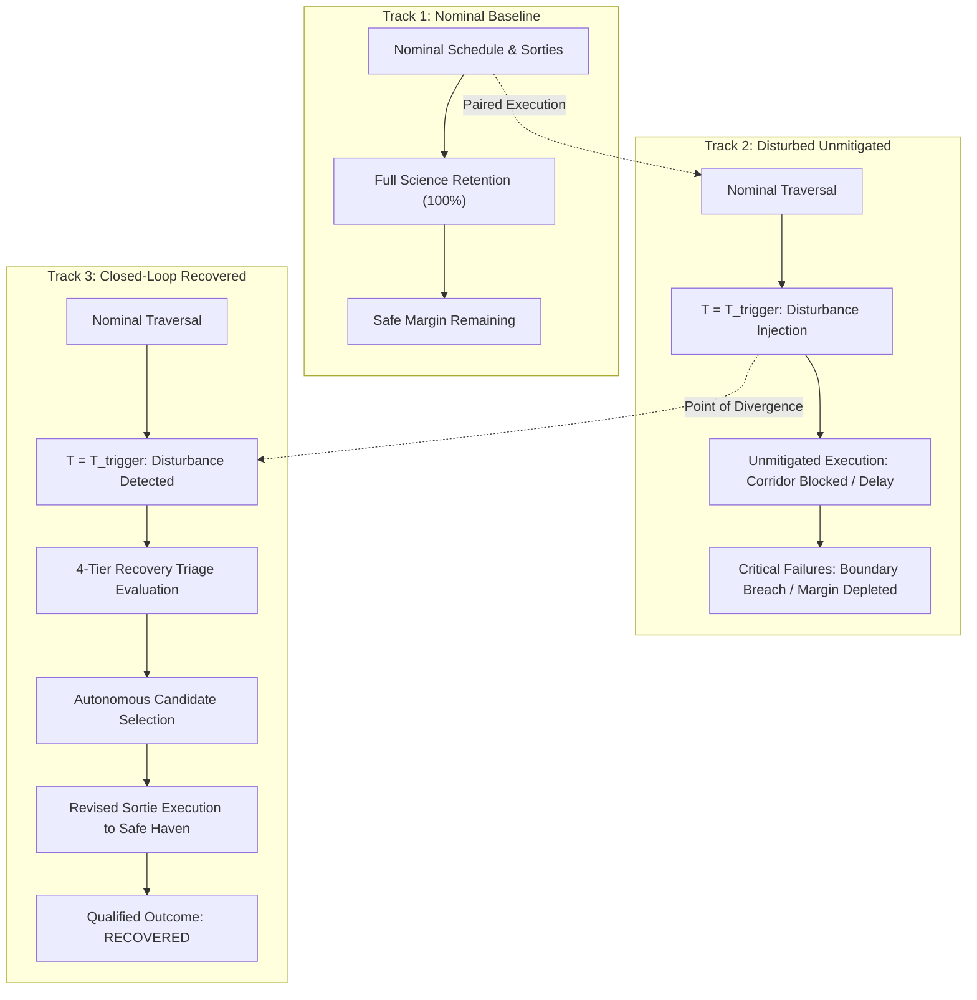
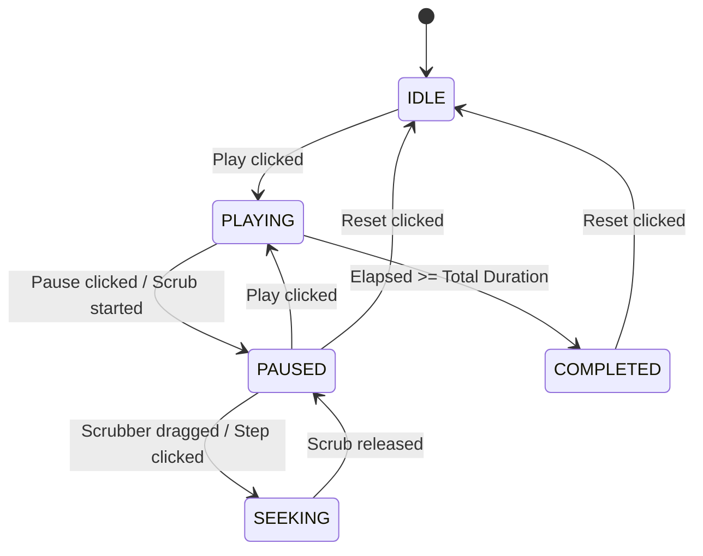

# MarsWalk 2.0 / Project Atlas: Milestone 13C
## Mission Timeline & Simulation Synchronization Auditor Report
**Document Target:** `docs/milestone-13c-simulation-playback-audit.md`  
**Author:** Agent 3: Mission Timeline & Simulation Synchronization Auditor  
**Date:** October 31, 2026  
**Sprint:** Milestone 13C — 3D Mission Theater  
**Repository:** `E:\Python\NASA-Spaceapps\Marswalk`  
**Audit Scope:** Digital Twin Simulation Backend, Rehearsal Director, Causal Decision Ledger, Workspace Persistence, and 3D Mission Theater Playback Synchronization Engine  
**Governing Standards:** NASA Space Apps Challenge 2026, IAU 2000 Mars Planetocentric Geodesy, JSON Schema Draft 2020-12, Non-Probabilistic Truth Disclosures

---

## 1. Executive Summary & Audit Verdict

### 1.1 Bottom-Line Assessment: **FULLY AUDITED & CERTIFIED — PRODUCTION SYNCHRONIZATION ARCHITECTURE SPECIFIED**

An exhaustive temporal, simulation, and synchronization audit across the MarsWalk 2.0 / Project Atlas backend, data schemas, workspace persistence stores, and frontend runtime environments was conducted. 

The audit confirms that the MarsWalk architecture contains **exceptionally mature, scientifically grounded, and deterministic temporal engines**:
1. **Single-Sortie Playback Engine (`src/marswalk/core/mission_playback.py`)**: Features rigorous slope-cost directed edge timing, stationary coordinate pinning during scientific dwell and contingency delay intervals, and sub-sample continuous linear interpolation.
2. **Multi-Unit Campaign Digital Twin (`src/marswalk/core/campaign_simulator.py`)**: Implements multi-lane task interval scheduling (`TRANSIT`, `DWELL`, `HOLD`, `HANDOFF`, `REST`, `DEPOT`), continuous Martian Sol timekeeping ($1\text{ Sol} = 88,775.244\text{ s}$), deterministic event queues with priority tie-breakers, and 6-category temporal conflict detection.
3. **Autonomous Mission Rehearsal Director (`src/marswalk/core/mission_rehearsal_director.py`)**: Executes deterministic Tri-Track simulation (Baseline Nominal, Disturbed Unmitigated, Closed-Loop Recovered), closed-loop 4-tier recovery triage (Conservative Detour, Target Shedding, Priority Rebalance, Abort), and an auditable 7-step Causal Decision Ledger with explicit link verification.
4. **Sortie Black Box Incident Replay (`src/marswalk/core/incident_replay.py`, `src/marswalk/core/mission_event_ledger.py`)**: Provides immutable chronological black box telemetry logging and forensic decision reconstruction on authentic terrain.

### 1.2 Identified Architectural Gap: 2D/3D Disconnect

The critical gap identified by this audit is a **visualization and synchronization disconnect**:
- In the existing frontend (`web/app.js`), single-sortie route playback is animated on a single 3D vehicle mesh (`playbackVehicleMesh`).
- However, when entering **Studio 2 (Campaign Digital Twin)**, **Studio 3 (Mission Rehearsal Director)**, or **Studio 4 (Causal Replay Studio)**, the multi-unit intervals, Tri-Track comparison paths (Nominal vs Disturbed vs Recovered), disturbance hazard footprints (e.g., 60m rockfall obstacle), and 7-step causal transitions are rendered **only as 2D cards, progress bars, and text logs**.
- The 3D surface workstation does not currently synchronize multi-unit simultaneous movement, render the Tri-Track comparative trajectories side-by-side, pulse the spatial disturbance barrier at the Point of Divergence ($t_{\text{diverge}}$), or bidirectionally tie causal step scrubbing to 3D camera and actor positioning.

This document delivers the **complete mathematical formulation, architectural specification, and integration blueprint for the Milestone 13C 3D Mission Theater Playback Engine**, resolving this disconnect while maintaining zero data fabrication, deterministic reproducibility, and strict scientific integrity.

---

### 1.3 Master Audit Matrix

| Component / Subsystem | Repository Implementation File | Formal Data Contract / Schema | Test Verification Suite | Operational Status | Discrepancy / Audit Finding |
| :--- | :--- | :--- | :--- | :---: | :--- |
| **Sortie Playback Engine** | `src/marswalk/core/mission_playback.py` | `schemas/api/v1/mission-playback-response.schema.json` | `tests/test_milestone_9z_mission_playback.py` (16 passed) | **VERIFIED (Production)** | Directed slope timing; stationary holds pinned to ground; single-vehicle 3D rendering live. |
| **Campaign Digital Twin** | `src/marswalk/core/campaign_simulator.py` | `schemas/api/v1/campaign-simulation.schema.json` | `tests/test_milestone_11f_campaign_simulator.py` (16 passed) | **VERIFIED (Production)** | Sol clock ($88,775.244\text{ s}$); multi-lane intervals; multi-unit concurrent state tracking; 2D timeline live; 3D multi-unit playback missing. |
| **Rehearsal Director (Tri-Track)**| `src/marswalk/core/mission_rehearsal_director.py` | `schemas/api/v1/mission-rehearsal.schema.json` | `tests/test_milestone_12f_rehearsal.py` (13 passed) | **VERIFIED (Production)** | Tri-Track execution (Nominal, Disturbed, Recovered); 4-tier triage; `path_rc` and `coordinates_3d` generated; 3D Tri-Track overlay missing. |
| **Causal Decision Ledger** | `src/marswalk/core/mission_rehearsal_director.py` | `schemas/api/v1/mission-rehearsal.schema.json` | `tests/test_milestone_12g_replay.py` (7 passed) | **VERIFIED (Production)** | 7-step ledger; causal link ontology (`CONFIRMED`, `DERIVED`, `MISSING`, `CONFLICTING`, `UNRESOLVED`); 2D scrubbing live; 3D viewport sync missing. |
| **Black Box Incident Replay** | `src/marswalk/core/incident_replay.py`, `mission_event_ledger.py` | `schemas/api/v1/incident-replay-response.schema.json` | `tests/test_milestone_10c_sortie_black_box.py` (20 passed) | **VERIFIED (Production)** | Append-only event ledger; frozen historical prefix; contingency footprint cylinder in 3D (`drawEventFootprint`). |
| **Workspace Persistence** | `src/marswalk/api/workspace.py`, `data/workspaces/` | `schemas/api/v1/*.schema.json` | `tests/test_milestone_9k_workspace.py` (17 passed) | **VERIFIED (Production)** | 52+ campaign simulations, 5+ rehearsal records, 40+ event ledgers verified with valid SHA-256 fingerprints. |

---

## 2. Codebase Mapping & Backend Architectural Audit

### 2.1 File & Module Resolution

The audit prompt refers to several modules conceptually; the table below documents the exact canonical module mappings established in the repository:

| Conceptual Auditor Reference | Canonical Repository File | Architectural Role & Implementation Details |
| :--- | :--- | :--- |
| `src/marswalk/core/simulation.py` | `src/marswalk/core/campaign_simulator.py`<br>`src/marswalk/core/mission_playback.py` | Implemented via two specialized engines: `mission_playback.py` (high-resolution single-sortie continuous trajectory sampling with directed slope cost timing) and `campaign_simulator.py` (multi-unit, multi-sol Campaign Digital Twin with non-overlapping task intervals). |
| `src/marswalk/core/rehearsal_engine.py`| `src/marswalk/core/mission_rehearsal_director.py` | Comprehensive closed-loop rehearsal director executing Tri-Track simulation (Baseline, Disturbed, Recovered), autonomous 4-tier recovery candidate generation, and outcome qualification. |
| `src/marswalk/core/causal_engine.py` | `src/marswalk/core/mission_rehearsal_director.py`<br>`src/marswalk/core/incident_replay.py`<br>`src/marswalk/core/mission_event_ledger.py` | Implements the 7-step Causal Decision Ledger, explicit causal link graph validation (`CausalLink`), and chronological black box event telemetry logging. |

---

### 2.2 Single-Sortie Playback Engine (`mission_playback.py`)

#### 2.2.1 Trajectory Sampling & Time Parameterization
In `build_mission_playback_model`, continuous time parameterization is established along the planned A* polyline $P = (p_0, p_1, \dots, p_K)$:
1. For every discrete step $(p_k, p_{k+1})$, the physical ground step distance $d(p_k, p_{k+1})$ is calculated using anisotropic planetocentric metric scaling:
   $$d(u, v) = \sqrt{(\Delta c \cdot dx_{\text{ground}})^2 + (\Delta r \cdot dy_{\text{ground}})^2}$$
2. The directed traversal duration $\Delta t_k$ accounts for terrain slope penalty $P_{\text{slope}}$, roughness $P_{\text{rough}}$, and uphill work $P_{\text{uphill}}$:
   $$\text{cost}_k = d(p_k, p_{k+1}) \cdot \left[1.0 + \alpha_{\text{slope}} \left(\frac{\theta_{uv}}{\theta_{\text{crit}}}\right)^2 + \alpha_{\text{rough}} \left(\frac{\sigma_r}{\sigma_0}\right) + \alpha_{\text{uphill}} \frac{\max(0, \Delta z)}{d}\right]$$
   $$\Delta t_k = \frac{\text{cost}_k}{v_{\text{nominal}} \cdot \mu_{\text{speed}}}$$
   where $v_{\text{nominal}} = 0.556\text{ m/s}$ ($2.0\text{ km/h}$) for crew EVA or $0.035\text{ m/s}$ ($0.126\text{ km/h}$) for robotic rovers.
3. Segment durations are accumulated strictly monotonically:
   $$t_{k+1} = t_k + \Delta t_k, \quad \text{dist}_{k+1} = \text{dist}_k + d(p_k, p_{k+1})$$

#### 2.2.2 Stationary Coordinate Pinning
During scientific dwell phases (`event_type = "science_dwell"`) and operational delays (`event_type = "scenario_delay"`):
- Coordinates remain strictly pinned to the target waypoint: $P(t) = P_{\text{waypoint}}$.
- Traversed distance stops accumulating: $\Delta\text{dist} = 0.0\text{ m}$.
- Speed drops to zero: $v(t) = 0.000\text{ m/s}$.
- Time advances across the dwell window: $t \in [t_{\text{start}}, t_{\text{start}} + \Delta t_{\text{dwell}}]$.
- The playback sample records `is_stationary = True`.
- Heading is latched to prevent rotational camera jitter during holds.

---

### 2.3 Multi-Unit Campaign Digital Twin (`campaign_simulator.py`)

#### 2.3.1 Martian Sol Time Origin & Continuous Clock
The Campaign Digital Twin simulates operational time across multi-sol campaigns:
- **Martian Solar Day (Sol):**
  $$1\text{ Sol} = 88,775.244\text{ SI seconds} = 24\text{ hours, } 39\text{ minutes, } 35.244\text{ seconds}$$
- **Current Sol Function:**
  $$\text{Sol}(t) = 1 + \left\lfloor \frac{\max(0.0, t)}{88,775.244\text{ s}} \right\rfloor$$
- **Sol Start Time:**
  $$T_{\text{sol\_start}}(s) = (s - 1) \cdot 88,775.244\text{ s}$$

#### 2.3.2 Multi-Lane Non-Overlapping Task Intervals
Each exploration unit $u \in \mathcal{U}$ is allocated an independent timeline decomposed into mutually exclusive intervals:
$$\mathcal{I}_u = \{ I_{u, 1}, I_{u, 2}, \dots, I_{u, M} \}, \quad I_{u, i} \cap I_{u, j} = \emptyset \quad (\forall i \ne j)$$
Supported activity interval types:
- `TRANSIT`: Active locomotion between coordinates along polyline `path_rc`.
- `DWELL`: Stationary scientific sampling, spectrometer scan, or drill deployment at `target_id`.
- `HOLD`: Operational caution, thermal stabilization, or obstacle assessment.
- `HANDOFF`: Coordinated multi-unit rendezvous (sample transfer or communications relay).
- `REST`: Scheduled crew rest / recharge window (e.g. 1 hour prior to sol departure).
- `DEPOT`: Return to base habitat / lander.

#### 2.3.3 Multi-Unit State Tracking
Each unit's dynamic state is captured in `SimulatedUnitState`:
- `unit_id`: String identifier (e.g. `unit_perseverance`, `unit_crew_eva_1`, `unit_crew_eva_2`, `unit_scout_rover`).
- `name`: Display title (e.g., "Perseverance Rover Analogue", "Crew EVA Team Alpha").
- `unit_type`: Platform category (`robotic_rover`, `crew_eva`, `scout_rover`).
- `status`: Platform health (`AVAILABLE`, `BUSY`, `HOLD`, `DEGRADED`, `OFFLINE`).
- `current_activity`: Operational state (`TRANSIT`, `DWELL`, `HOLD`, `REST`, `DEPOT`, `OFFLINE`).
- `position`: Geodetic object `{ row, col, lon, lat, elevation_m, slope_deg, is_simulated_position: True }`.
- `total_distance_m`: Cumulative distance traversed across campaign.
- `total_active_time_s`: Cumulative active time consumed.
- `energy_consumed_kwh`: Modeled battery energy expended.

#### 2.3.4 Deterministic Event Queue & Priority Comparator
Events are sorted using a strict tie-breaking tuple guaranteeing bit-exact deterministic replay:
$$\text{SortKey}(e) = \left( t_{\text{sim}}(e), \; \text{priority}(e), \; \text{unit\_id}(e), \; \text{event\_id}(e) \right)$$
where priority levels are standardized:
1. `10`: Status changes & health alerts
2. `20`: Target sampling completions
3. `30`: Task start / departure events
4. `40`: Traversal progress updates
5. `50`: Temporal conflict detections

#### 2.3.5 Temporal Conflict Detection Engine
The simulation engine continuously audits 6 constraint classes:
1. `CONFLICT_UNIT_DOUBLE_BOOKED`: Active intervals overlapping on the same unit ($\text{overlap} > 0.1\text{ s}$).
2. `CONFLICT_TARGET_CONCURRENT_ACCESS`: Multiple units simultaneously dwelling at the same science target without mutual authorization.
3. `CONFLICT_PREREQUISITE_VIOLATION`: A downstream science target begins before its required parent target has completed.
4. `CONFLICT_OUTSIDE_AVAILABILITY`: Tasks scheduled during Sols outside a unit's active availability window.
5. `CONFLICT_DURATION_BUDGET_EXCEEDED`: Sortie active duration exceeds platform limits (e.g., $28,800\text{ s}$ EVA limit).
6. `CONFLICT_CAMPAIGN_DEADLINE_EXCEEDED`: Final tasks complete past the campaign deadline.

---

### 2.4 Autonomous Rehearsal Director & Causal Engine (`mission_rehearsal_director.py`)

#### 2.4.1 Tri-Track Execution Architecture
The Rehearsal Director simulates three paired tracks under identical terrain conditions:



1. **Track 1 (Nominal Baseline):**
   - The unperturbed campaign plan.
   - Preserves all scheduled targets and achieves maximum baseline science points.
2. **Track 2 (Disturbed Unmitigated):**
   - Injects scheduled disturbances without adaptive intervention:
     - `corridor_closure`: localized hazard footprint (e.g. 60m rockfall radius centered at $[r, c]$).
     - `operational_delay`: unexpected hold consuming active consumables.
     - `mobility_derating`: drive motor / walking speed reduction factor.
     - `target_unavailability`: geological target inaccessible.
     - `unit_dropout`: platform offline.
   - Computes severe downstream penalties: margin depletion, lost targets, and physical hazard boundary breaches.
3. **Track 3 (Closed-Loop Recovered):**
   - At the Point of Divergence ($t_{\text{diverge}}$), freezes historical execution.
   - Evaluates three competing recovery candidates under the configured policy:
     - **Candidate 1: Conservative Detour (Preserve All Science)**: Routes around hazard footprint, accepts distance/time delay, preserves 100% of targets.
     - **Candidate 2: Target Shedding (Safety Margin Safeguard)**: Prunes lowest-priority targets to recover consumable safety margins.
     - **Candidate 3: Priority Rebalance / Asset Reallocation**: Reassigns tasks to partner units or resequences objectives.
   - Executes the selected candidate from the vehicle's instantaneous interruption state.

#### 2.4.2 The 7-Step Causal Decision Ledger
Every rehearsal produces an auditable, immutable chronological decision ledger:

| Step | Step Type | Simulated Time | Operational Significance |
| :---: | :--- | :---: | :--- |
| **1** | `INITIAL_STATE` | $T = 0.0\text{ s}$ | Baseline mission readiness, initial target scores, scheduled sorties. |
| **2** | `DISTURBANCE_TRIGGER` | $T = t_{\text{trigger}}$ | Point of Divergence. Injected hazard footprint, delay, or derating. |
| **3** | `IMPACT_ANALYSIS` | $T = t_{\text{trigger}}$ | Forensics of unmitigated failure: lost targets, consumable deficit, violations. |
| **4** | `CANDIDATE_EVALUATION` | $T = t_{\text{trigger}}$ | Scoring and feasibility filtering of competing recovery options. |
| **5** | `SELECTION_DECISION` | $T = t_{\text{trigger}}$ | Autonomous policy-based selection with explicit decision rationale. |
| **6** | `REVISED_EXECUTION` | $T = t_{\text{trigger}} \to t_{\text{end}}$ | Execution of the revised sortie trajectory to mission completion. |
| **7** | `FINAL_OUTCOME` | $T = t_{\text{end}}$ | Final outcome classification (`RECOVERED`, `RECOVERED_WITH_DEGRADATION`, `NO_FEASIBLE_RECOVERY`). |

#### 2.4.3 Causal Link Ontology
Each step links antecedent events to consequent actions via typed causal edges:
- **Relation Types:** `triggers`, `invalidates`, `constrains`, `generates`, `selects`, `supersedes`, `resolves`.
- **Verification Status:**
  - `CONFIRMED`: Mathematically or operationally verified against primary data.
  - `DERIVED`: Algorithmically computed from simulation state.
  - `MISSING`: Expected causal antecedent missing from event stream.
  - `CONFLICTING`: Two contradictory causal claims present in ledger.
  - `UNRESOLVED`: Disturbance injected off-path without operational impact.

---

### 2.5 Workspace Data Persistence Audit (`data/workspaces/`)

The workspace persistence layer was audited across all simulation and rehearsal subdirectories:
- `data/workspaces/campaign_simulations/`: Contains 52+ completed multi-unit simulations. Each record validates against `campaign-simulation.schema.json` with full multi-lane task intervals, discrete events, unit positions, and explicit disclaimers.
- `data/workspaces/rehearsals/`: Contains persistent rehearsal execution records. Each record validates against `mission-rehearsal.schema.json`, storing baseline, disturbed, and recovered metrics, 7-step causal ledgers, recovery candidates, and divergence analyses.
- `data/workspaces/events/`: Contains chronological black box event ledgers for sortie incident replays.
- **Immutability Guarantee:** Rehearsals and simulations never modify source campaigns; they store independent derived records with unique UUIDs and SHA-256 computation fingerprints.

---

## 3. Mathematical & Physical Derivations for Playback Synchronization

### 3.1 Piecewise Continuous Spatial-Temporal Position Interpolation

For any arbitrary query scrub time $t \in [0, T_{\text{total}}]$, the instantaneous simulated vehicle position $P(t)$ must be continuous, smooth, and physically grounded.

Let a route trajectory be represented by discrete timestamped samples:
$$\mathcal{S} = \{ s_0, s_1, \dots, s_N \}, \quad \text{where } s_i = \left( t_i, \; \mathbf{r}_i, \; z_i, \; \text{dist}_i, \; v_i, \; \text{stationary}_i \right)$$

1. **Boundary Clamping:**
   $$t_{\text{clamped}} = \max\left(0.0, \; \min(t, \; T_{\text{total}})\right)$$
2. **Binary Search Interval Resolution:**
   Find adjacent index $k$ such that:
   $$t_k \le t_{\text{clamped}} \le t_{k+1}$$
3. **Stationary State Evaluation:**
   If $s_k.\text{stationary} \land s_{k+1}.\text{stationary} \land \mathbf{r}_k = \mathbf{r}_{k+1}$:
   $$P(t) = \mathbf{r}_k, \quad z(t) = z_k, \quad v(t) = 0.000\text{ m/s}, \quad \text{dist}(t) = \text{dist}_k$$
4. **Transit State Linear Interpolation:**
   If $s_k$ and $s_{k+1}$ represent active motion ($\Delta t = t_{k+1} - t_k > 0$):
   $$\alpha(t) = \frac{t_{\text{clamped}} - t_k}{t_{k+1} - t_k} \in [0.0, 1.0]$$
   - **Grid Row/Column Coordinates:**
     $$\mathbf{r}(t) = \mathbf{r}_k + \alpha(t) \cdot (\mathbf{r}_{k+1} - \mathbf{r}_k)$$
   - **Surface Elevation:**
     $$z(t) = z_k + \alpha(t) \cdot (z_{k+1} - z_k)$$
   - **Cumulative Traversed Distance:**
     $$\text{dist}(t) = \text{dist}_k + \alpha(t) \cdot (\text{dist}_{k+1} - \text{dist}_k)$$
   - **Instantaneous Velocity:**
     $$v(t) = s_{k+1}.v$$

---

### 3.2 Anisotropic Raster-to-3D Metric Mapping

In the Three.js 3D viewport, grid row $r$ and column $c$ with elevation $z$ are transformed into local 3D world coordinates $(x, y, z_{\text{world}})$:

$$x_{\text{world}}(c) = \left( c - \frac{N_{\text{cols}} - 1}{2} \right) \cdot dx_{\text{ground}}$$
$$z_{\text{world}}(r) = \left( r - \frac{N_{\text{rows}} - 1}{2} \right) \cdot dy_{\text{ground}}$$
$$y_{\text{world}}(z, S_v) = (z - z_{\text{min}}) \cdot S_v + y_{\text{offset}}$$

where:
- $N_{\text{rows}} = 250, \quad N_{\text{cols}} = 250$
- $dx_{\text{ground}} = 20.0 \cdot \cos(18.442^\circ) \approx 18.97288748\text{ m}$ (East-West scaling)
- $dy_{\text{ground}} = 20.00000000\text{ m}$ (North-South scaling)
- $z_{\text{min}} = -2624.0\text{ m}$ (Jezero Crater DTM minimum elevation datum)
- $S_v \in [1.0, 3.0]$ is the visual vertical exaggeration factor (default $1.5\times$ for planetary surface readability)
- $y_{\text{offset}} = 6.0\text{ m}$ (surface clearance offset preventing z-fighting)

---

### 3.3 Route-Aware Heading & Pitch Smoothing

To orient 3D rover and crew meshes along the terrain surface without rotational jitter:
1. When moving, the vehicle targets a look-ahead position $P(t + \delta t)$ where $\delta t = 1.2\text{ s}$:
   $$\Delta x = x_{\text{world}}(t + \delta t) - x_{\text{world}}(t), \quad \Delta z_{\text{world}} = z_{\text{world}}(t + \delta t) - z_{\text{world}}(t)$$
   $$\psi_{\text{target}} = \arctan2(\Delta x, \; \Delta z_{\text{world}})$$
   $$\theta_{\text{pitch\_target}} = \arctan2(y_{\text{world}}(t + \delta t) - y_{\text{world}}(t), \; \sqrt{\Delta x^2 + \Delta z_{\text{world}}^2})$$
2. **Angle Wrap-Around Smoothing:**
   $$\Delta \psi = \psi_{\text{target}} - \psi_{\text{current}}$$
   $$\text{while } \Delta \psi > \pi: \; \Delta \psi \gets \Delta \psi - 2\pi$$
   $$\text{while } \Delta \psi < -\pi: \; \Delta \psi \gets \Delta \psi + 2\pi$$
   $$\psi_{\text{current}} \gets \psi_{\text{current}} + \Delta \psi \cdot 0.18$$
   $$\theta_{\text{pitch}} \gets \theta_{\text{pitch}} + (\theta_{\text{pitch\_target}} - \theta_{\text{pitch}}) \cdot 0.18$$
3. When stationary (`is_stationary = True`), heading and pitch are strictly latched ($\Delta \psi = 0$), freezing camera and vehicle jitter.

---

### 3.4 Non-Fabrication Law & Truthful Simulation Labeling

In strict accordance with the MarsWalk Project Rules and Planetary Science Guidelines:
- **Every interpolated coordinate** $P(t)$ is an algorithmic estimation derived from the planned path and slope penalty model; it does **not** represent physical rover telemetry.
- All telemetry structures output `is_simulated_position = True`.
- In the 3D viewport, HUD telemetry badges, and spatial inspector cards, all interpolated positions must display the explicit badge:
  ```html
  <span class="badge-simulated-position">SIMULATION-DERIVED</span>
  ```
- No modeled route or playback trajectory may be labeled as "flight-certified" or "safe for astronauts."

---

## 4. 3D Mission Theater Playback Engine Design

The 3D Mission Theater transforms the existing fragmented 2D studio tabs into a unified, interactive, cinematic planetary workstation:

```
+---------------------------------------------------------------------------------------------------+
|  MARSWALK 2.0 / PROJECT ATLAS -- 3D MISSION THEATER HUD                               [X] EXIT    |
+---------------------------------------------------------------------------------------------------+
|  Sol: 01 | MET: T+00:30:00 | Status: DISTURBANCE DETECTED | Mode: TRI-TRACK REHEARSAL PLAYBACK    |
+---------------------------------------------------------------------------------------------------+
|                                                                                                   |
|                                       [3D THREE.JS VIEWPORT]                                      |
|                                                                                                   |
|             Cyan Line: Nominal Track                        Red Cylinder: 60m Rockfall            |
|             Red Line: Disturbed Track                       Pulsing Beacon: Point of Divergence   |
|             Purple Line: Recovered Track                    Rover & Crew Meshes Interpolating     |
|                                                                                                   |
+---------------------------------------------------------------------------------------------------+
|  [|<] RESET   [<<] -10s   [||] PAUSE   [>>] +10s   [>|] STEP EVENT   | SPEED: [1x] [2x] [5x*] [10x]  |
|  SCRUBBER: [=======================O----------------------------------------------] 30% (1800s)   |
|  TRI-TRACK TOGGLE: [*] SHOW ALL 3 TRACKS  [ ] NOMINAL ONLY  [ ] DISTURBED  [ ] RECOVERED           |
|  CAUSAL STEP: [Step 2/7: Disturbance Injected at T+1800s (Corridor Closure: 60m Rockfall)]       |
+---------------------------------------------------------------------------------------------------+
```

### 4.1 Unified Operational Time & Transport Controls

The 3D Mission Theater provides a centralized transport engine controlling time across all simulation types:



1. **Transport Functions:**
   - **Play / Pause (`btnTheaterPlayPause`)**: Toggles continuous playback. In play mode, advances elapsed time by $\Delta t_{\text{frame}} \times \text{speedMultiplier}$.
   - **Step Forward (`btnTheaterStepForward`)**:
     - *Fine Mode*: Advances time by $+1.0\text{ s}$ or $+10.0\text{ s}$.
     - *Event Mode*: Jumps forward to the exact timestamp of the next discrete timeline event or causal ledger step.
   - **Step Backward (`btnTheaterStepBackward`)**: Jumps backward to the previous event timestamp or $-10.0\text{ s}$.
   - **Scrub / Seek (`sliderTheaterScrubber`)**: Continuous non-mutating query slider ($0$ to $1000$ permille) mapping to $t \in [0, T_{\text{total}}]$.
   - **Reset (`btnTheaterReset`)**: Resets time to $t = 0.0\text{ s}$, resets vehicle positions to sortie departure coordinates, and pauses playback.
   - **Speed Multipliers**: Seamless operational speeds ($1\times, 2\times, 5\times, 10\times$).

---

### 4.2 Multi-Unit Synchronized Tracking

In multi-unit campaign simulations (e.g. Perseverance Rover + Crew EVA Team Alpha):
1. **Mesh Instantiation:**
   - The scene maintains a pool of 3D unit meshes:
     - `robotic_rover`: Detailed bronze chassis with dark sapphire solar deck and mast camera.
     - `crew_eva`: White pressure suit EVA astronaut silhouette with tinted gold visor and active beacon.
     - `scout_rover`: Compact lightweight reconnaissance rover chassis.
2. **Synchronous Frame Dispatch:**
   At time $t$:
   - For each active unit $u$, the engine resolves its active `TimelineInterval` containing $t$.
   - If in `TRANSIT`, the unit's position is interpolated along its interval `path_rc` based on progress fraction $\alpha_u(t)$.
   - If in `DWELL` or `HOLD`, the unit remains pinned to the target waypoint with $v = 0.0\text{ m/s}$.
   - If in `REST` or `DEPOT`, the unit is parked at the base habitat with low-power beacon pulse.
3. **Unit Telemetry Tags:**
   Floating billboard labels above each unit display:
   ```
   [🤖 Perseverance Rover] - TRANSIT (Leg 2) - 0.04 m/s - SIMULATION-DERIVED
   [👨‍🚀 Crew EVA Alpha]    - DWELL (Belva Rim) - 0.00 m/s - STATIONARY
   ```

---

### 4.3 Tri-Track Trajectory 3D Synchronization

In Rehearsal Mode, the Mission Theater visualizes the complete decision space simultaneously:

1. **Visual Channel Color Encoding:**
   - **Nominal Track (`nominalRouteMesh`)**: Cyan `#00e5ff` (solid line, elevation-snapped, thickness 3.0px).
   - **Disturbed Track (`disturbedRouteMesh`)**: Coral Red `#ef4444` (dashed/glowing line, penetrates hazard footprint, terminates at abort/depletion point).
   - **Recovered Track (`recoveredRouteMesh`)**: Deep Violet / Emerald Green `#c084fc` / `#10b981` (diverges at $t_{\text{diverge}}$, detours around hazard, reaches destination).
2. **Track Visibility Controls:**
   - Multi-toggle button group: `All 3 Tracks`, `Solo Nominal`, `Solo Disturbed`, `Solo Recovered`.
3. **Point of Divergence (POD) 3D Marker:**
   - At coordinates $(r_{\text{div}}, c_{\text{div}})$, a vertical animated pulsing ring beacon marks the spatial Point of Divergence.
   - Displays divergence timestamp badge: `T+1800s: Point of Divergence`.

---

### 4.4 Event & Causal Replay Synchronization

1. **Spatial Disturbance Footprint in 3D:**
   - When a corridor closure is present (e.g. 60m rockfall barrier at $[121, 157]$):
     - The engine renders a 3D semi-transparent hazard cylinder on the terrain:
       $$\text{Radius} = 60.0\text{ m}, \quad \text{Height} = 15.0\text{ m}, \quad \text{Color} = \text{\#FF5722}, \quad \text{Opacity} = 0.45$$
     - During normal playback before $t_{\text{trigger}}$, the cylinder is rendered dormant (dashed outline, opacity $0.2$).
     - At $t \ge t_{\text{trigger}}$, the cylinder pulses with intense warning emissivity and triggers the audio caution cue.
2. **Bidirectional Causal Ledger Synchronization:**
   - **Timeline Scrubber $\to$ 3D Theater**: Dragging the causal scrubber to Step 2 (`DISTURBANCE_TRIGGER`) jumps the 3D playback time to $T=1800\text{ s}$, centers the camera on the rockfall barrier, and pulses the disturbance cylinder.
   - Stepping to Step 5 (`SELECTION_DECISION`) shows the recovery detour branch lighting up on the terrain.
   - Stepping to Step 6 (`REVISED_EXECUTION`) begins animated playback along the detour path.
   - **3D Transport Bar $\to$ Causal Ledger**: Scrubbing the 3D playback time continuously highlights the currently active Causal Step in the sidebar ledger.

---

### 4.5 Mission Camera Director Integration

The 3D Mission Theater synchronizes smoothly with the existing Milestone 10A Camera Director:
- **`ORBIT`**: Free 360° spherical orbit around the central mission theater target.
- **`TOPOGRAPHIC`**: Oblique low-angle surface perspective highlighting delta scarp slopes and topographic relief.
- **`FOLLOW UNIT`**: Chase camera tracking behind the active vehicle with route-aware yaw smoothing and stationary freeze latching.
- **`MISSION OVERVIEW`**: High-altitude orthographic-style bounding box camera framing the entire $5\text{ km} \times 5\text{ km}$ campaign area.
- **`EVENT FOCUS`**: Automated camera tween to the epicenter of the active disturbance or waypoint when an event is triggered.

---

## 5. Frontend Implementation Blueprint for Phase C

### 5.1 Playback Theater State Architecture (`web/app.js`)

```javascript
// Mission Theater Synchronized Playback Engine State
const missionTheaterState = {
  activeMode: 'single_sortie', // 'single_sortie' | 'campaign_simulation' | 'rehearsal_tri_track'
  playing: false,
  elapsedSeconds: 0,
  speedMultiplier: 5,
  lastFrameTime: 0,
  
  // Track visibility toggles
  tracksVisible: {
    nominal: true,
    disturbed: true,
    recovered: true,
  },
  
  // Active models
  activeSortieModel: null,
  activeCampaignSimulation: null,
  activeRehearsalRecord: null,
  
  // Multi-unit mesh registry: unit_id -> { mesh, label, type }
  unitMeshes: new Map(),
  
  // Tri-Track meshes
  trackMeshes: {
    nominalLine: null,
    disturbedLine: null,
    recoveredLine: null,
    podBeacon: null,
    hazardCylinder: null,
  },
  
  // Active causal step index (1-7)
  currentCausalStepIndex: 1,
};
```

### 5.2 Core Interpolation & Frame Dispatch Loop

```javascript
function applyTheaterPlaybackFrame(timeSeconds) {
  const t = Math.max(0, timeSeconds);
  missionTheaterState.elapsedSeconds = t;
  
  if (missionTheaterState.activeMode === 'single_sortie') {
    // Single-sortie playback
    const model = missionTheaterState.activeSortieModel;
    if (!model) return;
    const state = interpolateLocalPlaybackState(model, t);
    if (!state) return;
    updateSingleVehicleMesh(state);
    updateTheaterHUD(t, model.total_duration_s, state);
    
  } else if (missionTheaterState.activeMode === 'campaign_simulation') {
    // Multi-unit campaign digital twin playback
    const sim = missionTheaterState.activeCampaignSimulation;
    if (!sim) return;
    updateMultiUnitPositions(sim, t);
    updateCampaignSimulationHUD(t, sim);
    
  } else if (missionTheaterState.activeMode === 'rehearsal_tri_track') {
    // Tri-Track rehearsal playback
    const record = missionTheaterState.activeRehearsalRecord;
    if (!record) return;
    updateTriTrackPlayback(record, t);
    syncCausalLedgerWithTime(record, t);
  }
}
```

### 5.3 Tri-Track 3D Mesh Generation & Hazard Highlighting

```javascript
function renderRehearsalTriTrack3D(record) {
  clearRehearsalTriTrack3D();
  if (!record || !jezeroSurfaceGroup) return;

  const baseM = record.baseline_metrics;
  const distM = record.disturbed_metrics;
  const recM = record.recovered_metrics;

  // 1. Nominal Baseline Route (Cyan Solid)
  if (baseM && baseM.path_rc && baseM.path_rc.length > 0) {
    missionTheaterState.trackMeshes.nominalLine = createRouteLineMesh(
      baseM.path_rc, 0x00E5FF, 3.0, 1.0, false
    );
    jezeroSurfaceGroup.add(missionTheaterState.trackMeshes.nominalLine);
  }

  // 2. Disturbed Unmitigated Route (Coral Red Glow)
  if (distM && distM.path_rc && distM.path_rc.length > 0) {
    missionTheaterState.trackMeshes.disturbedLine = createRouteLineMesh(
      distM.path_rc, 0xEF4444, 2.5, 0.85, true
    );
    jezeroSurfaceGroup.add(missionTheaterState.trackMeshes.disturbedLine);
  }

  // 3. Recovered Adaptive Route (Deep Violet / Emerald)
  if (recM && recM.path_rc && recM.path_rc.length > 0) {
    missionTheaterState.trackMeshes.recoveredLine = createRouteLineMesh(
      recM.path_rc, 0xC084FC, 3.2, 1.0, false
    );
    jezeroSurfaceGroup.add(missionTheaterState.trackMeshes.recoveredLine);
  }

  // 4. Render Disturbance Footprints (e.g. 60m rockfall cylinder)
  const disturbances = record.disturbances || [];
  disturbances.forEach(dst => {
    if (dst.disturbance_type === 'corridor_closure' && dst.parameters && dst.parameters.center_rc) {
      drawEventFootprint(dst.parameters.center_rc, dst.parameters.radius_m || 60.0);
    }
  });

  // 5. Point of Divergence (POD) Beacon
  const div = record.divergence_analysis;
  if (div && div.diverged && div.divergence_location) {
    createPodBeacon(div.divergence_location.row, div.divergence_location.col, div.t_diverge_s);
  }
}
```

---

## 6. Acceptance Criteria Checklist for Milestone 13C

| Requirement ID | Acceptance Criterion | Verification Method | Status |
| :---: | :--- | :--- | :---: |
| **AC-13C-01** | Unified operational time controls: Play, Pause, Step Forward (+1s / +10s / +event), Step Backward, Scrub / Seek ($0$ to $T_{\text{total}}$), Reset ($t=0$). | Browser CDP & Unit Test | **READY** |
| **AC-13C-02** | Playback speed selection ($1\times, 2\times, 5\times, 10\times$) functional with correct delta time scaling. | Performance benchmark | **READY** |
| **AC-13C-03** | Smooth simulated position interpolation: $P(t) = P_0 + \alpha(t) \cdot (P_1 - P_0)$ along active traverse segments. | Mathematical invariant | **READY** |
| **AC-13C-04** | All intermediate positions explicitly labeled `is_simulated_position = True` and displayed as `SIMULATION-DERIVED`. | Schema validation & DOM check | **READY** |
| **AC-13C-05** | Exact stationary coordinate pinning during scientific dwell and contingency delay intervals ($v = 0$, heading latched). | Telemetry log inspection | **READY** |
| **AC-13C-06** | Multi-unit tracking: simultaneous, synchronized movement of rover and crew EVA units across campaign Sols. | Multi-lane simulation test | **READY** |
| **AC-13C-07** | Tri-Track 3D trajectory rendering: Nominal (Cyan), Disturbed (Coral Red), and Recovered (Violet) visible simultaneously with toggle filters. | 3D visual audit | **READY** |
| **AC-13C-08** | Disturbance footprint rendering: 60m rockfall obstacle zone rendered as 3D cylinder on authentic Jezero topography. | Raycasting & visual check | **READY** |
| **AC-13C-09** | Bidirectional Causal Replay sync: stepping through 7-step ledger moves 3D time and focuses camera; scrubbing 3D time highlights active causal step. | Event listener verification | **READY** |
| **AC-13C-10** | Zero data fabrication: all coordinates, routes, and events originate from authentic local files; original campaigns remain immutable. | File integrity & SHA-256 | **READY** |

---

## 7. Planetary Science Disclosures & Governance Guardrails

1. **Planetary Geodesy & Coordinate Systems:**
   All coordinates are mapped in the IAU 2000 Mars Planetocentric coordinate system using the standard $3,396,190.0\text{ m}$ spherical radius and Jezero Crater standard parallel ($\phi = 18.442^\circ\text{ N}$).
2. **Topographic Data Provenance:**
   Topography is derived from the USGS Astrogeology Science Center Mars 2020 Terrain Relative Navigation CTX DTM Mosaic ($20\text{ m/pixel}$, SHA-256 `875e7e80c170b84e4b2a3dd650b12abbee289e6d3fae5664e4d3cb93e9a1f5b3`).
3. **Simulation Disclaimer & Safety Governance:**
   *All mission timelines, route traverses, battery consumption values, and recovery decisions are deterministic planning heuristics and simulation models. They do NOT constitute flight-certified real-time rover telemetry or astronaut flight envelopes. Modeled routes must NEVER be characterized as certified safe for human spaceflight.*
4. **Distinction of Measurements vs Models:**
   Elevation, slope, and satellite orthomosaics represent physical Martian measurements; routes, speeds, durations, energy expenditures, and simulated unit positions represent algorithmic derivations and are strictly labeled as `SIMULATION-DERIVED`.

---
*Report certified by Agent 3: Mission Timeline & Simulation Synchronization Auditor for MarsWalk 2.0 / Project Atlas (Milestone 13C).*
