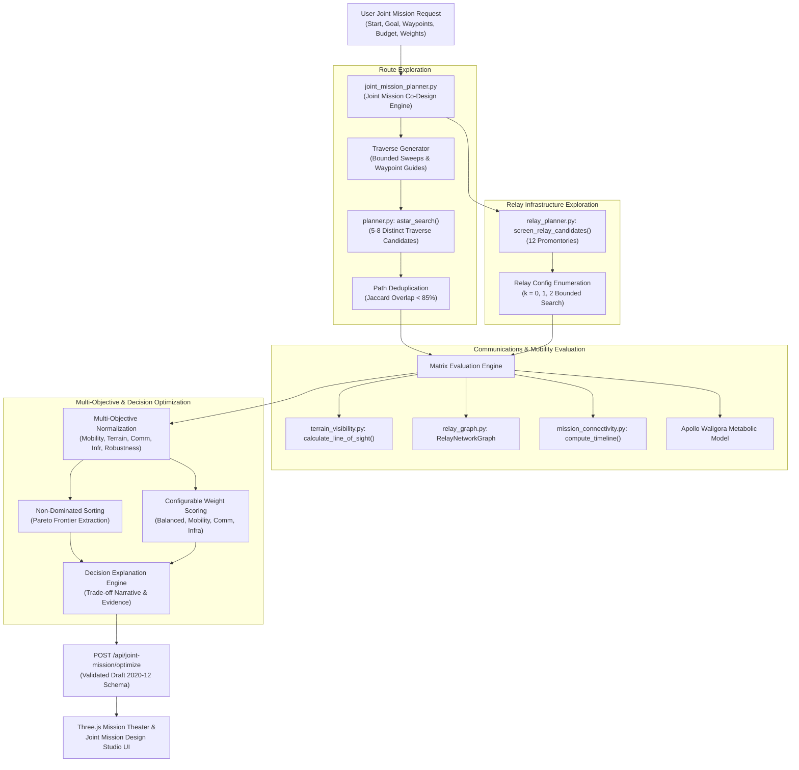

# Milestone 13E Architecture & Integration Audit
## Pre-Implementation Investigation: Terrain-Aware Traverse Planning × RelayNet Communications Integration

**Milestone:** 13E — Atlas Joint Mission Co-Design  
**Repository:** `E:\Python\NASA-Spaceapps\Marswalk`  
**Date:** 2026-10-31  
**Auditor:** Primary Integration Agent & Specialist Subagents (A, B, C, D)  
**Status:** **AUDIT COMPLETE — ARCHITECTURE SPECIFIED & APPROVED**  

---

## 1. Executive Summary

Milestone 13E addresses a fundamental architectural opportunity in MarsWalk 2.0 / Project Atlas: **co-designing surface mobility routes and supporting communications relay infrastructure simultaneously**.

Prior to Milestone 13E, traverse planning (`src/marswalk/core/planner.py`) and communications network visibility (`src/marswalk/core/terrain_visibility.py`, `src/marswalk/core/relay_graph.py`, `src/marswalk/core/relay_planner.py`, `src/marswalk/core/mission_connectivity.py`) operated as decoupled pipelines:
1. The route planner calculated paths based strictly on geodetic distance, slope penalties, and science priorities without awareness of terrain-blocked communications shadows.
2. RelayNet evaluated visibility and placed relays after the traverse was already chosen, or on an ad-hoc grid of science waypoints.

This audit establishes the architectural blueprint for `src/marswalk/core/joint_mission_planner.py`, orchestrating existing modules to evaluate alternative traverses, discover communications gaps, optimize relay infrastructure, calculate Pareto trade-offs, and visualize co-designed missions in the 3D Mission Theater.

---

## 2. Inventory of Existing Reusable Components

### 2.1 Terrain Physics & Coordinate Framework (`src/marswalk/core/terrain.py`)
- **`TerrainConfig`:** Dataclass encapsulating physical parameter weights:
  - `cell_size_m`: default 20.0m
  - `ref_lat_deg`: 18.442° N (Jezero reference latitude for Equirectangular projection)
  - `dx_ground_m` ($18.973\text{ m}$), `dy_ground_m` ($20.000\text{ m}$)
  - `alpha_s`: slope penalty weight (default 2.0)
  - `theta_crit_deg`: critical slope threshold (default 10.0°, must be $< \theta_{\max}$)
  - `theta_max_deg`: maximum traversable slope (default 25.0°)
  - `alpha_r`: decameter roughness weight (default 1.0)
  - `alpha_up`: uphill slope penalty factor (default 1.5)
- **`TerrainGrid`:** Container holding 2D numpy arrays:
  - `elevation_m`: float32 raster ($250 \times 250$ in Jezero)
  - `slope_deg`: Horn 3x3 finite-difference slope array
  - `roughness_m`: decameter roughness proxy array
  - `invalid_mask`: boolean mask of NoData / invalid cells dilated by 1 cell
- **`load_and_process_terrain(geotiff_path)`:** Loads authentic USGS CTX 20m GeoTIFF (`data/processed/jezero_ready_20m.tif`), computes geodetic ground spacings, slopes, roughness, and dilated invalid masks.

### 2.2 Route & Traverse Planner (`src/marswalk/core/planner.py`)
> [!NOTE]
> *Audit Correction:* The prompt referred to `route_planner.py`; the authentic production implementation is located in `src/marswalk/core/planner.py`.
- **`astar_search(start_rc, goal_rc, terrain, terrain_config, blocked_mask, cost_multiplier_mask) -> LegResult`:**
  - 8-connected grid A* pathfinding.
  - Returns `LegResult(start_rc, goal_rc, path, distance_m, cost, is_reachable)`.
- **`plan_route(start_rc, goal_rc, terrain, waypoints, config, terrain_config, ...) -> RouteResult`:**
  - Multi-stop TSP/path stitching with Apollo Waligora metabolic cost modeling and timeline generation.
- **`ScienceWaypoint(id, name, rc, priority_score, ...)`:** Waypoint data container.
- **`PlannerConfig(profile, science_appetite_gamma, max_distance_m, max_waypoints)`:** Profiles include `conservative`, `balanced`, `science_first`.

### 2.3 RelayNet Communications Engine (Milestone 13D)
- **`terrain_visibility.py`:**
  - `sample_bilinear_elevation(grid, r, c)`: 4-point bilinear interpolation with $-9000\text{ m}$ NoData guard.
  - `calculate_line_of_sight(grid, p0_rc, p1_rc, p0_antenna_h, p1_antenna_h, max_range_m, dx_m, dy_m) -> LineOfSightResult`:
    - Parametric ray $P(t) = P_0 + t(P_1 - P_0)$ sampled at Nyquist step $\Delta s \le 9.486\text{ m}$.
    - Mars spheroid curvature drop $\Delta h = \frac{d^2}{2 R_{\text{Mars}}}$.
    - Clearance $c(t) = h_{\text{LOS}}(t) - z(t)$, identifies obstruction coordinate $(r_{\text{obs}}, c_{\text{obs}})$ and clearance depth.
- **`relay_graph.py`:**
  - `RelayNode(node_id, row, col, elevation_m, antenna_height_m, effective_z_m, node_type)`
  - `RelayEdge(source_id, target_id, distance_m, min_clearance_m, is_visible, status)`
  - `RelayNetworkGraph`: dual adjacency graph, BFS reachability, shortest hops, Dijkstra minimum-weight routing, Tarjan bridge & cut-vertex detection (single points of failure), unweighted Laplacian algebraic connectivity $\lambda_2(L)$.
- **`relay_planner.py`:**
  - `screen_relay_candidates(elevation_grid, slope_grid, max_slope_deg=12.0, min_elevation_m=-2500.0, min_separation_m=450.0, max_candidates=12) -> List[Dict]`:
    - Discovers 12 prime promontories on Jezero rim and delta front.
  - `optimize_relay_placement(candidates, base_node, target_units, budget_k, max_direct_range_m, max_relay_range_m) -> Dict`:
    - Submodular greedy placement with $(1 - 1/e) \approx 63.2\%$ approximation ratio.
- **`mission_connectivity.py`:**
  - `compute_mission_connectivity_timeline(path_rc, elevation_grid, base_node, deployed_relays, sampling_interval_s=10.0, ...) -> MissionConnectivityTimeline`:
    - Tracks `CONNECTED_DIRECT`, `CONNECTED_RELAYED`, and `SIMULATED_GEOMETRIC_CONNECTIVITY_GAP`.
    - `coalesce_gap_intervals()`: merges contiguous blackout checkpoints into formal mission intervals with duration, meters, and occluding obstacles.
    - SHA-256 fingerprint caching.

### 2.4 Mission Infrastructure, API & Workspaces
- **API Server:** Lightweight HTTP server in `scripts/run_atlas.py` dispatching to `src/marswalk/api/service.py` on port 3000.
- **Workspace Storage:** `data/workspaces/` containing `missions/`, `campaigns/`, `experiments/`, `rehearsals/`, and `events/`.
- **Frontend Architecture:** Vanilla JavaScript IIFE in `web/app.js` with Three.js WebGL scene `jezeroSurfaceGroup`, `missionTheaterHUD`, `relayNetGroup`, and 5-tier spatial raycaster.

---

## 3. Integration Points for Joint Mission Co-Design

The central orchestrator `src/marswalk/core/joint_mission_planner.py` will integrate with existing modules as follows:

---

## 4. Alternative Traverse Generation Strategy

A critical requirement of Section 3.2 is generating 3 to 8 meaningfully different candidate traverses without inventing ungrounded terrain models.

Our empirical inspection shows that varying cost penalty parameters and introducing intermediate strategic topological waypoints produces distinct, valid routes:

1. **Candidate 1 (Direct Shortest):**
   - Parameters: $\alpha_s = 1.0, \theta_{\text{crit}} = 18.0^\circ, \theta_{\max} = 25.0^\circ$.
   - Behavior: Minimizes Euclidean traverse distance across the Jezero floor.
2. **Candidate 2 (Conservative Low-Slope):**
   - Parameters: $\alpha_s = 8.0, \theta_{\text{crit}} = 8.0^\circ, \theta_{\max} = 15.0^\circ$.
   - Behavior: Aggressively circumvents topographic rises, preferring flat regolith plains.
3. **Candidate 3 (Balanced Profile):**
   - Parameters: Standard MarsWalk balanced profile ($\alpha_s = 2.0, \theta_{\text{crit}} = 10.0^\circ$).
   - Behavior: Minimizes Waligora metabolic cost trade-off between slope and distance.
4. **Candidate 4 (Promontory-Saddle Pass):**
   - Constrained via Promontory Saddle Waypoint $[126, 138]$ on the eastern rim.
   - Behavior: Climbs intermediate terrain to maintain high elevation and direct LOS to Base Station.
5. **Candidate 5 (Northern Delta Plain Detour):**
   - Constrained via Northern Plain Waypoint $[100, 135]$.
   - Behavior: Bypasses the central Séítah dune field and ridge occlusions entirely.

**Deduplication Protocol:**
Before evaluation, routes are checked for mutual path overlap. If two paths share $\ge 85\%$ of grid cells, the higher-cost duplicate is pruned, ensuring candidate diversity.

---

## 5. Relay Infrastructure Evaluation Strategy

For each candidate route $R_i \in \{R_1, \dots, R_m\}$:
1. **Screen Promontories:** Screen the 12 prime Jezero candidate promontories via `screen_relay_candidates()`.
2. **Evaluate Relay Configurations:**
   - **$k = 0$ (Direct Baseline):** Evaluates baseline geometric line-of-sight to Base Station without relays. Identifies unmitigated blackout gaps.
   - **$k = 1$ (Single Relay Placement):** Evaluates each candidate $c \in C_{\text{pool}}$ that has clear LOS backhaul to Base. Measures how much gap distance $c$ eliminates.
   - **$k = 2$ (Dual Relay Pair):** For routes with persistent gaps under $k=1$, evaluates pairs $(c_1, c_2)$ providing multi-hop backhaul to Base.
3. **Bounded Search Pruning:**
   - Candidate pool bounded to $C \le 12$.
   - Maximum relay budget $k \le 2$ (or 3 if explicitly requested).
   - Prunes relay candidates whose mutual distance to Base exceeds $5000\text{ m}$.
   - Max LOS evaluations capped at 250 per optimization query, ensuring execution time $< 1.5\text{ seconds}$.

---

## 6. Multi-Objective Normalization & Pareto Frontier Formulation

### 6.1 Dimension Normalization Reference Ranges
Raw metrics cannot be added directly. Normalization uses documented physical reference bounds:

| Dimension | Raw Metric | Reference Normalizer | Normalized Metric $f_d \in [0, 1]$ (Lower is Better) |
| :--- | :--- | :--- | :--- |
| **Mobility** | Distance $D\ (\text{m})$ | $D_{\text{ref}} = 3000\text{ m}$ (Max local traverse) | $f_{\text{dist}} = \min(1.0, D / D_{\text{ref}})$ |
| **Terrain** | Mean Slope $\bar{\theta}\ (^\circ)$ | $\theta_{\text{ref}} = 15.0^\circ$ (Slope threshold) | $f_{\text{slope}} = \min(1.0, \bar{\theta} / \theta_{\text{ref}})$ |
| **Elevation** | Relief $\Delta z_{\text{gain}} + \Delta z_{\text{loss}}\ (\text{m})$ | $\Delta z_{\text{ref}} = 300\text{ m}$ (Delta scarp height) | $f_{\text{elev}} = \min(1.0, \Delta z / \Delta z_{\text{ref}})$ |
| **Connectivity** | Gap Distance $D_{\text{gap}}\ (\text{m})$ | $D_{\text{traverse}}\ (\text{m})$ | $f_{\text{gap}} = D_{\text{gap}} / D_{\text{traverse}}$ |
| **Infrastructure** | Relay Count $k$ | $k_{\max} = 3$ | $f_{\text{infra}} = k / k_{\max}$ |
| **Hops** | Maximum Hops $H$ | $H_{\max} = 3$ | $f_{\text{hops}} = \max(0, H - 1) / (H_{\max} - 1)$ |
| **Robustness** | Tarjan Bridge Count $B$ | $B_{\max} = 3$ | $f_{\text{bridge}} = B / B_{\max}$ |

### 6.2 Pareto Dominance Criterion
Given two mission configurations $\mathcal{C}_A = (R_A, S_A)$ and $\mathcal{C}_B = (R_B, S_B)$ with objective vectors $\vec{F}_A, \vec{F}_B \in \mathbb{R}^k$:
$$\mathcal{C}_A \succ \mathcal{C}_B \iff \forall d \in \{1, \dots, k\}, F_{A, d} \le F_{B, d} \land \exists d \in \{1, \dots, k\} \text{ s.t. } F_{A, d} < F_{B, d}$$

The **Pareto Frontier** $\mathcal{P}^*$ consists of all non-dominated configurations:
$$\mathcal{P}^* = \{\mathcal{C} \in \Omega \mid \nexists \mathcal{C}' \in \Omega \text{ s.t. } \mathcal{C}' \succ \mathcal{C}\}$$

---

## 7. Data Model Dependencies & JSON Schemas

New schemas to be authored in `schemas/api/v1/`:
1. `joint-mission-evaluation.schema.json`: Single configuration evaluation schema.
2. `joint-mission-optimization.schema.json`: Complete co-design optimization result including candidate traverses, evaluated configurations, Pareto frontier, ranked configurations, and decision explanation.

---

## 8. Potential Regression Risks & Mitigations

| Risk | Impact | Mitigation Strategy |
| :--- | :--- | :--- |
| **Operational Workspace Corruption** | High | Strictly isolate joint mission tests to ephemeral memory or dedicated `test_` prefixed files. Never modify `data/workspaces/`. |
| **A* Performance Bottleneck** | Medium | Bounded route sweeps (max 5 candidates), reuse pairwise leg cache, cap grid bounds. |
| **LOS Evaluation Explosion** | Medium | Screen candidates first ($C \le 12$), check Base backhaul before rover evaluation, cache pairwise raycasts by `(r0, c0, r1, c1)`. |
| **Frontend Three.js Hierarchy Bloat** | Medium | Attach `jointMissionGroup` inside `jezeroSurfaceGroup`. Dispose geometries cleanly on reset. |
| **Browser Layout Overflow** | Medium | Ensure `#jointMissionStudioPanel` uses flexbox/grid with `overflow-x: hidden` and test at both $1920\times 1080$ and $1366\times 768$. |

---

## 9. Next Steps
1. Implement `src/marswalk/core/joint_mission_planner.py`.
2. Implement backend API handlers in `src/marswalk/api/service.py` and route in `scripts/run_atlas.py`.
3. Author schemas in `schemas/api/v1/`.
4. Implement comprehensive unit tests in `tests/test_milestone_13e_joint_planner.py`.
5. Integrate frontend Joint Mission Design Studio and Three.js visualizer in `web/app.js`, `web/index.html`, and `web/styles.css`.
6. Run full verification: unit tests, regression baseline, preflight check, and automated CDP browser acceptance.
