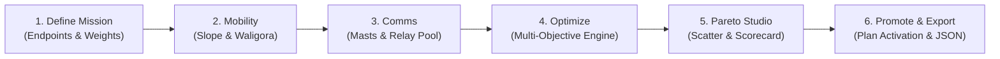
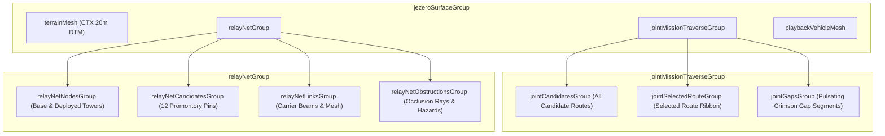

# Milestone 13E — Atlas Joint Mission Co-Design: Frontend & 3D Mission Theater Design Specification

**Document Version:** 1.0.0  
**Milestone:** 13E — Atlas Joint Mission Co-Design  
**Component:** Frontend User Interface & 3D Mission Theater Spatial Digital Twin  
**Target Files:** `web/index.html`, `web/styles.css`, `web/app.js`  
**Execution Environment:** Vanilla JavaScript (ES2022), Three.js r128, Chrome DevTools Protocol (CDP)  
**Date:** 2026-10-31  

---

## 1. Executive Summary & Architectural Vision

Milestone 13E introduces the **Joint Mission Design Studio** into Project Atlas / MarsWalk 2.0. This studio provides a unified, terrain-aware operational co-design environment where surface mobility planning (traverses, slope constraints, Apollo Waligora metabolic costs) and communications infrastructure engineering (geometric Line-of-Sight visibility, submodular greedy relay placement, dynamic multi-hop routing) are solved **simultaneously** rather than in disconnected sequential silos.

The frontend and 3D Mission Theater integration delivers:
1. A **6-Step Guided Co-Design Wizard** that leads mission planners from initial science target definition through mobility and RF configuration, multi-objective optimization, Pareto frontier trade-off exploration, to final plan promotion and JSON evidence export.
2. An **Interactive Pareto Frontier Visualizer** combining a responsive 2D/3D scatter plot ($D_{\text{traverse}}$ vs. $G_{\text{gap}}$ vs. $K_{\text{relays}}$) and a comprehensive comparative scorecard table with click-to-preview synchronization.
3. A **Multi-Trajectory 3D Theater Visualization** capable of simultaneously rendering candidate routes (bold cyan/emerald selected, dashed violet alternatives, faint grey dominated), crimson pulsating blackout gap segments, and the active Mars RelayNet mesh.
4. **Dynamic Timeline Playback Synchronization** that tracks kinematic vehicle progression, computes real-time line-of-sight clearance against the USGS Jezero 20m DTM, triggers autonomous beam handovers, and alerts on communications gaps.
5. An extended **5-Tier Spatial Raycaster** enabling mission operators to click directly on candidate routes, blackout gaps, relay masts, and promontories in the 3D scene to inspect trade-off metrics inside `#theaterInspectorCard`.

---

## 2. Frontend Inspection Findings

A thorough audit of the existing codebase (`web/index.html`, `web/styles.css`, and `web/app.js`) revealed key structural foundations and integration points:

### 2.1 Tab & Inspector Architecture (`web/index.html` & `web/app.js`)
- **Inspector Tabs Container:** `#inspectorTabs` currently manages tabs: `#tabBtnMissionControl`, `#tabBtnExperimentStudio`, `#tabBtnRobustnessLab`, `#tabBtnRehearsalDirector`, `tabPlan`, `tabResults`, `tabScenarios`, and `tabWorkspaces`.
- **Tab Switching Logic:** `switchInspectorTab(tabId)` in `web/app.js` (lines 1153–1178) toggles the `.active` class on tab buttons, removes `.hidden` from the active panel, and applies `.cockpit-mode` (width 600px) to `#inspectorPanel` when wide analytical studios are active.
- **Integration Target:** Adding `#tabBtnJointMissionStudio` to `#inspectorTabs` and `#tabJointMissionStudio` into `.hud-inspector-body` seamlessly hooks into `switchInspectorTab` and `.cockpit-mode`.

### 2.2 3D Mission Theater & HUD (`web/index.html` & `web/styles.css`)
- **Top Command Bar:** `#missionTheaterHUD` (lines 337–386) hosts telemetry readouts (`#theaterSolDisplay`, `#theaterClockDisplay`, `#theaterPhaseDisplay`, `#theaterUnitDisplay`), vertical exaggeration controls (`#theaterExaggerationSelect`), and action buttons (`#btnToggleRelayNet`, `#btnTheaterExplain`, `#btnExitTheaterMode`).
- **Layer & Trajectory Controls:** `#theaterTrajectoryToggles` (lines 408–425) provides checkbox toggles for Nominal, Disturbed, and Recovered paths.
- **Drawer Conventions:** `#relayNetPanel` (lines 463–547) establishes an established pattern for floating, glassmorphic HUD control drawers (`position: absolute; top: 130px; right: 20px; width: 320px; backdrop-filter: blur(14px)`).
- **Integration Target:** 
  1. Add `#btnToggleJointStudio` to `#missionTheaterHUD` top bar.
  2. Implement `#jointMissionStudioPanel` as an in-theater floating drawer mirroring `#relayNetPanel`, synchronized two-way with the cockpit tab `#tabJointMissionStudio`.
  3. Add candidate route toggle filters into `#theaterTrajectoryToggles` (Selected Candidate, Pareto Alternatives, Dominated, Comms Gaps).

### 2.3 Raycasting Hierarchy & Spatial Inspector (`web/app.js`)
- **Current Raycast Hierarchy:** In `web/app.js` (lines 15379–15455), the pointer raycaster tests objects in descending order:
  1. Vehicle Mesh (`playbackVehicleMesh`)
  2. Hazard Mesh (`disruptionHazardMesh`)
  3. Relay Nodes (`relayNetNodesGroup`)
  4. Relay Candidates (`relayNetCandidatesGroup`)
  5. LOS Obstructions (`relayNetObstructionsGroup`)
  6. Waypoint Beacons (`waypointBeacons`)
  7. Terrain Mesh (`terrainMesh`)
- **Spatial Inspector Card:** `#theaterInspectorCard` (lines 550–565 in HTML; `showTheaterSpatialInspector` lines 18013–18113 in JS) dynamically displays telemetry for `terrain`, `waypoint`, `unit`, `hazard`, `route`, `base_station`, `relay_node`, `candidate_relay`, and `los_obstruction`.
- **Integration Target:** Add `joint_candidate_route` and `joint_gap_segment` object types to `showTheaterSpatialInspector`, and insert `jointMissionTraverseGroup` into the raycasting check between Tier 1/2 hazards and Tier 3 waypoints.

---

## 3. Joint Mission Design Studio UI Architecture

The Joint Mission Design Studio is organized as a structured 6-step guided wizard that minimizes cognitive load while preserving complete multi-objective transparency.

### 3.1 Step-by-Step Wizard Specification

#### Step 1: Define Mission Requirements & Boundaries
- **Mission Origin:** Fixed or selectable starting location (Default: `Octavia E. Butler Landing Base [117, 157]`, ground elevation $-2548.2\text{ m}$).
- **Target Science Destination:** Dropdown / Coordinates (Default: `Delta Remnant Promontory / Three Forks [138, 114]`).
- **Science Waypoints Checklist:** Multi-select targets (Kodiak Butte `[175, 122]`, Séítah Carbonates `[150, 140]`, Belva Crater Rim `[95, 185]`) with science priority tags.
- **Mission Sol Budget:** Planning timeframe (e.g. 1 Sol / 88,775s; Sortie EVA window 4.0 hours / 14,400s).
- **Multi-Objective Optimization Weights ($w_i \in [0, 1]$):**
  * $w_{\text{dist}}$: Traverse Distance / Time Minimization
  * $w_{\text{gap}}$: Line-of-Sight Blackout Minimization
  * $w_{\text{relays}}$: Relay Infrastructure Footprint Minimization
  * $w_{\text{energy}}$: Waligora Metabolic Work Minimization
  * *Auto-Normalize Button:* Enforces $\sum w_i = 1.0$.

#### Step 2: Configure Mobility & Locomotion Systems
- **Platform Selector:**
  * `Perseverance Rover Class` (Nominal speed $0.38 - 0.55\text{ m/s}$, mass $1025\text{ kg}$, mechanical drive power $110\text{ W}$).
  * `Crew EVA Astronaut Suit` (Nominal speed $0.80 - 1.20\text{ m/s}$, mass $140\text{ kg}$ total, Apollo Waligora metabolic model).
- **Slope Traversability Envelope:**
  * Nominal Slope Limit: $15.0^\circ$ (Horn 3x3 finite difference).
  * Caution Ceiling: $20.0^\circ$.
  * Hard Cutoff: $25.0^\circ$ (Impassable cliff wall).
- **Consumable & Energy Limits:**
  * Max energy expenditure: $18.5\text{ MJ}$ ($5,140\text{ Wh}$).
  * Metabolic rate warning threshold: $320\text{ W}$.

#### Step 3: Configure Mars RelayNet Communications
- **Base Transceiver Configuration:**
  * Mast Height: $10.0\text{ m}$ above local terrain (transceiver Z: $-2538.2\text{ m}$).
  * RF Band: UHF ($401.58\text{ MHz}$) / X-Band ($8.4\text{ GHz}$).
- **Mobile Unit Antenna:**
  * Mast Height: $2.5\text{ m}$ (Rover) / $1.8\text{ m}$ (EVA Backpack).
  * Max Surface RF Range: $3.5\text{ km} - 5.0\text{ km}$ cutoff.
- **Relay Infrastructure Budget:**
  * Deployable Relay Towers: $K_{\text{max}} \in [0, 4]$.
  * Field Tower Mast Height: $5.0\text{ m} - 10.0\text{ m}$.
  * Candidate Promontory Pool: 12 pre-screened Jezero high-visibility topographic promontories.
- **Blackout Tolerance Constraint:**
  * Max Continuous Gap Distance: $d_{\text{gap,max}} \le 400\text{ m}$.
  * Max Continuous Gap Duration: $t_{\text{gap,max}} \le 900\text{ s}$ (15 minutes).

#### Step 4: Autonomous Joint Co-Design Optimization Engine
- **Trigger:** Button `[⚡ EXECUTE JOINT CO-DESIGN OPTIMIZATION]` calling `POST /api/joint-mission/optimize`.
- **Search Process:**
  1. Generates 3 to 8 diverse candidate traverses $T_1, \dots, T_k$ across distinct terrain corridors using multi-objective A* with varied slope weights and waypoint paths.
  2. Runs 3D geometric line-of-sight raycasting against the authentic USGS CTX 20m DTM for every candidate.
  3. Executes Submodular Greedy Relay Selection across the candidate promontory pool to deploy optimal relays $\{r_1, \dots, r_m\}$ ($m \le K_{\text{max}}$) per traverse.
  4. Identifies all residual blackout gap segments $[s_{\text{start}}, s_{\text{end}}]$.
  5. Computes full metrics vector $\mathbf{F} = (D, G_{\text{dist}}, G_{\text{time}}, C_{\%}, K, E_{\text{met}}, S_{\text{max}})$.
  6. Evaluates Pareto dominance to isolate the non-dominated frontier.
- **Live UI Feedback:** Animated solver spinner, elapsed computation time ($< 850\text{ ms}$), candidate count tally.

#### Step 5: Interactive Pareto Frontier Multi-Objective Trade-Off Studio
- **2D/3D Interactive Scatter Plot:**
  * **X-Axis:** Total Traverse Distance $D$ (meters).
  * **Y-Axis:** Comms Gap Duration $G_{\text{time}}$ (minutes) or Gap Percentage ($G_{\%}$).
  * **Point Size / Badge:** Relays Deployed $K$ ($0, 1, 2, 3$).
  * **Visual Styling:**
    * Non-dominated Pareto frontier candidates: Glowing emerald markers connected by a stepped non-dominated efficiency boundary line.
    * Dominated candidates: Muted grey circular markers.
    * Currently selected candidate: Highlighted with a pulsing cyan reticle ring.
  * **Hover Tooltip:** Displays Candidate ID, Strategy Name, Distance, Coverage %, Relay Count, Waligora Energy.
  * **Click Action:** Selects candidate, syncs scorecard table row, updates 3D Theater scene.
- **Comprehensive Multi-Objective Comparative Scorecard:**
  * Clean tabular comparison with columns:
    1. Candidate ID (`JMC-01`, `JMC-02`, etc.)
    2. Route Concept / Strategy Name (`Delta Direct`, `Scarp Crest Highway`, `Low-Energy Basin`)
    3. Pareto Status (`Rank 1 (Frontier)` vs `Dominated`)
    4. Distance ($m$) & Delta vs Baseline
    5. Comms Coverage ($0\% - 100\%$)
    6. Relays Deployed ($0, 1, 2$)
    7. Max Blackout Gap ($m$ / $s$)
    8. Waligora Metabolic Work ($kJ$ / $Wh$)
    9. Action: `[👁 Preview]` & `[✔ Select]`
- **Decision Rationale & Trade-Off Engine:**
  * Dynamic explanation box summarizing the physical trade-off:
    * *Example:* *"Candidate JMC-02 (Scarp Crest Highway + 1 Relay) achieves 100% comms coverage at the cost of +182m extra distance, completely eliminating the 420m shadow gap present on the direct route."*

#### Step 6: Selection, Promotion & Formal Artifact Export
- **Promotion Action:** Button `[🚀 PROMOTE CO-DESIGN TO ACTIVE MISSION PLAN]` calling `POST /api/joint-mission/promote`.
- **System Synchronization:**
  * Sets selected route as `currentRouteLine` in Mission Control Cockpit.
  * Deploys selected relays into active `relayNetActiveRelays` collection.
  * Updates timeline scrubber and kinematic vehicle simulation.
- **Export Formats:**
  * `Export Joint Plan (.json)`: Fully conforms to Draft 2020-12 Schema `joint-mission-evaluation.schema.json`. Includes dataset provenance `USGS_CTX_DTM_JEZERO_20M` and SHA-256 `875e7e80c170b84e4b2a3dd650b12abbee289e6d3fae5664e4d3cb93e9a1f5b3`.
  * `Download Decision Report (.md)`: Markdown summary containing trade-off rationale, Waligora metabolic breakdown, and network link margins.
  * `Export GeoJSON Route (.geojson)`: Projected coordinates for GIS ingestion.

---

## 4. 3D Mission Theater Integration Architecture

The 3D Mission Theater renders candidate traverses, blackout gaps, and relay assets directly onto the 20-meter USGS CTX Jezero Crater terrain drape.

### 4.1 Trajectory Material & Geometry Hierarchy

| Element Type | Geometry | Material Type | Color / Hex | Visual Treatment |
| :--- | :--- | :--- | :--- | :--- |
| **Selected Candidate Route** | `TubeGeometry` (radius $2.5\text{ m}$) | `MeshStandardMaterial` | `#00e5ff` (Cyan) or `#10b981` (Emerald) | Bold solid tube with animated sine-wave emissive pulse ($I \in [0.4, 0.8]$). |
| **Pareto Alternative Routes** | `LineDashedGeometry` or segmented line | `LineDashedMaterial` | `#a855f7` (Violet) | Dashed pattern (`dashSize: 15, gapSize: 8`), semi-transparent (`opacity: 0.85`). |
| **Dominated / Sub-optimal Routes** | `LineGeometry` (thin, $1.5\text{px}$) | `LineBasicMaterial` | `#64748b` (Slate Grey) | Muted low-opacity line (`opacity: 0.35`), non-distracting background context. |
| **Comms Blackout Gap Segments** | `TubeGeometry` (radius $3.2\text{ m}$) | `MeshBasicMaterial` | `#ef4444` (Crimson Hazard) | High-visibility pulsating red tube oscillating opacity ($0.4 \leftrightarrow 1.0$) at $2\text{ Hz}$. Flashing beacon rings at entry and exit boundaries. |

### 4.2 Interlaced Relay Mesh Display
- **Candidate Promontory Sites:** 12 screened high-prominence sites rendered as floating amber holographic octahedrons and ground target rings hovering $20\text{ m}$ above terrain crests (`relayNetCandidatesGroup`).
- **Deployed Relay Towers:** Selected relays rendered as full 3D lattice masts with green operational beacon halos (`relayNetNodesGroup`).
- **Dynamic Carrier Beams:** During playback or inspection, active line-of-sight carrier beams connect the vehicle to the nearest visible relay tower or base station (`relayNetLinksGroup`).
- **Occluded LOS Rays:** Blocked direct line-of-sight rays are rendered as red dashed lines terminating at the occluding terrain ridge, marked by an impact collision indicator (`relayNetObstructionsGroup`).

### 4.3 Timeline Scrubber Integration & Dynamic Handover
- **Scrubber Hook:** Synchronized with `theaterTimelineScrubber` via `updateRelayNetPlayback(timeSeconds, state)` in the main animation loop.
- **Dynamic Vehicle State Evaluation:**
  * Vehicle coordinates $(x, y, z)$ interpolated along the active candidate polyline.
  * Dynamic line-of-sight check against USGS CTX 20m DTM to Base and all active relays.
  * Real-time network state machine transitions:
    * `DIRECT LINK` (Cyan): Clear line-of-sight to Octavia Base ($0\text{ hops}$).
    * `RELAYED (1 HOP)` (Emerald): Direct path blocked by delta scarp, but clear link maintained via deployed tower (e.g. `MRN-01`).
    * `CONNECTIVITY GAP` (Crimson): Both direct and relay links occluded by local topography ($0\text{ hops}$, link severed).
- **HUD Telemetry Synchronization:**
  * `#relayNetConnectivityBadge`: Updates badge class and text in real time.
  * `#theaterRelayStatusDot`: Flashes online green or warning red.
  * `#relayTelemetryStatus`: Displays clearance margin and active transceiver ID.
  * `#relayTelemetryClearance`: Shows numeric terrain clearance in meters (e.g. `+14.2 m` vs `-6.8 m BLOCKED`).
  * `#relayTelemetryLatency`: Reports round-trip propagation latency in milliseconds.

### 4.4 5-Tier Spatial Raycaster Extension
The pointer raycaster evaluates interactive objects in the following strict 5-tier order:
1. **Tier 1 — Exploration Units & Vehicles:** `playbackVehicleMesh.children` $\to$ Inspects rover telemetry, speed, consumable margins.
2. **Tier 2 — Joint Traverse Candidates & Gaps:**
   * `jointMissionTraverseGroup.children` $\to$ Inspects candidate route or blackout gap.
   * If candidate route clicked: `#theaterInspectorCard` displays Candidate ID, Pareto classification, Distance, Comms Coverage %, Relays required, Waligora Metabolic Work, and `[Promote to Plan]` action button.
   * If gap clicked: Displays Gap length ($m$), Duration ($s$), Occluding scarp elevation, and recommended relay promontory.
3. **Tier 3 — Communication Relays & Infrastructure:** `relayNetNodesGroup`, `relayNetCandidatesGroup`, `waypointBeacons` $\to$ Inspects tower mast height, dish elevation, prominence, and backhaul status.
4. **Tier 4 — Environmental Hazards & Obstructions:** `relayNetObstructionsGroup`, `disruptionHazardMesh` $\to$ Inspects rockfall obstacles and terrain occlusion points.
5. **Tier 5 — Terrain Surface:** `terrainMesh` $\to$ Inspects MOLA elevation, Horn 3x3 slope, and geographic coordinates.

---

## 5. Browser Acceptance & Screenshot Verification Plan

To ensure production-grade reliability across multiple viewports and prevent regressions, an automated Chrome DevTools Protocol (CDP) script (`scripts/verify_joint_mission_browser.py`) executes 8 acceptance stages.

### 5.1 Acceptance Quality Gates
1. **Zero Horizontal Overflow:** Enforced strictly across all viewports (`document.body.scrollWidth <= window.innerWidth`).
2. **Zero Browser Console Errors:** Monitored via `Runtime.consoleAPICalled` and `Runtime.exceptionThrown` (`console_errors.length === 0`).
3. **Responsive Viewport Support:**
   * Desktop: $1920 \times 1080$ (Full High-Definition Cockpit)
   * Laptop: $1366 \times 768$ (Compact Field Operations Layout)
4. **Live Three.js Render Integrity:** Verified 60 fps render loop with active DTM mesh and dynamic lighting.

### 5.2 Required Showcase Screenshots (`outputs/conference_showcase/joint_mission/`)

| # | Filename | Viewport | Target Visual State & Content |
| :-: | :--- | :---: | :--- |
| **01** | `01_joint_studio_wizard_overview.png` | $1920 \times 1080$ | Joint Mission Design Studio tab open in cockpit mode, showcasing 6-step guided wizard stepper and Step 1 mission parameters (origin, goal, waypoints, objective weight sliders). |
| **02** | `02_mobility_comms_configuration.png` | $1920 \times 1080$ | Step 2 (Mobility systems: rover platform, slope thresholds $15^\circ/20^\circ/25^\circ$, velocity envelope, Waligora metabolic derating) and Step 3 (Comms systems: Base mast $10\text{m}$, rover mast $2.5\text{m}$, $K_{\text{max}}=2$ relay budget). |
| **03** | `03_pareto_frontier_scatter_analysis.png` | $1920 \times 1080$ | Interactive Pareto Frontier scatter plot displaying Distance ($m$) vs Comms Gap Duration ($s$) vs Relays ($0, 1, 2$), showing glowing non-dominated frontier line, dominated points, and active hover tooltip. |
| **04** | `04_theater_candidate_routes_co_design.png` | $1920 \times 1080$ | 3D Mission Theater perspective displaying all generated candidates simultaneously: selected candidate in bold cyan/emerald, alternative Pareto candidates in dashed violet, dominated routes in faint grey, and blackout gaps in pulsating crimson. |
| **05** | `05_relay_mesh_overlay_candidates.png` | $1920 \times 1080$ | 3D view showing candidate traverses interlaced with the 12 candidate promontory octahedrons and active deployed emerald relay towers on Jezero crater ridges. |
| **06** | `06_dynamic_timeline_scrubber_sync.png` | $1920 \times 1080$ | Timeline scrubber in active playback, showing vehicle traversing near the delta scarp, real-time carrier beam handover from Direct Base to Relay MRN-01, and HUD comms telemetry status. |
| **07** | `07_spatial_raycast_candidate_inspector.png` | $1920 \times 1080$ | Interactive raycast click on an alternative traverse route, opening `#theaterInspectorCard` with multi-objective scorecard and trade-off metrics. |
| **08** | `08_responsive_layout_1366x768.png` | $1366 \times 768$ | Compact laptop viewport demonstrating responsive `.cockpit-mode` scaling, fluid card wrapping, zero horizontal scroll, and clear HUD readouts. |

---

## 6. Implementation Task Breakdown for Milestone 13E

1. **HTML Architecture (`web/index.html`):**
   - Add `#tabBtnJointMissionStudio` to `#inspectorTabs`.
   - Add `#tabJointMissionStudio` container with 6-step guided wizard and Pareto components.
   - Add `#btnToggleJointStudio` to `#missionTheaterHUD`.
   - Add `#jointMissionStudioPanel` in-theater drawer.
2. **Stylesheet Architecture (`web/styles.css`):**
   - Define styles for `.joint-wizard-stepper`, `.pareto-scatter-container`, `.pareto-scorecard-table`.
   - Style candidate route trajectory legends and color swatches.
   - Implement responsive breakpoints for $1366 \times 768$ and $1920 \times 1080$.
3. **Three.js & Logic Integration (`web/app.js`):**
   - Initialize `jointMissionTraverseGroup` inside `jezeroSurfaceGroup`.
   - Implement candidate route rendering functions with color hierarchy.
   - Implement interactive 2D canvas Pareto Frontier scatter plot with hover/click events.
   - Extend `updateRelayNetPlayback` to synchronize with joint candidate routes.
   - Extend raycaster with Tier 2 candidate route and gap segment hit tests.
   - Extend `showTheaterSpatialInspector` with `joint_candidate_route` and `joint_gap_segment`.
4. **Verification & Evidence Generation:**
   - Execute automated CDP verification script `scripts/verify_joint_mission_browser.py`.
   - Capture all 8 showcase screenshots to `outputs/conference_showcase/joint_mission/`.
   - Validate zero horizontal overflow and zero console errors.
