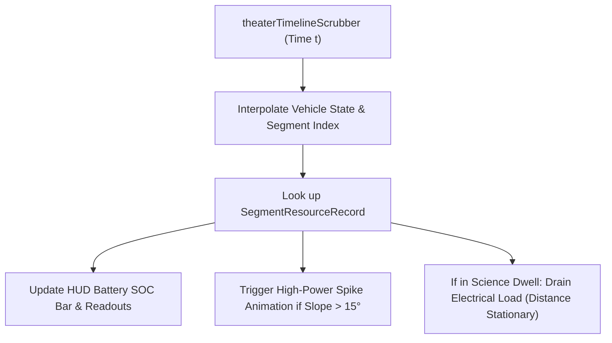

# Milestone 13F — Atlas Energy & Resource Intelligence: Frontend & 3D Mission Theater Design Specification

**Document Version:** 1.0.0  
**Milestone:** 13F — Resource-Constrained Mars Traverse Planning, Power Budgeting & Mission Feasibility Digital Twin  
**Component:** Frontend User Interface & 3D Mission Theater Spatial Digital Twin  
**Target Files:** `web/index.html`, `web/styles.css`, `web/app.js`, `scripts/verify_resource_intelligence_browser.py`  
**Execution Environment:** Vanilla JavaScript (ES2022), Three.js r128, Chrome DevTools Protocol (CDP)  
**Date:** 2026-10-31  

---

## 1. Executive Summary & Architectural Vision

Milestone 13F elevates Project Atlas / MarsWalk 2.0 from a kinematic and radio-frequency geometric optimizer into a **complete mission feasibility Digital Twin**. While Milestone 13E coupled terrain traversability with line-of-sight communications (Mars RelayNet), real-world Martian missions are ultimately governed by **finite onboard energy reserves, electrical power limits, instrument duty cycles, and strict mission time envelopes**.

A surface route may exhibit low slope angles and 100% geometric line-of-sight coverage via deployed relays, yet remain **operationally catastrophic** if:
1. Cumulative rolling work, gravitational lift, and continuous avionics base loads exceed usable battery capacity ($E_{\text{consumed}} > C_{\text{battery}}$).
2. The vehicle draws down its battery below the safety reserve threshold ($E_{\text{remaining}} < E_{\text{reserve}}$) before reaching target science waypoints.
3. Traverse and in-situ science operations exceed the allotted single-Sol exploration window ($88,775\text{ s}$) or crew life-support envelope.

This specification details the comprehensive frontend and 3D Mission Theater design for Milestone 13F:
- **7-Step Guided Co-Design Wizard:** Incorporates a dedicated, highly detailed **Energy & Resource Subsystems stage (Step 4)** into `#tabJointMissionStudio`.
- **4 Operational Platform Presets:** Instantaneous, one-click parameterization for *Perseverance Nominal*, *High-Power Science Drill*, *Ultralight Scout Rover*, and *Crew EVA Sortie*.
- **Resource-Aware Pareto Frontier Studio:** Multi-dimensional trade-off exploration with interactive metric toggles (Distance vs Comms Gap, Energy vs Distance, Energy vs Comms Gap) and a rich comparative scorecard table with explicit feasibility classifications (`FEASIBLE`, `LOW RESERVE`, `ENERGY VIOLATION`, `TIME VIOLATION`).
- **3D Mission Theater Resource Digital Twin:** Real-time dynamic battery drain synchronized with the timeline scrubber (`theaterTimelineScrubber`), instantaneous power spike indicators, and segment-level terramechanics and energy raycasting.
- **Automated Browser Acceptance & Showcase Capture Plan:** Chrome DevTools Protocol (CDP) harness capturing 8 high-resolution showcase screenshots in `outputs/conference_showcase/mission_energy/` across $1920\times1080$ and $1366\times768$ viewports with zero console errors and zero horizontal overflow.

---

## 2. Audit of Current Joint Mission Design Studio UI

An audit of the Milestone 13E frontend implementation revealed the following structural foundations:

### 2.1 Current 6-Step Stepper Architecture (`web/index.html`)
The current Joint Mission Design Studio (`#tabJointMissionStudio`, lines 1615–1950) is structured as a 6-step guided wizard:
1. **Step 1: Mission** (`#jointStepPanel1`): Origin, goal destination dropdown, planning horizon budget, and multi-objective weight sliders ($w_{\text{dist}}, w_{\text{gap}}, w_{\text{relays}}, w_{\text{energy}}$).
2. **Step 2: Mobility** (`#jointStepPanel2`): Platform selector (`perseverance_rover` vs `crew_eva`), Horn slope thresholds ($15^\circ / 20^\circ / 25^\circ$), and static Apollo Waligora power display ($320\text{ W}$, $18.5\text{ MJ}$).
3. **Step 3: Comms** (`#jointStepPanel3`): Base mast ($10\text{m}$), rover mast ($2.5\text{m}$), relay budget $K_{\text{max}} \in [0, 4]$, field mast height ($8\text{m}$).
4. **Step 4: Solve** (`#jointStepPanel4`): Optimization execution button calling `POST /api/joint-mission/optimize` and animated solver status indicator.
5. **Step 5: Pareto** (`#jointStepPanel5`): 2D canvas scatter plot (Distance vs Gap Duration), comparative scorecard table (`#paretoScorecardTable`), and marginal trade-off explanation card.
6. **Step 6: Promote** (`#jointStepPanel6`): Selected plan summary card, `[Promote to Plan]` action, and JSON/Markdown export buttons.

### 2.2 Shortcomings & Technical Debt Identified
1. **Conflation of Human Metabolic and Robotic Electrical Models:** Step 2 currently references "Apollo Waligora Metabolic Power" for both the crew EVA suit and the robotic Perseverance rover. A robotic rover operates under electromechanical rolling resistance ($C_{rr}$), drivetrain efficiency ($\eta$), avionics base loads, and payload duty cycles, which are fundamentally distinct from human metabolic caloric consumption.
2. **Missing Subsystem Controls:** Planners currently have no ability to configure battery capacity ($Wh$), reserve threshold percentages, rolling resistance coefficients, drivetrain efficiencies, avionics base loads, science dwell times, or relay operational power budgets.
3. **Static Telemetry in Theater HUD:** The in-theater drawer (`#jointMissionStudioPanel`) displays static cumulative metabolic work but provides no real-time battery state-of-charge (SOC) gauge or dynamic depletion as the vehicle moves along the polyline.
4. **Binary Pareto Dominance Without Hard Feasibility Gates:** The scorecard table displays `Rank 1 (Pareto)` vs `Dominated` based purely on distance, gap, and relay count, without checking whether a candidate exceeds battery capacity or mission time. An energy-violating candidate could be displayed as "Pareto efficient".
5. **Scorecard Lacks Energy Ledger Metrics:** Columns are limited to ID, Strategy, Rank, Distance, Coverage, Relays, Gap Time, Energy, and Action. Crucial engineering indicators—such as Final Battery SOC %, Reserve Margin %, and Feasibility Classification—are absent.

---

## 3. Dedicated 7-Step Guided Co-Design Wizard Architecture

To seamlessly incorporate the resource engine without overcrowding existing steps, the wizard is expanded into a **7-Step Guided Workflow**:


### 3.1 Stepper Navigation Update (`web/index.html` & `web/styles.css`)
The stepper container (`#jointWizardStepper`) transitions from `grid-template-columns: repeat(6, 1fr)` to `grid-template-columns: repeat(7, 1fr)`.

```html
<div class="joint-stepper-nav" id="jointWizardStepper">
  <button class="joint-step-btn active" data-step="1" title="Step 1: Mission Targets & Weights">
    <span class="step-num">1</span><span class="step-name">Mission</span>
  </button>
  <button class="joint-step-btn" data-step="2" title="Step 2: Mobility Platforms & Kinematics">
    <span class="step-num">2</span><span class="step-name">Mobility</span>
  </button>
  <button class="joint-step-btn" data-step="3" title="Step 3: Mars RelayNet Communications">
    <span class="step-num">3</span><span class="step-name">Comms</span>
  </button>
  <button class="joint-step-btn" data-step="4" title="Step 4: Energy Budgets & Power Subsystems">
    <span class="step-num">4</span><span class="step-name">Energy</span>
  </button>
  <button class="joint-step-btn" data-step="5" title="Step 5: Autonomous Co-Design Optimization">
    <span class="step-num">5</span><span class="step-name">Solve</span>
  </button>
  <button class="joint-step-btn" data-step="6" title="Step 6: Interactive Pareto Frontier Studio">
    <span class="step-num">6</span><span class="step-name">Pareto</span>
  </button>
  <button class="joint-step-btn" data-step="7" title="Step 7: Plan Promotion & Artifact Export">
    <span class="step-num">7</span><span class="step-name">Promote</span>
  </button>
</div>
```

---

## 4. Detailed Specification of Step 4: Energy & Resources Configuration

Step 4 (`#jointStepPanel4`) provides granular, scientific control over all energy, power, terramechanical, and scheduling parameters.

### 4.1 Subsystem Control Cards
The step is organized into four clean, glassmorphic control cards:

#### Card A: Operational Platform Presets
Four rapid configuration buttons instantly populate scientifically grounded parameters across all inputs:
- **`Perseverance Nominal`**:
  * Platform: $1025\text{ kg}$ rover mass, $50\text{ kg}$ payload ($1075\text{ kg}$ total).
  * Battery: $4,800\text{ Wh}$ ($17.28\text{ MJ}$) usable capacity, $20\%$ reserve margin threshold.
  * Terramechanics: $C_{rr} = 0.08$, $\eta = 0.72$, $v = 0.38\text{ m/s}$.
  * Power: Base $110\text{ W}$, Instrument standby $15\text{ W}$ / active $120\text{ W}$ (duty $25\%$).
  * Comms: Standby $20\text{ W}$, Active $85\text{ W}$.
  * Scheduling: Science dwell $900\text{ s}$ ($15\text{ min}$), Relay deployment $1200\text{ s}$ ($20\text{ min}$).
- **`High-Power Science Drill`**:
  * Platform: $1150\text{ kg}$ heavy rover, $80\text{ kg}$ payload ($1230\text{ kg}$ total).
  * Battery: $6,000\text{ Wh}$ ($21.60\text{ MJ}$), $25\%$ reserve margin threshold.
  * Terramechanics: $C_{rr} = 0.09$, $\eta = 0.68$, $v = 0.30\text{ m/s}$.
  * Power: Base $140\text{ W}$, Instrument standby $25\text{ W}$ / active $240\text{ W}$ (duty $50\%$).
  * Scheduling: Science dwell $1800\text{ s}$ ($30\text{ min}$ per site), Relay deployment $1200\text{ s}$.
- **`Ultralight Scout Rover`**:
  * Platform: $185\text{ kg}$ scout rover, $15\text{ kg}$ payload ($200\text{ kg}$ total).
  * Battery: $1,600\text{ Wh}$ ($5.76\text{ MJ}$), $15\%$ reserve margin threshold.
  * Terramechanics: $C_{rr} = 0.06$, $\eta = 0.80$, $v = 0.65\text{ m/s}$.
  * Power: Base $45\text{ W}$, Instrument standby $8\text{ W}$ / active $35\text{ W}$ (duty $20\%$).
  * Scheduling: Science dwell $450\text{ s}$ ($7.5\text{ min}$), Relay deployment $900\text{ s}$.
- **`Crew EVA Sortie`**:
  * Platform: $140\text{ kg}$ astronaut with Portable Life Support System (PLSS).
  * Consumables: $2,500\text{ Wh}$ ($9.0\text{ MJ}$) equivalent energy, $25\%$ safety reserve.
  * Locomotion: Apollo Waligora metabolic cost model ($v = 1.0\text{ m/s}$).
  * Power: PLSS base load $85\text{ W}$, Handheld instruments $20\text{ W}$.
  * Scheduling: Science dwell $600\text{ s}$ ($10\text{ min}$), Relay deployment $600\text{ s}$.

#### Card B: Rover Energy Storage & Margins
- **Usable Battery Capacity ($Wh$ / $MJ$):** Number input + synchronous range slider ($1,000 - 10,000\text{ Wh}$, default $4,800\text{ Wh}$).
- **Reserve Margin Threshold ($\%$):** Number input + slider ($5\% - 40\%$, default $20\%$). Triggers warning if $E_{\text{remaining}} < E_{\text{reserve}}$.
- **Allow Regenerative Braking:** Checkbox toggle (default: `false` / unchecked). Strictly enforces that downhill gravity ($\Delta h < 0$) does not generate unmodeled free energy unless an explicit recovery mechanism is activated.

#### Card C: Terramechanics & Locomotion Efficiency
- **Rolling Resistance Coefficient ($C_{rr}$):** Number input + slider ($0.03 - 0.20$, step $0.01$, default $0.08$ Martian regolith). Calculates rolling work:
  $$W_{r, i} = C_{rr} \cdot m_{\text{total}} \cdot g_{\text{Mars}} \cdot \cos(\theta_i) \cdot d_i$$
- **Drivetrain Electromechanical Efficiency ($\eta_{\text{drive}}$):** Number input + slider ($0.50 - 0.90$, step $0.02$, default $0.72$). Calculates electrical mobility demand:
  $$E_{m, i} = \frac{W_{r, i} + \max(0, W_{g, i})}{\eta_{\text{drive}}}$$
- **Nominal Drive Speed ($v$):** Number input ($0.10 - 1.50\text{ m/s}$, default $0.38\text{ m/s}$).

#### Card D: Electrical Subsystem Loads & Mission Scheduling
- **Avionics Base Load ($P_{\text{base}}$):** Number input ($40 - 250\text{ W}$, default $110\text{ W}$).
- **Scientific Instrument Power & Duty Cycle:**
  * Standby Power: $15\text{ W}$.
  * Active Power: $120\text{ W}$.
  * Active Duty Cycle Slider ($\delta_{\text{inst}}$): $0\% - 100\%$ (default $25\%$).
- **Communications RF Power Draw:**
  * Standby / Listening: $20\text{ W}$.
  * Active Transmission / Uplink: $85\text{ W}$.
- **Activity Scheduling Dwell Durations:**
  * Science Stop Dwell: $900\text{ s}$ per waypoint ($15\text{ min}$).
  * Relay Tower Deployment: $1200\text{ s}$ per deployed mast ($20\text{ min}$).
- **RelayNet Infrastructure Power Subsystems:**
  * Field Tower Battery Capacity: $400\text{ Wh}$ ($1.44\text{ MJ}$).
  * Standby / Listening Load: $8\text{ W}$.
  * Active Transmission Load: $35\text{ W}$.

### 4.2 Step 4 HTML Markup Blueprint
```html
<!-- STEP 4: Energy Budgets & Power Subsystems -->
<div id="jointStepPanel4" class="joint-step-content hidden">
  <!-- Preset Selection Card -->
  <div class="control-card" style="margin-bottom:8px;">
    <div class="control-label" style="font-size:9.5px; font-weight:700; color:#cbd5e1; margin-bottom:6px;">
      &#9889; STEP 4: ENERGY &amp; RESOURCE CONFIGURATION
    </div>
    <div style="font-size:8px; color:#94a3b8; margin-bottom:8px;">
      Select an operational platform preset or fine-tune battery, terramechanical, and electrical subsystem parameters.
    </div>
    <div class="resource-presets-container" style="display:grid; grid-template-columns:1fr 1fr; gap:4px; margin-bottom:8px;">
      <button class="joint-resource-preset-btn active" data-preset="perseverance_nominal">
        <span class="preset-name">&#128663; Perseverance Nominal</span>
        <span class="preset-spec">4.8 kWh &bull; Crr 0.08 &bull; 110W Base</span>
      </button>
      <button class="joint-resource-preset-btn" data-preset="high_power_drill">
        <span class="preset-name">&#128296; High-Power Drill</span>
        <span class="preset-spec">6.0 kWh &bull; 240W Drill &bull; 30m Dwell</span>
      </button>
      <button class="joint-resource-preset-btn" data-preset="ultralight_scout">
        <span class="preset-name">&#128640; Ultralight Scout</span>
        <span class="preset-spec">1.6 kWh &bull; 200kg &bull; 0.65 m/s</span>
      </button>
      <button class="joint-resource-preset-btn" data-preset="crew_eva_sortie">
        <span class="preset-name">&#129497; Crew EVA Sortie</span>
        <span class="preset-spec">2.5 kWh &bull; Waligora &bull; 1.0 m/s</span>
      </button>
    </div>
  </div>

  <!-- Battery & Margin Configuration Card -->
  <div class="control-card" style="margin-bottom:8px;">
    <div class="control-label" style="font-size:9px; font-weight:700; color:var(--telemetry-cyan); margin-bottom:6px;">
      &#128267; BATTERY STORAGE &amp; OPERATIONAL MARGINS
    </div>
    <div style="display:grid; grid-template-columns:1fr 1fr; gap:6px; margin-bottom:6px;">
      <div>
        <div style="display:flex; justify-content:space-between; font-size:8px; margin-bottom:2px;">
          <span style="color:#94a3b8;">Usable Battery Capacity:</span>
          <span id="jointBatteryCapVal" class="font-mono text-cyan">4,800 Wh</span>
        </div>
        <input type="range" id="jointBatteryCapacity" min="1000" max="10000" step="200" value="4800" class="hud-slider" style="width:100%;">
      </div>
      <div>
        <div style="display:flex; justify-content:space-between; font-size:8px; margin-bottom:2px;">
          <span style="color:#94a3b8;">Reserve Margin Threshold:</span>
          <span id="jointReserveMarginVal" class="font-mono text-amber">20.0%</span>
        </div>
        <input type="range" id="jointReserveMargin" min="5" max="40" step="1" value="20" class="hud-slider" style="width:100%;">
      </div>
    </div>
    <div style="display:flex; align-items:center; gap:6px; margin-top:4px;">
      <input type="checkbox" id="jointAllowRegenBraking">
      <label for="jointAllowRegenBraking" style="font-size:8px; color:#cbd5e1; cursor:pointer;">
        Allow Regenerative Braking on Descents (Disabled by default: physics strictly conserves descent work)
      </label>
    </div>
  </div>

  <!-- Terramechanics & Locomotion Efficiency Card -->
  <div class="control-card" style="margin-bottom:8px;">
    <div class="control-label" style="font-size:9px; font-weight:700; color:var(--telemetry-cyan); margin-bottom:6px;">
      &#9881; TERRAMECHANICS &amp; LOCOMOTION EFFICIENCY
    </div>
    <div style="display:grid; grid-template-columns:1fr 1fr 1fr; gap:6px; margin-bottom:6px;">
      <div>
        <label style="font-size:8px; color:#94a3b8; display:block;">Rolling Res. (C_rr):</label>
        <input type="number" id="jointRollingCrr" class="hud-select" value="0.08" step="0.01" min="0.03" max="0.20" style="width:100%; font-size:9px;">
      </div>
      <div>
        <label style="font-size:8px; color:#94a3b8; display:block;">Drivetrain Eff. (&eta;):</label>
        <input type="number" id="jointDrivetrainEff" class="hud-select" value="0.72" step="0.02" min="0.50" max="0.90" style="width:100%; font-size:9px;">
      </div>
      <div>
        <label style="font-size:8px; color:#94a3b8; display:block;">Speed (m/s):</label>
        <input type="number" id="jointDriveSpeed" class="hud-select" value="0.38" step="0.02" min="0.10" max="1.50" style="width:100%; font-size:9px;">
      </div>
    </div>
  </div>

  <!-- Electrical Subsystem Loads & Dwell Scheduling Card -->
  <div class="control-card" style="margin-bottom:8px;">
    <div class="control-label" style="font-size:9px; font-weight:700; color:var(--telemetry-cyan); margin-bottom:6px;">
      &#9889; ELECTRICAL LOADS &amp; MISSION TIMETABLE
    </div>
    <div style="display:grid; grid-template-columns:1fr 1fr; gap:6px; margin-bottom:6px;">
      <div>
        <label style="font-size:8px; color:#94a3b8; display:block;">Avionics Base Load (W):</label>
        <input type="number" id="jointBaseLoadW" class="hud-select" value="110.0" step="5" min="40" max="300" style="width:100%; font-size:9px;">
      </div>
      <div>
        <label style="font-size:8px; color:#94a3b8; display:block;">Instrument Active Load (W):</label>
        <input type="number" id="jointInstActiveW" class="hud-select" value="120.0" step="10" min="20" max="400" style="width:100%; font-size:9px;">
      </div>
    </div>
    <div style="display:grid; grid-template-columns:1fr 1fr; gap:6px; margin-bottom:6px;">
      <div>
        <label style="font-size:8px; color:#94a3b8; display:block;">Science Dwell per WP (s):</label>
        <input type="number" id="jointScienceDwellS" class="hud-select" value="900" step="60" min="300" max="3600" style="width:100%; font-size:9px;">
      </div>
      <div>
        <label style="font-size:8px; color:#94a3b8; display:block;">Relay Deploy Time (s):</label>
        <input type="number" id="jointRelayDeployS" class="hud-select" value="1200" step="60" min="600" max="3600" style="width:100%; font-size:9px;">
      </div>
    </div>
  </div>

  <div style="display:flex; justify-content:space-between;">
    <button class="btn-secondary joint-prev-step-btn" data-prev="3" style="font-size:9.5px; padding:4px 10px;">&larr; Back to Comms</button>
    <button class="btn-primary joint-next-step-btn" data-next="5" style="font-size:9.5px; padding:4px 10px;">Proceed to Solve &rarr;</button>
  </div>
</div>
```

---

## 5. Scorecard & Pareto Studio Resource Integration

In Step 6 (Pareto Studio, formerly Step 5), the comparative scorecard table and 2D canvas visualizer are enhanced with explicit energy dimensions and feasibility gates.

### 5.1 Comparative Scorecard Table Extension (`#paretoScorecardTable`)
The scorecard table is upgraded with 4 additional columns to display the complete resource ledger:

| Column Header | Data Key / Metric | Formatting | Visual Treatment / Semantics |
| :--- | :--- | :--- | :--- |
| **ID** | `candidate_id` | `JMC-01`, `JMC-02` | Bold monospace cyan |
| **Strategy** | `strategy_name` | `Direct Highway`, `Scarp Detour` | White text, 600 weight |
| **Pareto Rank** | `is_pareto` | `Rank 1 (Pareto)` vs `Dominated` | Emerald or grey pill badge |
| **Distance** | `total_distance_m` | `3,412 m` | Monospace |
| **Duration** | `total_duration_s` | `02:44:12` | Monospace format `hh:mm:ss` |
| **Coverage** | `comms_coverage_pct` | `100.0%` | Color coded: $\ge 95\%$ green, $\ge 75\%$ amber, $< 75\%$ red |
| **Relays** | `relay_count` | `0`, `1`, `2` | Centered monospace |
| **Energy Consumed** | `total_mission_energy_j` | `12.45 MJ (3,458 Wh)` | Monospace purple |
| **Energy Remaining** | `final_energy_remaining_j` | `4.82 MJ (1,342 Wh)` | Monospace |
| **Reserve Margin** | `reserve_margin_pct` | `27.8% (OK)` vs `14.2% (LOW)` | Amber if below threshold |
| **Feasibility** | `feasibility_classification` | Badge | Status badge (`FEASIBLE`, `LOW RESERVE`, `ENERGY VIOLATION`, `TIME VIOLATION`) |
| **Action** | Action button | `[Select]` | Interactive button syncing 3D scene |

### 5.2 Feasibility Badges & Palette
To ensure operational violations are immediately distinguishable, five distinct feasibility badges are defined:
1. `FEASIBLE` (`.feasibility-badge.feasible`): Emerald background `rgba(16,185,129,0.2)`, text `#10b981`. Indicates total consumption is within budget and final battery reserve exceeds threshold.
2. `LOW RESERVE` (`.feasibility-badge.low-reserve`): Amber background `rgba(245,158,11,0.2)`, text `#f59e0b`. Energy budget satisfied, but final battery margin dips below the configured threshold (e.g., $< 20\%$).
3. `ENERGY VIOLATION` (`.feasibility-badge.energy-violation`): Crimson background `rgba(239,68,68,0.25)`, text `#ef4444`. Candidate traverse exhausts battery capacity before completing the route ($E_{\text{consumed}} > C_{\text{battery}}$).
4. `TIME VIOLATION` (`.feasibility-badge.time-violation`): Orange background `rgba(249,115,22,0.2)`, text `#f97316`. Candidate traverse and science dwell exceed planning window (e.g. $> 88,775\text{ s}$).
5. `MULTI-VIOLATION` (`.feasibility-badge.multi-violation`): Deep crimson background `rgba(220,38,38,0.3)`, text `#f87171`. Both energy and time constraints are violated.

### 5.3 Resource-Aware Pareto Frontier Scatter Canvas (`#paretoScatterCanvas`)
The 2D interactive scatter plot is upgraded with a **Metric Dimension Switcher**:
- **Mode A: Distance vs Comms Gap Duration** (Milestone 13E classic trade-off).
- **Mode B: Total Energy Consumed vs Traverse Distance** (Mobility efficiency trade-off: evaluates mechanical climbing work vs detours).
- **Mode C: Total Energy Consumed vs Comms Gap Duration** (Energy-connectivity trade-off: evaluates whether deploying extra relays saves or expends net mission energy).

```html
<div class="pareto-mode-selector" style="display:flex; gap:4px; margin-bottom:6px;">
  <button class="joint-pareto-mode-btn active" data-mode="energy_vs_distance">
    &#9889; Energy vs Distance
  </button>
  <button class="joint-pareto-mode-btn" data-mode="energy_vs_gap">
    &#128225; Energy vs Comms Gap
  </button>
  <button class="joint-pareto-mode-btn" data-mode="distance_vs_gap">
    &#128506; Distance vs Comms Gap
  </button>
</div>
```

#### Multi-Dimensional Visual Encoding
- **X-Axis:** Total Mission Energy Consumed ($MJ$).
- **Y-Axis:** Traverse Distance ($m$) or Comms Gap Duration ($s$).
- **Point Radius:** Number of Relays Deployed $K$ ($K=0 \to 4\text{px}$, $K=1 \to 6\text{px}$, $K=2 \to 8\text{px}$, $K\ge 3 \to 10\text{px}$).
- **Point Outer Ring (Feasibility):**
  * Feasible: Solid emerald ring (`#10b981`).
  * Low Reserve: Pulsing amber dashed ring (`#f59e0b`).
  * Violation: Thick crimson glowing ring (`#ef4444`).
- **Hover Tooltip:** Displays comprehensive energy breakdown:
  ```text
  JMC-01: Delta Direct Ridge
  Status: Rank 1 (Pareto Efficient) & FEASIBLE
  Distance: 3,412 m | Duration: 02:44:12
  Total Energy: 12.45 MJ (3,458 Wh)
  Mechanical Work: 7.82 MJ (Rolling: 5.10 MJ, Gravity: 2.72 MJ)
  Electrical Loads: 4.63 MJ (Base: 1.08 MJ, Inst: 2.35 MJ, Comms: 1.20 MJ)
  Battery Remaining: 4.82 MJ (SOC: 27.8%) [Reserve: OK]
  ```

---

## 6. In-Theater HUD & 3D Mission Theater Digital Twin Integration

In the 3D Mission Theater (`#jointMissionStudioPanel` and Three.js scene), resource intelligence is visualized in real time.



### 6.1 In-Theater Floating Drawer Telemetry (`#jointMissionStudioPanel`)
The drawer panel is updated with real-time battery and power metrics:
```html
<div class="jointstudio-telemetry-box">
  <div class="jointstudio-telemetry-row">
    <span class="jointstudio-telemetry-key">ACTIVE CANDIDATE:</span>
    <span id="jointTheaterCandidateId" class="jointstudio-telemetry-val text-cyan">JMC-01 (Nominal Balanced)</span>
  </div>
  <div class="jointstudio-telemetry-row">
    <span class="jointstudio-telemetry-key">FEASIBILITY:</span>
    <span id="jointTheaterFeasibilityBadge" class="feasibility-badge feasible">FEASIBLE (OK)</span>
  </div>
  <div class="jointstudio-telemetry-row">
    <span class="jointstudio-telemetry-key">TRAVERSE DISTANCE:</span>
    <span id="jointTheaterDistance" class="jointstudio-telemetry-val">3,412 m</span>
  </div>
  <div class="jointstudio-telemetry-row">
    <span class="jointstudio-telemetry-key">COMMS COVERAGE:</span>
    <span id="jointTheaterCoverage" class="jointstudio-telemetry-val text-emerald">100.0% (0s gap)</span>
  </div>
  <div class="jointstudio-telemetry-row">
    <span class="jointstudio-telemetry-key">ENERGY CONSUMED:</span>
    <span id="jointTheaterEnergyConsumed" class="jointstudio-telemetry-val text-purple">12.45 MJ (3,458 Wh)</span>
  </div>
  
  <!-- Dynamic Battery SOC Gauge -->
  <div style="margin-top:4px;">
    <div style="display:flex; justify-content:space-between; font-size:8px; margin-bottom:2px;">
      <span style="color:#64748b; font-weight:600;">BATTERY SOC (REAL-TIME):</span>
      <span id="jointTheaterBatterySocVal" class="font-mono text-cyan" style="font-weight:700;">27.8% (4.82 MJ)</span>
    </div>
    <div class="theater-battery-gauge-track">
      <div id="jointTheaterBatteryBar" class="theater-battery-gauge-fill" style="width: 27.8%; background: #10b981;"></div>
      <div class="theater-battery-reserve-marker" style="left: 20%;" title="20% Reserve Threshold"></div>
    </div>
  </div>
</div>
```

### 6.2 Dynamic Timeline Playback Synchronization
In `web/app.js`, `updateRelayNetPlayback(timeSeconds, state)` is extended to synchronize kinematic movement with battery discharge:
1. **Kinematic Scrubbing:** As `theaterTimelineScrubber` advances to time $t$:
   * Vehicle $(x, y, z)$ position moves along polyline.
   * Traversed segment index $i$ is calculated from cumulative distances and speeds.
2. **Dynamic Energy Ledger Lookup:**
   * Reads `segment_records[i]` from the active candidate's resource ledger.
   * Updates `#jointTheaterBatteryBar` width ($\text{SOC}\%$) and background color:
     * Green (`#10b981`) when $\text{SOC} \ge 35\%$.
     * Amber (`#f59e0b`) when $20\% \le \text{SOC} < 35\%$.
     * Crimson (`#ef4444`) when $\text{SOC} < 20\%$ (Reserve Violated).
3. **Instantaneous Power Spikes:**
   * When traversing steep terrain ($\theta > 12^\circ$), mechanical lifting work $W_g$ surges.
   * An animated lightning icon flashes amber/crimson adjacent to the battery bar, alerting operators to high instantaneous discharge ($> 450\text{ W}$).
4. **Science Stop Dwell Simulation:**
   * When time $t$ corresponds to a science dwell window at Séítah or Kodiak Butte:
     * Kinematic position remains pinned at the science waypoint.
     * Battery gauge continues to deplete at the active instrument rate ($P_{\text{base}} + P_{\text{inst,active}} \approx 230\text{ W}$).

### 6.3 Extended Spatial Raycaster: Segment-Level Terramechanics & Energy Inspector
In `showTheaterSpatialInspector(type, data, pt)`:
When an operator raycast-clicks directly on a candidate traverse ribbon or science stop in the 3D scene:
- Type: `joint_candidate_route` or `joint_segment_energy`.
- `#theaterInspectorCard` renders a complete terramechanical energy breakdown:
  * **Segment Index & Coordinates:** e.g., Step 42 $\to$ 43 (`Row 142, Col 135` to `Row 143, Col 136`).
  * **Segment Length & Slope:** $19.5\text{ m}$, Horn slope $14.2^\circ$, Elevation change $\Delta h = +4.8\text{ m}$.
  * **Rolling Resistance Work ($W_r$):** $1075\text{ kg} \times 3.71 \times 0.08 \times \cos(14.2^\circ) \times 19.5 = 6.00\text{ kJ}$.
  * **Gravitational Work ($W_g$):** $1075\text{ kg} \times 3.71 \times 4.8 = 19.14\text{ kJ}$.
  * **Drivetrain Electrical Demand ($E_m$):** $(6.00 + 19.14) / 0.72 = 34.92\text{ kJ}$ ($9.70\text{ Wh}$).
  * **Electrical Subsystem Base Load:** $110\text{ W} \times 51.3\text{ s} = 5.64\text{ kJ}$.
  * **Cumulative Energy Remaining:** $14.22\text{ MJ}$ ($\text{SOC } 82.3\%$).

---

## 7. Automated Browser Acceptance & Showcase Capture Plan

To satisfy quality gates and prevent regressions, `scripts/verify_resource_intelligence_browser.py` automates CDP testing and captures 8 genuine showcase screenshots into `outputs/conference_showcase/mission_energy/`.

### 7.1 Quality Gate Criteria
1. **Zero Browser Console Errors:** Monitored via `Runtime.consoleAPICalled` (type error) and `Runtime.exceptionThrown`.
2. **Zero Horizontal Overflow:** Enforced strictly across all viewports (`document.body.scrollWidth <= window.innerWidth`).
3. **Multi-Viewport Support:**
   * Desktop Cockpit: $1920 \times 1080$.
   * Laptop Operational Layout: $1366 \times 768$.
4. **Authentic File Verification:** All 8 screenshots must exist and exceed $50\text{ KB}$ each.

### 7.2 Showcase Screenshots Specification

| # | Filename | Viewport | UI State & Visual Elements Captured |
| :-: | :--- | :---: | :--- |
| **01** | `01_energy_configuration_wizard.png` | $1920 \times 1080$ | Step 4 (Energy & Resources) active in `#tabJointMissionStudio`, displaying battery capacity ($4,800\text{ Wh}$), reserve threshold ($20\%$), terramechanics sliders ($C_{rr}=0.08, \eta=0.72$), electrical load inputs, and the 4 platform preset buttons. |
| **02** | `02_resource_presets_selection.png` | $1920 \times 1080$ | Step 4 with `High-Power Science Drill` preset activated, highlighting updated heavy rover mass ($1230\text{ kg}$), drill active load ($240\text{ W}$), and extended dwell time ($1800\text{ s}$). |
| **03** | `03_resource_pareto_frontier_scatter.png` | $1920 \times 1080$ | Step 6 (Pareto Studio) with `Energy vs Distance` scatter mode active, showcasing non-dominated efficiency boundary, candidate points with reserve halos, and interactive hover tooltip displaying complete energy ledger. |
| **04** | `04_scorecard_feasibility_matrix.png` | $1920 \times 1080$ | `#paretoScorecardTable` populated with all candidates, showcasing columns for Total Energy ($MJ$), Energy Remaining, Reserve Margin %, and color-coded Feasibility Badges (`FEASIBLE`, `LOW RESERVE`, `ENERGY VIOLATION`). |
| **05** | `05_theater_dynamic_battery_drain.png` | $1920 \times 1080$ | 3D Mission Theater perspective during timeline playback ($t = 1800\text{ s}$), showing vehicle traversing delta scarp, in-theater drawer displaying dynamic battery SOC bar, and carrier beams to Relay `MRN-01`. |
| **06** | `06_segment_energy_raycast_inspector.png` | $1920 \times 1080$ | Raycast click on a steep traverse climbing segment, opening `#theaterInspectorCard` displaying rolling resistance work, gravitational lift work, electromechanical drive demand, and battery SOC. |
| **07** | `07_science_dwell_energy_telemetry.png` | $1920 \times 1080$ | Timeline scrubber paused at Séítah Carbonates science waypoint during dwell activity, displaying contact science instrument load ($120\text{ W}$), dwell countdown, and steady electrical energy depletion. |
| **08** | `08_responsive_laptop_1366x768.png` | $1366 \times 768$ | Compact laptop viewport showing responsive `.cockpit-mode` layout, fluid multi-column card wrapping, zero horizontal scrollbar, and intact energy telemetry. |

---

## 8. Implementation Code Architecture

### 8.1 Stylesheet Rules (`web/styles.css`)
```css
/* 7-Step Stepper Grid */
.joint-stepper-nav {
  display: grid;
  grid-template-columns: repeat(7, 1fr);
  gap: 3px;
}

/* Resource Presets Container */
.resource-presets-container {
  display: grid;
  grid-template-columns: 1fr 1fr;
  gap: 4px;
}
.joint-resource-preset-btn {
  background: rgba(30, 41, 59, 0.7);
  border: 1px solid rgba(255, 255, 255, 0.12);
  border-radius: 4px;
  padding: 6px 8px;
  text-align: left;
  cursor: pointer;
  display: flex;
  flex-direction: column;
  gap: 2px;
  transition: all 0.15s ease;
}
.joint-resource-preset-btn:hover {
  background: rgba(51, 65, 85, 0.9);
  border-color: rgba(0, 229, 255, 0.4);
}
.joint-resource-preset-btn.active {
  background: linear-gradient(135deg, rgba(0, 229, 255, 0.25) 0%, rgba(124, 58, 237, 0.25) 100%);
  border-color: var(--telemetry-cyan);
  box-shadow: 0 0 8px rgba(0, 229, 255, 0.25);
}
.joint-resource-preset-btn .preset-name {
  font-size: 8.5px;
  font-weight: 700;
  color: #f1f5f9;
}
.joint-resource-preset-btn .preset-spec {
  font-size: 7.5px;
  color: #94a3b8;
  font-family: ui-monospace, SFMono-Regular, Consolas, monospace;
}

/* Feasibility Badges */
.feasibility-badge {
  display: inline-block;
  padding: 1px 5px;
  border-radius: 3px;
  font-size: 7.5px;
  font-weight: 700;
  text-transform: uppercase;
  letter-spacing: 0.3px;
}
.feasibility-badge.feasible {
  background: rgba(16, 185, 129, 0.2);
  color: #10b981;
  border: 1px solid rgba(16, 185, 129, 0.4);
}
.feasibility-badge.low-reserve {
  background: rgba(245, 158, 11, 0.2);
  color: #f59e0b;
  border: 1px solid rgba(245, 158, 11, 0.4);
}
.feasibility-badge.energy-violation {
  background: rgba(239, 68, 68, 0.25);
  color: #ef4444;
  border: 1px solid rgba(239, 68, 68, 0.5);
}
.feasibility-badge.time-violation {
  background: rgba(249, 115, 22, 0.2);
  color: #f97316;
  border: 1px solid rgba(249, 115, 22, 0.4);
}
.feasibility-badge.multi-violation {
  background: rgba(220, 38, 38, 0.3);
  color: #f87171;
  border: 1px solid rgba(220, 38, 38, 0.6);
}

/* Battery SOC Gauge Track & Fill */
.theater-battery-gauge-track {
  position: relative;
  width: 100%;
  height: 8px;
  background: rgba(0, 0, 0, 0.5);
  border: 1px solid rgba(255, 255, 255, 0.1);
  border-radius: 4px;
  overflow: hidden;
}
.theater-battery-gauge-fill {
  height: 100%;
  border-radius: 3px;
  transition: width 0.15s ease, background-color 0.2s ease;
}
.theater-battery-reserve-marker {
  position: absolute;
  top: 0;
  bottom: 0;
  width: 2px;
  background: #f59e0b;
  box-shadow: 0 0 4px #f59e0b;
  z-index: 2;
}

/* Pareto Metric Mode Buttons */
.joint-pareto-mode-btn {
  background: rgba(30, 41, 59, 0.6);
  border: 1px solid rgba(255, 255, 255, 0.1);
  border-radius: 3px;
  color: #94a3b8;
  font-size: 8px;
  padding: 2px 6px;
  cursor: pointer;
  transition: all 0.15s ease;
}
.joint-pareto-mode-btn:hover {
  background: rgba(51, 65, 85, 0.8);
  color: #f1f5f9;
}
.joint-pareto-mode-btn.active {
  background: rgba(0, 229, 255, 0.2);
  border-color: var(--telemetry-cyan);
  color: var(--telemetry-cyan);
  font-weight: 700;
}
```

### 8.2 Application Logic Hooks (`web/app.js`)
1. **Resource Preset Application:**
   `applyJointResourcePreset(presetId)` updates battery capacity, reserve margin, $C_{rr}$, $\eta$, speeds, and loads.
2. **Payload Formulation for `POST /api/joint-mission/optimize`:**
   Includes the nested `resource_config` object containing all rover and relay power parameters.
3. **Scorecard Renderer:**
   `renderParetoScorecard(candidates, selectedId)` parses `candidate.resource_ledger` and dynamically generates columns for duration, total energy, battery remaining, reserve margin, and feasibility badge.
4. **Pareto Scatter Visualizer:**
   `renderParetoFrontier(result)` switches between metric pairs (`energy_vs_distance`, `energy_vs_gap`, `distance_vs_gap`) and formats tooltips with energy breakdowns.
5. **Timeline Scrubber Synchronization:**
   `updateRelayNetPlayback(timeSeconds, state)` interpolates `segment_records` to update the battery SOC gauge and power telemetry.

---

## 9. Scientific Provenance, Coordinate Integrity & Non-Probabilistic Disclosures

In strict adherence to MarsWalk planetary science rules and `AGENTS.md`:
1. **Deterministic Physics Over Empirical Flight Safety:**
   All mechanical energy calculations ($W_r, W_g, E_m$) are deterministic engineering approximations based on rigid terramechanics and Horn slope derivatives on the USGS Jezero 20m DTM. **They are mission-planning decision aids and are NEVER certified flight envelopes for astronauts.**
2. **Strict Unit Conservation & Dimensional Integrity:**
   - Work and Energy: Joules ($J$), Kilojoules ($kJ$), Megajoules ($MJ$), and Watt-hours ($Wh$) with exact conversion $1\text{ Wh} = 3,600\text{ J}$.
   - Power: Watts ($W$).
   - Distance: Meters ($m$).
   - Mars Surface Gravity: Explicitly pegged to $g_{\text{Mars}} = 3.71\text{ m/s}^2$.
3. **Preservation of Authentic Topographic Provenance:**
   - DTM Source: USGS CTX Jezero Crater 20m DTM (DOI: `10.5066/P906QQT8`, SHA-256: `875e7e80c170b84e4b2a3dd650b12abbee289e6d3fae5664e4d3cb93e9a1f5b3`).
   - Spheroid Model: IAU 2000 Mars Spheroid ($R = 3,396,190\text{ m}$).
   - No Data / Cliff Masks: Slopes exceeding $25.0^\circ$ are treated as impassable topological barriers, never smoothed or interpolated away.
