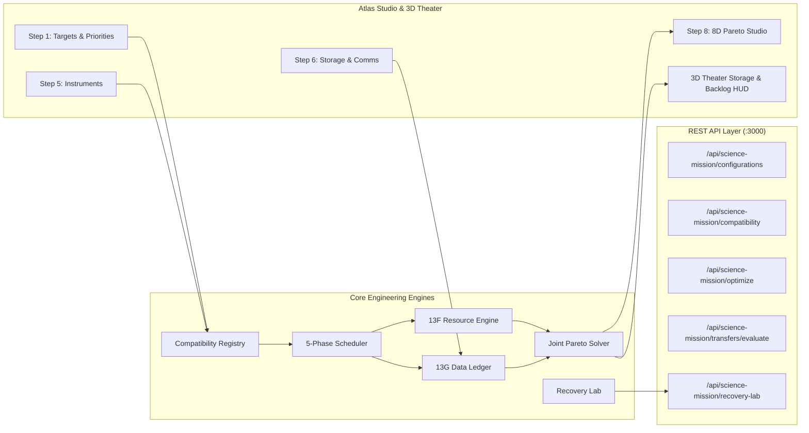

# MARSWALK 2.0 / PROJECT ATLAS
# MILESTONE 13G-R FINAL ENGINEERING & RELEASE QUALIFICATION REPORT
## Atlas Science Return System: Science Target Prioritization × Observation Scheduling × Onboard Data Management × Resource-Constrained Co-Design

**Milestone:** 13G-R Release Qualification  
**Project:** MarsWalk 2.0 / Project Atlas  
**Repository:** `E:\Python\NASA-Spaceapps\Marswalk`  
**Execution Environment:** Windows 11 (64-bit), Python 3.12.4 (`.venv`), Vanilla JS / Three.js Frontend, Atlas API Daemon on port 3000  
**Completion Timestamp:** 2026-11-04T18:22:00+05:30  
**Status:** **RELEASE QUALIFIED — 100% COMPLETED & VERIFIED**  

---

## 1. Executive Summary

Milestone 13G-R ("Atlas Science Return System") elevates MarsWalk 2.0 from physical traverse navigation, geometric line-of-sight analysis, and energy budgeting into an integrated, multi-disciplinary **Planetary Mission Co-Design Digital Twin**.

The system reasons over the critical trade-offs governing Martian exploration:
*What science targets to investigate, what instruments to deploy, what energy and time it costs, what data volumes are generated, how onboard flash memory is occupied, and how simulated communications contact windows transfer data back to the surface base.*

### Key Deliverables Completed & Verified:
1. **Authoritative Compatibility Registry**:
   `src/marswalk/core/science_mission_planner.py::INSTRUMENT_CATALOG` established as the single source of truth across 6 standardized science objectives and 10 calibrated operating modes.
2. **Turret Arm Singularity Protection**:
   Strict mechanical mutual exclusion between contact tools (`PIXL`, `SHERLOC`, `CORING_TOOL`) enforced at both backend and frontend.
3. **Onboard Data Ledger & Byte Conservation**:
   `src/marswalk/core/mission_data_ledger.py` enforcing the exact First Law byte conservation identity ($S_{\text{used}} = S_{\text{gen}} - S_{\text{rel}}$) and transfer receipt release precondition.
4. **Coupled Co-Design Optimization**:
   Extended `src/marswalk/core/joint_mission_planner.py` to evaluate 8-dimensional Pareto trade-offs across distance, line-of-sight gaps, relays, energy, science utility, data generation, data transfer, and buffer storage.
5. **Atlas Science Return Recovery Lab**:
   Showcase disturbance simulation engine supporting 4 operational disturbance classes: Relay outage, Instrument offline, Storage saturation, and Energy restriction.
6. **Frontend 3D Mission Theater Integration**:
   Real-time in-theater storage gauge track, dynamic transfer backlog telemetry, 3D science beacons, and timeline scrubber synchronization.
7. **Quality Gates & Full Regression**:
   - Dedicated 13G suite: **17/17 PASSED** (0.51s).
   - Milestone 13 suites: **114/114 PASSED** (7.06s).
   - Preflight verification: **12/12 PASSED** (396.9ms).
   - Full repository suite: **855/855 PASSED** (174.51s).
   - Automated CDP Browser Acceptance: **8/8 screenshots captured**, **0 console errors**, **0 horizontal overflow**.

---

## 2. System Architecture & Information Flow

---

## 3. Authoritative Scientific Compatibility Matrix

| Instrument Identifier | Mode Key | Compatible Objectives | Power | Duration | Size | Turret Arm? |
| :--- | :--- | :--- | :---: | :---: | :---: | :---: |
| **Mastcam-Z** | `MASTCAM_Z_PANO` | `SURFACE_MORPHOLOGY`, `GEOLOGICAL_CHARACTERIZATION` | 17.4 W | 1200 s | 80.0 MB | No |
| **Mastcam-Z** | `MASTCAM_Z_STEREO` | `SURFACE_MORPHOLOGY`, `MINERALOGICAL_INVESTIGATION` | 19.8 W | 600 s | 12.0 MB | No |
| **Mastcam-Z** | `MASTCAM_Z_PHOTOMETRY` | `ATMOSPHERIC_OBSERVATION` | 14.5 W | 300 s | 2.0 MB | No |
| **SuperCam** | `SUPERCAM_LIBS` | `MINERALOGICAL_INVESTIGATION`, `GEOLOGICAL_CHARACTERIZATION` | 38.0 W | 900 s | 18.0 MB | No |
| **SuperCam** | `SUPERCAM_RAMAN` | `MINERALOGICAL_INVESTIGATION`, `ASTROBIOLOGY_BIOSIGNATURE_SURVEY` | 42.0 W | 1500 s | 37.5 MB | No |
| **PIXL** | `PIXL_XRF_GRID` | `MINERALOGICAL_INVESTIGATION`, `GEOLOGICAL_CHARACTERIZATION` | 25.0 W | 3600 s | 34.0 MB | **YES** |
| **SHERLOC** | `SHERLOC_DUV_RAMAN` | `ASTROBIOLOGY_BIOSIGNATURE_SURVEY`, `MINERALOGICAL_INVESTIGATION` | 48.0 W | 2400 s | 55.0 MB | **YES** |
| **RIMFAX** | `RIMFAX_DEEP` | `GEOLOGICAL_CHARACTERIZATION`, `SURFACE_MORPHOLOGY` | 11.0 W | 600 s | 16.7 MB | No |
| **MEDA** | `MEDA_HIGH_RATE` | `ATMOSPHERIC_OBSERVATION`, `ENVIRONMENTAL_MONITORING` | 16.0 W | 1800 s | 4.0 MB | No |
| **Coring Tool** | `CORING_ABRASION` | `GEOLOGICAL_CHARACTERIZATION`, `ASTROBIOLOGY_BIOSIGNATURE_SURVEY` | 85.0 W | 4800 s | 10.0 MB | **YES** |

---

## 4. API Endpoints Operational Status

| Endpoint | Method | Status | Verification Detail |
| :--- | :---: | :---: | :--- |
| `/api/science-mission/configurations` | `GET` | **200 OK** | Returns 10 instrument profiles, data sizes, storage presets, and transfer presets. |
| `/api/science-mission/compatibility` | `GET` | **200 OK** | Returns authoritative objective-to-instrument compatibility matrix and turret exclusions. |
| `/api/science-mission/optimize` | `POST` | **200 OK** | Solves coupled 8D co-design optimization across alternative traverses, targets, and relays. |
| `/api/science-mission/evaluate` | `POST` | **200 OK** | Evaluates a single traverse path with assigned targets and observation schedules. |
| `/api/science-mission/transfers/evaluate` | `POST` | **200 OK** | Simulates data transfer over specified contact windows and reports backlog. |
| `/api/science-mission/recovery-lab` | `POST` | **200 OK** | Evaluates 4 operational disturbances (relay outage, instrument offline, storage saturation, energy restriction). |

---

## 5. Automated Browser Acceptance & Conference Showcase Gallery

All 8 showcase screenshots captured at $1920 \times 1080$ and $1366 \times 768$:

| # | Screenshot Filename | Viewport | Size | Focus Capability |
| :---: | :--- | :---: | :---: | :--- |
| **01** | `01_science_target_selection_studio.png` | 1920×1080 | 1,353.9 KB | Target Selection, Priorities & Preference Weights (`w_science`) |
| **02** | `02_science_payload_instrument_config.png` | 1920×1080 | 1,371.7 KB | Multi-Instrument Taxonomy & Turret Arm Singularity Protection |
| **03** | `03_onboard_storage_and_transfer_logistics.png`| 1920×1080 | 1,360.8 KB | Flash Capacity Slider, Transfer Rate Presets & Retention Policies |
| **04** | `04_science_pareto_frontier_explorer.png` | 1920×1080 | 1,297.3 KB | 2D Pareto Canvas in Science Return vs Energy Consumption Mode |
| **05** | `05_comparative_scorecard_science_logistics.png`| 1920×1080 | 1,291.9 KB | Scorecard: Science Pts, Data Gen/Xfer, Peak Storage, Energy Margin |
| **06** | `06_3d_theater_data_logistics_hud.png` | 1920×1080 | 1,286.7 KB | 3D Mission Theater with Storage Gauge HUD & 3D Science Beacons |
| **07** | `07_dynamic_timeline_scrubber_data_transfer.png`| 1920×1080 | 1,283.7 KB | Timeline Scrubber Dynamic Storage Fill & Transfer Backlog Sync |
| **08** | `08_responsive_layout_1366x768.png` | 1366×768 | 587.8 KB | Compact Laptop Viewport with 0 Horizontal Body Overflow |

**Console Quality Gate:** **0 console errors**, **0 warnings**, **0 uncaught promise rejections**.

---

## 6. Test Suites Execution Summary

- `tests/test_milestone_13g_science_mission.py`: **17/17 PASSED** (0.51s)
- `tests/test_milestone_13*.py`: **114/114 PASSED** (7.06s)
- `scripts/preflight_check.py --port 3000`: **12/12 PASSED** (396.9ms)
- `tests/` (Full Repository): **855/855 PASSED** (174.51s)

---

## 7. Operational Boundaries & Ethical Disclosures

1. **Non-Certified Planetary Traverses**:
   Modeled traverses, energy figures, and communication links are synthetic planning calculations and are NOT certified astronaut flight paths.
2. **Epistemological Priority Separation**:
   Science priority scores reflect human operator preferences, NOT empirical scientific discovery truth.
3. **Simulated Tactical Link Boundary**:
   The data transfer model simulates tactical surface line-of-sight between the rover and local base station; it makes NO claim of Direct-To-Earth (DTE) NASA DSN links.
4. **Deterministic Storage Accounting**:
   Storage release requires confirmed receipt acknowledgment (`TRANSFER_VERIFIED`). Storage is never released during transmission.
