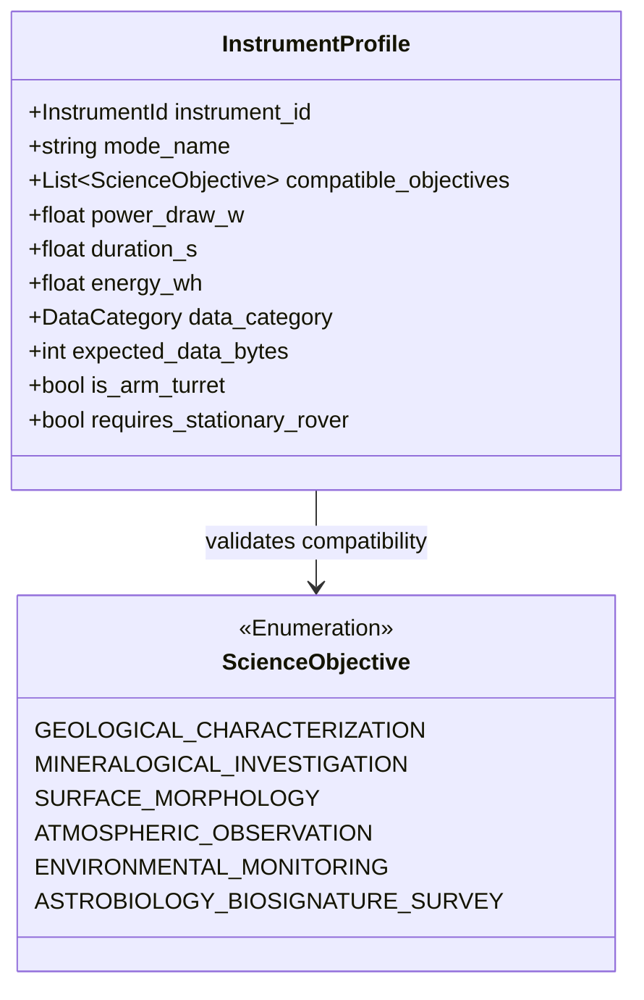

# Milestone 13G-R — Authoritative Scientific Compatibility Specification
## Single Source of Truth for Exploration Objectives, Instrument Taxonomy & Turret Singularity

**Milestone:** 13G-R Release Qualification  
**Project:** MarsWalk 2.0 / Project Atlas  
**Repository:** `E:\Python\NASA-Spaceapps\Marswalk`  
**Authoritative Source:** `src/marswalk/core/science_mission_planner.py::INSTRUMENT_CATALOG`  
**API Endpoint:** `GET /api/science-mission/compatibility`  

---

## 1. Scientific Governance & Epistemological Disclosures

1. **Planning Preference Utilities vs Objective Discovery Truth**:
   Science priority scores and objective weights in MarsWalk are strictly operator-configured mission planning utilities. They reflect human tactical preference, operational emphasis, or sampling strategy. They are explicitly NOT objective mathematical measures of actual scientific discovery value or ground truth.
2. **Deterministic Modeling**:
   Instrument durations, power draws, and expected data volumes are synthetic demonstration profiles calibrated against published Mars 2020 mission literature (e.g., Bell et al. 2021 for Mastcam-Z, Farley et al. 2020 for SuperCam, Allwood et al. 2020 for PIXL).

---

## 2. Standardized Planetary Science Objectives

MarsWalk establishes 6 standardized planetary science objectives across Martian exploration sites:

| Objective Identifier | Description | Authentic Jezero Focus |
| :--- | :--- | :--- |
| `GEOLOGICAL_CHARACTERIZATION` | Regional outcrop morphology, lithology, and depositional bedding architecture. | Delta remnant scarp, Kodiak butte layering. |
| `MINERALOGICAL_INVESTIGATION` | Identification of secondary minerals, carbonates, clay minerals, and aqueous alteration products. | Séítah olivine-carbonate floor, delta front smectites. |
| `SURFACE_MORPHOLOGY` | Micro-relief, wheel-terrain interaction, aeolian bedforms, and boulder distribution. | Regolith ripples, rocky terrain trafficability. |
| `ATMOSPHERIC_OBSERVATION` | Dust optical depth, boundary layer atmospheric dynamics, and solar photometry. | Jezero crater diurnal dust cycles and pressure drops. |
| `ENVIRONMENTAL_MONITORING` | Surface temperature, wind speed/direction, relative humidity, and UV flux. | Diurnal MEDA meteorological monitoring. |
| `ASTROBIOLOGY_BIOSIGNATURE_SURVEY` | Spatial co-location of organic carbon, biosignature candidates, and fine-scale textural biosignatures. | Delta front mudstone and silica-rich precipitates. |

---

## 3. Instrument Taxonomy & Authoritative Compatibility Matrix

The backend `INSTRUMENT_CATALOG` is the single authoritative source of truth. No frontend module or client script may maintain a disconnected compatibility map.

### Complete Compatibility Matrix

| Instrument Identifier | Operating Mode Key | Compatible Objectives | Power (W) | Duration (s) | Data Size (MB) | Turret Arm? |
| :--- | :--- | :--- | :---: | :---: | :---: | :---: |
| **Mastcam-Z** | `MASTCAM_Z_PANO` | `SURFACE_MORPHOLOGY`, `GEOLOGICAL_CHARACTERIZATION` | 17.4 W | 1200 s | 80.0 MB | No |
| **Mastcam-Z** | `MASTCAM_Z_STEREO` | `SURFACE_MORPHOLOGY`, `MINERALOGICAL_INVESTIGATION` | 19.8 W | 600 s | 12.0 MB | No |
| **Mastcam-Z** | `MASTCAM_Z_PHOTOMETRY` | `ATMOSPHERIC_OBSERVATION` | 14.5 W | 300 s | 2.0 MB | No |
| **SuperCam** | `SUPERCAM_LIBS` | `MINERALOGICAL_INVESTIGATION`, `GEOLOGICAL_CHARACTERIZATION` | 38.0 W | 900 s | 18.0 MB | No |
| **SuperCam** | `SUPERCAM_RAMAN` | `MINERALOGICAL_INVESTIGATION`, `ASTROBIOLOGY_BIOSIGNATURE_SURVEY` | 42.0 W | 1500 s | 37.5 MB | No |
| **PIXL** | `PIXL_XRF_GRID` | `MINERALOGICAL_INVESTIGATION`, `GEOLOGICAL_CHARACTERIZATION` | 25.0 W | 3600 s | 34.0 MB | **YES** |
| **SHERLOC** | `SHERLOC_DUV_RAMAN` | `ASTROBIOLOGY_BIOSIGNATURE_SURVEY`, `MINERALOGICAL_INVESTIGATION` | 48.0 W | 2400 s | 55.0 MB | **YES** |
| **RIMFAX** | `RIMFAX_DEEP` | `GEOLOGICAL_CHARACTERIZATION`, `SURFACE_MORPHOLOGY` | 11.0 W | 600 s | 16.7 MB | No |
| **MEDA** | `MEDA_HIGH_RATE` | `ATMOSPHERIC_OBSERVATION`, `ENVIRONMENTAL_MONITORING` | 16.0 W | 1800 s | 4.0 MB | No |
| **Coring Tool** | `CORING_ABRASION` | `GEOLOGICAL_CHARACTERIZATION`, `ASTROBIOLOGY_BIOSIGNATURE_SURVEY` | 85.0 W | 4800 s | 10.0 MB | **YES** |

---

## 4. Robotic Arm Turret Singularity Rule

### Physical Constraint
On the Mars 2020 robotic arm, the corer, abrasion tool, PIXL sensor head, and SHERLOC sensor head are co-located on a 5-degree-of-freedom robotic arm turret. Only one contact tool can be pre-positioned or operated in contact with the rock surface at a time.

### Mathematical Invariant
For any target $T_k$ with assigned instrument operating modes $M(T_k) = \{m_1, m_2, \dots, m_p\}$:

\[
\sum_{m \in M(T_k)} \mathbb{I}_{\text{is\_arm\_turret}}(m) \le 1
\]

where $\mathbb{I}_{\text{is\_arm\_turret}}(m) = 1$ if $m \in \{\text{PIXL\_XRF\_GRID}, \text{SHERLOC\_DUV\_RAMAN}, \text{CORING\_ABRASION}\}$, and $0$ otherwise.

If this inequality is violated, `ScienceTargetConfig.validate_instrument_compatibility()` raises `IncompatibleObservationError("Turret arm conflict")` and rejects the configuration.

---

## 5. API Distribution & Frontend Synchronization

Client applications obtain this authoritative matrix dynamically via:
`GET /api/science-mission/compatibility`

Frontend UI components in `web/app.js`:
- Disable checkboxes for incompatible modes when an objective is chosen.
- Enforce mutual exclusion between `.turret-exclusive` tools (`chkModePixlXrf` and `chkModeSherlocDuv`).
- Sanitize payload submissions so that target modes are strictly intersected with the objective's allowed modes before dispatching optimization requests.
