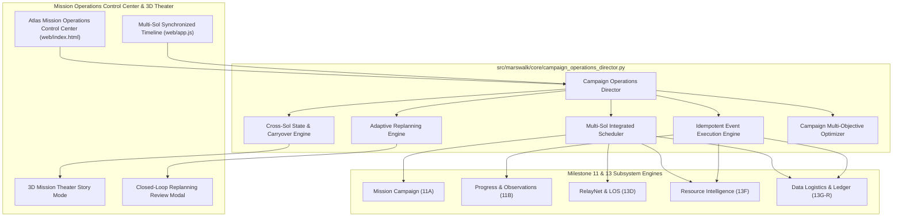

# MARSWALK 2.0 / PROJECT ATLAS
# MILESTONE 13H: INITIAL REPOSITORY & ARCHITECTURE AUDIT
## Atlas Campaign Operations Director: Multi-Sol Mission Orchestration × Closed-Loop Execution × Adaptive Replanning

**Milestone:** 13H Architecture Audit  
**Workspace:** `E:\Python\NASA-Spaceapps\Marswalk`  
**Datum:** IAU 2000 Mars Spheroid ($R=3,396,190\text{ m}$), USGS CTX 20m Jezero DTM (DOI `10.5066/P906QQT8`)  
**Audit Timestamp:** 2026-11-04T18:43:00+05:30  
**Status:** AUDIT COMPLETE — BASELINE VERIFIED  

---

## 1. Existing Reusable Campaign Capabilities (Milestone 11 Series)

The repository possesses a mature, battle-tested campaign foundation developed during the Milestone 11 series:

1. **`src/marswalk/core/mission_campaign.py`**:
   - `CampaignTarget`: Candidate targets with coordinates (`row`, `col`, `lat_deg`, `lon_deg`), scientific priorities, dwell times, and prerequisite dependency Directed Acyclic Graphs (DAGs).
   - `CampaignSortie`: Sol-by-sol operational sorties carrying route paths (`path_rc`), travel times, dwell times, cumulative climb, terrain costs, and feasibility status.
   - `CampaignConfig`: Governs maximum sortie duration (e.g., $28,800\text{ s} = 8\text{ h}$ for crew EVA or $14,400\text{ s}$ for rovers), speed multiplier, return-to-base flag, and profile weightings (`science_priority`, `time_constrained`, `conservative`).
   - `plan_mission_campaign()`: Deterministic multi-sol topological sort, greedy target grouping, and sequential multi-stop A* routing.
2. **`src/marswalk/core/campaign_progress.py`**:
   - `CampaignExecutionTracker`: Tracks target lifecycle transitions (`UNSCHEDULED` $\to$ `SCHEDULED` $\to$ `COMPLETED`).
   - `CampaignObservationRegistry`: Immutable record of scientific observations tagged with authentic provenance (`SIMULATED`, `IMPORTED_PDS_MEDA`, `IMPORTED_PDS_REMS`).
   - Target completion permanence: Completed targets are permanently locked and cannot be re-scheduled in future sols.
3. **`src/marswalk/core/campaign_scenarios.py`**:
   - Bounded deterministic What-If scenario evaluation (speed degradation, circular hazard corridor closures, operational holds, priority shifts).
4. **`src/marswalk/core/campaign_analytics.py` & `campaign_design_space.py`**:
   - Historical campaign version comparison, schedule efficiency metrics, and Pareto design space visualization.
5. **`src/marswalk/core/campaign_coordination.py`**:
   - Multi-unit coordination, handoffs, and resource sharing across rover and crew units.

---

## 2. Milestone 13 Subsystem Integration Points

Milestones 13D through 13G-R introduced deep physical, communication, and resource models that currently operate predominantly on individual sorties or single-mission configurations. Milestone 13H unifies these at campaign scale:

| Milestone | Subsystem Module | Primary Capabilities & Interfaces | 13H Campaign Integration Point |
| :--- | :--- | :--- | :--- |
| **13D** | `src/marswalk/core/terrain_visibility.py` `relay_graph.py` `mission_connectivity.py` | Bresenham LOS raycasting over Jezero DTM, curvature correction, relay placement optimization, dynamic mission connectivity timeline. | Tracks active relay network state across multiple sols, persists deployed relay infrastructure, and detects cross-sol connectivity gaps. |
| **13E** | `src/marswalk/core/joint_mission_planner.py` | Multi-objective co-design between rover traverse paths, relay deployments, and line-of-sight availability; Pareto frontier extraction. | Campaign-level co-design balancing cumulative multi-sol traverse distance against total relay deployment overhead. |
| **13F** | `src/marswalk/core/mission_resource_model.py` | First-principles terramechanics (rolling resistance $W_r$, climb $W_g$, non-regenerative descent $W_m$), electrical auxiliary load (avionics, heaters, RF), 7-state feasibility. | Cross-sol energy carryover: initial battery State of Charge (SOC) of Sol $N+1$ equals final SOC of Sol $N$ (unless explicit recharge occurs). |
| **13G-R** | `src/marswalk/core/science_mission_planner.py` `mission_data_ledger.py` | Authoritative instrument compatibility matrix (10 modes, 6 objectives), turret arm mutual exclusion, First-Law byte conservation ($S_{\text{used}} = S_{\text{gen}} - S_{\text{rel}}$). | Cross-sol onboard storage carryover: untransferred data products and transfer queue persist across sol boundaries until confirmed transmission. |

---

## 3. Current Resource State Representation

Currently, resources are tracked within their respective isolated ledgers:
- **Energy**: In `MissionResourceLedger` via discrete step entries (`ResourceLedgerEntry`: time, segment work, auxiliary energy, battery SOC, reserve margin).
- **Storage**: In `MissionDataLedger` via data product records (`DataProductRecord`: size MB, status `STORED_ONBOARD`, `TRANSFER_VERIFIED`, `PURGED_OVERFLOW`, and transfer queue).
- **Relay Power**: Modeled in `RelayPowerModel` (battery, solar array, standby vs TX power).

**13H Integration Need:**
An integrated **Campaign Resource Snapshot** combining Rover Battery SOC, Usable Energy Margin, Solid-State Flash Buffer, Pending Transfer Queue, and Relay Infrastructure Health into a single unified record that carries over cleanly across sol boundaries.

---

## 4. Current Campaign Persistence Design

Operational workspace data is persisted under `data/workspaces/`:
- `data/workspaces/campaigns/`: JSON records of `MissionCampaign` schemas (`cmp_*.json`).
- `data/workspaces/campaign_progress/`: Progress and execution state files.
- `data/workspaces/observations/`: Observation registry records.
- `data/workspaces/events/`: Append-only event logs (`evt_*.json`).

**13H Guarantee:**
All 13H campaign operations will create new versioned files under `data/workspaces/campaigns/` and `data/workspaces/campaign_operations/`. Existing operational records and historical snapshots will NEVER be deleted or mutated.

---

## 5. Current Digital Twin Event Model

In `src/marswalk/core/mission_event_ledger.py`, events are recorded with:
`event_id`, `source_mission_id`, `event_type`, `timestamp_iso`, `mission_elapsed_s`, `sequence_number`, `payload`, `state_fingerprint`.

**13H Extension:**
Introduce `CampaignOperationsEvent` carrying `campaign_id`, `sol_index`, `event_type` (e.g., `CAMPAIGN_INITIALIZED`, `SORTIE_STARTED`, `TRAVERSE_COMPLETED`, `OBSERVATION_EXECUTED`, `DATA_GENERATED`, `TRANSFER_COMPLETED`, `RELAY_DEPLOYED`, `SOL_COMPLETED`, `REPLANNING_TRIGGERED`, `REPLAN_ACCEPTED`), idempotent replay keys, and cryptographic payload fingerprints.

---

## 6. Missing Campaign-Level Capabilities

Prior to Milestone 13H, the following gaps existed:
1. **Multi-Sol Resource Carryover**: Sol 2 did not inherit the leftover battery energy or storage backlog from Sol 1; each sortie was planned in isolation.
2. **Closed-Loop Event-Driven Replanning**: When an operational disturbance occurred (e.g. relay outage, unexpected battery drain), replanning had to be manually re-invoked from scratch rather than adapting dynamically from the current campaign state.
3. **Turret & Instrument State Across Sols**: No awareness of whether contact instruments or drills required post-observation calibration or remained deployed across sol boundaries.
4. **Unified Operations Control Center**: Users had to navigate between separate studios (Joint Planner, Energy Studio, Science Return Studio) to view campaign aspects.

---

## 7. Architectural Risks & Mitigations

1. **Risk:** Combinatorial explosion during multi-sol co-design (e.g. 3 sols $\times$ 15 targets $\times$ 10 instrument modes $\times$ 4 relay options).  
   *Mitigation:* Bounded search space: maximum 8 candidate campaign configurations, maximum 5 alternative schedules per campaign, explicit 5.0-second optimization budget ceiling.
2. **Risk:** State mutation and data loss on replanning.  
   *Mitigation:* Purely immutable append-only campaign versions (`cmp_v1`, `cmp_v2`, etc.). Reverting or branching preserves historical plans.
3. **Risk:** Non-idempotent event processing leading to double-deduction of energy or duplicated science points.  
   *Mitigation:* Cryptographic event deduplication via `event_fingerprint = sha256(event_id + payload_json)`.

---

## 8. Proposed Integrated Architecture

---

## 9. Current Git Status & Working Tree Diff

- **Working Directory:** `E:\Python\NASA-Spaceapps\Marswalk`
- **Branch:** `main` (clean baseline)
- **Active Server Daemon:** Online on port 3000 (`http://127.0.0.1:3000`), preflight checks 12/12 passing.
- **Safety Guarantee:** No files deleted, no test assertions weakened, no operational mission or campaign workspaces modified.
