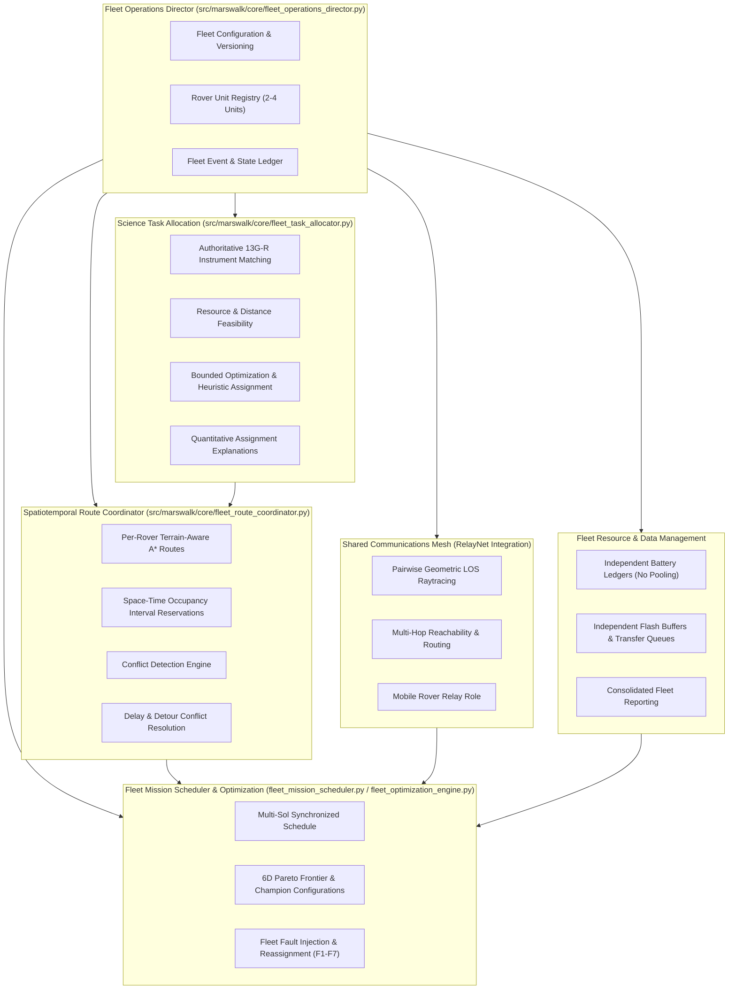

# Milestone 13J Architecture Audit & Fleet Systems Integration Plan

## 1. Executive Summary

Milestone 13J transitions MarsWalk 2.0 / Project Atlas from single-rover campaign orchestration (Milestones 13H/13I) to **cooperative multi-rover planetary fleet operations**. 

This audit assesses:
1. Reusable components from earlier multi-unit coordination (Milestone 11E).
2. Existing physical energy models (13F) and data ledgers (13G-R).
3. Authoritative instrument compatibility matrices (13G-R).
4. Shared terrain-aware geometric communications graphs (13D RelayNet).
5. Mission assurance invariants, deterministic replay, and immutable branching (13I).
6. Frontend inspector cockpits and Three.js 3D Mission Theater architectures.

---

## 2. Forensic Audit of Existing System Capabilities

### 2.1 Campaign & Multi-Unit Architecture
- **Milestone 11E (`src/marswalk/core/campaign_coordination.py`)**:
  - Implements basic `ExplorationUnit`, `MobilityProfile`, `AvailabilityWindow`, and `TargetAllocation`.
  - *Limitation*: Designed for abstract task distribution without physical battery Wh calculations, flash memory byte counts, authoritative 13G-R instrument matching, spatiotemporal occupancy deconfliction, or geometric RelayNet integration.
  - *Integration Strategy*: Re-use clean dataclass semantics (`ExplorationUnit`, `MobilityProfile`), while augmenting rovers with explicit physical resource ledgers, instrument suites, and live fleet status.
- **Milestone 13H (`src/marswalk/core/campaign_operations_director.py`)**:
  - Implements closed-loop single-rover campaign state, multi-sol sorties, deterministic event log sequencing, and contingency replanning.
  - *Fleet Evolution*: `FleetOperationsDirector` will coordinate a collection of rovers, where each rover maintains its own `RoverResourceConfig`, `MissionResourceLedger`, and `MissionDataLedger`, while sharing a unified terrain grid, relay infrastructure, and fleet event ledger.

### 2.2 Terrain & Route Planning
- **Terrain Foundation (`src/marswalk/core/terrain.py`)**:
  - USGS CTX 20m Jezero Crater DTM (DOI `10.5066/P906QQT8`, $250 \times 250$ grid, elevation $-2623.8\text{ m}$ to $-2445.0\text{ m}$).
  - All rovers operate on the identical terrain elevation and slope grid without duplicating memory arrays.
- **Route Planner (`src/marswalk/core/planner.py`)**:
  - A* pathfinding with Minetti metabolic / Farley terramechanical slope impedance.
  - *Fleet Evolution*: Each rover generates an independently optimal route through its assigned waypoints. The `FleetRouteCoordinator` then overlays temporal occupancy intervals along route segments to detect and resolve space-time conflicts.

### 2.3 Rover Energy & Usable Power
- **Milestone 13F (`src/marswalk/core/mission_resource_model.py`)**:
  - Rigorous physics: terramechanical rolling resistance, gravity slope work, base electrical avionics load ($110\text{ W}$), instrument duty cycles, non-regenerative descent physics, and $20\%$ minimum reserve margin.
  - *Fleet Rule*: **Zero Energy Pooling**. Each rover has an independent battery pack ($4800\text{ Wh}$ baseline, customizable per unit). Rover A cannot discharge energy to Rover B unless an explicit physical power transfer is configured.

### 2.4 Science Instruments & Onboard Data
- **Milestone 13G-R (`src/marswalk/core/science_mission_planner.py` & `mission_data_ledger.py`)**:
  - Authoritative `INSTRUMENT_CATALOG`: `MASTCAM_Z`, `SUPERCAM`, `PIXL`, `SHERLOC`, `RIMFAX`, `MEDA`, `CORING_TOOL`.
  - Robotic arm turret singularity protection: only one turret tool (`PIXL`, `SHERLOC`, `CORING_TOOL`) active at any instant.
  - *Fleet Rule*: Target allocation strictly verifies that the assigned rover is physically equipped with an instrument compatible with the target's `ScienceObjective`.
  - *Data Isolation*: Data products carry unique identifiers: `dp_{rover_id}_{target_id}_{seq}`.

### 2.5 Communications Network (RelayNet)
- **Milestone 13D (`src/marswalk/core/relay_graph.py` & `relay_planner.py`)**:
  - Line-of-sight ray tracing on DTM with spherical Mars datum ($R=3,396,190\text{ m}$).
  - `RelayNodeType` already contains `ROBOTIC_ROVER`, `SCOUT_ROVER`, `CREW_EVA`, `BASE_STATION`, and `ACTIVE_RELAY`.
  - *Fleet Evolution*: Build a unified fleet graph incorporating Base Station, all active rovers, and deployed relays. Support rovers acting as opportunistic mobile relays when stationary.

### 2.6 Mission Assurance & Branching
- **Milestone 13I (`src/marswalk/core/mission_assurance_engine.py` & `campaign_branch_manager.py`)**:
  - 20 invariant rules (`ENG-001` through `CONC-001`), deterministic replay, isolated workspaces (`data/workspaces/branches/`), and optimistic concurrency locks.
  - *Fleet Evolution*: Extend invariants with 7 fleet-scale integrity categories (Unit Integrity, Allocation Integrity, Spatiotemporal Non-Conflict, Resource Non-Pooling, Network Reachability, Fleet Aggregate Accuracy, Recovery Lineage).

### 2.7 Frontend & 3D Mission Theater
- **Frontend Architecture (`web/index.html`, `web/styles.css`, `web/app.js`)**:
  - Existing inspector tabs: `tabMissionControl`, `tabExperimentStudio`, `tabRobustnessLab`, `tabRehearsalDirector`, `tabJointMissionStudio`, `tabCampaignOperations`, `tabMissionAssurance`.
  - Single Three.js scene and animation loop (`theaterStoryGroup`, `theaterMultiSolPathsGroup`).
  - *Fleet Integration*: Add `tabFleetControl` (Atlas Fleet Control Center) with Rover Cards (A, B, C, D), Science Allocation Board, Multi-Lane Fleet Timeline, and 3-Way Comparative Recovery Drawer.
  - *3D Scene*: Render simultaneous colored rover polylines (Cyan Rover A, Emerald Rover B, Purple Rover C, Amber Rover D) and microwave communications mesh in the existing Mission Theater.

---

## 3. Git Status & Working Tree Integrity

- Working Tree: Clean working state on `main` branch.
- Operational Workspaces: `data/workspaces/` contains verified persistent records that must remain untouched. All new fleet configurations and scenario trials will reside in `data/workspaces/fleets/` and `data/workspaces/fleets/branches/`.
- No operational campaigns or historical test outputs will be deleted.

---

## 4. Architectural Proposals & Subsystem Decomposition

---

## 5. Performance Constraints & Regression Safeguards

1. **Computational Bounds**:
   - Fleet routing coordinates $N=2$ to $4$ rovers across $M=4$ to $12$ science targets.
   - Bounded beam search and Hungarian/greedy allocation run in $< 200\text{ ms}$.
   - Occupancy grid resolution: cell radius $20\text{ m}$ (1 DTM pixel), buffer radius $40\text{ m}$ (2 pixels), time slot $\Delta t = 60\text{ s}$.
2. **Quality Gates**:
   - Dedicated unit & integration battery in `tests/test_milestone_13j_fleet_operations.py`.
   - Node syntax check on `web/app.js`.
   - Preflight verification on port 3000 (12/12 checkpoints).
   - Full regression suite across Milestone 13 and repository.
