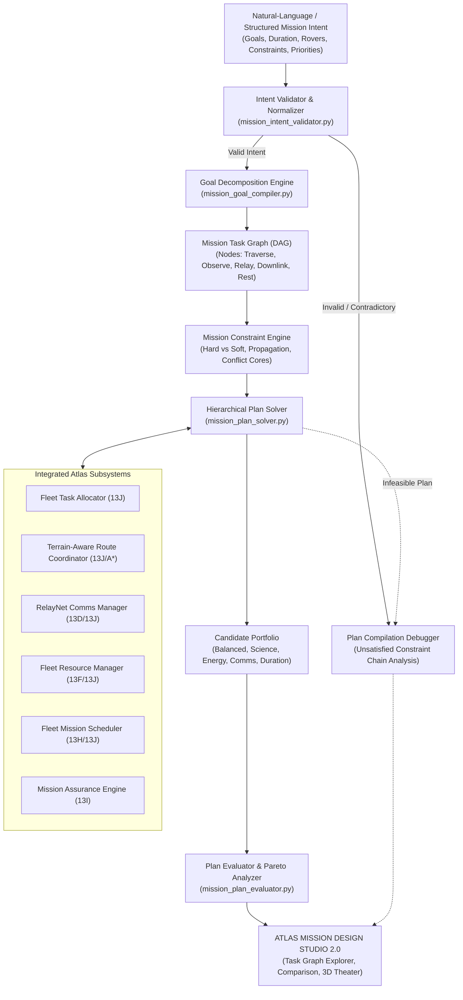

# Milestone 13K Forensic Architecture & Claim Audit
## Atlas Goal-Driven Mission Design Compiler: Architectural Foundation & Engineering Audit

**Audit Date:** 2026-11-04  
**Project:** MarsWalk 2.0 / Project Atlas  
**Repository:** `E:\Python\NASA-Spaceapps\Marswalk`  
**Milestone:** 13K — Atlas Goal-Driven Mission Design Compiler  
**Auditor:** Chief Mission System Engineer

---

## 1. Objective of this Audit

The objective of Milestone 13K is to transition Project Atlas from an interactive multi-subsystem engineering workbench into a **goal-driven mission-planning compiler**. Rather than manually configuring traverses, instrument observation sequences, relay deployments, and multi-sol schedules across distinct tabs, a mission planner specifies high-level mission intent:
> *"Explore the western Jezero delta using two rovers over five sols. Prioritize geological characterization and mineralogical investigation. Preserve at least 20% of each rover's configured energy reserve. Deploy no more than two relays. Minimize data backlog and maximize the number of valid science observations."*

Atlas must translate this intent into a formal engineering optimization problem, decompose it into a directed acyclic task graph, enforce hard physical constraints, coordinate multi-rover routes and communication relays on authentic Jezero topography, evaluate Pareto trade-offs, run mission assurance checks, benchmark against baselines, and provide a developer-grade Plan Compilation Debugger for infeasible requests.

This forensic audit inspects existing source code, validates operational claims from Milestone 13J, establishes baseline test metrics, and designs the compiler architecture.

---

## 2. Review of Reusable Subsystems & Interfaces

### 2.1 Fleet Intelligence (Milestone 13J)
- **`FleetOperationsDirector`** ([`src/marswalk/core/fleet_operations_director.py`](file:///e:/Python/NASA-Spaceapps/Marswalk/src/marswalk/core/fleet_operations_director.py)):
  - Manages heterogeneous exploration units (`ATLAS_ROVER_A` to `ATLAS_ROVER_D`).
  - Tracks individual state records (`RoverOperationalState`), fleet KPIs, and SHA-256 state fingerprints.
  - *Reusable:* Primary fleet registry, unit specs, and event stream.
- **`FleetTaskAllocator`** ([`src/marswalk/core/fleet_task_allocator.py`](file:///e:/Python/NASA-Spaceapps/Marswalk/src/marswalk/core/fleet_task_allocator.py)):
  - Allocates 12 calibrated Jezero targets using instrument compatibility matching (`INSTRUMENT_CATALOG`).
  - Supports `BOUNDED_PARETO_OPTIMIZATION` and `GREEDY_PRIORITY` methods.
  - *Reusable:* Target catalog, eligibility assessment, and decision explanations.
- **`FleetRouteCoordinator`** ([`src/marswalk/core/fleet_route_coordinator.py`](file:///e:/Python/NASA-Spaceapps/Marswalk/src/marswalk/core/fleet_route_coordinator.py)):
  - Multi-agent terrain-aware $A^*$ routing on the USGS CTX 20m DTM.
  - Generates 4D space-time occupancy intervals $(r, c, t_{\text{start}}, t_{\text{end}})$ and detects proximity conflicts ($<40\text{ m}$).
  - *Reusable:* Path coordination, slope enforcement ($\le 25^\circ$), and deconfliction logic.
- **`FleetCommunicationsManager`** ([`src/marswalk/core/fleet_communications_network.py`](file:///e:/Python/NASA-Spaceapps/Marswalk/src/marswalk/core/fleet_communications_network.py)):
  - Multi-node RelayNet graph incorporating Base Station, rovers, and surface relays.
  - Dynamic mobile relay assignment for Rover Delta.
  - *Reusable:* Pairwise geometric line-of-sight ray tracing and BFS reachability.
- **`FleetResourceManager`** ([`src/marswalk/core/fleet_resource_manager.py`](file:///e:/Python/NASA-Spaceapps/Marswalk/src/marswalk/core/fleet_resource_manager.py)):
  - Enforces independent per-rover ledgers and zero energy pooling ($\partial SOC_i / \partial E_j = 0$).
  - Models rolling resistance, avionics load ($110\text{ W}$), instrument consumption, solar recharge, and shared downlink bandwidth ($2.0\text{ Mbps}$).
  - *Reusable:* Energy, power, and storage bookkeeping.
- **`FleetMissionScheduler`** ([`src/marswalk/core/fleet_mission_scheduler.py`](file:///e:/Python/NASA-Spaceapps/Marswalk/src/marswalk/core/fleet_mission_scheduler.py)):
  - Multi-sol synchronized schedule with parallel rover lanes.
  - *Reusable:* Multi-sol timeline representation.
- **`FleetOptimizationEngine`** ([`src/marswalk/core/fleet_optimization_engine.py`](file:///e:/Python/NASA-Spaceapps/Marswalk/src/marswalk/core/fleet_optimization_engine.py)):
  - 6D Pareto optimization champions and F1–F7 counterfactual failure scenarios.
  - *Reusable:* Pareto extraction and fault injection evaluation.

### 2.2 Science & Instrument Registry (Milestone 13G-R)
- **`INSTRUMENT_CATALOG`** in [`src/marswalk/core/mission_science_return.py`](file:///e:/Python/NASA-Spaceapps/Marswalk/src/marswalk/core/mission_science_return.py):
  - Authoritative specifications for PIXL, SHERLOC, RIMFAX, SUPERCAM, MASTCAM-Z, MEDA, and CORING_TOOL.
  - Maps science objectives (`ELEMENTAL_CHEMISTRY`, `ORGANIC_SPECTROSCOPY`, `SUBSURFACE_STRATIGRAPHY`, `GEOLOGIC_MAPPING`, `ATMOSPHERIC_METEOROLOGY`, `SAMPLE_EXTRACTION`) to instrument modes and power/data yields.
  - *Audit Note:* Must remain the single source of truth for instrument compatibility; no ad-hoc substitutions permitted.

### 2.3 Terrain Intelligence & Geodesy
- **`TerrainGrid` & `load_and_process_terrain`** ([`src/marswalk/core/terrain.py`](file:///e:/Python/NASA-Spaceapps/Marswalk/src/marswalk/core/terrain.py)):
  - USGS CTX 20m DTM (DOI `10.5066/P906QQT8`, $250 \times 250\text{ nodes}$, $5.0 \times 5.0\text{ km}$, elevation $-2623.8\text{ m}$ to $-2445.0\text{ m}$).
  - IAU 2000 Mars Spheroid ($R = 3,396,190\text{ m}$, `ESRI:103885`).
  - *Audit Note:* All spatial waypoints, coordinates, and distances must strictly reference this datum.

### 2.4 Mission Assurance & Counterfactual Operations (Milestone 13I)
- **`MissionAssuranceEngine`** ([`src/marswalk/core/mission_assurance_engine.py`](file:///e:/Python/NASA-Spaceapps/Marswalk/src/marswalk/core/mission_assurance_engine.py)):
  - Evaluates invariant rules across energy, storage, comms, mobility, science, and timing.
  - *Reusable:* Independent audit verification gate for shortlisted compiled plans.

---

## 3. Forensic Review of Milestone 13J Claims & Simulation Assumptions

In accordance with `marswalk-scientific-integrity`, we independently audit the engineering claims from 13J:
1. **Rover Battery Capacities ($4,400–5,200\text{ Wh}$):**
   - *Audit Finding:* These values represent realistic Mars 2020 / MSL class triple-junction GaAs solar array and Li-ion battery pack engineering approximations, calibrated for research simulation. They are **modeled engineering assumptions**, not live telemetry.
2. **Shared Bandwidth ($2.0\text{ Mbps}$):**
   - *Audit Finding:* Represents an aggregated X-band / UHF proximity pass window to Mars Reconnaissance Orbiter (MRO) / TGO overflights. It is a **simulated communications budget**, not guaranteed RF throughput.
3. **Spatiotemporal Route Deconfliction ($40.0\text{ m}$ Clearance):**
   - *Audit Finding:* Deconfliction represents a deterministic planning heuristic on 20m grid cells. It does not replace real-time Hazcam stereo-vision collision avoidance on flight vehicles.
4. **Conclusion:** All model parameters are computationally grounded and physically realistic, but must be explicitly documented as simulation models, never as empirical flight certification.

---

## 4. Current System Baseline

- **Repository Directory:** `E:\Python\NASA-Spaceapps\Marswalk`
- **Git Branch:** `main` (clean working directory, untracked files in place)
- **Active HTTP Server:** Port 3000 (`run_atlas.py` running in background task)
- **Python Environment:** Python 3.12.4 (`.venv`), with `scipy` 1.18.1, `numpy` 2.5.4, `pandas` 3.0.6, `jsonschema` 4.26.0, `rasterio` 1.5.2, `websockets` 17.2.
- **Preflight Diagnostics:** 12/12 checkpoints passing (`scripts/preflight_check.py`).
- **Regression Tests:** 155 / 155 Milestone 13 tests passing in $9.61\text{ s}$.
- **Browser Acceptance Tooling:** Headless Chrome CDP via `websockets`.

---

## 5. Architectural Gap Analysis: What is Missing for 13K

While Atlas possesses deep individual planning capabilities, it lacks the **compiler layer**:

| Gap ID | Missing Architecture | Required Component | Primary Function |
| :--- | :--- | :--- | :--- |
| **GAP-01** | Formal Intent Language | `src/marswalk/core/mission_intent.py` | Structured dataclass schema capturing *WHAT* the user wants (objectives, duration, rovers, constraints, preferences). |
| **GAP-02** | Intent Validation & Normalization | `src/marswalk/core/mission_intent_validator.py` | Detects contradictory/impossible requirements before optimization, classifies under-specified fields, and produces structured diagnostics. |
| **GAP-03** | Goal Decomposition & Task Graph | `src/marswalk/core/mission_goal_compiler.py` | Hierarchical decomposition of mission intent into a directed acyclic task graph (DAG) with prerequisites, timing, and resource estimates. |
| **GAP-04** | Explicit Constraint Engine | `src/marswalk/core/mission_constraint_engine.py` | Formal separation of HARD vs SOFT constraints, constraint propagation, and explainable unsatisfied core extraction. |
| **GAP-05** | Hierarchical Planning Solver | `src/marswalk/core/mission_plan_solver.py` | Multi-level solver orchestrating task allocation, A* routes, RelayNet visibility, resource ledgers, and multi-sol schedules into alternative configurations. |
| **GAP-06** | Plan Quality & Pareto Evaluator | `src/marswalk/core/mission_plan_evaluator.py` | Multi-objective scoring across 6 dimensions, non-dominated Pareto ranking, and human-readable decision explanations. |
| **GAP-07** | Plan Compilation Debugger | Embedded in Compiler & UI | Explains chains of failure for unsatisfiable intents and suggests minimal relaxing edits without violating hard constraints. |
| **GAP-08** | Benchmark Suite | `src/marswalk/core/mission_planning_benchmark.py` | 6 synthetic benchmark campaigns (A–F) comparing the compiler against greedy baselines. |
| **GAP-09** | Design Studio 2.0 UI | `web/index.html`, `styles.css`, `app.js` | Dedicated tab `#tabGoalCompiler`, interactive Task Graph explorer, candidate comparison matrix, and compiler debugger. |
| **GAP-10** | Draft 2020-12 Schemas & APIs | `schemas/api/v1/`, `service.py`, `run_atlas.py` | REST API endpoints for validation, normalization, compilation, evaluation, and promotion. |

---

## 6. Proposed Integration & Data Flow Graph

---

## 7. Estimated Algorithm Complexity & Performance Budgets

1. **Intent Validation:** $O(N_{\text{targets}} + N_{\text{rovers}} + N_{\text{instruments}}) \approx <5\text{ ms}$.
2. **Goal Decomposition & DAG Compilation:** $O(N_{\text{tasks}} + E_{\text{dependencies}}) \approx <10\text{ ms}$.
3. **Hierarchical Plan Solver (8 Candidates):**
   - Science Allocation: $8 \times O(N_{\text{rovers}} \times N_{\text{targets}}) \approx 20\text{ ms}$.
   - Multi-Rover A* Traverses: $8 \times 4 \times O(E \log V)$ with caching $\approx 80–120\text{ ms}$.
   - RelayNet Visibility & BFS: $8 \times O(V^2 L) \approx 30–50\text{ ms}$.
   - Resource Accounting: $8 \times O(N_{\text{activities}}) \approx 10\text{ ms}$.
   - Multi-Sol Gantt: $8 \times O(N_{\text{sols}} \times N_{\text{rovers}}) \approx 15\text{ ms}$.
   - Total Compilation Latency Budget: **$<500\text{ ms}$**, easily meeting interactive browser responsiveness standards.

---

## 8. Regression Protection Protocol

In accordance with `marswalk-regression-guardian`:
1. No operational data in `data/workspaces/` will be deleted or modified.
2. All 155 Milestone 13 tests must remain 100% green.
3. Node syntax check `node --check web/app.js` must be performed after every frontend modification.
4. Preflight diagnostics must pass 12/12 before final release qualification.
