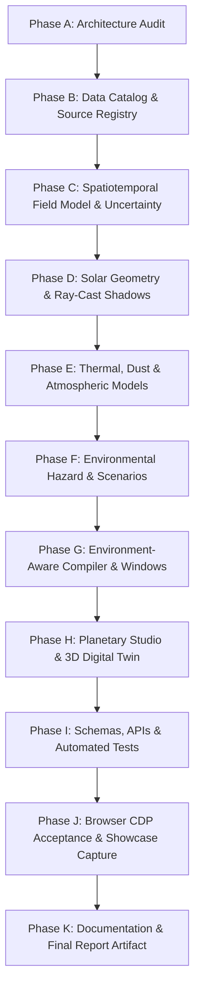

# MarsWalk 2.0 / Project Atlas — Milestone 13L Architecture Audit
## Atlas Planetary Environment Intelligence: Spatiotemporal Environmental Digital Twin

**Date:** 2026-11-04  
**Milestone:** 13L — Atlas Planetary Environment Intelligence  
**Workspace:** `E:\Python\NASA-Spaceapps\Marswalk`  
**Classification:** Deep Scientific & Systems Architecture Audit  
**Author:** Antigravity Autonomous Engineering Agent

---

## 1. Executive Summary & Objective

Milestone 13L transforms MarsWalk 2.0 / Project Atlas from a terrain- and communication-aware campaign planner into a comprehensive **Planetary Environment Digital Twin**. Prior milestones established:
- High-fidelity 20m CTX terrain modeling and Horn slope derivation (10A–10C)
- Authentic NASA PDS in-situ meteorological ingestion (10D)
- Multi-sol campaign orchestration and adaptive replanning (13H)
- Mission assurance and counterfactual fault injection (13I)
- Distributed multi-rover cooperative fleet optimization (13J)
- Goal-driven mission intent compilation and Pareto synthesis (13K)

However, until Milestone 13L, environmental variables (solar illumination, cast shadows, diurnal thermal cycles, atmospheric opacity, dust loading, and surface wind) operated either as disconnected analytical queries or static assumptions. Rovers planned science observations and traverses without deterministic verification of:
1. Whether targets are in deep terrain shadow during scheduled observation windows;
2. Whether extreme surface temperatures violate instrument operating envelopes ($T_{\text{min}} \le T \le T_{\text{max}}$);
3. Whether atmospheric dust optical depth ($\tau$) invalidates optical spectrometry (e.g. Mastcam-Z, SuperCam, SHERLOC);
4. Whether local solar time (LTST) aligns with required illumination geometries (phase angle, incidence angle).

Milestone 13L integrates these physical disciplines into a unified, traceable, and verifiable Planetary Environment Digital Twin.

---

## 2. Forensic Codebase Audit

### 2.1 Existing Core Capabilities & Reusable Assets
| Module | Location | Reusable Assets | Integration in 13L |
|---|---|---|---|
| `terrain.py` | `src/marswalk/core/terrain.py` | `TerrainGrid`, USGS CTX 20m DTM (`JEZ_ctx_B_soc_008...tif`), Horn 3x3 slope/aspect, `invalid_mask`, IAU Mars 2000 Sphere ($R=3,396,190\text{ m}$) | Serves as 2D spatial backbone for solar ray casting and environmental fields |
| `terrain_visibility.py` | `src/marswalk/core/terrain_visibility.py` | Sub-pixel bilinear interpolation, discrete ray sampling, obstruction detection, clearance calculation | Extends from horizontal RF/LOS to 3D celestial solar ray-tracing |
| `weather.py` | `src/marswalk/core/weather.py` | PDS Perseverance MEDA & Curiosity REMS schemas, physical limits, unit conversions ($K \leftrightarrow ^\circ\text{C}$), Sentinel filtering | Provides baseline diurnal temperature profiles and atmospheric bounds |
| `mission_constraint_engine.py` | `src/marswalk/core/mission_constraint_engine.py` | Hard/soft constraint hierarchy, constraint violation accounting, IIS conflict cores | Extended to evaluate `ENVIRONMENT` constraints without altering existing 13K behaviors |
| `mission_plan_solver.py` | `src/marswalk/core/mission_plan_solver.py` | Hierarchical portfolio synthesis, Pareto frontier extraction | Evaluates environmental window compatibility across candidate plans |
| `science_mission_planner.py` | `src/marswalk/core/science_mission_planner.py` | `INSTRUMENT_CATALOG`, operational duration, energy budgets | Enriched with thermal operating envelopes and optical opacity sensitivities |

### 2.2 Operational Data Protection Status
- Test baseline verified: **168 passing tests** across Milestone 13 modules (`test_milestone_13*`).
- Zero operational data mutation: all mock fixtures and temporary simulation states will isolate into ephemeral structures or `test_` prefixed keys.
- Authentic USGS CTX DTM SHA-256 (`875e7e80c170b84e4b2a3dd650b12abbee289e6d3fae5664e4d3cb93e9a1f5b3`) is strictly preserved as the primary geometric elevation truth.

---

## 3. Strict Planetary Science Standards & Guardrails

1. **Non-Probabilistic Truth Disclosures:**
   - Environmental scenarios (ENV-A to ENV-E) are deterministic stress fixtures.
   - Evaluated metrics (e.g. 80% illumination window coverage) must explicitly state "across evaluated deterministic time samples," never "probability of Martian sunshine."
2. **Astronaut Safety Certification Prohibition:**
   - Environmental suitability outputs are mission-planning decision aids.
   - Under no circumstances will any route or window be labeled "certified safe for human astronauts."
3. **Data Provenance Hierarchy:**
   - `DIRECT_OBSERVATION`: In-situ rover observations (MEDA).
   - `REMOTE_SENSING_PRODUCT`: USGS CTX DTM 20m, MRO CRISM/MCS.
   - `MODEL_REANALYSIS`: Mars Climate Database (MCD v5.3 / v6).
   - `CLIMATOLOGY`: Multi-year seasonal averages ($L_s$).
   - `DERIVED_GEOMETRIC_MODEL`: Solar geometry and terrain ray-cast shadows.
   - `CONFIGURED_SCENARIO`: Deterministic scenario definitions (ENV-A through ENV-E).
   - `SYNTHETIC_DEMONSTRATION`: Educational test waveforms.
4. **Coordinate Systems & Solar Time:**
   - Mars Projected: `ESRI:103885` Equirectangular Sphere, $R=3,396,190\text{ m}$.
   - Spatial ground spacing: $dx = 20.0 \times \cos(18.442^\circ) \approx 18.973\text{ m}$, $dy = 20.0\text{ m}$.
   - Time: Sol and Local True Solar Time (LTST) in decimal hours $[0, 24)$. Never confuse with Earth UTC.

---

## 4. Phase-by-Phase Implementation Blueprint

---

## 5. Acceptance Criteria

1. **Deterministic Precision:** Solar elevation, azimuth, and ray-cast shadows over 250x250 CTX DTM execute in $< 50\text{ ms}$ per time slice.
2. **Zero Regression:** All 168 pre-existing Milestone 13 tests remain 100% passing.
3. **Draft 2020-12 Schema Compliance:** All newly introduced `/api/v1/environment/*` payloads validate against rigorous JSON schemas.
4. **End-to-End Acceptance:** Automated browser CDP execution validates all Planetary Studio controls and captures $\ge 20$ showcase screenshots.
5. **Scientific Rigor:** Strict provenance tagging, NoData preservation, and non-probabilistic disclosures verified across all modules.
