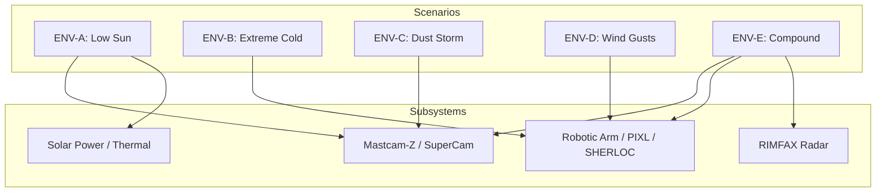

# MarsWalk 2.0 / Project Atlas — Milestone 13L: Calibrated Scenarios Gauntlet

## 1. Overview
The Scenario Engine (`src/marswalk/core/environment_scenario_engine.py`) provides 5 calibrated, reproducible deterministic stress test fixtures (ENV-A through ENV-E) alongside the nominal baseline to validate fleet robustness under non-ideal Martian conditions.

## 2. Scientific Truth & Non-Probabilistic Disclosures
> [!IMPORTANT]
> In accordance with the NASA Space Apps Scientific Integrity directives, scenario frequencies (e.g., 4/5 scenarios passed) represent stress performance across explicitly formulated test fixtures. They must NEVER be labeled as empirical Martian weather probabilities or flight reliability certifications.

## 3. Scenario Matrix (ENV-A through ENV-E)

| Scenario Code | Scenario Title | Solar Flux Factor | Thermal Anomaly ($^\circ\text{C}$) | Dust Opacity ($\tau$) | Wind Gust Anomaly ($\text{m/s}$) | Primary Failure Mode Tested |
|---|---|---|---|---|---|---|
| `BASELINE_NOMINAL` | Clear Jezero Spring Conditions | $1.00\times$ | $0.0^\circ\text{C}$ | $0.45$ | $+0.0$ | Baseline control; all systems permissible |
| `ENV_A_REDUCED_ILLUMINATION` | Low Sun & Winter Geometry ($L_s=270^\circ$) | $0.65\times$ | $-3.0^\circ\text{C}$ | $0.55$ | $+1.0$ | Rapid shadow formation behind western delta scarp |
| `ENV_B_ELEVATED_THERMAL_STRESS` | Extreme Diurnal Freeze | $1.00\times$ | $-10.0^\circ\text{C}$ | $0.45$ | $+2.0$ | Dawn air reaches $-86^\circ\text{C}$; violates PIXL/SHERLOC limits |
| `ENV_C_DUST_STORM_OPACITY` | Regional Dust Storm Opacity | $0.30\times$ | $+4.0^\circ\text{C}$ | $2.40$ | $+6.0$ | Severe optical attenuation (~90%); Mastcam-Z & SuperCam blocked |
| `ENV_D_ATMOSPHERIC_WIND_PERTURBATION` | Afternoon Convective Wind & Dust Devil | $0.90\times$ | $+1.0^\circ\text{C}$ | $0.85$ | $+12.0$ | Peak gusts reach $25.0\text{ m/s}$; mast/arm stability hazards |
| `ENV_E_COMPOUND_DISTURBANCE` | Compound Planetary Disturbance | $0.45\times$ | $-8.0^\circ\text{C}$ | $1.90$ | $+9.5$ | Multi-variable stress; tests adaptive replanning & RIMFAX fallback |

## 4. Subsystem Impact Mapping

