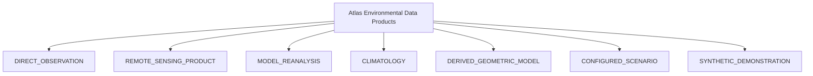

# MarsWalk 2.0 / Project Atlas — Milestone 13L: Environmental Catalog & Provenance Specification

## 1. Executive Summary
The Atlas Environmental Data Catalog (`src/marswalk/core/environmental_data_catalog.py`) establishes a centralized, immutable registry of all remote sensing, in-situ, climatological, and model-derived planetary datasets across the Jezero Crater quadrangle ($18.442^\circ\text{ N}, 77.451^\circ\text{ E}$).

## 2. Rigorous Data Provenance Taxonomy
To uphold NASA Space Apps scientific credibility and prevent synthetic data from masquerading as authentic planetary observations, every registered dataset is assigned an immutable `ProvenanceClass`:

### Provenance Classification Definitions:
1. **`DIRECT_OBSERVATION`**: Authentic physical in-situ sensor telemetry from Mars surface missions (e.g., Mars 2020 Perseverance MEDA atmospheric station, Curiosity REMS). Valid strictly along the rover traverse path.
2. **`REMOTE_SENSING_PRODUCT`**: Validated orbital remote sensing observations (e.g., USGS MRO CTX 20m DTM, HiRISE, CRISM spectral mosaics).
3. **`MODEL_REANALYSIS`**: Global circulation models constrained by multi-year orbital data (e.g., Mars Climate Database v5.3 / v6 GCM).
4. **`CLIMATOLOGY`**: Multi-year seasonal averages indexed by Solar Longitude ($L_s$).
5. **`DERIVED_GEOMETRIC_MODEL`**: Deterministic physical calculations derived directly from authentic DTM surfaces (e.g., Horn 3x3 slope, astronomical solar ephemeris, 3D ray-cast horizon shadows).
6. **`CONFIGURED_SCENARIO`**: Explicitly configured stress-testing scenario fixtures (ENV-A through ENV-E) for mission resilience analysis.
7. **`SYNTHETIC_DEMONSTRATION`**: Educational demonstration waveforms without empirical backing.

## 3. Registered Core Products

| Product ID | Name | Parameter | Provenance | Source / DOI | SHA-256 Digest |
|---|---|---|---|---|---|
| `USGS_CTX_DTM_JEZERO_20M` | USGS MRO CTX Jezero Crater DTM (20m) | Surface Elevation ($m$) | `REMOTE_SENSING_PRODUCT` | USGS Astrogeology / DOI: 10.5066/P906QQT8 | `875e7e80c170b84e4b2a3dd650b12abbee289e6d3fae5664e4d3cb93e9a1f5b3` |
| `USGS_CTX_DERIVED_SLOPE_20M` | Derived Local Slope & Decameter Roughness | Slope Angle ($^\circ$) | `DERIVED_GEOMETRIC_MODEL` | Project Atlas Core / DOI: 10.5066/P906QQT8 | `875e7e80c170b84e4b2a3dd650b12abbee289e6d3fae5664e4d3cb93e9a1f5b3` |
| `NASA_M2020_MEDA_JEZERO_HISTORICAL` | Mars 2020 Perseverance MEDA Station | Microclimate ($T, P, \tau, \mathbf{u}$) | `DIRECT_OBSERVATION` | NASA JPL / CAB-CSIC PDS4 Atmospheres | Validated PDS4 Archive |
| `MCD_V5_3_JEZERO_CLIMATOLOGY` | Mars Climate Database v5.3 GCM | Air/Surface Temp ($K$) | `MODEL_REANALYSIS` | LMD / CNRS / ESA GCM Reanalysis | Mars Years 24-35 Synthesis |
| `ATLAS_SOLAR_GEOMETRY_RAYCAST_V1` | 3D Celestial Solar Ephemeris & Raycast | Direct Flux & Shadows | `DERIVED_GEOMETRIC_MODEL` | Project Atlas Solar Engine | Deterministic IAU 2000 Ephemeris |
| `ATLAS_ENV_SCENARIOS_V1` | Atlas Calibrated Stress Scenarios (ENV-A..E) | Multi-Factor Stress | `CONFIGURED_SCENARIO` | Project Atlas Operations Assurance | Calibrated Deterministic Fixtures |

## 4. Scientific Truth & Non-Probabilistic Disclosures
- All product records carry mandatory `scientific_disclaimer` strings.
- Under no circumstances is a modeled or simulated environmental state presented as a certified astronaut safety guarantee.
