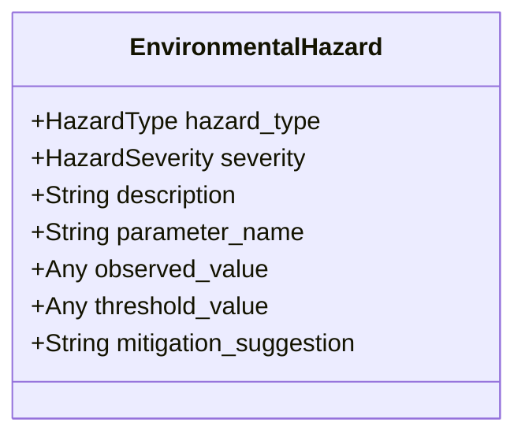

# MarsWalk 2.0 / Project Atlas — Milestone 13L: Environmental Hazard Rule Catalog

## 1. Overview
The Environmental Hazard Engine (`src/marswalk/core/environmental_hazard_model.py`) evaluates formal operational rules across physical environmental variables to determine whether rover traverses, mast pointing, and science observations are permissible.

## 2. Hazard Taxonomy & Severity Levels
Hazards are classified into three operational tiers:
1. **`CRITICAL`**: Prohibits activity execution. Potential payload destruction, thermal shock, or guaranteed science failure (e.g. optical imaging at night).
2. **`WARNING`**: Permits activity with substantial operational risk or science degradation (>30% quality penalty).
3. **`ADVISORY`**: Informational notice regarding suboptimal environmental conditions.

## 3. Formalized Rule Catalog

| Hazard Code | Severity | Trigger Condition | Affected Subsystems | Automated Mitigation Advice |
|---|---|---|---|---|
| `ILLUMINATION_UNAVAILABLE` | `CRITICAL` | $\alpha_{\odot} \le 0.0^\circ$ (Nighttime) during optical observation | `MASTCAM_Z`, `SUPERCAM` | Reschedule observation to diurnal daylight hours (10:00–16:00 LTST) |
| `TERRAIN_SHADOW_OBSTRUCTION` | `WARNING` | Solar ray occluded by crater rim or delta scarp ($c(t) \le 0$) | Optical Payloads, Solar Arrays | Shift observation window until solar azimuth/elevation bypasses terrain obstacle |
| `THERMAL_ENVELOPE_EXCEEDED` | `CRITICAL` | $T_{\text{air}} < T_{\min}$ or $T_{\text{air}} > T_{\max}$ | All Science Instruments | Engage survival pre-heaters or defer observation to warmer midday sol hours |
| `DUST_OPACITY_HIGH` | `CRITICAL` / `WARNING` | $\tau > \tau_{\max}$ for instrument | `SUPERCAM` ($\tau > 1.5$), `MASTCAM_Z` ($\tau > 1.8$) | Substitute with ground-penetrating radar (`RIMFAX`) or wait for dust storm subsidence |
| `HIGH_WIND_GUST` | `WARNING` | Wind gust $\ge 22.0\text{ m/s}$ | Robotic Arm, Mast Head, HGA | Stow robotic arm and mast head until convective afternoon gusts subside |
| `MISSING_ENVIRONMENTAL_DATA` | `WARNING` | Query falls in uncalibrated or NoData pixel | All Systems | Rely on conservative regional climatological fallback models |

## 4. Holistic Environmental Scoring
Overall operational feasibility is scored between $0.0$ (completely infeasible) and $1.0$ (ideal conditions):
$$\text{Score} = \max\left(0.0, 1.0 - \sum w_i \cdot \text{severity}_i\right)$$
An operation is permissible if and only if zero `CRITICAL` hazards are active.
