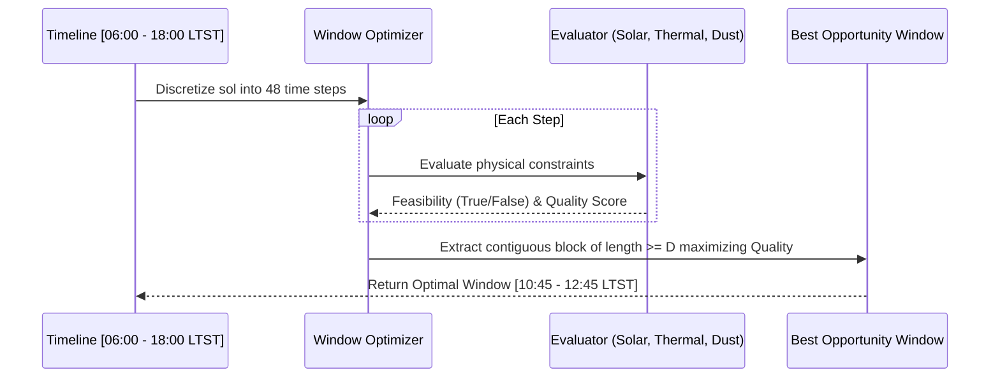

# MarsWalk 2.0 / Project Atlas — Milestone 13L: Environmental Mission Windows Optimizer

## 1. Overview
The Environmental Mission Windows Optimizer (`src/marswalk/core/environmental_mission_window.py`) solves the temporal constraint satisfaction problem of scheduling science observations and rover activities when illumination, thermal envelopes, atmospheric opacity, and wind limits are concurrently satisfied.

## 2. Temporal Optimization Formulation
For a science target at DTM coordinates $(r, c, z)$ requiring duration $D$ hours on sol $S$:
1. **Diurnal Time Discretization:** The operational day $[06:00, 18:00\text{ LTST}]$ is sampled in 15-minute ($\Delta t = 0.25\text{ h}$) increments.
2. **State Evaluation:** At each time step $t_k$:
   - Celestial position $(\alpha_{\odot}, \phi_{\odot})$ and direct flux $I_{\text{direct}}$.
   - Terrain horizon ray cast shadow obstruction $c(t_k)$.
   - Ambient air temperature $T_{\text{air}}(t_k)$ and instrument envelope headroom.
   - Atmospheric dust opacity $\tau(t_k)$ and optical contrast degradation.
   - Wind speed and peak gust $u_{\text{gust}}(t_k)$.
   - Operational feasibility gate: $\operatorname{is\_permissible}(t_k) \in \{0, 1\}$.

## 3. Multi-Variable Quality Scoring ($Q$)
For candidate contiguous window slices satisfying all hard constraints:
$$Q = 0.40 \cdot \left(\frac{\bar{I}_{\text{direct}}}{500.0\text{ W/m}^2}\right) + 0.30 \cdot \bar{S}_{\text{hazard}} + 0.20 \cdot \left(1.0 - \frac{\bar{\tau}}{3.0}\right) + 0.10 \cdot \left(1.0 - \frac{\bar{u}_{\text{gust}}}{25.0\text{ m/s}}\right)$$
The optimizer selects the interval $[\text{start\_ltst}, \text{end\_ltst}]$ that maximizes $Q$.

## 4. Constraint Relaxation & Fallback Handling
If severe scenario constraints (e.g. `ENV_C` or heavy shadowing) prevent finding any completely hazard-free window:
- The optimizer extracts the least-constrained window.
- It returns `is_valid = False` with explicit, human-readable violation reasons (e.g. `"Atmospheric optical depth tau=2.40 exceeds instrument limit (1.5) for SUPERCAM"`).
- Advises the operator on alternative options (e.g., substituting with RIMFAX radar or waiting for dust clearing).
