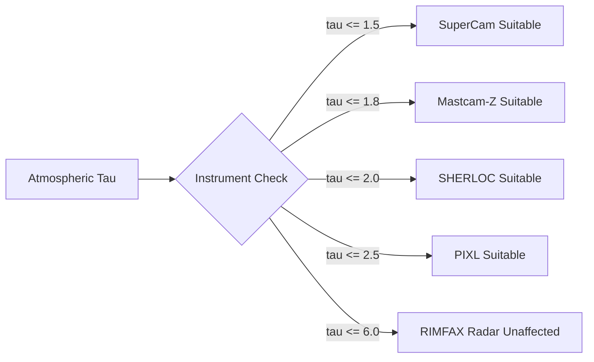

# MarsWalk 2.0 / Project Atlas — Milestone 13L: Mars Dust & Visibility Model

## 1. Overview
The Dust & Atmospheric Visibility Model (`src/marswalk/core/mars_dust_environment.py`) simulates atmospheric column optical depth ($\tau$), optical contrast loss, and payload-specific suitability limits across Jezero Crater.

## 2. Atmospheric Opacity ($\tau$) Classification
Optical depth $\tau$ quantifies total atmospheric column attenuation of direct solar radiation:

| Opacity ($\tau$) | Atmospheric Status | Physical Conditions | Science Impact |
|---|---|---|---|
| $\tau < 0.60$ | `NOMINAL_CLEAR` | Baseline spring/summer Jezero atmosphere | All instruments fully operable; direct sun imaging optimal |
| $0.60 \le \tau < 1.40$ | `MODERATE_HAZE` | Typical seasonal dust haze | 10%–45% contrast degradation; optical targets require longer exposures |
| $1.40 \le \tau < 3.00$ | `DUST_STORM` | Regional dust storm event | Severe optical attenuation (>75%); Mastcam-Z & SuperCam restricted |
| $\tau \ge 3.00$ | `GLOBAL_STORM` | Planet-encircling dust storm (e.g. MY28, MY34) | Direct solar flux near zero; optical science suspended; RIMFAX unaffected |

## 3. Optical Degradation Formulation
Contrast reduction and signal-to-noise ratio degradation are parameterized by an exponential extinction proxy relative to clear-sky baseline $\tau_0 = 0.45$:
$$\text{Degradation (\%)} = \min\left(100.0, \max\left(0.0, \left(1.0 - e^{-1.2(\tau - \tau_0)}\right) \cdot 100.0\right)\right)$$

## 4. Instrument Tolerance Ceilings

- **`SUPERCAM` ($\tau \le 1.5$):** Remote laser-induced breakdown spectroscopy (LIBS) requires clear atmospheric transmission across 2–7m paths.
- **`MASTCAM_Z` ($\tau \le 1.8$):** Stereo parallax and multispectral band ratios lose radiometric accuracy under thick haze.
- **`RIMFAX` ($\tau \le 6.0$):** Ground-penetrating radar pulses at 15–500 MHz penetrate dust particles with near-zero attenuation.
