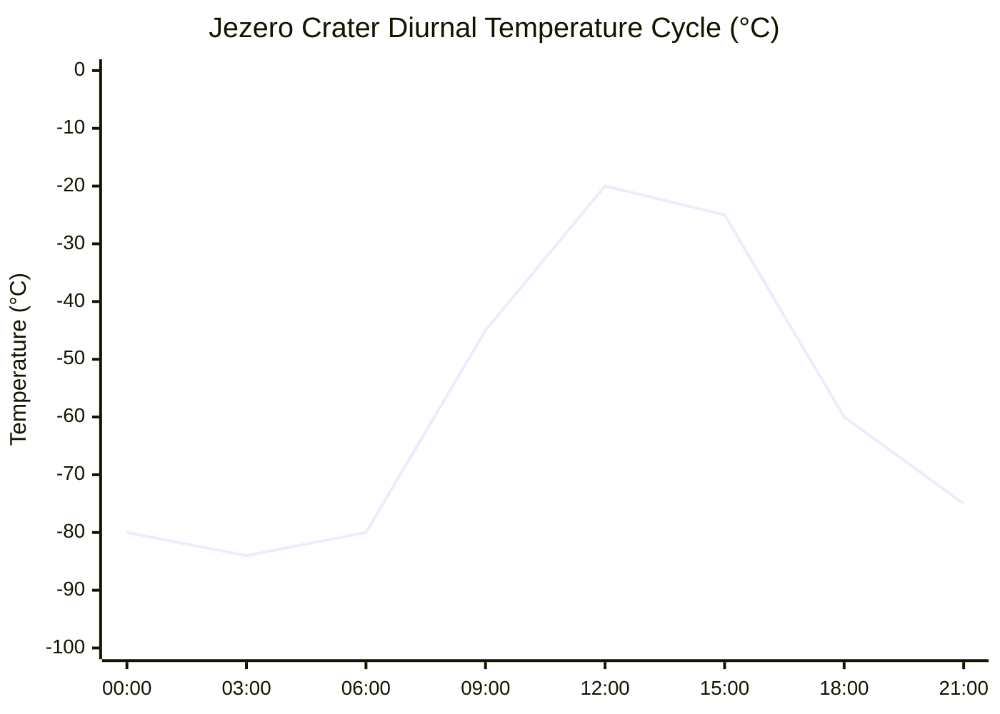

# MarsWalk 2.0 / Project Atlas — Milestone 13L: Mars Thermal Environment Intelligence

## 1. Overview
The Thermal Environment Engine (`src/marswalk/core/mars_thermal_environment.py`) simulates diurnal surface and atmospheric air temperatures across Jezero Crater, calibrated against in-situ records from Mars 2020 Perseverance MEDA and Mars Climate Database (MCD) profiles.

## 2. Diurnal Temperature Spline
In-situ data from Perseverance MEDA shows strong thermal asymmetry between rapid solar daytime heating and prolonged nocturnal radiative cooling into the thin Martian carbon dioxide atmosphere:

### Mathematical Model:
- **Ground Temperature:**
  - Daytime heating phase ($05:30 \le LTST \le 13:00$, duration 7.5h):
    $$\text{phase} = \pi \left(1.0 - \frac{LTST - 5.5}{7.5}\right), \quad g(t) = \cos(\text{phase})$$
  - Nocturnal radiative cooling phase ($13:00 \le LTST \le 05:30$, duration 16.5h):
    $$\text{phase} = \pi \left(\frac{\Delta t_{\text{cooling}}}{16.5}\right), \quad g(t) = \cos(\text{phase})$$
  - Extrema: Minimum $-85.0^\circ\text{C}$ at dawn (05:30 LTST), Maximum $-15.0^\circ\text{C}$ at early afternoon (13:00 LTST).

- **Air Temperature (at 1.5m Mast Height):**
  - Atmospheric thermal inertia introduces a ~1 hour lag behind ground surface temperature.
  - Heating phase ($06:00 \le LTST \le 14:00$, duration 8.0h).
  - Cooling phase ($14:00 \le LTST \le 06:00$, duration 16.0h).
  - Extrema: Minimum $-80.0^\circ\text{C}$ at dawn (06:00 LTST), Maximum $-22.0^\circ\text{C}$ at afternoon (14:00 LTST).

- **Elevation Lapse Rate:**
  - Dry adiabatic lapse rate on Mars: $\Gamma = -4.5^\circ\text{C/km}$.
  - Temperature at elevation $z$:
    $$T(z) = T_{\text{base}} + \left(\frac{z - z_{\text{base}}}{1000.0}\right) \cdot \Gamma$$

## 3. Instrument Operating Envelopes

| Instrument | Payload Type | Min Operational Temp ($^\circ\text{C}$) | Max Operational Temp ($^\circ\text{C}$) | Operational Constraints |
|---|---|---|---|---|
| `MASTCAM_Z` | Multispectral Mast Stereo Camera | $-55.0^\circ\text{C}$ | $+40.0^\circ\text{C}$ | Heaters required before 08:30 LTST |
| `SUPERCAM` | Remote LIBS / Raman Spectrometer | $-50.0^\circ\text{C}$ | $+30.0^\circ\text{C}$ | Laser head thermal stabilization window |
| `PIXL` | Micro-XRF Arm Contact Sensor | $-40.0^\circ\text{C}$ | $+35.0^\circ\text{C}$ | Robotic arm deployment restricted in dawn freeze |
| `SHERLOC` | Deep UV Raman & Fluorescence | $-35.0^\circ\text{C}$ | $+30.0^\circ\text{C}$ | Tightest thermal envelope; midday preference |
| `RIMFAX` | Ground-Penetrating Radar | $-60.0^\circ\text{C}$ | $+50.0^\circ\text{C}$ | Wide operating range; operable day and night |
| `MEDA` | Meteorological Station | $-90.0^\circ\text{C}$ | $+60.0^\circ\text{C}$ | Continuous 24-sol baseline station |
