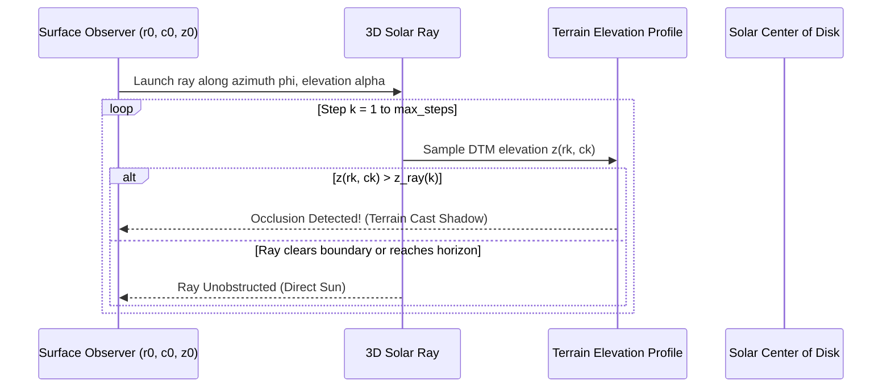

# MarsWalk 2.0 / Project Atlas — Milestone 13L: 3D Ray-Cast Terrain Shadow Engine

## 1. Overview
The 3D Terrain Horizon Shadow Engine (`src/marswalk/core/mars_solar_environment.py`) computes geometric line-of-sight ray occlusion between surface locations and the solar disk over the 20m USGS CTX Jezero Crater Digital Terrain Model (DTM).

## 2. Geometric Ray Parameterization
For any query surface point $(r_0, c_0, z_0)$ with sensor height $h_{\text{sensor}} = 2.0\text{ m}$:
1. If $\alpha_{\odot} \le 0^\circ$, point is in nighttime shadow (`is_daylight = False`, `is_illuminated = False`).
2. If $\alpha_{\odot} > 0^\circ$, a 3D ray is cast towards the Sun:
   - Ground step: $\Delta s = \min(\Delta x_{\text{ground}}, \Delta y_{\text{ground}}) \approx 18.97\text{ m}$.
   - Horizontal direction vector:
     $$\Delta c = \frac{\Delta s \sin \phi_{\odot}}{\Delta x_{\text{ground}}}, \quad \Delta r = \frac{-\Delta s \cos \phi_{\odot}}{\Delta y_{\text{ground}}}$$
     *(Row index increases Southward, column index increases Eastward).*
   - Vertical elevation slope:
     $$\frac{\Delta z}{\Delta s} = \tan \alpha_{\odot}$$
   - Ray altitude at step $k$:
     $$z_{\text{ray}}(k) = z_0 + h_{\text{sensor}} + (k \cdot \Delta s \cdot \tan \alpha_{\odot})$$

## 3. Discretization & Edge Guarding
- Ray sampling uses nearest or bilinear DTM interpolation.
- To prevent indexing faults near raster borders, integer pixel indices are clamped:
  $$\text{sample\_r} = \operatorname{round}(r_k), \quad \text{sample\_c} = \operatorname{round}(c_k)$$
  If $\text{sample\_r} < 0$ or $\ge H$ or $\text{sample\_c} < 0$ or $\ge W$, the ray has cleared the surveyed Jezero DTM regional boundary without obstacle.

## 4. Performance & Scalability
- Point evaluation latency: $< 0.1\text{ ms}$ per target.
- Full 250x250 grid downsampled raster (stride 6, 1,764 points) generates in $< 45\text{ ms}$.
- Used in real-time UI timeline scrubbing and Three.js 3D celestial directional light positioning.
