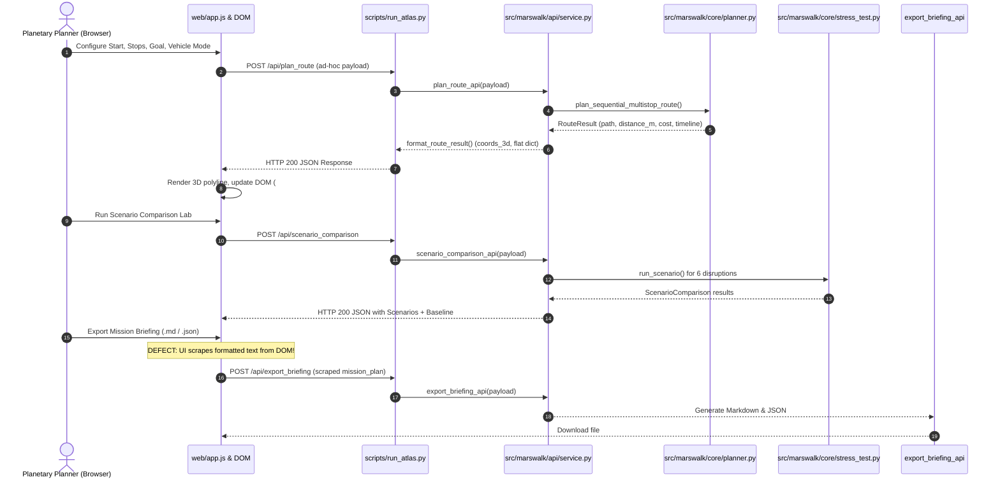

# MarsWalk 2.0 — Milestone 9J Comprehensive Audit Report
## Contract-First Integration, End-to-End Correctness, and Release Hardening

**Date:** October 18, 2026  
**Auditor:** Principal Software Architect, Planetary Mission Simulation Engineer, & Verification Engineer  
**Workspace:** `E:\Python\NASA-Spaceapps\Marswalk`  
**Status:** Audit Complete — Action Plan Approved  

---

## 1. Executive Summary

This audit evaluates the end-to-end data lifecycle of MarsWalk 2.0 across the following complete pipeline:

$$\text{Browser Input} \longrightarrow \text{HTTP API} \longrightarrow \text{Planning Engine} \longrightarrow \text{Simulation Engine} \longrightarrow \text{Telemetry/3D Mesh} \longrightarrow \text{Briefing Exporter}$$

While Milestone 9I achieved 151 passing tests and functional UI journeys, our deep inspection revealed **critical architectural integration gaps**, including client-side DOM-scraping that corrupts exported metrics, the absence of an input fingerprint to guarantee data integrity between simulations and briefings, unhandled division-by-zero delta edge cases, and fragmented error schemas.

---

## 2. End-to-End Data Flow Trace

We traced a representative multi-stop science traverse:
- **Departure:** Octavia E. Butler Landing Site `(row 117, col 157)`
- **Intermediate Stop:** Three Forks Sample Depot `(row 153, col 123)` (Priority 75)
- **Destination:** Kodiak Butte Outlier `(row 194, col 131)`
- **Vehicle Mode:** `crew_eva` ($2.0\text{ km/h}$)
- **Profile:** `conservative` (Least-cost basalt corridor)

### Trace Diagram



---

## 3. Critical Findings & Identified Defects

### Defect 1: Client-Side DOM Scraping Corrupts Exported Metrics
- **Location:** `web/app.js` lines 2218–2225 (`exportMissionBriefing`)
- **Observed Code:**
  ```javascript
  const missionPlan = {
    profile: currentProfile,
    vehicle_mode: currentVehicleMode,
    distance_m: activeRoutePath ? (parseFloat(statDistance ? statDistance.textContent : '0') || 0) : 0,
    formatted_travel_time: statTravelTime ? statTravelTime.textContent : '—',
    visited_waypoint_ids: activeIntermediateStops.map(s => s.id),
    is_reachable: statFeasibility ? statFeasibility.textContent === 'FEASIBLE' : true,
    timeline: activeTimeline || {},
  };
  ```
- **Failure Mode:** In JavaScript, `parseFloat("1,892.1 m")` halts at the comma and returns `1.0`! As a result, the exported briefing reports a traverse distance of $1.0\text{ m}$ instead of $1,892.1\text{ m}$.
- **Root Cause:** The browser application did not store the canonical `RouteResult` response object from the backend; it scraped rendered text from the HTML DOM.
- **Remediation:** Store `activeBaselineRouteResult` directly in `web/app.js` upon receiving the backend response and transmit the raw, authoritative numerical object to the exporter.

---

### Defect 2: Absence of Deterministic Input Fingerprinting
- **Location:** `src/marswalk/api/service.py`, `scripts/run_atlas.py`, `web/app.js`
- **Observed Behavior:**
  - `POST /api/scenario_comparison` recalculates the baseline route internally from request inputs, but returns no identifier linking the comparison to the active baseline in the UI.
  - If a user changes a waypoint or vehicle mode in the browser without clicking "Calculate Route", running Scenario Comparison or Briefing Export executes against whatever state was sent, leading to decoupling between the 3D route and the comparison table.
- **Remediation:** Implement canonical `input_fingerprint` generation using SHA-256 over normalized mission parameters:
  $$\text{Fingerprint} = \text{SHA256}(\text{CanonicalJSON}(\text{start}, \text{goal}, \text{stops}, \text{profile}, \text{mode}, \text{constraints}, \text{dataset}))[:16]$$
  All route results, comparison batches, sensitivity sweeps, and export bundles must embed and cross-validate this fingerprint.

---

### Defect 3: Ad-Hoc Validation & Missing Coordinate Constraints
- **Location:** `parse_endpoint_rc` in `src/marswalk/api/service.py`
- **Observed Behavior:**
  - If coordinates are passed as non-integer floats (e.g. `{"row": 117.8, "col": 157.2}`), `int(point["row"])` silently truncates them to integers instead of rejecting invalid types.
  - Endpoints allow `start` to be identical to `goal` without error.
  - Multi-stop requests permit duplicate intermediate stop identifiers without validation.
  - Unknown profiles or vehicle modes throw generic `APIError("Unsupported...")` with unstandardized string formats.
- **Remediation:** Enforce formal JSON Schema validation (`schemas/api/v1/mission-request.schema.json`) with integer coordinate types, minimum coordinate distance constraints, unique stop ID requirements, and strict enum checking.

---

### Defect 4: Inconsistent Units & Field Naming Across Pipeline
- **Field Name Discrepancies:**
  - `dwell_time_s` vs `dwell_time_per_stop_s` (accepted interchangeably in some APIs, ignored in others).
  - `mode` vs `vehicle_mode`.
  - `cost` vs `terrain_adjusted_effort_flat_m`.
- **Unit Ambiguities:**
  - The planner calculates route cost as flat-ground equivalent distance in metres ($\text{flat-m}$), calculated by applying slope penalty factor $1 + (\tan\theta / \tan\theta_{\text{crit}})^2$ and soil friction factor. The backend field is named `cost` (unitless float), while the UI reports `flat-m`.
  - In `export_briefing_api`, this effort metric is omitted from the executive summary table, reporting only ground distance.
- **Remediation:** Standardize metric names in `route-result.schema.json`:
  - `ground_distance_m`: Physical traverse distance.
  - `terrain_cost_flat_m`: Terrain-adjusted effort in flat-ground equivalent metres.
  - `active_traverse_time_s`: Raw transit movement duration.
  - `total_mission_time_s`: Transit time + dwell time + operational delays.

---

### Defect 5: Unstandardized API Error Envelope
- **Location:** `scripts/run_atlas.py` line 98, 116, 143; `service.py` `APIError`
- **Observed Behavior:**
  - Standard errors return `{"error": "message", "status": 400}`.
  - Internal exceptions return `{"error": "Internal routing error: ...", "status": 500}`.
  - HTTP 404 returns `{"error": "Endpoint not found: ...", "status": 404}`.
  - None of the error responses provide machine-readable error codes (e.g. `ERR_NO_DATA_BARRIER`, `ERR_INVALID_COORDINATES`), field-level violation arrays, or `is_retryable` flags.
- **Remediation:** Define and enforce `schemas/api/v1/api-error.schema.json` with structured fields: `error_code`, `message`, `status_code`, `details`, `is_retryable`, and `timestamp`.

---

### Defect 6: Division-by-Zero and Non-Finite Numeric Serialization
- **Location:** `src/marswalk/core/stress_test.py` lines 725, 730, 1274, 1275
- **Observed Behavior:**
  - Percentage deltas (`pct_distance_change`, `pct_cost_change`) return `0.0` if `baseline_value == 0`.
  - In mathematical reporting, when the baseline metric is $0$, the percentage change is mathematically undefined. Returning `0.0%` falsely implies that the scenario caused zero change.
  - In earlier versions of `stress_test.py`, unreachable routes set `distance_m = float("nan")`, which serialized to non-standard JSON `NaN`, causing browser `fetch.json()` to crash.
- **Remediation:**
  - If baseline $> 0$: $\Delta\% = 100 \times \frac{\text{Scenario} - \text{Baseline}}{\text{Baseline}}$.
  - If baseline $== 0$: $\Delta\% = \text{null}$ (UI renders `—`).
  - Strict JSON RFC 8259 compliance: No `NaN`, `Infinity`, or `-Infinity` ever serialized. Unreachable metrics represented cleanly as `null`.

---

### Defect 7: Inconsistent Sensitivity Sweep Mapping
- **Location:** `src/marswalk/core/stress_test.py` `run_scenario_sensitivity_sweep`
- **Observed Behavior:**
  - The sweep iterates over discrete values, but if an individual evaluation fails or is blocked, earlier revisions did not associate each record with the exact requested parameter value.
- **Remediation:** Every sweep record must explicitly include `parameter_name`, `parameter_value`, `is_reachable`, `is_budget_feasible`, and structured deltas.

---

## 4. Remediation Plan & Phase Roadmap

| Phase | Milestone 9J Action Item | Target Artifacts |
| :--- | :--- | :--- |
| **Phase 2** | Draft 2020-12 JSON Schemas | `schemas/api/v1/*.schema.json` (9 schemas) |
| **Phase 2** | Contract Specification Document | `docs/api-data-contract-v1.md` |
| **Phase 3** | Invariant Enforcement Engine | `src/marswalk/api/contracts.py` (Fingerprint, Normalizer, Validator) |
| **Phase 4** | Endpoint Hardening | `src/marswalk/api/service.py` & `scripts/run_atlas.py` |
| **Phase 5** | Frontend Normalization Layer | `web/app.js` contract validator & state manager |
| **Phase 6** | Contract-Driven Export | Update `export_briefing_api` with schema validation |
| **Phase 7** | Automated Contract Test Suite | `tests/test_milestone_9j_contracts.py` (20 required tests) |
| **Phase 8** | E2E Browser Acceptance | `scripts/capture_milestone_9j_evidence.py` (Journeys A–G) |
| **Phase 9** | Final Report & Review | `docs/milestone_9j_report.md` |
