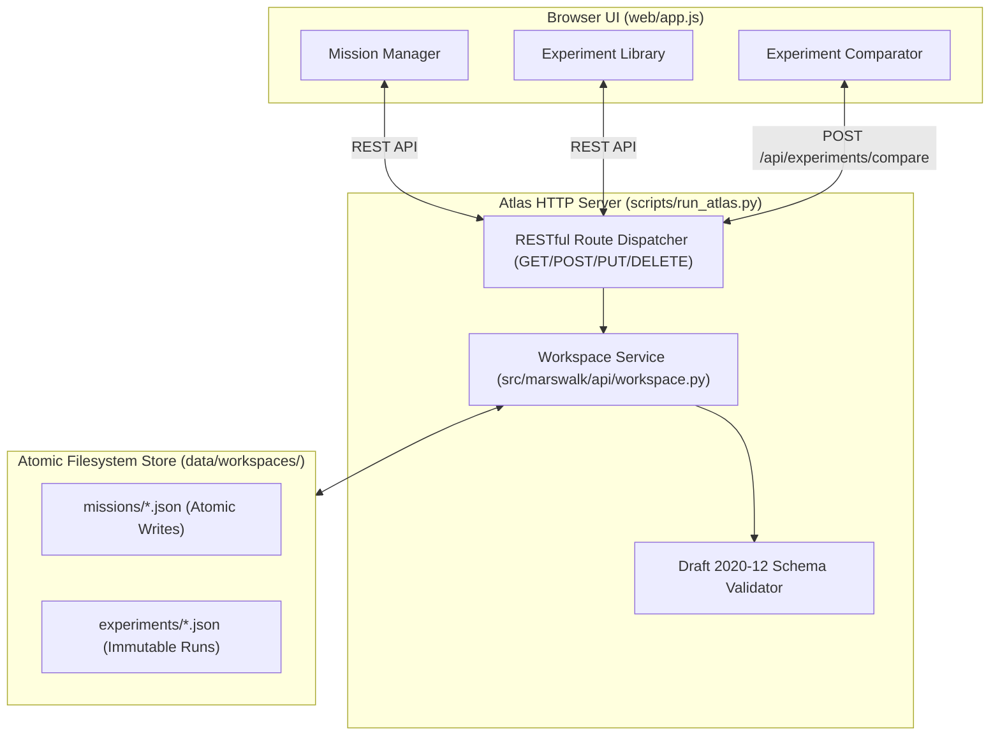

# MarsWalk 2.0 — Milestone 9K Workspace Architecture & Design
## Persistent Mission Workspace, Experiment Library, and Reproducible Analysis

**Date:** October 18, 2026  
**Author:** Principal Software Architect, Planetary Mission Planning Engineer, & Simulation Engineer  
**Workspace:** `E:\Python\NASA-Spaceapps\Marswalk`  
**Specification Version:** 1.0.0  
**JSON Schema Standard:** Draft 2020-12  

---

## 1. System Overview

Milestone 9K introduces a dual-library persistence engine for MarsWalk 2.0:
1. **Mission Library (`data/workspaces/missions/`):** Stores reusable, named mission definitions (departure, destination, intermediate science targets, visitation order, planning profiles, and constraints).
2. **Experiment Library (`data/workspaces/experiments/`):** Stores immutable scientific simulation runs (baseline traverses, disruption scenarios, parameter sensitivity sweeps, and recovery calculations).



---

## 2. Storage Directory Structure & Security Rules

All persistent records are stored locally in standard JSON files. No external databases or background database processes are introduced.

```text
E:\Python\NASA-Spaceapps\Marswalk\
└── data\
    └── workspaces\
        ├── missions\
        │   ├── mission_jezero_delta_recon_v1.json
        │   └── mission_crater_floor_survey.json
        └── experiments\
            ├── exp_rockfall_sweep_three_forks_20261018.json
            └── exp_compound_mobility_degrade_001.json
```

### Security & Integrity Rules:
1. **ID Sanitization & Directory Traversal Protection:**
   Record identifiers must match the strict regular expression:
   $$\text{pattern} = \texttt{\textasciicircum[a-zA-Z0-9\_-]{3,64}\$}$$
   Any identifier containing path separators (`/`, `\`), relative navigators (`..`), or special characters is rejected immediately with `ERR_INVALID_RECORD_ID` (400).
2. **Atomic Writes:**
   Files are written to a temporary sibling file (`<target_path>.tmp_<uuid>`) and committed using `os.replace`. If an error occurs during serialization or writing, the temporary file is deleted and the existing file remains untouched.
3. **Payload Size Guard:**
   Request payloads are limited to $5\text{ MB}$ to prevent denial-of-service memory exhaustion.
4. **No Overwrites by Name:**
   Missions and experiments are indexed by immutable IDs. Two missions may share the same human-readable display name without collision or silent overwriting.

---

## 3. Data Models and Schemas

### 3.1 Saved Mission Record (`saved-mission.schema.json`)
```json
{
  "$schema": "https://json-schema.org/draft/2020-12/schema",
  "title": "MarsWalk Saved Mission Record",
  "type": "object",
  "required": [
    "schema_version",
    "mission_id",
    "name",
    "created_at",
    "updated_at",
    "input_fingerprint",
    "canonical_mission",
    "terrain_dataset_id",
    "model_version"
  ],
  "properties": {
    "schema_version": { "type": "string", "const": "1.0.0" },
    "mission_id": { "type": "string", "pattern": "^[a-zA-Z0-9_-]{3,64}$" },
    "name": { "type": "string", "minLength": 1, "maxLength": 100 },
    "description": { "type": "string", "maxLength": 1000 },
    "created_at": { "type": "string", "format": "date-time" },
    "updated_at": { "type": "string", "format": "date-time" },
    "input_fingerprint": { "type": "string", "pattern": "^[0-9a-f]{16,64}$" },
    "canonical_mission": { "type": "object" },
    "terrain_dataset_id": { "type": "string" },
    "model_version": { "type": "string" },
    "assumptions_version": { "type": "string" },
    "tags": { "type": "array", "items": { "type": "string" } }
  }
}
```

### 3.2 Saved Experiment Record (`saved-experiment.schema.json`)
```json
{
  "$schema": "https://json-schema.org/draft/2020-12/schema",
  "title": "MarsWalk Saved Experiment Record",
  "type": "object",
  "required": [
    "schema_version",
    "experiment_id",
    "name",
    "created_at",
    "status",
    "lifecycle_state",
    "baseline_fingerprint",
    "mission_snapshot",
    "baseline_route",
    "terrain_dataset_id",
    "model_version"
  ],
  "properties": {
    "schema_version": { "type": "string", "const": "1.0.0" },
    "experiment_id": { "type": "string", "pattern": "^[a-zA-Z0-9_-]{3,64}$" },
    "name": { "type": "string", "minLength": 1, "maxLength": 100 },
    "description": { "type": "string", "maxLength": 1000 },
    "created_at": { "type": "string", "format": "date-time" },
    "mission_id": { "type": ["string", "null"] },
    "status": { "type": "string", "enum": ["success", "infeasible", "failed"] },
    "lifecycle_state": {
      "type": "string",
      "enum": ["historical_result", "reproducible", "recalculation_required", "stale_incompatible", "failed"]
    },
    "baseline_fingerprint": { "type": "string", "pattern": "^[0-9a-f]{16,64}$" },
    "mission_snapshot": { "type": "object" },
    "baseline_route": { "type": "object" },
    "scenarios_evaluated": { "type": "array", "items": { "type": "object" } },
    "sensitivity_sweep": { "type": ["object", "null"] },
    "recovery_plan": { "type": ["object", "null"] },
    "replayed_from_experiment_id": { "type": ["string", "null"] },
    "reproducibility_notes": { "type": "string" },
    "terrain_dataset_id": { "type": "string" },
    "model_version": { "type": "string" },
    "assumptions_version": { "type": "string" }
  }
}
```

---

## 4. Historical vs. Current Separation & Reproducibility States

When an experiment is reopened from the library, it is evaluated against the current planner environment and classified into one of 5 distinct states:

| Lifecycle State | Criteria | Visual Representation | User Guidance |
| :--- | :--- | :---: | :--- |
| **`historical_result`** | Viewing the experiment exactly as calculated and saved in the past. | 🏛️ Grey/Slate Badge | Stored metrics are immutable records of historical study. |
| **`reproducible`** | Current mission configuration, terrain DTM, and planner versions match the stored experiment fingerprint. | 🟢 Green Badge | Experiment can be re-run and is mathematically identical. |
| **`recalculation_required`** | Active mission inputs have changed (modified stops, profiles, or coordinates) while viewing this experiment. | 🟡 Amber Badge | The active mission differs from the experiment baseline. Replay to generate a new run record. |
| **`stale_incompatible`** | DTM dataset version, planner model version, or vehicle assumptions differ between runtime and record. | 🔴 Red Badge | Incompatible model definitions prevent direct scalar comparisons. |
| **`failed`** | The simulation calculation encountered impassable barriers or unhandled failure at save time. | ⚠️ Orange Badge | Negative result preserved for study. |

### Immutability Invariant:
**A saved historical experiment is NEVER mutated when replaying or re-running.**
Replaying an experiment `EXP-001` generates a new distinct experiment record `EXP-001_replay_<timestamp>` with a link `replayed_from_experiment_id: "EXP-001"`. The original record remains unchanged on disk.

---

## 5. Experiment Comparison Engine (`/api/experiments/compare`)

The comparison engine evaluates two saved experiment records ($A$ and $B$) side-by-side:

### Evaluated Dimensions:
1. **Compatibility Gate:** Asserts that both experiments share the same `terrain_dataset_id` and compatible model versions. If incompatible, reports a clear compatibility error rather than computing misleading deltas.
2. **Physical Route Trade-offs:**
   - Ground distance difference ($\Delta \text{distance}$)
   - Active traverse time difference ($\Delta \text{traverse time}$)
   - Total mission time difference ($\Delta \text{mission time}$)
   - Directional terrain effort difference ($\Delta \text{effort}$)
3. **Scientific Yield:**
   - Priority points harvested ($S_A$ vs $S_B$)
   - Targets visited vs bypassed
4. **Applied Scenarios & Parameters:**
   - Identifies which disruptions were applied in $A$ vs $B$
   - Highlights parameter discrepancies (e.g. $40\text{ m}$ vs $80\text{ m}$ rockfall radius)
5. **No Blind "Winner" Claims:**
   - The comparison explicitly avoids declaring one experiment "superior" simply because its route is shorter. A shorter route that skips key science targets or incurs excessive slope risk is presented with all trade-offs transparently visible.

---

## 6. RESTful Workspace API Endpoints

| Method | Endpoint | Description |
| :--- | :--- | :--- |
| `GET` | `/api/missions` | List all saved missions with summary metadata. |
| `POST` | `/api/missions` | Create a new saved mission record. |
| `GET` | `/api/missions/{mission_id}` | Retrieve full mission definition by ID. |
| `PUT` | `/api/missions/{mission_id}` | Update an existing mission definition by ID. |
| `DELETE` | `/api/missions/{mission_id}` | Delete a mission record by ID. |
| `GET` | `/api/experiments` | List all saved experiments with summary metadata. |
| `POST` | `/api/experiments` | Save a completed simulation as an experiment record. |
| `GET` | `/api/experiments/{experiment_id}` | Retrieve full experiment record by ID. |
| `DELETE` | `/api/experiments/{experiment_id}` | Delete an experiment record by ID. |
| `POST` | `/api/experiments/{experiment_id}/replay` | Re-run a saved experiment under current planner and save as new run. |
| `POST` | `/api/experiments/compare` | Compare two saved experiment records. |

All endpoints validate payloads against Draft 2020-12 schemas, return standardized error envelopes on failure, and operate within the local filesystem.
