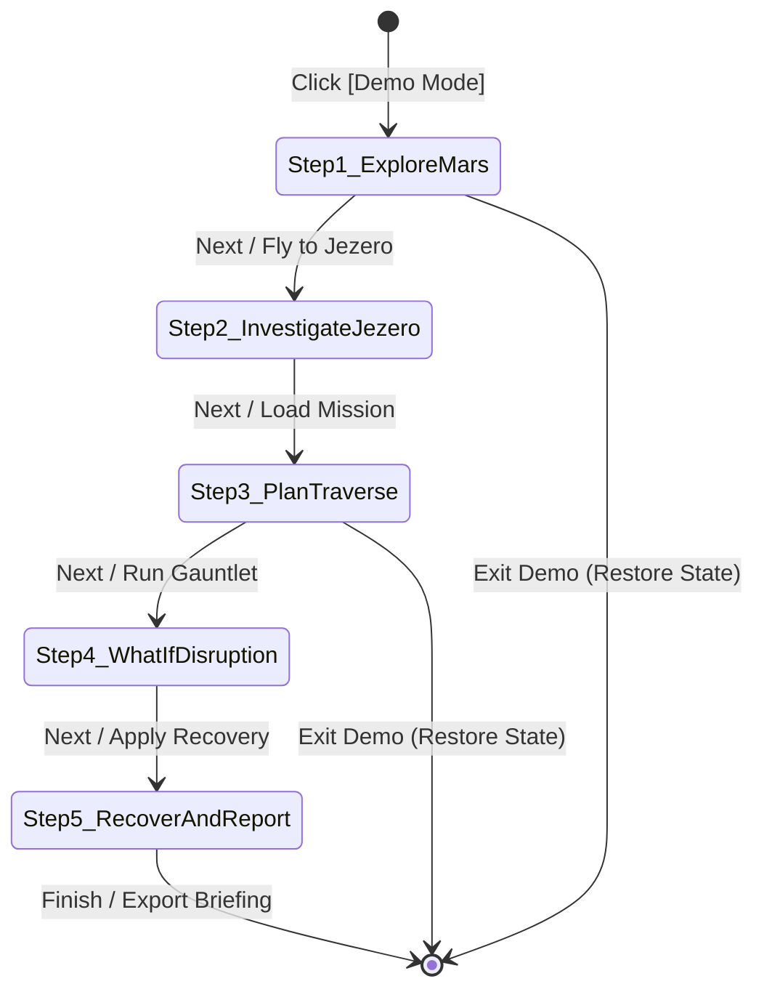

# MARSWALK 2.0 — MILESTONE 9Q DEMO DESIGN SPECIFICATION

**Project:** MarsWalk 2.0 (Project Atlas)  
**Milestone:** 9Q — Competition Demo Mode, Guided Mission Showcase, Preflight Diagnostics, and Release Readiness  
**Date:** October 18, 2026  
**Author:** Principal Product Engineer, Planetary Mission Systems Engineer, and NASA Space Apps Competition Demo Lead  

---

## 1. Objectives & Principles

During high-stakes competition presentations (e.g., NASA Space Apps Challenge judging), presenters face strict time limits (3–5 minutes), intense Q&A, and technical scrutiny from aerospace and software judges. MarsWalk 2.0 must deliver a seamless, reproducible demonstration that showcases genuine planetary GIS and deterministic route planning without risk of session corruption or awkward pauses.

### Core Architectural Principles
1. **No Synthetic or Hardcoded Results:** Every metric, coordinate, distance, and duration displayed during Demo Mode is computed in real time by the authoritative Python A\* and Gauntlet engines.
2. **Strict Session Isolation:** Entering Demo Mode takes an in-memory snapshot of the user's active mission (`demoSessionBackup`). Leaving Demo Mode cleanly restores the user's previous workspace without data loss.
3. **Immutability of Persistent Workspaces:** Demo calculations generate transient results. Stored missions (`data/workspaces/missions/`) and historical experiments (`data/workspaces/experiments/`) are never overwritten, renamed, or deleted.
4. **Non-Blocking Guided Walkthrough:** The guided showcase floats as an explanation overlay above the live application, highlighting real controls rather than trapping the presenter in a modal sequence.
5. **Preflight Readiness Verification:** A 12-point diagnostic check allows presenters to verify all local and remote systems before presenting.

---

## 2. Demonstration Mission Configuration

The demo mission is constructed strictly from verified landmarks in the USGS Jezero 20 m/pixel terrain grid (`data/processed/jezero_ready_20m.tif`):

```json
{
  "mission_id": "demo_jezero_delta_reconnaissance",
  "name": "Jezero Delta Front Science Reconnaissance",
  "description": "Authentic demonstration sortie surveying the Jezero crater floor, delta scarp foot, and crater rim overlook.",
  "canonical_mission": {
    "start": { "row": 117, "col": 157, "name": "Octavia E. Butler Landing", "id": "octavia_landing" },
    "stops": [
      { "row": 104, "col": 147, "id": "hawksbill_gap", "name": "Hawksbill Gap", "priority_score": 95.0 },
      { "row": 95, "col": 139, "id": "skinner_ridge", "name": "Skinner Ridge", "priority_score": 88.0 },
      { "row": 107, "col": 136, "id": "enchanted_lake", "name": "Enchanted Lake", "priority_score": 80.0 }
    ],
    "goal": { "row": 66, "col": 128, "name": "Delta Rim Overlook", "id": "delta_rim" },
    "profile": "balanced",
    "vehicle_mode": "crew_eva",
    "speed_multiplier": 1.0,
    "optimize_stops": false,
    "mission_constraints": {
      "max_duration_s": 28800.0,
      "dwell_time_per_stop_s": 900.0,
      "operational_delay_s": 0.0,
      "max_distance_m": 8000.0
    }
  }
}
```

### Verified Scientific Characteristics
- **Departure:** Perseverance touchdown point on Máaz floor basalt.
- **Stop 1 (Hawksbill Gap):** Basal delta scarp mudstone contacts; primary astrobiology sample target.
- **Stop 2 (Skinner Ridge):** Layered sandstones exhibiting cross-bedding fluvial deposition.
- **Stop 3 (Enchanted Lake):** Fine-grained sedimentary outcrop with high biosignature preservation potential.
- **Destination:** Elevated overlook surveying Neretva Vallis breach and western crater rim.
- **Trajectory Geometry:** 4 sequential legs, ~2.5–3.2 km ground distance, ~1h 15m–1h 45m walking time, 45 min total science dwell, comfortably within the 8.0-hour EVA ceiling.

---

## 3. Demonstration Scenarios (Three Verified Cases)

The showcase features three complementary scenarios that demonstrate the diverse mathematical capabilities of the engine:

1. **Scenario A — Physical Corridor Closure (Rockfall):**
   - **ID:** `scen_corridor_rockfall` (or `scen_hawksbill_rockfall`)
   - **Disruption:** A 200 m radius rockfall blocks the primary traversable pass.
   - **Impact:** Physical detour forced. Path geometry alters; ground distance increases; travel duration increases; 3D red hazard cylinder rendered.
2. **Scenario B — Mobility & Velocity Derating (Drive Derating):**
   - **ID:** `scen_mobility_degradation`
   - **Disruption:** Drive actuator derating reduces nominal traverse velocity by 50% ($0.5\times$ multiplier).
   - **Impact:** **No geometric detour** (terrain coordinates remain identical), but travel duration strictly doubles, demonstrating scientific honesty by not inventing unnecessary detours.
3. **Scenario C — Contingency Recovery & Safe Corridor:**
   - **Action:** Engine computes an automated recovery plan (stop pruning or direct safe corridor).
   - **Impact:** Operational margin recovered ($+15$ to $+35$ min); 3-way recovery table displayed (*Baseline vs Disrupted vs Recovered*); presenter can click *Apply Recovery Route* to update the active baseline.

---

## 4. Guided 5-Minute Showcase UX Architecture

The showcase is implemented as an interactive, non-blocking floating card (`#demoShowcaseHUD`) positioned in the upper portion of the viewport, with forward, back, skip, and exit controls.



### Step Definitions

| Step | Title & Subtitle | Key Action & Explanatory Text | Target Control Highlight |
| :--- | :--- | :--- | :--- |
| **01** | **Global Planetary Cartography**<br>IAU 2000 Sphere & 4 Regions | Demonstrates global orbit, 2,000+ landmark gazetteer, and regional subquads (Olympus Mons, Valles Marineris, Gale Crater, Jezero Crater). Explains that elevation planning requires verified DTM coverage. | Featured destination cards & Search bar |
| **02** | **Jezero Surface Topography**<br>USGS 20m DTM & 6m CTX Ortho | Flies camera into Jezero Crater. Explains the difference between optical imagery and physical elevation models. Highlights slope hazards (>15° ceiling) and 12 candidate waypoints. | Jezero Workstation & Texture pills |
| **03** | **Multi-Stop Mission Planning**<br>Start + 3 Science Stops + Goal | Loads transient demo sortie and computes live A\* path. Explains leg-by-leg timeline breakdown, Apollo walk model (2.0 km/h), dwell time (15 min/stop), and life-support margin. | Calculate Traverse button & Timeline card |
| **04** | **Hypothetical Disruption Rehearsal**<br>"What If?" Gauntlet Stress Test | Simulates a 200m corridor rockfall. Renders 3D red hazard cylinder on terrain and amber detour polyline. Explains metric deltas without pre-baked numbers. | Gauntlet Select & Simulate button |
| **05** | **Contingency Recovery & Briefing**<br>3-Way Trade-Offs & Auditable Dossier | Inspects recommended recovery plan. Applies recovered route to active baseline. Triggers technical mission briefing export (Markdown & Draft 2020-12 JSON). | Recovery Card & Export Briefing button |

---

## 5. Data Protection Architecture

```
User Session Active: { customStart, customGoal, activeStops, currentProfile, currentVehicleMode }
                            │
              User clicks [DEMO MODE]
                            │
                            ▼
              ┌───────────────────────────┐
              │ Cache in demoSessionBackup│
              └─────────────┬─────────────┘
                            │
                            ▼
              ┌───────────────────────────┐
              │ Load Transient Demo State │
              │ Display [DEMO MODE ACTIVE]│
              └─────────────┬─────────────┘
                            │
              User clicks [EXIT DEMO MODE]
                            │
                            ▼
              ┌───────────────────────────┐
              │ Restore demoSessionBackup │
              │ Redraw User's Route & HUD │
              └───────────────────────────┘
```

1. **State Snapshotting:** On entering Demo Mode, the client saves:
   - `customStart`, `customGoal`
   - `activeIntermediateStops`
   - `currentProfile`, `currentVehicleMode`
   - `inputExpeditionHours`, `inputDwellMins`, `inputDelayMins`, `inputMaxDistanceM`
   - `activeRoutePath`, `activeBaselineRouteResult`
2. **Visual Affordance:** A distinct orange pill (`DEMO MODE ACTIVE • TRANSIENT SESSION`) is displayed on the HUD telemetry bar.
3. **Clean Restoration:** Exiting Demo Mode restores the backup, redraws the user's route, rebuilds markers, and updates all telemetry.

---

## 6. Preflight Diagnostic Suite (12 Checkpoints)

The preflight diagnostic tool inspects 12 core systems:

1. **Atlas Server Health:** `GET /api/health` returns `status == "online"`.
2. **Frontend Assets:** `index.html`, `app.js`, `styles.css` exist and are accessible.
3. **Places Gazetteer:** `mars_places.json` contains ≥2,000 valid IAU features.
4. **Imagery Registry:** `mars_imagery_registry.json` contains valid product metadata for all 4 regions.
5. **Global Basemap:** Viking MDIM 2.1 global texture or tile server is reachable.
6. **Jezero CTX Imagery:** Local optical orthomosaic tiles / assets exist.
7. **Jezero Elevation Model:** `jezero_ready_20m.tif` is loaded in memory with valid transform.
8. **Python A\* Route Planner:** Evaluates a deterministic smoke-test route in <500 ms.
9. **Gauntlet Stress Engine:** Evaluates a deterministic rockfall scenario cleanly.
10. **Workspace Filesystem:** `data/workspaces/missions/` and `data/workspaces/experiments/` are writable.
11. **Technical Briefing Exporter:** Produces valid JSON conforming to Draft 2020-12 schema.
12. **Streamlit Application:** `src/marswalk/gui/app.py` exists and has valid Python syntax.
