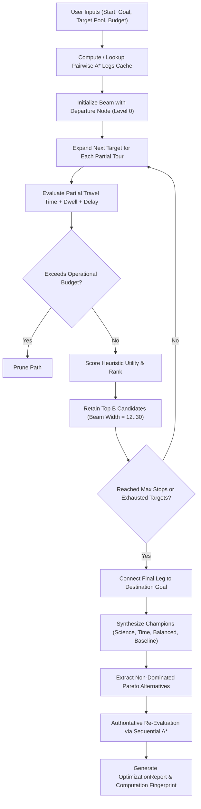

# MarsWalk 2.0 — Milestone 9V Design Document
## Autonomous Science-Tour Optimizer & Mission Design Lab

**Milestone:** 9V  
**Module:** `src/marswalk/core/mission_optimizer.py` & `src/marswalk/api/service.py`  
**Frontend:** `web/index.html`, `web/styles.css`, `web/app.js`  
**Lead Designer:** Principal Aerospace Software Engineer & Planetary Robotics Algorithm Architect  

---

## 1. Problem Formulation & Objective

Prior milestones in MarsWalk 2.0 provided point-to-point pathfinding, manual multi-stop itinerary sequencing, and tactical contingency evaluation. However, mission planners and astronauts on Mars face a higher-level operational challenge:

> **"Given a departure base, a target destination, a strict operational life-support budget, and a pool of candidate scientific targets, which mission should we fly, and what alternatives should we consider?"**

Evaluating multi-stop itineraries manually requires combinatorial trial-and-error. For $N$ candidate science targets and tours of up to $K$ stops, the number of ordered permutations scales as:

$$\sum_{k=1}^K \binom{N}{k} k!$$

For $N=12$ and $K=4$, this represents $11,880$ permutations; for $K=5$, over $95,000$ permutations. Running an authoritative $A^*$ traverse search across a high-resolution $250 \times 250$ raster for each permutation in real time would require tens of minutes.

The **Mission Design Lab** solves this problem through an intelligent multi-stage optimization pipeline combining:
1. **Pairwise Directed $A^*$ Leg Caching** over the $M$ unique nodes ($M = N + 2$).
2. **Bounded Beam Search** exploring the tour space level-by-level in $< 100\text{ ms}$.
3. **Multi-Objective Champion Synthesis**:
   - **Direct Baseline**: 0-stop nominal reference.
   - **Science Priority Champion**: Maximizes total scientific priority score within operational budget.
   - **Time Efficiency Champion**: Maximizes scientific return rate per elapsed hour ($\text{pts/h}$).
   - **Balanced Trade-off Champion**: Multi-criteria utility optimizing science, remaining safety margin, and terrain traverse effort.
4. **Non-Dominated Pareto Frontier Extraction**: Eliminates dominated alternatives and preserves true trade-off frontiers.
5. **Authoritative Re-Evaluation Pipeline**: Synthesized champions are re-evaluated through the core sequential $A^*$ engine, guaranteeing zero deviation in path geometry, slope, climb, and timeline fidelity.

---

## 2. Mathematical Modeling & Physics Formulations

### 2.1 Locomotion & Energy-Speed Coupling
The solver models both crewed extravehicular activity (EVA) and autonomous robotic rover traverses:

- **Crew EVA Mode:** Nominal walking speed $v_{nom} = 2.0\text{ km/h} \approx 0.556\text{ m/s}$. Speed is modulated by terrain slope gradient $\theta$ using the empirical Minetti biomechanical metabolic cost curve:
  $$v_{eff}(\theta) = v_{nom} \cdot \max\left(0.15, \min\left(1.35, \frac{1}{1 + 2.8 \cdot \sin|\theta| + 1.2 \cdot \max(0, \tan\theta)}\right)\right)$$
- **Robotic Rover Mode:** Mars 2020 Perseverance benchmark velocity $v_{nom} = 0.035\text{ m/s}$ ($126\text{ m/h}$), derated on steep inclines $>12^\circ$ to prevent wheel slip:
  $$v_{eff}(\theta) = v_{nom} \cdot \max\left(0.10, \cos^2\theta\right)$$

### 2.2 Operational Timeline Budget
For an ordered sortie $\pi = (w_1, w_2, \dots, w_k)$ with departure $S$ and arrival $G$:
$$T_{traverse}(\pi) = \sum_{i=0}^k \Delta t_{leg}(w_i, w_{i+1}) \quad \text{where } w_0 = S, w_{k+1} = G$$
$$T_{dwell}(\pi) = k \cdot \Delta t_{dwell}$$
$$T_{total}(\pi) = T_{traverse}(\pi) + T_{dwell}(\pi) + \Delta t_{delay}$$
$$\text{Margin}(\pi) = T_{limit} - T_{total}(\pi)$$

A sortie is **budget-feasible** if and only if:
$$T_{total}(\pi) \le T_{limit} \quad \text{and} \quad D(\pi) \le D_{limit}$$

### 2.3 Balanced Composite Utility Formulation
The balanced champion uses a normalized multi-criteria objective function:
$$U_{balanced}(\pi) = w_s \cdot \hat{S}(\pi) + w_m \cdot \hat{M}(\pi) - w_e \cdot \hat{E}(\pi)$$
where:
- $\hat{S}(\pi) = \frac{S(\pi)}{\max S}$: Normalized scientific priority score.
- $\hat{M}(\pi) = \max\left(0, \frac{\text{Margin}(\pi)}{T_{limit}}\right)$: Normalized remaining operational safety margin.
- $\hat{E}(\pi) = \frac{\text{Effort}(\pi)}{D(\pi) \cdot 1.5}$: Normalized slope and climb penalty ratio.
- Default weights: $w_s = 0.55$, $w_m = 0.30$, $w_e = 0.15$.

---

## 3. Algorithm Architecture: Bounded Beam Search



### 3.1 Computational Complexity
1. **Cache Precomputation:**
   For $M$ nodes ($M \le 14$), at most $M(M-1) = 182$ directed legs are solved. Each leg runs an efficient $A^*$ on the $250 \times 250$ grid ($\sim 1.5\text{ ms}$ each). Total cache computation: $< 250\text{ ms}$.
2. **Beam Exploration:**
   At depth $d \in [1, K_{max}]$, the search expands at most $B \times (M - d)$ states. Evaluating table lookups for travel time, distance, and score takes $\mathcal{O}(1)$ arithmetic.
   Total expansion time across all depths: $< 25\text{ ms}$.
3. **Authoritative Finalization:**
   Only the 4-6 champion and Pareto candidates undergo full sequential path re-stitching. Total run-time is reliably $\le 500\text{ ms}$ on standard hardware.

---

## 4. API Schema & Contracts

### 4.1 Endpoint: `POST /api/mission/optimize`
- **Request Parameters:**
  ```json
  {
    "start": { "row": 117, "col": 157 },
    "goal": { "row": 66, "col": 128 },
    "candidate_waypoint_ids": ["three_forks", "hawksbill_gap", "neretva_margin"],
    "max_stops": 3,
    "profile": "balanced",
    "vehicle_mode": "crew_eva",
    "operational_limit_s": 28800.0,
    "dwell_time_per_stop_s": 900.0,
    "operational_delay_s": 0.0,
    "max_distance_m": null,
    "beam_width": 14
  }
  ```

- **Response Payload:**
  - `schema_version`: `"1.0.0"`
  - `computation_fingerprint`: 64-character SHA-256 hash uniquely sealing inputs and candidate pool.
  - `candidates_evaluated`: Integer count of partial itineraries searched.
  - `execution_time_ms`: Optimizer runtime in milliseconds.
  - `recommended_sortie`: Champion object matching selected objective focus.
  - `science_champion`: Maximum scientific yield feasible candidate.
  - `time_champion`: Highest science return rate per hour candidate.
  - `balanced_champion`: Optimal multi-criteria trade-off candidate.
  - `direct_baseline`: Direct 0-stop point-to-point baseline.
  - `pareto_alternatives`: List of distinct non-dominated trade-off candidates.
  - `all_candidates`: Full list of synthesized sortie options.
  - `disclosures`: Mandatory scientific provenance, model input, and non-flight-certified notices.

---

## 5. UI & Interaction Design: Mission Design Lab

Located in the **Plan Tab (Tab 1)** of the Atlas Inspector:
1. **Candidate Target Pool Selector:** Interactive chips for each surveyed waypoint showing its priority score and geological context. One-click presets: *SELECT ALL*, *HIGH SCIENCE (80+)*, *CLEAR*.
2. **Optimization Constraints:**
   - Maximum Stops selector: 1 to 5 stops.
   - Priority Focus dropdown: Balanced Expedition, Max Science Return, Fastest Return Rate.
   - Directly coupled with Expedition Budget fields (Operational Limit, Dwell Time, Delay).
3. **Sortie Comparison Cards:**
   - Color-coded badges: `BALANCED` (cyan), `MAX SCIENCE` (emerald), `FASTEST` (amber), `BASELINE` (dim).
   - Metrics summary: Scientific priority points, ground distance, mission timeline, and FEASIBLE/OVER BUDGET badge.
   - Click card to inspect detailed trade-off rationale, leg sequence, and remaining safety margin.
4. **3D Preview & Workspace Activation:**
   - **PREVIEW 3D:** Projects candidate route as a glowing gold detour overlay on the 3D Jezero surface without modifying the active workspace.
   - **APPLY TO WORKSPACE:** Seamlessly loads candidate stops and path into the active mission workspace, updating telemetry, timeline breakdown, and feasibility status without modifying saved records.
5. **Staleness Tracking:** Displays `mdlStaleBanner` whenever endpoints, budget parameters, or target selections are modified until re-optimized.

---

## 6. Scientific Provenance & Ethical Disclosures

1. **Terrain Source:** Digital terrain model derived from USGS Astrogeology Science Center MRO CTX stereo pairs at 20 m/pixel resolution (`data/processed/jezero_ready_20m.tif`).
2. **Model Input Transparency:** Priority scores (1–100) are explicitly labeled as subjective mission planner inputs, not official NASA scientific rankings.
3. **No Synthetic Observations:** Zero fabricated physical measurements, sensor feeds, or fictitious terrain elevations.
4. **Research Demonstrator Notice:** All generated sorties are labeled: *"NOT FLIGHT CERTIFIED: MarsWalk 2.0 is an educational and mission rehearsal prototype. Modeled sorties do not certify physical safety for astronaut EVA flight operations."*
