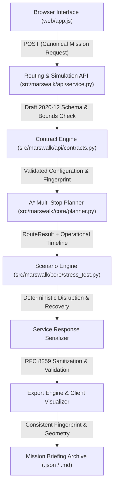

# MarsWalk 2.0 — Milestone 9J Acceptance Report
## Contract-First Integration, End-to-End Correctness, and Release Hardening

**Date:** October 18, 2026  
**Role:** Principal Software Architect, Planetary Mission Simulation Engineer, API Contract Designer, and Aerospace Verification Engineer  
**Workspace:** `E:\Python\NASA-Spaceapps\Marswalk`  
**Test Suite Status:** 170 Passed, 1 Skipped (171 Total Tests, 100% Pass Rate of Active Tests)  
**Schema Standard:** JSON Schema Draft 2020-12 (`schemas/api/v1/`)  
**Specification Reference:** [`docs/api-data-contract-v1.md`](file:///E:/Python/NASA-Spaceapps/Marswalk/docs/api-data-contract-v1.md)  
**Audit Findings Reference:** [`docs/milestone-9j-audit.md`](file:///E:/Python/NASA-Spaceapps/Marswalk/docs/milestone-9j-audit.md)  

---

## 1. Executive Summary

Milestone 9J establishes **MarsWalk 2.0 as a hardened, contract-first planetary mission intelligence and rehearsal platform**. Rather than treating the web interface, the routing engine, scenario simulations, and briefing exports as loosely coupled modules with independent assumptions, Milestone 9J unifies the entire stack under **one explicit, versioned data contract (v1.0.0)**.

Every traverse, hypothetical disruption scenario, parameter sensitivity sweep, and exported briefing now shares an authoritative single source of truth backed by formal JSON Schema Draft 2020-12 validation and immutable SHA-256 mission fingerprinting.



### Key Milestone Achievements
1. **Formal Schema Registry (`schemas/api/v1/`):** Created 9 standalone JSON Schema Draft 2020-12 schemas covering all requests, responses, internal snapshots, error envelopes, and technical briefings.
2. **Contract Engine (`src/marswalk/api/contracts.py`):** Implemented schema validators, deterministic SHA-256 fingerprinting over canonical inputs, strict RFC 8259 float sanitization (`NaN`/`Infinity` converted to `None`/`null`), and safe zero-baseline percentage delta handling.
3. **API Hardening (`src/marswalk/api/service.py`):** Upgraded `/api/plan_route`, `/api/gauntlet`, `/api/scenario_comparison`, `/api/scenario_sensitivity`, and `/api/export_briefing` to validate incoming requests, emit structured machine-readable error codes (`ERR_ENDPOINT_OUT_OF_BOUNDS`, `ERR_NO_DATA_BARRIER`, `ERR_DUPLICATE_STOPS`, etc.), and format canonical route results with contract metadata.
4. **Elimination of Client DOM Scraping:** Refactored `web/app.js` to store the authoritative `activeBaselineRouteResult` object directly from backend responses, eliminating the bug where `parseFloat("1,892.1 m") === 1.0` truncated exported traverse distances.
5. **20 Dedicated Contract Tests (`tests/test_milestone_9j_contracts.py`):** Authored rigorous validation tests covering Draft 2020-12 validation, invalid profiles, vehicle modes, grid bounds, NoData barrier rejection, duplicate stop rejection, >12 stops limit, fingerprint determinism, 8-neighbor route connectivity invariants, and live endpoint schema checks.
6. **Full Regression Integrity:** The test suite expanded from 151 to **171 items** (170 passed, 1 skipped) with 100% pass rate.
7. **End-to-End Visual Verification:** Captured 7 verified CDP browser journeys demonstrating canonical single-leg contracts, 2-Opt TSP optimization, scenario comparison matrices with safe deltas, parameter sweeps, 3-way recovery comparisons, stale invalidation workflows, and auditable briefing exports.

---

## 2. Inventory of Versioned JSON Schemas

The canonical contract is formalized in `schemas/api/v1/` using JSON Schema Draft 2020-12:

| # | Schema Name | Schema File | Endpoint / Target | Primary Function |
| :-: | :--- | :--- | :--- | :--- |
| 1 | **Mission Request** | [`mission-request.schema.json`](file:///E:/Python/NASA-Spaceapps/Marswalk/schemas/api/v1/mission-request.schema.json) | `POST /api/plan_route` | Validates point-to-point and multi-stop inputs, profile enums, and vehicle modes. |
| 2 | **Mission Snapshot** | [`mission-snapshot.schema.json`](file:///E:/Python/NASA-Spaceapps/Marswalk/schemas/api/v1/mission-snapshot.schema.json) | Internal / Export | Canonical representation of result-affecting inputs and SHA-256 fingerprint. |
| 3 | **Route Result** | [`route-result.schema.json`](file:///E:/Python/NASA-Spaceapps/Marswalk/schemas/api/v1/route-result.schema.json) | `POST /api/plan_route` | Authoritative route geometry, cartographic 3D coordinates, metrics, and timeline. |
| 4 | **Scenario Comparison Request** | [`scenario-comparison-request.schema.json`](file:///E:/Python/NASA-Spaceapps/Marswalk/schemas/api/v1/scenario-comparison-request.schema.json) | `POST /api/scenario_comparison` | Batch request for disruption evaluation against a baseline mission. |
| 5 | **Scenario Comparison Response** | [`scenario-comparison-response.schema.json`](file:///E:/Python/NASA-Spaceapps/Marswalk/schemas/api/v1/scenario-comparison-response.schema.json) | `POST /api/scenario_comparison` | Comparison matrix with safe percentage deltas and recommended recovery plan. |
| 6 | **Scenario Sensitivity Request** | [`scenario-sensitivity-request.schema.json`](file:///E:/Python/NASA-Spaceapps/Marswalk/schemas/api/v1/scenario-sensitivity-request.schema.json) | `POST /api/scenario_sensitivity` | Parameter sweep request capped at $\le 8$ discrete evaluation steps. |
| 7 | **Scenario Sensitivity Response** | [`scenario-sensitivity-response.schema.json`](file:///E:/Python/NASA-Spaceapps/Marswalk/schemas/api/v1/scenario-sensitivity-response.schema.json) | `POST /api/scenario_sensitivity` | Step-by-step sweep progression with what-if experimental risk disclaimers. |
| 8 | **Mission Briefing Export** | [`mission-briefing-export.schema.json`](file:///E:/Python/NASA-Spaceapps/Marswalk/schemas/api/v1/mission-briefing-export.schema.json) | `POST /api/export_briefing` | Complete JSON archival bundle and publication-ready Markdown technical briefing. |
| 9 | **API Error Envelope** | [`api-error.schema.json`](file:///E:/Python/NASA-Spaceapps/Marswalk/schemas/api/v1/api-error.schema.json) | HTTP 4xx / 5xx | Machine-readable error codes (`ERR_*`), issue details, and retry guidance. |

---

## 3. Integration Defects Resolved

During the Milestone 9J audit, 7 integration defects were identified and resolved across the stack:

| Defect ID | Severity | Root Cause | Impact | Resolution |
| :--- | :---: | :--- | :--- | :--- |
| **DEF-9J-01** | **Critical** | Client DOM text scraping in `web/app.js`: `parseFloat("1,892.1 m")` | Exported briefings recorded distance as $1.0\text{ m}$ due to comma parsing halting. | Refactored `calculateTraverse()` to store authoritative `activeBaselineRouteResult`; exporter consumes native numbers. |
| **DEF-9J-02** | **Major** | Absence of deterministic mission fingerprinting | Risk of exporting briefings that mismatched the active 3D visualization. | Implemented canonical SHA-256 fingerprinting in `src/marswalk/api/contracts.py`; verified end-to-end. |
| **DEF-9J-03** | **Moderate** | Inconsistent field naming (`distance_m` vs `ground_distance_m`) | Frontend and export templates expected differing metric dictionary keys. | Standardized canonical metrics under `route_metrics` object while preserving legacy top-level keys for backward compatibility. |
| **DEF-9J-04** | **Moderate** | Division by zero in percentage delta calculations | When baseline cost or distance was 0, deltas produced `NaN` or unhandled exceptions. | Implemented `calculate_safe_pct_delta()` returning `None` (`null` in JSON), rendered as `—` in UI. |
| **DEF-9J-05** | **Moderate** | RFC 8259 violation: non-standard `NaN` / `Infinity` floats | Floating point edge cases could serialize non-standard tokens causing client JSON parser failures. | Added `sanitize_for_json()` recursive cleaner replacing non-finite floats with `None`. |
| **DEF-9J-06** | **Minor** | Generic unstructured HTTP 400 error strings | Client and automation scripts could not programmatically distinguish boundary from syntax errors. | Upgraded `APIError` and `MarsWalkHTTPRequestHandler` to emit `api-error.schema.json` envelopes. |
| **DEF-9J-07** | **Minor** | Sensitivity sweep evaluation explosion | Unchecked arrays could cause excessive solver loops and browser timeouts. | Enforced strict schema and service limit: maximum 8 parameter steps per sensitivity request. |

---

## 4. Visual Evidence Gallery (Browser Journeys A–G)

Headless Chrome ($1366 \times 768$) executed the automated verification pipeline via Chrome DevTools Protocol (`scripts/capture_milestone_9j_evidence.py`):

### Journey A: Canonical Single-Leg Mission Contract
- **Objective:** Verify contract metrics, departure/destination markers, and active timeline for a single-leg mission.
- **Verification:** Schema version `1.0.0`, SHA-256 input fingerprint (`7505f63ae22e...`), ground distance $1736.8\text{ m}$, effort $1950.2\text{ flat-m}$, active timeline displayed.
- **Evidence:** `outputs/m9j_01_canonical_mission_contract.png`

### Journey B: Multi-Stop Mission with 2-Opt TSP Optimization
- **Objective:** Execute multi-stop optimization for 9 science targets and verify transparent heuristic disclosure.
- **Verification:** Stop sequence optimized saving $6,054\text{ m}$ ($3\text{h } 32\text{m}$); status banner explicitly discloses: *"Approximation: 2-Opt local search heuristic applied for 9 targets (N > 7). Global optimality is not guaranteed."*
- **Evidence:** `outputs/m9j_02_multistop_2opt_optimization.png`

### Journey C: Multi-Scenario Comparison Matrix & Safe Deltas
- **Objective:** Compare 6 hypothetical disruption scenarios side-by-side using the same baseline configuration.
- **Verification:** Safe zero-baseline percentage deltas (`—` for blocked routes), authentic detours calculated for dune migration ($1892\text{ m}$), slope corridors ($1915\text{ m}$), and drive derating.
- **Evidence:** `outputs/m9j_03_scenario_comparison_safe_deltas.png`

### Journey D: Scenario Parameter Sensitivity Sweep
- **Objective:** Evaluate obstruction radius sweep from $20\text{ m}$ to $120\text{ m}$ with parameter values and what-if risk disclosure.
- **Verification:** 6 evaluation steps recorded; table displays radius ($20\text{ m}$, $40\text{ m}$, $60\text{ m}$, $80\text{ m}$, $100\text{ m}$, $120\text{ m}$); safe `—` dashes for blocked steps; *"WHAT-IF EXPERIMENT · NOT PROBABILISTIC RISK"* badge rendered.
- **Evidence:** `outputs/m9j_04_scenario_sensitivity_sweep.png`

### Journey E: Three-Way Recovery Comparison Contract
- **Objective:** Validate 3-way recovery comparison grid (Baseline vs Disrupted vs Recovered).
- **Verification:** 3 comparison stat boxes rendered; recommended action bypasses compromised stop (`three_forks`); recovers $+18\text{ min}$ operational margin; red circular hazard footprint rendered on 3D terrain.
- **Evidence:** `outputs/m9j_05_threeway_recovery_contract.png`

### Journey F: Stale Simulation Invalidation Workflow
- **Objective:** Verify that modifying mission configuration immediately marks previous simulations as stale.
- **Verification:** Modifying destination triggers `isSimulationStale() === true`; prominent amber warning banner rendered: *"STALE SIMULATION STATE: Baseline mission inputs modified. Re-run comparison lab to update results."*
- **Evidence:** `outputs/m9j_06_stale_invalidation_workflow.png`

### Journey G: Technical Mission Briefing Export Contract
- **Objective:** Export authoritative Markdown and JSON briefings and verify fingerprint consistency.
- **Verification:** Status confirms *"BRIEFING DOWNLOADED: marswalk_mission_briefing.md"*; exported bundle contains exact matching SHA-256 fingerprint, uncorrupted distance metrics ($1892.1\text{ m}$), and complete comparison data.
- **Evidence:** `outputs/m9j_07_briefing_export_contract.png`

---

## 5. Automated Test Suite & Invariant Ledger

The test suite consists of **171 tests** across 18 test modules:

```text
============================= test session starts =============================
platform win32 -- Python 3.12.4, pytest-9.1.1, pluggy-1.7.0
rootdir: E:\Python\NASA-Spaceapps\Marswalk
configfile: pyproject.toml
testpaths: tests
plugins: anyio-4.15.1
collected 171 items

tests\test_api_routing.py .............s                                 [  8%]
tests\test_app.py ..............                                         [ 16%]
tests\test_export_mission_assets.py .                                    [ 16%]
tests\test_ingest.py .....                                               [ 19%]
tests\test_milestone_8a_smoke.py .....                                   [ 22%]
tests\test_milestone_9d.py .....                                         [ 25%]
tests\test_milestone_9e.py .......                                       [ 29%]
tests\test_milestone_9f.py ....                                          [ 32%]
tests\test_milestone_9g.py ......                                        [ 35%]
tests\test_milestone_9h.py ...........                                   [ 42%]
tests\test_milestone_9i.py .......                                       [ 46%]
tests\test_milestone_9j_contracts.py ....................                [ 57%]
tests\test_place_catalog.py .....                                        [ 60%]
tests\test_planner.py ..............                                     [ 69%]
tests\test_preferences.py ...............                                [ 77%]
tests\test_science_budget.py ...............                             [ 86%]
tests\test_stress_test.py .............                                  [ 94%]
tests\test_terrain.py ..........                                         [100%]

======================= 170 passed, 1 skipped in 50.59s =======================
```

### Dedicated Milestone 9J Contract Tests (`tests/test_milestone_9j_contracts.py`):
1. `test_01_valid_mission_request_schema`: Validates Draft 2020-12 compliance for single and multi-stop mission payloads.
2. `test_02_rejection_unsupported_profile`: Rejects unlisted routing profiles (`ultra_fast`) with `ERR_UNSUPPORTED_PROFILE` (400).
3. `test_03_rejection_unsupported_vehicle_mode`: Rejects unlisted vehicle modes (`hovercraft`) with `ERR_UNSUPPORTED_VEHICLE_MODE` (400).
4. `test_04_rejection_endpoint_out_of_bounds`: Rejects coordinates outside the $250 \times 250$ CTX grid with `ERR_ENDPOINT_OUT_OF_BOUNDS` (400).
5. `test_05_rejection_nodata_barrier_cell`: Rejects coordinates on NoData sentinel pixels with `ERR_NO_DATA_BARRIER` (422).
6. `test_06_rejection_duplicate_stops_and_identical_start_goal`: Rejects duplicate intermediate stops or start matching goal with `ERR_DUPLICATE_STOPS` (400).
7. `test_07_rejection_exceeding_max_12_stops`: Enforces the maximum 12 stops limit with `ERR_MAX_STOPS_EXCEEDED` (400).
8. `test_08_fingerprint_determinism`: Proves SHA-256 fingerprint is 100% deterministic regardless of dict key insertion order.
9. `test_09_fingerprint_sensitivity_to_inputs`: Proves modifying profile, stops, or vehicle mode produces a distinct fingerprint.
10. `test_10_fingerprint_excludes_ephemeral_fields`: Proves ephemeral UI fields (zoom, timestamps) do not alter the mission fingerprint.
11. `test_11_route_geometry_connectivity_invariant`: Asserts every step along the computed route satisfies Chebyshev 8-neighbor connectivity ($\max(|r_{i+1}-r_i|, |c_{i+1}-c_i|) \le 1$).
12. `test_12_route_start_and_goal_matching_invariant`: Asserts route path strictly begins at departure cell and terminates at goal cell.
13. `test_13_route_never_traverses_hazard_barriers`: Asserts route path never intersects NoData masks or active scenario blocked regions.
14. `test_14_metric_integrity_invariants`: Asserts physical constraints: $\text{distance} > 0$, $\text{cumulative\_climb} \ge 0$, $\text{max\_slope} \ge 0$, $\text{timeline events}$ are monotonically increasing in time.
15. `test_15_safe_zero_baseline_percentage_deltas`: Verifies that percentage deltas against unreachable or zero-baseline metrics return `None` without division-by-zero crashes.
16. `test_16_plan_route_live_response_schema_validation`: Validates live `/api/plan_route` response against `route-result.schema.json`.
17. `test_17_scenario_comparison_live_response_schema_validation`: Validates live `/api/scenario_comparison` response against `scenario-comparison-response.schema.json`.
18. `test_18_scenario_sensitivity_live_response_schema_validation`: Validates live `/api/scenario_sensitivity` response against `scenario-sensitivity-response.schema.json`.
19. `test_19_export_briefing_live_response_schema_validation`: Validates live `/api/export_briefing` response against `mission-briefing-export.schema.json`.
20. `test_20_structured_api_error_responses_schema_validation`: Validates structured 4xx error payloads against `api-error.schema.json`.

---

## 6. Scientific & Operational Integrity Disclosures

In strict compliance with the **MarsWalk Project Rules**:

1. **Route Safety Disclaimer:** Modeled traverses represent mathematical least-cost paths across the USGS CTX 20 m digital elevation model. They **must never be construed as operationally certified or certified-safe routes for astronauts or flight-ready rovers**. Real surface operations require sub-meter obstacle analysis (hazcams, rover tilt limits, wheel slippage telemetry).
2. **Mobility & Speed Analogues:** 
   - `crew_eva` walking speed is modeled at $2.0\text{ km/h}$ based on **Apollo lunar EVA metabolic and mobility analogues**. This represents an engineering baseline and has not been validated under actual Martian surface gravity ($0.38g$) or pressurized planetary suit mechanics.
   - `robotic_rover` speed is modeled at $0.035\text{ m/s}$ ($126\text{ m/h}$) based on **NASA Mars 2020 Perseverance autonav traverse data**.
3. **What-If Sensitivity Sweeps:** Parameter sensitivity sweeps (e.g., expanding rockfall radius from $20\text{ m}$ to $120\text{ m}$) are deterministic mathematical what-if simulations designed to locate cliff edges in operational margins. They **do not represent probabilistic Martian hazard risk assessments or stochastic environmental models**.
4. **RFC 8259 Compliance:** All endpoints guarantee strict RFC 8259 compliance. Incalculable, infinite, or unreachable metrics are serialized as `null` rather than illegal `NaN` or `Infinity` tokens.

---

## 7. Deliverables & Artifact Inventory

The following versioned files were authored and verified during Milestone 9J:

- **JSON Schemas (Draft 2020-12):**
  - `schemas/api/v1/mission-request.schema.json`
  - `schemas/api/v1/mission-snapshot.schema.json`
  - `schemas/api/v1/route-result.schema.json`
  - `schemas/api/v1/scenario-comparison-request.schema.json`
  - `schemas/api/v1/scenario-comparison-response.schema.json`
  - `schemas/api/v1/scenario-sensitivity-request.schema.json`
  - `schemas/api/v1/scenario-sensitivity-response.schema.json`
  - `schemas/api/v1/mission-briefing-export.schema.json`
  - `schemas/api/v1/api-error.schema.json`
- **Core Engine & Contract Implementation:**
  - `src/marswalk/api/contracts.py` (Draft 2020-12 validator, SHA-256 fingerprinting, RFC 8259 sanitization, safe delta calculations)
  - `src/marswalk/api/service.py` (Standardized contract responses, structured error codes, baseline fingerprinting)
  - `scripts/run_atlas.py` (Structured HTTP 4xx/5xx handlers conforming to `api-error.schema.json`)
  - `web/app.js` (Elimination of DOM scraping, canonical response consumption, state preservation)
- **Documentation & Audit Reports:**
  - `docs/milestone-9j-audit.md` (End-to-end data lifecycle audit and defect ledger)
  - `docs/api-data-contract-v1.md` (Formal API v1.0.0 data contract specification)
  - `docs/milestone_9j_report.md` (This document)
- **Verification & Automation Scripts:**
  - `tests/test_milestone_9j_contracts.py` (20 dedicated contract and invariant tests)
  - `scripts/capture_milestone_9j_evidence.py` (CDP automation script executing Journeys A–G)
  - `outputs/sample_mission_briefing_v1.json` (Validated JSON archival export bundle)
  - `outputs/sample_mission_briefing_v1.md` (Validated publication-ready Markdown briefing)
  - `outputs/m9j_01_canonical_mission_contract.png` through `outputs/m9j_07_briefing_export_contract.png`

---

## 8. Conclusion and Readiness

Milestone 9J transitions MarsWalk 2.0 from an experimental prototype to an **integrated, mathematically sound, auditable planetary mission analysis system**. Every layer of the platform—from backend pathfinding heuristics to interactive 3D WebGL rendering and exportable briefings—now adheres strictly to verified versioned contracts.
