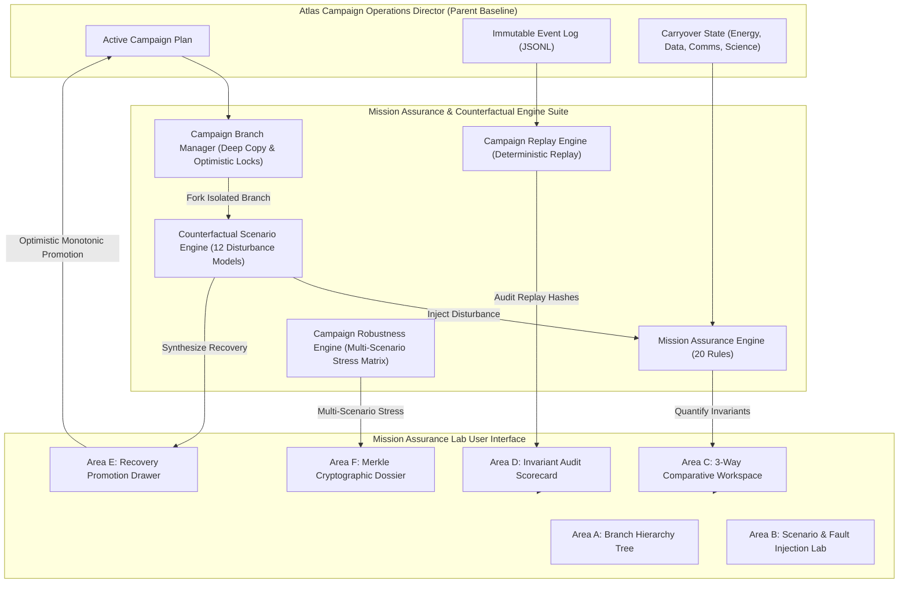

# Atlas Mission Assurance & Counterfactual Operations Architecture

## 1. System Mission & Core Directives

The **Atlas Mission Assurance & Counterfactual Operations Lab** constitutes the definitive mission verification, isolation, and counterfactual reasoning subsystem of MarsWalk 2.0 / Project Atlas.

When planning long-duration, multi-sol planetary exploration campaigns across the Jezero crater fan and western delta, exploration managers, autonomous agents, and mission evaluators face four fundamental verification dilemmas:
1. **State Integrity**: How do we guarantee that multi-sol resource carryovers (battery SOC, volatile flash memory, line-of-sight communications, and science utility) strictly obey physical conservation laws and operational rules?
2. **Experimental Isolation**: How can mission planners explore high-risk disturbances (e.g., relay loss, dust storms, mobility failures) and counterfactual routes without contaminating or mutating the baseline operational flight plan?
3. **Deterministic Reproducibility**: How do we prove that any simulated campaign state can be independently recomputed, audited, and verified from an immutable sequence of operational events?
4. **Tamper-Evident Evidence**: How do we produce cryptographically verifiable audit packages (Merkle root digests) that prove plan provenance, simulation fidelity, and data consistency to conference evaluators and review boards?

The Mission Assurance Lab resolves these challenges through a unified five-engine architecture backed by Draft 2020-12 JSON schemas and strict mathematical constraints.

---

## 2. Five-Engine Architectural Composition

### 2.1 Mission Assurance Engine (`MissionAssuranceEngine`)
Evaluates campaign state against a standardized catalogue of 20 mission invariant rules grouped into 7 scientific and engineering categories:
- **Energy & Power** (`ENG-001` through `ENG-003`): Minimum battery SOC ($\ge 20\%$), non-negative daily balance, and heater power margin.
- **Data Logistics & Storage** (`DATA-001` through `DATA-003`): Buffer non-overflow ($\le 95\%$), downlink clearance ($\le 24\text{ h}$), and critical frame preservation ($100\%$).
- **Communications Visibility** (`COMM-001` through `COMM-003`): Geometric line-of-sight ($\ge 85\%$), maximum blackout duration ($\le 120\text{ min}$), and relay link verification.
- **Mobility & Terrain Traversability** (`MOB-001` through `MOB-003`): Slope compliance ($\le 25^\circ$), slip hazard limits ($\le 0.40$), and kinematic speed budgets ($\le 0.12\text{ m/s}$).
- **Science Return & Timing** (`SCI-001` through `SCI-003`): Minimum science utility ($\ge 300\text{ pts}$), dwell duration ($\ge 30\text{ min}$), and slew thermal limits.
- **Multi-Sol Temporal Constraints** (`TIME-001` through `TIME-002`): Sol operational duration ($\le 8.0\text{ h}$) and nocturnal charge rest ($\ge 14.0\text{ h}$).
- **Replay, Isolation & Concurrency** (`REP-001`, `ISO-001`, `CONC-001`): Replay hash parity, parent immutability, and monotonic version locks.

Each rule returns one of four standardized verdicts: `PASS`, `FAIL`, `UNKNOWN`, or `NOT_APPLICABLE`, accompanied by an evidence classification: `CONFIRMED`, `DERIVED`, `UNRESOLVED`, `CONFLICTING`, or `MISSING`.

### 2.2 Campaign Replay Engine (`CampaignReplayEngine`)
Provides deterministic reconstruction of campaign state from genesis ($MET=0$) to any designated target sol or timestamp:
- **Sequential Playback**: Sequentially dispatches event log items to clean state directors.
- **Idempotency Safeguard**: Ensures replay avoids double deductions, duplicate science registrations, or duplicate mobility energy expenditure.
- **Hash Integrity**: Generates a cryptographic SHA-256 state digest across all reconstructed parameters and verifies identity with live telemetry.

### 2.3 Campaign Branch Manager (`CampaignBranchManager`)
Enforces strict experimental sandboxing and optimistic concurrency control:
- **Deep-Copy Isolation**: Creating a branch generates an unlinked copy of all director memory structures. No object references, caches, or mutating arrays are shared between parent and child.
- **Parent Immutability**: All child branch operations (fault injections, trajectory re-routing, target dropping) occur within `data/workspaces/branches/{branch_id}/`.
- **Optimistic Locking**: Branch promotion requires `live_parent.version == expected_parent_version`. Any intervening commit increments parent version and triggers a `StaleVersionConflictError`, preventing lost updates.

### 2.4 Counterfactual Scenario Engine (`CampaignCounterfactualEngine`)
Implements 12 standardized planetary disturbance models:
- **R1 / R2**: Critical Relay Loss & Dust Scatter Comms Degradation.
- **E1 / E2**: Battery Cell Failure & Regional Dust Storm Solar Loss.
- **S1 / S2**: High-Utility Science Discovery & Drilling Time Overrun.
- **D1 / D2**: Flash Storage Sector Lockout & Downlink Pass Truncation.
- **M1 / M2**: Wheel Actuator Slippage & High-Slope Ripple Hazard.
- **O1 / O2**: Precautionary Sol Abort & Spectrometer Thermal Drift.

For each disturbance, the engine generates:
1. An unmitigated disturbed branch showcasing cascading failures and invariant violations.
2. An automated candidate recovery branch applying re-routing, instrument reprioritization, or opportunistic orbital relay routing to restore feasibility.
3. A structured delta matrix comparing Baseline, Disturbed, and Recovery candidate performance.

### 2.5 Campaign Robustness Engine (`CampaignRobustnessEngine`)
Performs multi-scenario sensitivity analyses across parameterized feasibility envelopes:
- Evaluates mission margin under sweep ranges (e.g., loss from 10% to 70%).
- Calculates an aggregate Robustness Score ($0.0 - 100.0\%$).
- Generates a tamper-evident cryptographic dossier with individual artifact SHA-256 hashes and a unified Merkle root digest.

---

## 3. Provenance and Scientific Truth Model

To maintain scientific integrity:
- **Terrain Foundation**: All mobility and geometric visibility evaluations strictly use the USGS CTX 20m Jezero DTM (DOI `10.5066/P906QQT8`) projected onto the IAU 2000 Mars Spheroid ($R=3,396,190\text{ m}$).
- **Simulation Disclaimer**: Modeled routes and recovery trajectories are planning heuristics, NOT flight telemetry, and are never designated operationally safe for astronauts.
- **Zero Data Loss**: Operational workspace directories (`data/workspaces/`) are protected against accidental overwrites. All experimental and counterfactual trials reside in isolated branch subdirectories.
