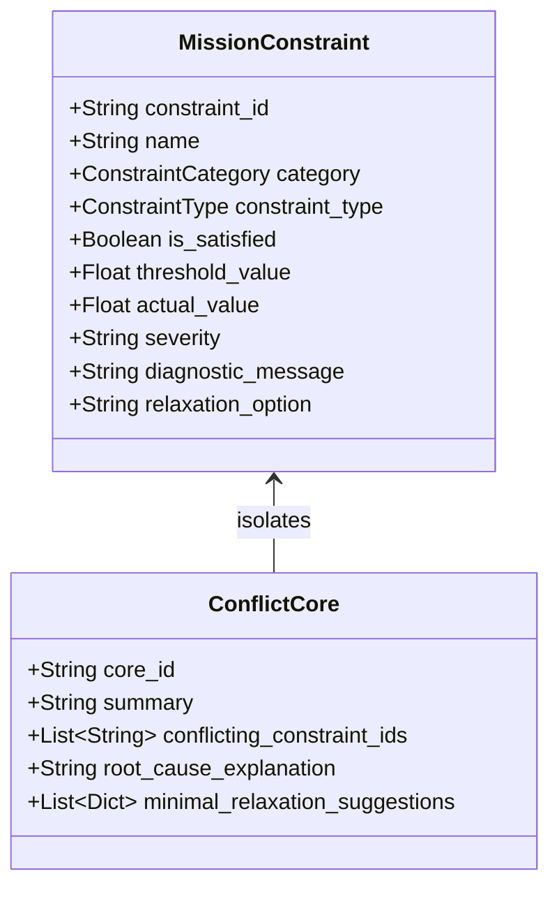

# MarsWalk 2.0 / Project Atlas — Mission Constraint Engine Methods

## 1. Physical Engineering Constraints vs Operational Preferences

The Mission Constraint Engine partitions mission requirements into two mathematically distinct classes:
1. **Hard Physical Constraints ($\mathcal{C}_{\text{hard}}$):** Physical laws, hardware ratings, and mandatory planetary science targets. Any violation renders the candidate plan **INFEASIBLE**.
2. **Soft Preferences ($\mathcal{C}_{\text{soft}}$):** Operational desires, target reachability thresholds, and backlog goals. Evaluated as continuous objective penalties to guide Pareto optimization.

---

## 2. Hard Constraint Formulations

### A. Individual Battery Reserve Margin
$$\forall r \in \mathcal{R}, \forall t \in \mathcal{T}: \quad \text{SoC}_r(t) \ge \text{SoC}_{\min} \quad (\text{typically } 20.0\%)$$
- Evaluated along every continuous path segment and activity stop.
- Enforces zero cross-rover energy pooling.

### B. Flash Storage Utilization Ceiling
$$\forall r \in \mathcal{R}, \forall t \in \mathcal{T}: \quad \frac{\text{StorageUsed}_r(t)}{\text{StorageCapacity}_r} \le \text{Storage}_{\max} \quad (\text{typically } 85.0\%)$$

### C. Terrain Slope Boundary
$$\forall \text{segment } s \in \text{TraversePath}: \quad \theta_{\text{slope}}(s) \le \theta_{\max} \quad (\le 25.0^\circ)$$

### D. Mandatory Target Completion
$$\mathcal{T}_{\text{mandatory}} \subseteq \bigcup_{r \in \mathcal{R}} \text{ObservedTargets}(r)$$

---

## 3. Conflict Core Extraction (Irreducible Inconsistent Subsets)

When a mission intent is infeasible ($\exists c \in \mathcal{C}_{\text{hard}}: \neg c.\text{is\_satisfied}$), the engine isolates the **minimal set of mutually contradictory constraints**:

$$\mathcal{S}_{\text{conflict}} \subseteq \mathcal{C} \quad \text{such that} \quad \mathcal{S}_{\text{conflict}} \text{ is unsatisfiable, but } \forall c' \in \mathcal{S}_{\text{conflict}}, \mathcal{S}_{\text{conflict}} \setminus \{c'\} \text{ is satisfiable}$$

This prevents vague error messages and produces targeted, actionable relaxation proposals:
- e.g., "Relax minimum battery reserve margin from $25\%$ to $18\%$."
- e.g., "Add `ATLAS_ROVER_C` to permitted rovers to satisfy `CORING_TOOL` requirement."
- e.g., "Extend campaign duration from 3 to 5 sols."
