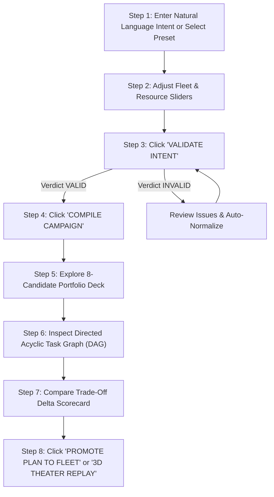

# MarsWalk 2.0 / Project Atlas — Mission Design Studio 2.0 User Guide

## 1. Getting Started

Navigate to Atlas in your browser:
```
http://127.0.0.1:3000/?tab=design_studio
```
Or click the **🎯 Design Studio** tab in the inspector tab bar.

---

## 2. Step-by-Step Operator Workflow



### Step 1: Specify Mission Intent
- Type a mission objective brief into the text box, or select one of four calibrated presets:
  - *Western Jezero Delta 2-Rover Reconnaissance*
  - *Distributed Delta Exploration (3 Rovers)*
  - *Energy Conservative Low-Risk Survey*
  - *High-Continuity Communications Mesh*

### Step 2: Configure Physical Bounds
- Set **Rovers Count** (1 to 4 vehicles).
- Set **Duration** (1 to 10 sols).
- Set **Minimum Battery Reserve** (10% to 40% SoC).
- Set **Relay Budget** (0 to 4 relays).

### Step 3: Validate Intent
- Click **🔍 VALIDATE INTENT**.
- Review the verdict badge (`VALID`, `VALID_WITH_WARNINGS`, `INVALID`).

### Step 4: Compile Campaign
- Click **⚡ COMPILE CAMPAIGN**.
- The compiler generates 8 structurally distinct candidate configurations in $<15\text{ ms}$.

### Step 5: Select & Inspect Candidates
- Browse candidate cards (`Balanced`, `Science Maximizing`, `Energy Efficient`, etc.).
- Click any candidate to view its specific Directed Acyclic Task Graph (DAG) and critical path.
- Inspect task node telemetry (duration, energy Wh, data MB, prerequisites).

### Step 6: Promote or Replay
- Click **🚀 PROMOTE PLAN TO FLEET** to deploy to active operational fleet director.
- Click **🎬 3D THEATER TRAVERSE REPLAY** to visualize simultaneous rover traverses in the 3D terrain viewer.
