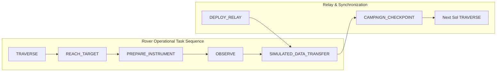

# MarsWalk 2.0 / Project Atlas — Mission Goal Decomposition & Directed Acyclic Task Graph

## 1. Goal Decomposition Theory

High-level mission goals cannot be scheduled directly by a surface rover. The Goal Decomposition Engine translates declarative science targets into an atomic, topologically ordered **Directed Acyclic Graph (DAG)** of operational tasks:

$$\mathcal{G} = (\mathcal{V}, \mathcal{E})$$

where each node $v \in \mathcal{V}$ is a `MissionTaskNode` and each directed edge $(u, v) \in \mathcal{E}$ represents a strict temporal or resource prerequisite: task $u$ must complete successfully before task $v$ may begin execution.

---

## 2. Standardized Task Node Taxonomy

| Task Type | Description | Primary Resource Impact |
| :--- | :--- | :--- |
| `TRAVERSE` | Point-to-point surface locomotion along terrain-aware $A^*$ paths | Motor electrical power ($W$), distance ($m$), transit duration ($s$) |
| `REACH_TARGET` | Precision stationkeeping and settling at science target coordinates | Baseline avionics electrical load ($110\text{ W}$), 300s dwell |
| `PREPARE_INSTRUMENT` | Robotic arm unlatching, mast articulation, sensor warmup | Instrument warmup load ($10-35\text{ W}$), calibration duration |
| `OBSERVE` | Active scientific measurement (XRF, Raman spectroscopy, imaging) | High power draw ($35-80\text{ W}$), science data bytes generation ($MB$) |
| `DEPLOY_RELAY` | Precision stationary RF relay deployment on high-ground ridge | Relay deployment actuation energy, static network reconfiguration |
| `SIMULATED_DATA_TRANSFER` | High-frequency telemetry and science payload transmission | RF transmitter load ($40\text{ W}$), flash buffer release |
| `CAMPAIGN_CHECKPOINT` | Diurnal rest, overnight fleet synchronization, solar recharging | Diurnal solar recharge energy gain ($+300\text{ Wh}$), state lock |

---

## 3. Dependency Guarantees & Critical Path Calculation

1. **Cycle Prevention:**
   - Graph construction enforces forward chronological ordering within rover sortees and sol transitions. Kahn's topological sorting algorithm guarantees $O(V + E)$ cycle detection.
2. **Critical Path Analysis:**
   - The critical path is computed via dynamic programming over topological order:
     $$\text{dist}(v) = \max_{(u, v) \in \mathcal{E}} \left( \text{dist}(u) + \text{duration}(v) \right)$$
   - Identifies the pacing sequence of tasks that governs total mission completion time.
