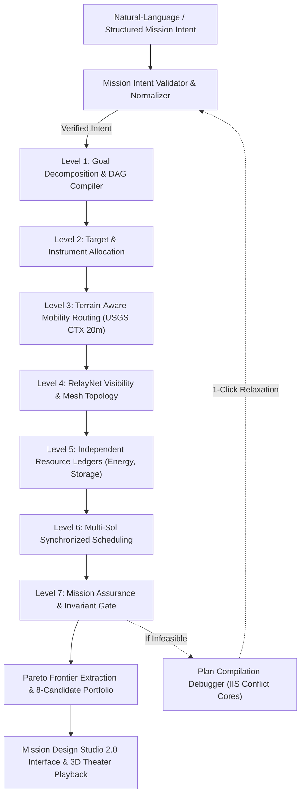

# MarsWalk 2.0 / Project Atlas — Mission Intent Compiler Architecture

## 1. System Overview

The **Atlas Goal-Driven Mission Design Compiler** (Milestone 13K) elevates planetary mission design from manual subsystem configuration to declarative, goal-driven campaign synthesis. Instead of requiring human mission designers to manually route individual rovers, schedule science observations, compute energy margins, and place communications relays, the operator specifies **high-level scientific and operational intent** in natural language or structured schema.

The compiler formally parses, validates, and transforms this intent into a 7-level hierarchical planning problem, synthesizing an **8-candidate Pareto exploration portfolio** in sub-second latency.

---

## 2. Core Architectural Principles

1. **Declarative Mission Intent:**
   - Operators state *what* science objectives must be achieved (e.g. geological characterization of Hawksbill Gap and Skinner Ridge), *what* safety bounds must be preserved (e.g. $\ge 20\%$ battery reserve, $<25^\circ$ slope ceiling), and *what* infrastructure is budgeted (e.g. $\le 2$ surface relays).
2. **Strict Physical Grounding:**
   - Traversal costs, line-of-sight ray casting, and solar diurnal recharge are computed on authentic USGS CTX 20m digital elevation models and IAU Mars 2000 spherical geodesy ($R = 3,396,190\text{ m}$).
   - Synthetic demonstration profiles are explicitly disclosed and never conflated with empirical spacecraft telemetry.
3. **Zero Energy Pooling:**
   - Each rover operates on its own dedicated physical ledger. Cross-rover battery pooling or instantaneous memory sharing is strictly forbidden.
4. **Explainable Conflict Cores:**
   - When an intent is mathematically or physically unsatisfiable under current boundaries, the compiler does not fail silently. It isolates the **Irreducible Inconsistent Subset (IIS)** and synthesizes structured 1-click relaxation proposals.

---

## 3. Data Contracts & JSON Schema Draft 2020-12

All data exchanged between the client and the compiler engine adheres to formal JSON Schema Draft 2020-12 definitions:
- [`mission-intent.schema.json`](file:///e:/Python/NASA-Spaceapps/Marswalk/schemas/api/v1/mission-intent.schema.json)
- [`mission-intent-validation.schema.json`](file:///e:/Python/NASA-Spaceapps/Marswalk/schemas/api/v1/mission-intent-validation.schema.json)
- [`mission-task-graph.schema.json`](file:///e:/Python/NASA-Spaceapps/Marswalk/schemas/api/v1/mission-task-graph.schema.json)
- [`mission-plan-candidate.schema.json`](file:///e:/Python/NASA-Spaceapps/Marswalk/schemas/api/v1/mission-plan-candidate.schema.json)
- [`mission-plan-compilation.schema.json`](file:///e:/Python/NASA-Spaceapps/Marswalk/schemas/api/v1/mission-plan-compilation.schema.json)
- [`mission-constraint-diagnosis.schema.json`](file:///e:/Python/NASA-Spaceapps/Marswalk/schemas/api/v1/mission-constraint-diagnosis.schema.json)

---

## 4. API Service Endpoints

| HTTP Method | Endpoint | Description |
| :--- | :--- | :--- |
| `GET` | `/api/compiler/sample-intent` | Returns calibrated reference mission intent |
| `POST` | `/api/compiler/validate` | Validates intent against physical envelopes |
| `POST` | `/api/compiler/normalize` | Applies automatic sanity defaults |
| `POST` | `/api/compiler/compile` | Compiles intent into 8-candidate Pareto portfolio |
| `POST` | `/api/compiler/evaluate` | Evaluates candidates across 6 performance dimensions |
| `POST` | `/api/compiler/compare` | Generates pairwise trade-off delta scorecard |
| `GET` | `/api/compiler/plan` | Retrieves compiled portfolio or candidate details |
| `POST` | `/api/compiler/debug` | Forensic failure chain diagnosis & relaxation advice |
| `GET` | `/api/compiler/benchmark` | Runs 6-scenario benchmark suite across Campaigns A–F |
| `POST` | `/api/compiler/promote` | Promotes compiled candidate into active fleet operations |
