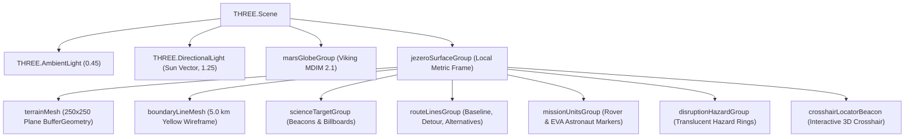

# MarsWalk 2.0 / Project Atlas
# Milestone 13C — Mission Theater System Architecture
## Immersive Spatial Digital Twin, Dynamic Mission Visualization & Synchronized Forensic Playback

**Document Version:** 1.0.0  
**Target Architecture:** Three.js WebGL Engine, Mars IAU 2000 Planetocentric Sphere & USGS CTX 20m Jezero Crater DTM  
**Author:** Antigravity / Gemini Lead Systems Architect  
**Status:** **AUTHORITATIVE ARCHITECTURAL SPECIFICATION**  

---

## 1. Executive Vision & Purpose

The **Atlas 3D Mission Theater** elevates MarsWalk 2.0 from an analytical GIS planning dashboard into a **fully integrated spatial digital twin and mission playback operations center**. Rather than presenting static 3D terrain meshes disconnected from operational simulations, the Mission Theater synchronizes:

1. **Authentic USGS CTX 20m Topography:** $250 \times 250$ elevation grid cells ($5.0 \times 5.0\text{ km}$) with Horn 3x3 normal gradient slope calculation.
2. **Deterministic Multi-Sol Campaign Traverses:** Primary and alternative Pareto routes snapped precisely to physical terrain vertices.
3. **Multi-Unit Exploration Entities:** Simulated astronauts (Crew EVA Alpha / Bravo) and rovers with dynamic orientation, heading yaw latching, and localized elevation tracking.
4. **Closed-Loop Disruption & Recovery Events:** Spatially grounded 3D hazard footprints (e.g., 60m rockfall obstacle zones) and active detour geometries.
5. **Interactive 5-Mode Camera Director:** Seamless transitions between `ORBIT`, `TOPOGRAPHIC`, `FOLLOW UNIT`, `MISSION OVERVIEW`, and `EVENT FOCUS`.
6. **Raycast Spatial Object Inspector:** Interactive raycasting enabling evaluators to click any visible terrain point, route segment, vehicle marker, or science target to inspect underlying physical attributes.
7. **Unified Time-Synchronized Playback Engine:** Deterministic simulation timeline ($P(t) = P_0 + \alpha(t) \cdot (P_1 - P_0)$) linked directly to the Rehearsal Director, Digital Twin telemetry, and Causal Replay 7-step ledger.

---

## 2. Geospatial Datum, Coordinate Transforms & Vertical Scaling

### 2.1 Cartographic & Planetary Geodetic Foundation
MarsWalk references all planetary positions to the authoritative **IAU 2000 Mars Spheroid**:
- Mars Mean Equatorial Radius: $R_{\text{Mars}} = 3,396,190.0\text{ m}$.
- Flattening factor: $f = 0.0$ (standard planetocentric sphere).
- Jezero Western Delta Reference Latitude: $\phi_0 = 18.442000^\circ\text{ N}$.
- Jezero Western Delta Reference Longitude: $\lambda_0 = 77.442000^\circ\text{ E}$.

### 2.2 Equirectangular Anisotropic Metric Spacing
Due to meridional convergence on a spherical body, longitudinal ground spacing contracts with the cosine of latitude, while latitudinal spacing remains invariant:
$$dx = C \cdot \cos(\phi_0) = 20.0 \times \cos(18.442^\circ) = 18.972887\text{ m}$$
$$dy = C = 20.000000\text{ m}$$
$$\Delta d_{\text{diagonal}} = \sqrt{dx^2 + dy^2} = 27.567562\text{ m}$$

### 2.3 Raster Grid to 3D World Transformation
Let $(r, c)$ represent the discrete raster indices where $r \in [0, 249]$ (North to South) and $c \in [0, 249]$ (West to East). The 3D scene coordinates in Three.js (`jezeroSurfaceGroup`) are defined as:
$$\text{totalWidth} = (cols - 1) \cdot dx = 249 \times 18.972887 = 4,724.25\text{ m}$$
$$\text{totalHeight} = (rows - 1) \cdot dy = 249 \times 20.000000 = 4,980.00\text{ m}$$

$$X(c) = c \cdot dx - \frac{\text{totalWidth}}{2.0}$$
$$Z(r) = r \cdot dy - \frac{\text{totalHeight}}{2.0}$$
$$Y(r, c) = (z_{\text{elev}}(r, c) - z_{\text{min}}) \cdot k_{\text{exagg}}$$

where:
- $z_{\text{min}} = -2,623.8\text{ m}$ (crater floor datum baseline).
- $z_{\text{max}} = -2,445.0\text{ m}$ (delta scarp rim elevation).
- $k_{\text{exagg}} \in [1.0, 3.0]$ is the visual vertical exaggeration factor (default $1.5\times$).

> [!IMPORTANT]
> **Scientific Integrity Rule on Vertical Exaggeration:**  
> The factor $k_{\text{exagg}}$ affects ONLY vertex rendering coordinates $Y$ for display relief readability. All physical calculations—including Horn facet slope, uphill grade, A* edge costs, and Waligora metabolic expenditures—operate strictly on true unexaggerated metric differences $\Delta z = z(v) - z(u)$.

---

## 3. Three.js Scene Graph Hierarchy & Render Architecture

The Mission Theater utilizes a single unified WebGL scene graph to eliminate redundant render loops, prevent memory leaks, and guarantee 60fps performance:



### 3.1 Terrain BufferGeometry Specification
- **Vertex Count:** $250 \times 250 = 62,500$ vertices.
- **Index Count:** $249 \times 249 \times 2 \text{ triangles} \times 3 \text{ indices} = 372,006$ uint32 indices.
- **Buffer Attributes:**
  - `position`: `Float32Array(187,500)` $(x, y, z)$.
  - `color`: `Float32Array(187,500)` $(r, g, b)$ supporting dynamic vertex tinting.
  - `uv`: `Float32Array(125,000)` $(u, v)$ mapping 1:1 to the USGS CTX orthomosaic drape.
  - `normal`: `Float32Array(187,500)` recalculated via `computeVertexNormals()` for realistic solar illumination.

---

## 4. Digital Twin Playback & Kinematic Position Interpolation

### 4.1 Temporal Model & Progression Interval
Mission playback derives its clock from the simulated mission elapsed time $\tau \in [0, T_{\text{total}}]$, rather than browser animation frames:
$$\Delta \tau = \Delta t_{\text{wall}} \times k_{\text{speed}}$$
where $k_{\text{speed}} \in \{1\times, 2\times, 5\times, 10\times\}$.

### 4.2 Route Segment Interpolation
For a simulated exploration unit traveling along planned traverse $\mathcal{T} = \{\mathbf{w}_1, \dots, \mathbf{w}_N\}$:
Let segment $j$ connect waypoint $\mathbf{w}_j$ to $\mathbf{w}_{j+1}$ with start time $t_{j,\text{start}}$ and duration $\Delta t_j = d_j / v_{\text{nominal}}$.
For elapsed time $\tau \in [t_{j,\text{start}}, t_{j,\text{start}} + \Delta t_j]$:

$$\alpha(\tau) = \text{clamp}\left(\frac{\tau - t_{j,\text{start}}}{\Delta t_j}, 0.0, 1.0\right)$$
$$\mathbf{X}_{\text{horiz}}(\tau) = (1 - \alpha(\tau)) \cdot \mathbf{w}_j^{\text{metric}} + \alpha(\tau) \cdot \mathbf{w}_{j+1}^{\text{metric}}$$

The vertical elevation is sampled directly from the underlying DTM raster at the continuous coordinate $(r(\tau), c(\tau))$:
$$Y_{\text{unit}}(\tau) = (z_{\text{interp}}(r(\tau), c(\tau)) - z_{\text{min}}) \cdot k_{\text{exagg}} + h_{\text{clearance}}$$
where $h_{\text{clearance}} = 2.5\text{ m}$ for rovers and $1.8\text{ m}$ for EVA crew.

### 4.3 Heading Yaw & Stationary Latching
To prevent camera jitter during in-situ science sampling or dwell periods:
$$\theta_{\text{target}} = \arctan2(\Delta X, \Delta Z)$$
$$\theta_{\text{smoothed}}(\tau) = \text{lerpAngle}(\theta_{\text{smoothed}}(\tau - \Delta \tau), \theta_{\text{target}}, 0.15)$$

When the unit enters a planned dwell or operational hold ($\Delta X = 0, \Delta Z = 0$):
$$\theta(\tau) \equiv \theta_{\text{latched}}$$
The heading is strictly frozen until locomotion resumes.

---

## 5. Mission Camera Director (5 Operational Modes)

The Camera Director automatically manages perspective while respecting user autonomy:

| Camera Mode | Elevation Angle | Distance / Range | Target Point | Primary Operational Use Case |
| :--- | :---: | :---: | :---: | :--- |
| **`ORBIT`** | $45^\circ - 75^\circ$ | $1,200 - 3,500\text{ m}$ | Jezero Center / Free Orbit | High-level regional survey; user manual exploration. |
| **`TOPOGRAPHIC`** | $20^\circ - 30^\circ$ | $600 - 1,200\text{ m}$ | Scarp Base / Active Leg | Oblique view revealing delta scarp slope relief. |
| **`FOLLOW UNIT`** | $15^\circ - 25^\circ$ | $68\text{ m}$ behind, $34\text{ m}$ above | Unit Position | 3rd-person chase camera tracking active unit traverse. |
| **`MISSION OVERVIEW`** | $65^\circ$ | $2,800\text{ m}$ | Campaign Centroid | Fits complete multi-Sol route bounding box into view. |
| **`EVENT FOCUS`** | $35^\circ$ | $350\text{ m}$ | Hazard / Science Target | Centers obstacle zone or science sampling activity. |

### Smooth Interruptibility Protocol
Any mouse drag, touch event, or wheel scroll on the 3D canvas immediately transitions `cameraDirectorMode` to `'orbit'` and enables `controls.enabled = true`, ensuring the user is never trapped in an uncancelable camera lock.

---

## 6. Interactive Raycasting & Spatial Object Inspector

The raycast manager listens for `click` and `pointermove` events on the Three.js viewport:

```
[Raycast Hit Detection Hierarchy]
  1. Science Target Beacons  --> Type: 'SCIENCE_TARGET' (Hawksbill Gap, Priority 95.0, Dwell 15m)
  2. Mission Unit Markers    --> Type: 'EXPLORATION_UNIT' (Rover 1, Mode: CREW_EVA, Battery 87%)
  3. Disruption Footprint    --> Type: 'HAZARD_OBSTACLE' (60m Rockfall, Cost Penalty Infinity)
  4. Route Polyline Segment  --> Type: 'ROUTE_LEG' (Leg 2, Length 842m, Waligora 420 kcal)
  5. Terrain Mesh Facet      --> Type: 'TERRAIN_CELL' (Row 115, Col 138, Elev -2542m, Slope 8.2°)
```

Clicking any interactive object opens the dockable `#theaterInspectorCard` displaying:
- Entity Name & Badge.
- Grounded coordinates (Row, Col, Geodetic Lat/Lon, Elevation).
- Physical / Simulation attributes.
- Direct CTA: `[Inspect Traceability & Evidence →]` to open the full Evidence Inspector Modal.
