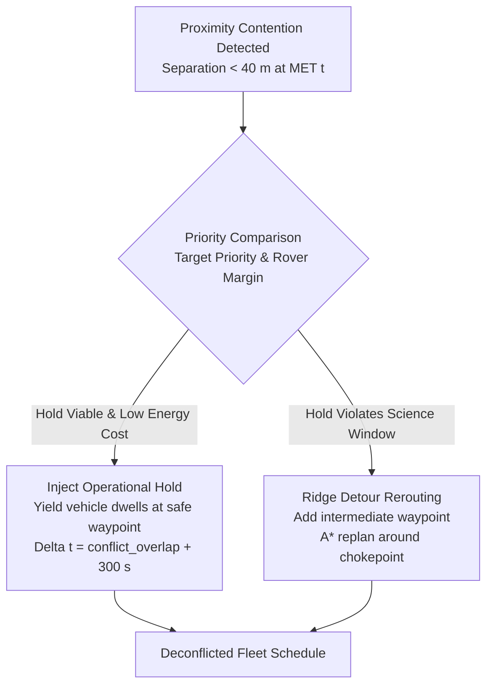

# Multi-Rover Route Coordination & Spatiotemporal Deconfliction
## Terrain-Aware Multi-Agent Traversal on the USGS CTX 20m Jezero DTM

**Component:** `src/marswalk/core/fleet_route_coordinator.py`  
**JSON Contract:** `schemas/api/v1/fleet-route.schema.json`  
**Terrain Source:** USGS CTX 20m DTM (DOI: `10.5066/P906QQT8`, $250 \times 250\text{ px}$)

---

## 1. Overview & Operational Need

When multiple planetary rovers operate within a shared exploration zone (such as the $5.0 \times 5.0\text{ km}$ Jezero Delta fan), paths inevitably intersect near critical geological formations, delta passes, or crater floor ramps. 

A collision on Mars would be catastrophic. Furthermore, rovers kicking up dust or blocking microwave line-of-sight can compromise mission success. MarsWalk implements a **multi-agent terrain-aware route coordination engine** that guarantees physical safety margins while minimizing overall mobility energy expenditure.

---

## 2. Terrain-Aware Cost Function

Each individual route is calculated using an enhanced A* algorithm adapted for the Martian surface. The step cost $C(u, v)$ between adjacent grid nodes $u$ and $v$ is formulated as:

$$C(u, v) = d_{\text{ground}}(u, v) \cdot \left[ 1.0 + \alpha \cdot \tan^2(\theta) + \beta \cdot \text{Roughness}(v) \right]$$

Where:
- $d_{\text{ground}}(u, v) = \sqrt{\Delta x^2 + \Delta y^2 + \Delta z^2}$ using IAU 2000 Mars Spheroid ground metrics.
- $\theta$: Local terrain slope (degrees). Any node with $\theta > 25.0^\circ$ is marked as non-traversable ($\infty$ cost) to prevent rollover hazards.
- $\alpha$: Slope penalty coefficient ($\alpha = 2.4$).
- $\beta$: Surface roughness penalty ($\beta = 1.2$) derived from local elevation variance.

Rover speed is dynamically modulated based on gradient:
$$v_{\text{traverse}}(\theta) = v_{\text{nominal}} \cdot \max\left(0.2, \cos^2(\theta)\right)$$

---

## 3. Spatiotemporal Occupancy Discretization

To detect multi-rover interference, each planned route is projected into a 4D space-time coordinate space. The route is represented as an ordered sequence of occupancy intervals:

$$\mathcal{O}_i = \left\{ \left(r_k, c_k, t_{k, \text{start}}, t_{k, \text{end}}\right) \right\}_{k=1}^{K_i}$$

Where:
- $(r_k, c_k)$: DTM grid cell.
- $t_{k, \text{start}}$: Estimated time of arrival (seconds from Mission Elapsed Time MET).
- $t_{k, \text{end}} = t_{k, \text{start}} + \Delta t_{\text{traverse}} + \Delta t_{\text{dwell}}$: Departure time including scientific observation dwell.

### Proximity Contention Detection:
Two rovers $r_a$ and $r_b$ are in conflict if their spatiotemporal bounding boxes violate the minimum physical safety clearance $D_{\text{safe}} = 40.0\text{ m}$:

$$\exists k \in \mathcal{O}_a, l \in \mathcal{O}_b \quad \text{s.t.} \quad \|(r_k, c_k) - (r_l, c_l)\|_{\text{ground}} < D_{\text{safe}} \quad \land \quad [t_{k, \text{start}}, t_{k, \text{end}}] \cap [t_{l, \text{start}}, t_{l, \text{end}}] \neq \emptyset$$

---

## 4. Automated Conflict Resolution Strategies

When a conflict is detected, the coordinator evaluates two operational remedies:

1. **Strategy 1: Operational Hold / Temporal Yield (`RESOLVED_HOLD`)**
   The lower-priority rover inserts a planned dwell period at an upstream waypoint, allowing the higher-priority rover to clear the chokepoint. The holding rover switches to low-power idle mode ($110\text{ W}$ base avionics load).
2. **Strategy 2: Ridge Detour / Spatial Rerouting (`RESOLVED_DETOUR`)**
   If an operational hold would breach a critical solar observation window or downlink pass, the coordinator inserts a spatial avoidance waypoint along an adjacent ridgeline, re-running A* pathfinding.

---

## 5. Non-Probabilistic Safety Disclosure

> [!IMPORTANT]
> **Scientific Integrity & Planetary Safety Disclosure:**
> In accordance with the NASA Space Apps Challenge and MarsWalk project rules, spatiotemporal route reservations are deterministic trajectory-planning heuristics. They are **NOT** flight-certified collision avoidance systems. Real flight rovers require onboard stereo-vision Hazard Avoidance Cameras (Hazcams) and autonomous obstacle detection during execution. Model routes must never be described as operationally certified for crewed astronaut traverses.
