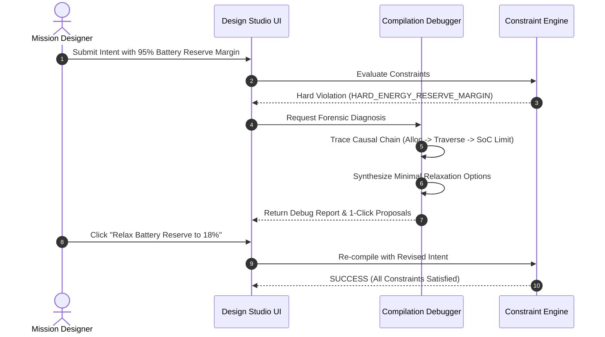

# MarsWalk 2.0 / Project Atlas — Plan Compilation Debugger Guide

## 1. Overview & Purpose

When a mission intent is infeasible or violates physical engineering bounds, the **Plan Compilation Debugger** traces the exact causal chain of failure from root cause to symptom. It then synthesizes safe, mathematically grounded **1-click relaxation proposals** that restore feasibility without violating physical laws.

---

## 2. Causal Failure Chain Structure

A failure chain decomposes the failure into ordered explanatory steps:
1. **Factor 1 (Allocation):** Science targets assigned across rovers.
2. **Factor 2 (Mobility):** Traversal distance between waypoints requires energy $E_{\text{trav}}$.
3. **Factor 3 (Physical Limit):** Projected battery state of charge drops below specified reserve threshold.
4. **Conclusion (Root Cause):** The constraint combination is mathematically inconsistent under single-sol solar budgets.

---

## 3. 1-Click Relaxation Actions

| Relaxation Type | Parameter Path | Recommended Value | Impact |
| :--- | :--- | :--- | :--- |
| **Relax Battery Reserve** | `resources.minimum_battery_reserve_pct` | $18.0\%$ | Enables deeper diurnal discharge while maintaining safety buffer |
| **Extend Campaign Duration** | `timeline.maximum_sols` | $+1\text{ to } +2\text{ sols}$ | Distributes traverses across more sols, allowing overnight recharge |
| **Deploy Additional Rover** | `fleet.maximum_rovers` | $+1\text{ rover}$ | Divides target observation load across multiple vehicles |
| **Convert Mandatory Targets** | `science.mandatory_target_ids` | Move to preferred | Permits solver to prioritize opportunistically without hard failure |
