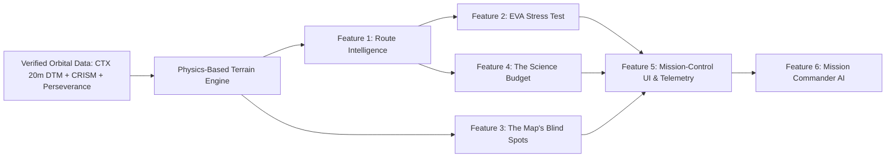

# MarsWalk — Mission Rehearsal: Product Specification

**Project Name:** MarsWalk — Mission Rehearsal  
**Tagline:** Plan the traverse. Stress-test the plan. Keep your scientific curiosity alive.  
**Challenge:** Interplanetary Survival Guide: Martian Map — NASA Space Apps Challenge 2026  
**Document Status:** Approved Specification (incorporating Phase 0 Research Audit findings)  
**Authors:** MarsWalk Engineering Team (Independent Student Submission)

---

## 1. Intended User, Problem Statement & Core Value Proposition

### 1.1 The Operational Problem
When human explorers land on Mars, Extravehicular Activities (EVAs, or "Marswalks") will be strictly governed by life-support consumables: oxygen, suit cooling water, battery reserves, and physical fatigue. Every meter walked uphill through loose regolith or over boulder-strewn slopes consumes precious margin. 

Existing planetary GIS portals (such as NASA Mars Trek and JMARS) provide multi-mission data viewing, but they act as passive map viewers:
- They do not calculate traversability costs over continuous Martian topography.
- They cannot compute how physical detour effort trades off against scientific return.
- They offer no capability to *stress-test* an operational traverse when unforeseen surface hazards emerge or consumable budgets are suddenly curtailed.

### 1.2 Target Users
1. **Surface EVA Crew & Hab Science Officers:** Astronauts rehearsing traverse routes before suit ingress, evaluating whether high-value geological outcrops justify steep climbs or excessive detours.
2. **Earth-Based Science Backroom Planners (Flight Control):** Ground operations evaluating mission trade-offs, contingency corridors, and sample-collection priorities under tight communication latency.
3. **Planetary Science Students & Hackathon Evaluators:** Users seeking an intuitive, mathematically grounded tool to understand Martian terrain morphology and mission trade-offs.

### 1.3 Core Value Proposition
**MarsWalk — Mission Rehearsal** is an interactive Martian surface exploration planning workstation. It does not simply draw lines on a map; it enables planners to:
1. Generate three mathematically grounded traverse profiles (**Conservative**, **Science-First**, and **Balanced**).
2. **Stress-test the plan** against hypothetical real-time anomalies (blocked terrain corridors, shortened consumable budgets, or lost science targets).
3. Quantify the exact trade-offs (distance, modeled terrain cost, science harvested, budget fit) with transparent scientific explainability and explicit sensor blind spots.

---

## 2. Six Core Product Capabilities

### Feature 1: Route Intelligence (Three Mission Profiles)
The engine provides three distinct planning profiles connecting a selected start location (e.g., Octavia E. Butler Landing) and goal location (e.g., Delta Rim Overlook):

1. **Conservative Traverse (Low Modeled Cost):**
   - *Objective:* Minimize total terrain cost $J(P)$ directly between Start and Goal.
   - *Behavior:* Skirts steep scarps, tracks gentle slopes ($<10^\circ$), strictly avoids slopes $\ge 25^\circ$, and visits 0 science detours.
   - *Color Code:* Azure Blue (`#2196F3`), Dashed.
2. **Science-First Traverse (Maximum Discovery):**
   - *Objective:* Visit all active, documented high-priority scientific waypoints ($W_{\text{active}}$) while finding the least-cost TSP order connecting them.
   - *Behavior:* Climbs onto delta terraces to reach phyllosilicate and carbonate deposits, accepting higher terrain slope penalties.
   - *Color Code:* Martian Amber/Orange (`#FF9800`), Bold Solid.
3. **Balanced Traverse (Pareto Optimization):**
   - *Objective:* Maximize marginal science return per unit of extra terrain effort via the utility function:
     $$E_{\text{eff}}(W_{\text{sub}}) = \frac{\sum_{k \in W_{\text{sub}}} V_k}{\left(\frac{J(W_{\text{sub}})}{J_{\text{conservative}}}\right)^\gamma}$$
     where $\gamma$ is the user-tunable *Science Appetite* parameter ($0.5 \le \gamma \le 2.5$).
   - *Behavior:* Intelligently picks only those science stops whose scientific value justifies the added climb or detour distance.
   - *Color Code:* Emerald Green (`#00E676`), Thick Solid.

*Safety Disclaimer:* All profiles are labeled **"Low Modeled Macro-Slope Cost"** and explicitly state that orbital 20 m/pixel rasters cannot certify operational safety.

---

### Feature 2: EVA Stress Test (Signature Feature)
The signature differentiator of MarsWalk is the ability to take a baseline mission plan and inject **controlled hypothetical anomalies** to stress-test mission viability:

* **Scenario Injections:**
  1. *Blocked Corridor / Rockfall Anomaly:* A user-selected traversable pass or narrow gap (e.g., Hawksbill Gap) becomes impassable due to a simulated localized scarp failure or rover hazard.
  2. *Consumable Budget Reduction:* Life-support telemetry simulates an early oxygen leak or battery temperature drop, reducing the maximum permitted walking distance by $20\%$ to $50\%$.
  3. *Target Dropout / Environmental Hazard:* A science waypoint is declared unreachable or hazardous (e.g., thermal instability or steep slip face).
  4. *Custom Blocked Polygon:* The user draws or toggles a hypothetical "No-Go Zone" directly on the terrain.
* **Comparative Stress-Test Output:**
  - **Reachability Status:** Immediate visual alert indicating whether the destination remains reachable under the $\theta_{\max} < 25^\circ$ constraint.
  - **KPI Delta Matrix:** Side-by-side comparison of Baseline vs. Stress-Tested plan:
    - Traversal Distance ($\Delta \text{m}$ and $\%$ change).
    - Modeled Cumulative Terrain Cost ($\Delta J$).
    - Scientific Targets Retained vs. Abandoned ($\Delta S$).
    - Walking Budget Clearance (Pass / Exceeded by $X$ meters).
  - **Deterministic Plain-Language Narrative:** Authors an immediate explanation of how the route adapted (e.g., *"Hawksbill Gap blocked: route diverted south through a 12° side-channel, adding 640 m of distance and dropping the Kodiak Butte sample target to remain within budget"*).
* **Provenance Integrity:** All injected obstacles and modified boundaries are strictly watermarked and labeled as **"HYPOTHETICAL SIMULATION"** to distinguish them from real Martian observations.

---

### Feature 3: The Map's Blind Spots (Scientific Integrity & Limitations)
A key requirement for scientific credibility is exposing what the map *cannot* see:
* **Dataset Metadata Panel:** Displays exact provenance:
  - Source: USGS Astrogeology Science Center / NASA PDS (Fergason et al., 2020; DOI: `10.5066/P906QQT8`).
  - Native Resolution: $20.0\text{ m/pixel}$ (each cell averages $400\text{ m}^2$ of terrain).
  - Vertical Datum: MOLA DeltaGeoid topography datum.
  - CRS: Equirectangular IAU Mars 2000 Sphere ($R = 3,396,190\text{ m}$).
* **Unmodeled Hazard Warning Card (Persistent):**
  - *Sub-Pixel Obstacles:* Boulders $<2\text{ m}$, angular scree, crevices, and overhangs are below the $20\text{ m}$ Nyquist limit.
  - *Regolith Bearing Capacity:* Loose aeolian bedforms (megaripples / "sand traps") can cause catastrophic wheel/boot sinkage despite flat macro-slopes.
  - *Slope Smoothing:* Horn's 3×3 finite differences smooth sharp breaks-of-slope; local instantaneous pitch may exceed the modeled cell value.
* **NoData & Edge Handling:** Any missing-data pixels (sentinel $\le -32768$) and their 1-pixel dilated buffer are displayed in hatch-pattern overlay and assigned infinite traversal cost ($C = \infty$).

---

### Feature 4: The Science Budget & Pareto Trade-Off Intelligence
Provides an interactive engineering analytics instrument comparing physical exertion against exploration payoff across all feasible candidate exploration plans:
* **Distinction of Key Quantities:**
  1. *Physical Ground Distance:* True metric walking distance $d \ge 0$ [meters].
  2. *Modeled Terrain Cost:* Directed cost $J \ge d$ [equivalent flat-terrain meters] incorporating slope and roughness penalties.
  3. *Scientific Priority Points:* Non-physical planning scores $S \ge 0$ [pts] reflecting astrobiological exploration priorities.
  4. *Feasibility Status:* Strict binary compliance with hard terrain limits ($\theta < 25^\circ$) and distance budgets.
  5. *Commander AI Utility:* Subjective learned utility $U(\mathbf{x}) = \mathbf{w}^T \mathbf{x}$, kept strictly independent of objective Pareto dominance.
* **Exact Candidate Plan Generation:**
  - Evaluates all $2^K$ candidate waypoint subsets (up to $K \le 6$, $\le 64$ combinations) using the precomputed pairwise leg cache.
  - Determines the least-cost TSP traversal permutation connecting $\text{Start} \to \text{Subset} \to \text{Goal}$.
  - Filters out unfeasible plans (severed paths or budget exceedances) from recommended rankings while retaining them for diagnostic inspection.
* **Two-Objective vs. Three-Objective Pareto Frontiers:**
  - **2D Minimum Frontier (Distance vs. Science):** Plan $A$ dominates $B$ iff $d_A \le d_B$ and $S_A \ge S_B$ with strict inequality on at least one objective.
  - **3D Full Frontier (Distance, Cost, vs. Science):** Plan $A$ dominates $B$ iff $d_A \le d_B$, $J_A \le J_B$, and $S_A \ge S_B$ with strict inequality on at least one.
  - *Mathematical Distinction:* A plan dominated in 2D by another plan with lower distance may remain non-dominated in 3D if it achieves strictly lower terrain cost $J$ via a flatter detour.
* **Interactive Scatter Plot & Candidate Inspection:**
  - Renders 2D trade-off scatter plot and optional 3D exploration space in Plotly.
  - Distinct visual markers for Conservative (Azure square), Balanced (Emerald star), and Science-First (Martian orange triangle).
  - Highlights non-dominated frontier plans, muted slate for dominated plans, and red crosses for budget-exceeded alternatives.
  - Interactive candidate selector allows inspecting any candidate's metrics and overlaying its path directly on the tactical map in Telemetry Cyan (`#00E5FF`).
* **Sensitivity & Gauntlet Comparison:**
  - Evaluates sensitivity to travel distance budgets, slope penalty weights ($\alpha_s$), roughness ($\alpha_r$), and science appetite ($\gamma$).
  - When The Gauntlet is active, displays comparative before-and-after metrics: severed plans, retained frontier plans, and lost science ceiling.
* **Mission Brief Telemetry Export:**
  - **CSV Export:** Tabulates all candidate plans, visited target IDs, distances, costs, science points, feasibility, and Pareto dominance flags.
  - **JSON Export:** Full machine-readable, reproducible mission specification with terrain weights, endpoints, and data provenance.

---

### Feature 5: Mission-Control User Interface & Humour Voice
A specialized, dark-mode workstation designed for desktop/laptop tactical mission planning:

* **Visual Theme & Palette:**
  - Workspace Background: Deep Space Obsidian (`#0B0F19`)
  - Panel Surfaces: Dark Charcoal Slate (`#161D2B`) with subtle border accents (`#263345`)
  - Accent / Brand Color: Martian Rust / Orange-Red (`#FF5722` / `#E64A19`)
  - Telemetry Cyan: (`#00E5FF`) for data labels and coordinates
  - High-Contrast Status Colors: Success Emerald (`#00E676`), Warning Amber (`#FFC107`), Hazard Red (`#FF1744`)
* **Three-Zone Responsive Layout:**
  1. *Left Control & Scenario Panel (25% width):* Scenario selectors, Stress-Test injection toggles, profile radio buttons, parameter sliders, and Mission Control Voice selector.
  2. *Top-Right Tactical Canvas (75% width, upper 55%):* High-resolution terrain hillshade canvas, semi-transparent slope hazard heatmaps ($>15^\circ$ amber, $\ge 25^\circ$ red), clickable PDS waypoint markers, and color-coded route polylines.
  3. *Bottom-Right Telemetry & Analytics Deck (75% width, lower 45%):* Side-by-side KPI Delta Cards, dual-axis Plotly Elevation & Slope profile charts along the active route, Pareto trade-off curve, and the plain-language trade-off rationale card.
* **Dual Mission Control Voice (Optional Humour Toggle):**
  - **Mode A: Professional (Default for Judges & Official Presentation):** Concise, objective aerospace flight-controller prose.  
    *Example:* `"Route replanned. Hawksbill Gap obstruction detected. Traverse diverted south via 11.2° corridor. Path length increased by 540 m; science harvest maintained at 85%."`
  - **Mode B: Dry Humour (Engaging Demo Mode):** Witty, space-themed, mildly sarcastic commentary using authored, deterministic templates tied to exact state triggers.  
    *Example (Blocked Corridor):* `"Well, that shortcut had a good run. Recalculating around the rubble."`  
    *Example (Budget Exceeded):* `"Curiosity: unlimited. Walking oxygen budget: unfortunately, not."`  
    *Example (NoData Area):* `"Sensors show a blank void. We can't see what's there, and neither can this satellite."`  
    *Humour Guardrails:* Humour is strictly rule-based, deterministic, and clean. It never obscures safety-critical warnings, alters numbers, or mocks scientific validity.
* **Attribution & Independent Status:** Prominently displays:  
  *"MarsWalk is an independent student prototype developed for the 2026 NASA Space Apps Challenge. Not affiliated with or endorsed by NASA."*

---

### Feature 6: Mission Commander AI: Learn from the Commander
An explainable, mathematically transparent machine-learning preference model that observes explicit user selections between alternative traverse profiles and personalizes subsequent recommendations:

* **Transparent Linear Utility Formulation:**
  For any candidate traverse $i$, predicted utility is a weighted sum over physical features:
  $$U(\mathbf{x}_i) = \mathbf{w}^T \mathbf{x}_i = w_d d_{\text{norm}} + w_c c_{\text{norm}} + w_s s_{\text{norm}} + w_e e_{\text{norm}}$$
  where $\mathbf{w} \in \mathbb{R}^4$ is initialized to a neutral prior $\mathbf{w}_0 = [-0.5, -0.5, +1.0, -0.2]^T$ (reflecting natural trade-offs: penalty for distance, cost, and climb; reward for science).
* **Four Normalized Physical Features ($\mathbf{x} \in [0, 2]^4$):**
  1. **Normalized Distance:** $d_{\text{norm}} = \min(2.0, d / 10\,000\text{ m})$
  2. **Normalized Modeled Cost:** $c_{\text{norm}} = \min(2.0, J / 20\,000)$
  3. **Normalized Science Priority:** $s_{\text{norm}} = \min(2.0, S / 250\text{ pts})$
  4. **Normalized Elevation Climb:** $e_{\text{norm}} = \min(2.0, \Delta z_+ / 500\text{ m})$
* **Pairwise Bradley-Terry Optimization:**
  When a commander selects profile $A$ over profile $B$, the difference vector $\mathbf{z} = \mathbf{x}_A - \mathbf{x}_B$ serves as training data under the Bradley-Terry choice probability:
  $$P(A \succ B) = \sigma(\mathbf{w}^T \mathbf{z}) = \frac{1}{1 + \exp(-\mathbf{w}^T \mathbf{z})}$$
  The model minimizes the convex L2-regularized logistic loss:
  $$\mathcal{L}(\mathbf{w}) = \sum_{k=1}^M \ln\left(1 + \exp(-\mathbf{w}^T \mathbf{z}_k)\right) + \frac{\lambda}{2} \|\mathbf{w} - \mathbf{w}_0\|_2^2$$
  Solved using `scipy.optimize.minimize` (L-BFGS-B) with $\lambda = 1.0$. Numerical stability is guaranteed via `np.logaddexp(0.0, -logits)` and clipping logits to $[-30, 30]$.
* **Primacy of Hard Constraints (Safety Non-Negotiable):**
  Learned preferences never override physical mission constraints. Unreachable destinations, paths violating the $\theta_{\max} < 25^\circ$ slope limit, blocked corridors, or paths exceeding walking distance budgets are strictly excluded prior to utility ranking. Only feasible candidate routes are ranked. If all candidates violate constraints, the system displays an explicit constraint violation alert.
* **Four-Stage Learning Lifecycle:**
  - `UNTRAINED` ($N = 0$): Recommends default Balanced profile with neutral prior explanation.
  - `COLLECTING_INITIAL` ($1 \le N < 3$): Records selections; informs user that at least $N_{\min} = 3$ choices are needed before personalizing.
  - `PERSONALIZED` ($N \ge 3$): Ranks feasible routes by learned utility, highlights top recommendation, and provides mathematical trade-off rationale.
  - `RESET`: Clears history and returns weights to neutral baseline.
* **Local Persistence & Privacy:**
  Observations persist locally in `data/preferences/commander_preferences.json` (git-ignored). Duplication is prevented via deterministic SHA-256 hashing across scenario parameters, candidates, and selection. Corrupt files fall back safely to a clean baseline.
* **Dual-Voice Narrative Summaries:**
  Provides deterministic preference summaries in both *Professional* (flight operations) and *Dry Humour* (witty mission commander) voices.

---

## 3. Mathematical Foundations & Formulations

### 3.1 Geodetic Metric Scaling (Equirectangular Mars 2000)
For cell indices $(r, c)$ on the Equirectangular grid with resolution $\Delta p = 20.0\text{ m/px}$ and reference latitude $\phi_0 \approx 18.44^\circ\text{N}$:
$$\Delta y_{\text{ground}} = \Delta r \times 20.0\text{ m}$$
$$\Delta x_{\text{ground}} = \Delta c \times 20.0 \times \cos(\phi_0)\text{ m} \approx \Delta c \times 18.973\text{ m}$$
$$\text{Step Distance: } d(u, v) = \sqrt{\left[(r_2 - r_1) \cdot 20.0\right]^2 + \left[(c_2 - c_1) \cdot 20.0 \cdot \cos(\phi_0)\right]^2}$$

### 3.2 Horn's 3×3 Weighted Finite-Difference Slope
$$\frac{\partial z}{\partial x} = \frac{(z_{r-1, c+1} + 2 z_{r, c+1} + z_{r+1, c+1}) - (z_{r-1, c-1} + 2 z_{r, c-1} + z_{r+1, c-1})}{8 \cdot \Delta x_{\text{ground}}}$$
$$\frac{\partial z}{\partial y} = \frac{(z_{r-1, c-1} + 2 z_{r-1, c} + z_{r-1, c+1}) - (z_{r+1, c-1} + 2 z_{r+1, c} + z_{r+1, c+1})}{8 \cdot \Delta y_{\text{ground}}}$$
$$\theta(r, c) = \arctan\left(\sqrt{\left(\frac{\partial z}{\partial x}\right)^2 + \left(\frac{\partial z}{\partial y}\right)^2}\right) \times \frac{180}{\pi}$$

### 3.3 Decameter Roughness Proxy $\sigma_r$
Using a $3\times3$ moving window ($60\text{ m} \times 60\text{ m}$ spatial footprint):
$$\bar{z}(r, c) = \text{mean}_{3\times3}(z)$$
$$\sigma_r(r, c) = \sqrt{\text{mean}_{3\times3}\left((z - \bar{z})^2\right)}\quad [\text{meters}]$$

### 3.4 Directed Edge Cost $C(u \to v)$
For adjacent cells $u$ and $v$ with elevation change $\Delta z = z(v) - z(u)$:
$$\text{Effective Step Slope: } \theta_{uv} = \max\left(\theta(v), \arctan\left(\frac{|\Delta z|}{d(u, v)}\right) \cdot \frac{180}{\pi}\right)$$
$$C(u \to v) = \begin{cases} 
\infty, & \text{if } \theta_{uv} \ge \theta_{\max} (25.0^\circ) \text{ or } u,v \in M_{\text{invalid}} \text{ or } u,v \in M_{\text{stress\_blocked}} \\
d(u, v) \cdot \left[1 + \alpha_s \left(\frac{\theta_{uv}}{\theta_{\text{crit}}}\right)^2 + \alpha_r \left(\frac{\sigma_r(v)}{\sigma_0}\right) + \alpha_{\text{up}} \max\left(0, \frac{\Delta z}{d(u, v)}\right)\right], & \text{otherwise}
\end{cases}$$
*Units:* Dimensionless penalty bracket multiplied by $d(u, v)$ [meters] yields **equivalent flat-terrain effort [meters]**.

---

## 4. End-to-End Acceptance Criteria

| Criteria ID | Category | Requirement Description | Verification Method |
|:---|:---|:---|:---|
| **AC-01** | Data Pipeline | Loads verified 20 m CTX GeoTIFF cropped to $250 \times 250$ px ($5\text{ km} \times 5\text{ km}$); Butler Landing elevation within $-2570 \pm 25\text{ m}$. | Unit test with `rasterio` & ground truth check. |
| **AC-02** | Terrain Physics | Analytical $15^\circ$ ramp produces $15.00^\circ \pm 0.05^\circ$; $32^\circ$ wall is strictly impassable; NoData buffer dilates by 1 px. | Automated pytest suite (`test_terrain.py`). |
| **AC-03** | Route Intelligence | Simultaneously solves Conservative, Science-First, and Balanced routes on $250 \times 250$ grid in $<1.5\text{ s}$ on single CPU core. | Automated benchmark test (`test_planner.py`). |
| **AC-04** | Stress-Test Engine | Blocking Hawksbill Gap dynamically diverts path; reducing distance budget drops lowest-efficiency science target. | Scenario integration test (`test_scenarios.py`). |
| **AC-05** | Map Canvas | Renders 2D hillshade, slope hazard bands ($>15^\circ$ amber, $\ge 25^\circ$ red), clickable waypoint markers, and distinct route lines without projection shift. | Visual inspection in Streamlit. |
| **AC-06** | Telemetry Deck | Dual-axis Plotly chart plots elevation & slope along distance; KPI table shows real $\Delta \text{m}$, $\Delta J$, and science points. | UI verification. |
| **AC-07** | Voice Selector | Toggling Professional vs. Dry Humour switches narrative tone deterministically without changing metrics or omitting safety disclaimers. | Text assertions across test scenarios. |
| **AC-08** | Scientific Honesty | Persistent disclaimer warns of unmodeled sub-pixel hazards; all simulated blocks explicitly watermarked as hypothetical. | Visual and accessibility audit. |
| **AC-09** | Mission Commander AI | Convex Bradley-Terry model learns preference weights from $\ge 3$ choices; never overrides hard constraints; stores locally without telemetry leakage. | Automated pytest suite (`test_preferences.py`). |
| **AC-10** | Science Budget & Pareto | Evaluates all $2^K$ candidate plans; correctly extracts 2D and 3D Pareto frontiers; integrates Gauntlet comparison and CSV/JSON export. | Automated pytest suite (`test_science_budget.py`). |
