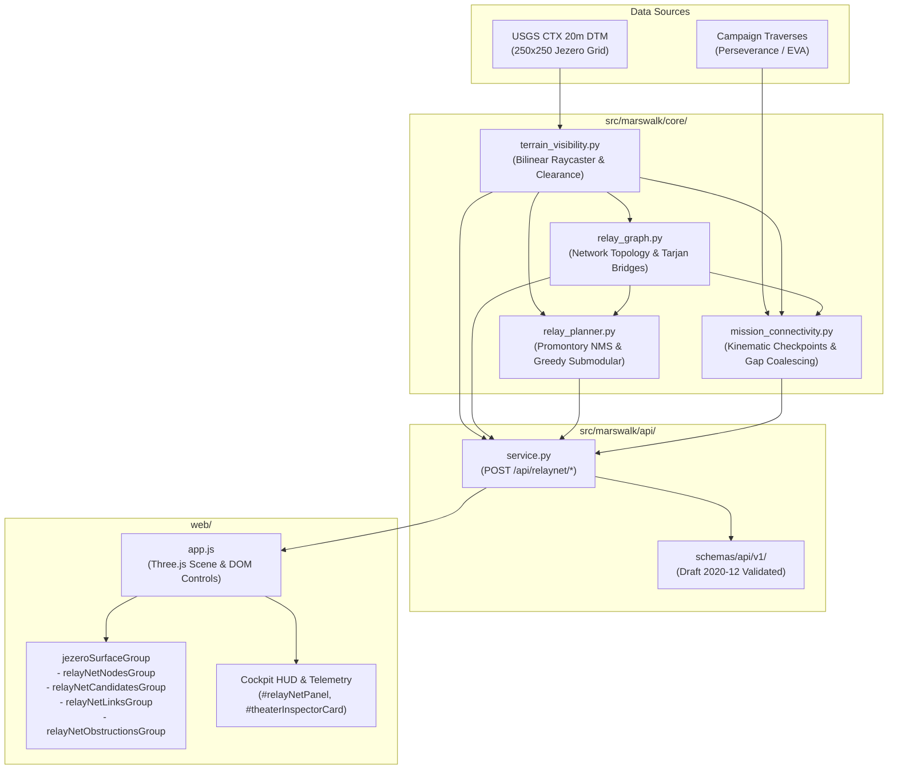

# Atlas Mars RelayNet: System Architecture & Communications Digital Twin

## 1. Executive Overview

**Atlas Mars RelayNet** is an autonomous mission communications planning and geometric connectivity analysis engine integrated into **MarsWalk 2.0 / Project Atlas**. Operating directly on authentic 20-meter USGS CTX digital elevation models (DTM DOI: `10.5066/P906QQT8`) within Jezero Crater, Mars, RelayNet provides mathematically rigorous, terrain-aware line-of-sight (LOS) visibility evaluation, graph-theoretic network optimization, and dynamic telemetry playback synchronization.

RelayNet bridges the gap between surface traverse mobility planning and mission communications resilience. It enables mission controllers, planetary roboticists, and evaluators to:
1. Predict geometric line-of-sight occlusions caused by crater rims, delta scarps, and ridge crests.
2. Formulate multi-hop surface relay graphs with deterministic pathfinding and single-point-of-failure analysis.
3. Automatically identify and optimize candidate promontory relay placements using submodular greedy coverage maximization.
4. Dynamically track real-time communications connectivity states (`CONNECTED_DIRECT`, `CONNECTED_RELAYED`, `SIMULATED_GEOMETRIC_CONNECTIVITY_GAP`) across continuous mission timelines.
5. Visually inspect communications rays, active multi-hop carrier beams, and terrain collision points in an interactive Three.js 3D Mission Theater.

---

## 2. Scientific & Operational Disclosures

> [!IMPORTANT]
> **Planetary Geospatial Provenance:**
> Elevation and slope fields are evaluated strictly against the authentic USGS Jezero Crater CTX DTM at 20-meter post spacing, projected to the IAU 2000 Mars Spheroid ($R_{\text{Mars}} = 3,396,190\text{ m}$). No synthetic terrain or artificial noise is introduced.

> [!WARNING]
> **Geometric vs. RF Communication Distinction:**
> RelayNet computes **geometric Line-of-Sight (LOS)** and graph reachability based purely on topography and user-configured antenna heights. Geometric clearance does **not** guarantee an operational RF link. Radio-frequency phenomena—such as Fresnel zone diffraction, dielectric attenuation by atmospheric dust, ground multi-path reflection, antenna radiation patterns, transmit power limits, bandwidth, link margins, and noise temperatures—are not modeled. RelayNet results must never be cited as certifying an operational radio link for astronauts or flight missions.

---

## 3. High-Level System Architecture

The following diagram illustrates the component architecture and data flow across the backend core engines, REST API layer, and frontend Three.js presentation:



---

## 4. Subsystem Breakdown

### 4.1 Terrain Visibility Engine (`src/marswalk/core/terrain_visibility.py`)
- **Bilinear Elevation Sampling:** Interpolates continuous sub-grid Martian elevations $z(r, c)$ with strict $-9000\text{ m}$ NoData sentinel rejection.
- **Parametric Ray Tracing:** Evaluates line segment $P(t) = P_0 + t(P_1 - P_0)$ at spatial intervals $\Delta s \le \frac{1}{2}\min(dx, dy) \approx 9.486\text{ m}$, satisfying the Nyquist spatial sampling theorem.
- **Topographic Clearance:** Computes clearance $c(t) = h_{\text{LOS}}(t) - z(t)$ along the ray. If $c(t) \le 0$, marks the link as `BLOCKED` and records the exact coordinates, distance, and depth of the maximum collision ridge.
- **Range Constraints:** Enforces configurable Euclidean threshold distances (e.g., $2500\text{ m}$ for direct surface links, $5000\text{ m}$ for elevated mast relays).

### 4.2 Mars Relay Network Graph (`src/marswalk/core/relay_graph.py`)
- **Dual Adjacency Graph:** Represents nodes (Base Stations, Surface Relays, Exploration Units) and validated bidirectional LOS edges.
- **Breadth-First Search (BFS) Reachability:** Computes shortest-hop paths from all exploration units to the central Base Station.
- **Tarjan Bridge & Cut-Vertex Detection:** Discovers critical single-point-of-failure communication relays whose loss would partition the network and isolate exploration units.
- **Algebraic Connectivity:** Computes the Fiedler eigenvalue $\lambda_2(L)$ of the unweighted graph Laplacian matrix, providing a spectral measure of network synchronization and robustness.

### 4.3 Promontory Screening & Relay Planner (`src/marswalk/core/relay_planner.py`)
- **Promontory Detection:** Analyzes the Jezero DTM to identify high-elevation peaks with substantial local prominence ($> 25\text{ m}$ above the local $15 \times 15$ mean).
- **Engineering Feasibility Screening:** Rejects sites with slope $> 12^\circ$ or overall elevation $< -2500\text{ m}$.
- **Non-Maximum Suppression (NMS):** Enforces an anti-clustering separation threshold ($\ge 450\text{ m}$) to ensure spatial diversity across candidate sites.
- **Greedy Submodular Coverage:** Iteratively selects $k$ relay locations that maximize incremental path coverage, achieving a provable $(1 - 1/e) \approx 63.2\%$ approximation ratio for monotone submodular set coverage.

### 4.4 Dynamic Mission Connectivity Digital Twin (`src/marswalk/core/mission_connectivity.py`)
- **Kinematic Checkpoint Interpolation:** Evaluates network connectivity at uniform temporal intervals ($10\text{ seconds}$) along mission traverse polylines.
- **Three-Tier Connectivity Classification:**
  - `CONNECTED_DIRECT`: Direct geometric LOS to Base Station within $2500\text{ m}$.
  - `CONNECTED_RELAYED`: Indirect multi-hop path to Base Station via active relay mesh.
  - `SIMULATED_GEOMETRIC_CONNECTIVITY_GAP`: Disconnected from Base Station due to terrain blockage or range limitation.
- **Gap Interval Coalescing:** Merges adjacent blackout checkpoints into formal mission blackout intervals with start/end MET, duration, traversed distance, and occluding obstacles.
- **SHA-256 Provenance Fingerprinting:** Caches mission connectivity calculations using a deterministic SHA-256 hash of the trajectory coordinates and relay configurations.

---

## 5. Three.js 3D Mission Theater Integration

RelayNet seamlessly extends the existing Atlas 3D Mission Theater (`jezeroSurfaceGroup`) via a dedicated sub-hierarchy:

```
jezeroSurfaceGroup
└── relayNetGroup
    ├── relayNetNodesGroup
    │   ├── Octavia E. Butler Base Station Mast (Lattice mast, rotating transceiver, cyan beacon)
    │   └── Active Relay Towers (Hexagonal base, truss mast, swiveling parabolic dish, emerald beacon)
    ├── relayNetCandidatesGroup
    │   └── Holographic Candidate Pins (Amber pulsating markers on Jezero promontories)
    ├── relayNetLinksGroup
    │   ├── Clear LOS Links (Emerald dashed line segments)
    │   └── Obstructed Rays (Crimson dashed rays terminating at collision points)
    └── relayNetObstructionsGroup
        └── Terrain Occlusion Diamonds (Pulsating 3D red octahedron at ridge collision peaks)
```

### Zero-Allocation 60 FPS Render Loop
To maintain 60 FPS performance during interactive camera manipulation and real-time timeline scrubbing, RelayNet utilizes pre-allocated Three.js geometries and reusable scratch vectors (`_rnVecA`, `_rnVecB`, `_rnVecMid`). Dynamic links and carrier beams are constructed via `LineSegments` and `BufferGeometry` attributes, eliminating runtime garbage collection pauses.

---

## 6. REST API Endpoint Specification

| Endpoint | Method | Input Payload | Output Response | Schema |
| :--- | :--- | :--- | :--- | :--- |
| `/api/relaynet/los` | `POST` | `source`, `target`, `options` | `LineOfSightResult` (clearance, obstruction point) | `relaynet-evaluation.schema.json` |
| `/api/relaynet/graph` | `POST` | `nodes`, `edges` (optional) | Graph topology, components, bridges, cut-vertices | `relaynet-evaluation.schema.json` |
| `/api/relaynet/candidates` | `GET` | *(None)* | List of 12 Jezero promontory candidate sites | `relaynet-evaluation.schema.json` |
| `/api/relaynet/optimize` | `POST` | `base_station`, `target_units`, `relay_budget` | Selected relays, reachability %, hop counts | `relaynet-evaluation.schema.json` |
| `/api/relaynet/timeline` | `POST` | `route_id`, `sampling_interval_s`, `relays` | Connectivity checkpoints, gaps, availability % | `relaynet-timeline.schema.json` |

---

## 7. Integration with MarsWalk Modules

1. **Mission Theater (13C):** Displays live 3D antenna beacons, multi-hop microwave beams, and spatial occlusion markers. Clicking any relay opens the 5-tier spatial inspector card.
2. **Digital Twin (10A):** Updates kinematic rover communications telemetry (`HDG`, `SPD`, `COMM HOPS`, `LATENCY`) synchronized with timeline scrubbing.
3. **Mission Robustness Lab (12E):** Stress-tests communication network resilience under simulated relay dropouts and antenna height degradations.
4. **Autonomous Rehearsal Director (12F) & Causal Replay Studio (12G):** Records communication loss events in the causal ledger and evaluates autonomous detour recovery vs. wait-for-relay operational protocols.
