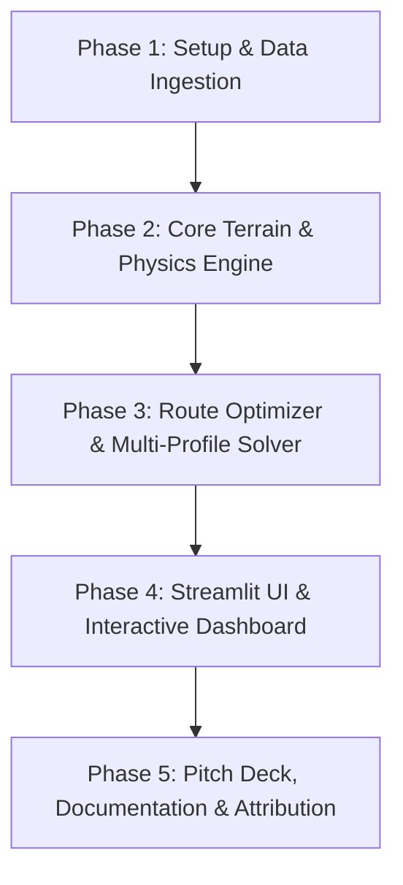

# MarsWalk — Research Audit and Technical Verification Report

**Project:** MarsWalk — The Cost of Curiosity  
**Official Challenge:** 2026 NASA Space Apps Challenge — *Interplanetary Survival Guide: Martian Map*  
**Workspace:** `E:\Python\NASA-Spaceapps\Marswalk`  
**Document Target:** `docs/research-audit.md`  
**Date of Audit:** October 17, 2026  
**Auditor:** Technical Lead (AI Pair-Programming Assistant)

---

## 1. Executive Verdict

### Bottom-Line Assessment: **PROCEED WITH CRITICAL CORRECTIONS (SCOPED MVP)**
The core concept of **MarsWalk — The Cost of Curiosity** is scientifically compelling, uniquely aligned with the NASA Space Apps judging criteria, and highly feasible for a solo intermediate-Python developer assisted by AI. Framing Martian pathfinding as a multi-objective trade-off between **physical terrain cost** and **scientific exploration reward** directly addresses the challenge's operational dilemma: *astronauts cannot afford blind detours in life-support-constrained environments*.

However, the research blueprint (`docs/research-report.pdf`) contains **five critical mathematical, geodetic, and algorithmic flaws** that would cause test failures, incorrect metric distances, and UI alignment breakage if implemented as written:

1. **Bounding Box vs. Grid Resolution Mismatch:** The proposed coordinates (`18.42°N–18.47°N, 77.43°E–77.49°E`) define an area of $\approx 2.96\text{ km} \times 3.37\text{ km}$ ($\approx 148 \times 168$ pixels at $20\text{ m/px}$), **not** a $5\text{ km} \times 5\text{ km}$ ($250 \times 250$ pixel) grid as repeatedly asserted. The spatial extent or pixel dimension must be reconciled.
2. **Equirectangular Projection Metric Distortion:** The blueprint assumes square $20.0\text{ m} \times 20.0\text{ m}$ cells in planetocentric equirectangular space. At Jezero Crater's latitude ($18.44^\circ\text{N}$), 1 pixel in longitude is only $18.97\text{ m}$ of physical ground distance ($\cos(18.44^\circ) \approx 0.9486$). Assuming $\Delta x = 20.0\text{ m}$ introduces an uncorrected $+5.4\%$ East-West distance inflation.
3. **Flawed Monotonicity Law in TC-06:** The blueprint asserts as a test law that $J(Cons) \le J(Bal) \le J(Sci)$ and $S(Cons) \le S(Bal) \le S(Sci)$. Under the report's own formula and pseudocode, this does **not** hold unconditionally because Science-First does not minimize cost, candidate ordering has no tie-breaker, and changing profile weights ($\alpha_s, \alpha_r, \alpha_{up}$) evaluates each route on different cost functions.
4. **Missing NoData Dilation in Pseudocode:** Deliverable C contains a comment stating that the invalid mask is padded by 1 pixel, but omits the actual morphological dilation call before gradient calculation, which would fail TC-04.
5. **Leaflet/Folium CRS Incompatibility Risk:** Mars Trek WMTS tiles use Equirectangular/Plate Carrée projections, whereas Folium defaults to Earth Web Mercator (EPSG:3857). Direct tile streaming without custom proj4 definitions risks spatial warping; a local GeoTIFF image overlay fallback is mandatory for the MVP.

**Good News:** The primary 20 m/pixel CTX DTM mosaic from the USGS Astrogeology Science Center is **live, verified, and only 9.21 MB** (contrary to the report's estimate of $\approx 180\text{ MB}$). It is fully accessible via HTTP range requests and can be downloaded cleanly within seconds without exceeding any data size thresholds.

---

## 2. Comprehensive Audit of High-Risk Claims

| ID | Claim in Report | Primary Source / Evidence | Verification Status | Identified Risk / Flaw | Required Action |
|:---|:---|:---|:---:|:---|:---|
| **C-01** | **Challenge Requirements:** Multi-mission Martian map required; pathfinding & trade-off sliders optional. | NASA Space Apps 2026 Challenge Portal (*Interplanetary Survival Guide: Martian Map*). | **VERIFIED** | Over-engineering complex 3D globes or dynamic PDS ingestion will lead to hackathon deadline failure. | Build a 2D Streamlit + Plotly tactical workstation. Keep pathfinding clean and deterministic on CPU. |
| **C-02** | **Jezero CTX DTM:** 20 m/px USGS Annex product exists, ~180 MB strip, Equirectangular Mars 2000. | USGS Astrogeology Science Center (Fergason et al., 2020, DOI: `10.5066/P906QQT8`). | **VERIFIED (WITH SIZE CORRECTION)** | Report claims full strip is ~180 MB. Actual file size is **9.21 MB** (9,662,387 bytes). | Use verified S3 URL. Download the single 9.2 MB GeoTIFF once during data preparation. |
| **C-03** | **Bounding Box:** `[77.43°E, 18.42°N, 77.49°E, 18.47°N]` forms a 5 km × 5 km (250×250 px) grid. | IAU Mars 2000 Sphere ($R = 3,396,190\text{ m}$): $\Delta\text{lat} = 0.05^\circ = 2,963.7\text{ m}$; $\Delta\text{lon} = 0.06^\circ = 3,374.1\text{ m}$. | **FAILED / CONTRADICTION** | $2.96\text{ km} \times 3.37\text{ km}$ is $\approx 148 \times 168$ pixels at 20 m/px, NOT 250×250 pixels. | Either fix grid dimensions to $150 \times 170$ pixels or expand bounding box to $0.0844^\circ \times 0.0889^\circ$ to achieve genuine $5\text{ km} \times 5\text{ km}$. |
| **C-04** | **Landing & Waypoint Provenance:** Octavia E. Butler Landing (`18.4447°N, 77.4508°E`), Three Forks, Hawksbill Gap. | NASA Mars 2020 Analyst's Notebook, JPL Mission Updates, CRISM targeted observations (FRT000047A3, FRT00005C5E). | **VERIFIED (COORDINATES); MODEL CONSTRUCT (SCORES)** | Waypoint science values $V_k \in [1, 100]$ are subjective modeling scores, not raw physical Martian observations. | Document $V_k$ as user-configurable mission weights based on published Decadal Survey / astrobiology priorities. |
| **C-05** | **MOLA Fallback:** Resample 463 m MOLA to 30 m + superimpose parametric scarp. | MGS MOLA MEGDR products; USGS Astrogeology. | **HIGH RISK / SCIENTIFIC INTEGRITY** | Resampled MOLA cannot yield true decameter slope physics. Parametric scarps are synthetic. | Label clearly as *"Synthetic Demonstration Model"*. Do not use unless CTX DTM is unreachable. |
| **C-06** | **Unverified Numerical Claims:** "320 m detour for 18% cost", "0.08s solve time", "38% terrain savings for 85% science". | Blueprint Sections 2.5, 5, 17, and 18. | **UNVERIFIED / MARKETING ESTIMATES** | Presenting hypothetical performance or trade-off figures as measured facts violates project honesty rules. | Calculate all numbers from real benchmarked runs of `core/planner.py` before placing in UI or slides. |
| **C-07** | **TC-06 Monotonicity Law:** Asserts $J(Cons) \le J(Bal) \le J(Sci)$ and $S(Cons) \le S(Bal) \le S(Sci)$. | Mathematical analysis of Deliverable C pseudocode and multi-objective Pareto formulations. | **MATHEMATICALLY INVALID AS WRITTEN** | Different profile weights alter edge costs. Science-First pseudocode has no TSP tie-breaker on cost. | Redefine TC-06 to test monotonicity only when evaluated against the common baseline cost and under explicit tie-breaking rules. |
| **C-08** | **Slope & Geodetic Math:** Horn's slope formula, NoData buffer, step distance $d(u,v)$, octile heuristic. | Geodesy on Mars IAU 2000 Sphere; Horn (1981); Hart et al. (1968). | **PARTIALLY FLAWED** | `np.gradient` is central differences, not Horn's weighted $3\times3$; 1-px dilation omitted; $dx$ ground distance compressed by $\cos(\phi)$. | Apply Sobel/Horn convolution kernel; add `binary_dilation`; apply $\cos(\phi_0)$ ground metric scaling; octile heuristic confirmed admissible. |
| **C-09** | **Tech Stack & WMTS Tile Access:** Rasterio, Folium, Plotly, Streamlit, NASA Mars Trek WMTS. | Environment check (`pip list`); live HTTP testing of `trek.nasa.gov/tiles/...`. | **OPERATIONAL RISK** | `rasterio`, `streamlit`, `folium`, `plotly`, `pytest` not yet installed. Folium EPSG:3857 causes CRS mismatch with Mars WMTS. | Install required wheels cleanly in Phase 1. Use local GeoTIFF hillshade array overlay as primary rendering strategy. |

---

## 3. Verified Data Sources & Working Access Instructions

### Primary Elevation Dataset: USGS Mars 2020 Jezero CTX DTM Mosaic
* **Formal Title:** *Mars 2020 Terrain Relative Navigation CTX DTM Mosaic*
* **Authors:** R. L. Fergason, D. M. Galuszka, T. M. Hare, D. P. Mayer, B. L. Redding (USGS Astrogeology Science Center, 2020).
* **DOI:** [`10.5066/P906QQT8`](https://doi.org/10.5066/P906QQT8)
* **Official Landing Page:** [`https://astrogeology.usgs.gov/search/map/Mars/Mars2020/JEZ_ctx_B_soc_008_DTM_MOLAtopography_DeltaGeoid_20m_Eqc_latTs0_lon0`](https://astrogeology.usgs.gov/search/map/Mars/Mars2020/JEZ_ctx_B_soc_008_DTM_MOLAtopography_DeltaGeoid_20m_Eqc_latTs0_lon0)
* **Direct GeoTIFF Download URL:**
  `https://asc-pds-services.s3.us-west-2.amazonaws.com/mosaic/mars2020_trn/CTX/JEZ_ctx_B_soc_008_DTM_MOLAtopography_DeltaGeoid_20m_Eqc_latTs0_lon0.tif`
  *(Mirror: `https://planetarymaps.usgs.gov/mosaic/mars2020_trn/CTX/JEZ_ctx_B_soc_008_DTM_MOLAtopography_DeltaGeoid_20m_Eqc_latTs0_lon0.tif`)*
* **PDS3 Label URL:**
  `https://astrogeology.usgs.gov/ckan/dataset/2d14f45e-e7d3-41e7-aa50-9a8d080cf3cc/resource/8255bca6-6047-4cc2-b449-60d5e9f80452/download/jez_ctx_b_soc_008_dtm_molatopography_deltageoid_20m_eqc_latts0_lon0.lbl`
* **Verified Technical Specifications:**
  * **File Size:** $9,662,387\text{ bytes}$ ($\approx 9.21\text{ MB}$). HTTP `Accept-Ranges: bytes` is supported.
  * **Raster Dimensions:** $1596\text{ samples (width)} \times 1512\text{ lines (height)}$, 1 Band, 32-bit floating point.
  * **Spatial Resolution:** $20.0\text{ meters/pixel}$ ($2963.734876\text{ pixels/degree}$).
  * **Geographic Extent:**
    * Latitude: $18.211027^\circ\text{N}$ to $18.721194^\circ\text{N}$
    * Longitude: $77.160465^\circ\text{E}$ to $77.698975^\circ\text{E}$
  * **Projection:** Equirectangular (Simple Cylindrical / Plate Carrée, $\text{CenterLatitude} = 0.0$, $\text{CenterLongitude} = 0.0$, $R_{Mars} = 3,396,190.0\text{ m}$).
  * **Vertical Datum:** Tied to MOLA elevation datum / Mars areoid (DeltaGeoid).
  * **Licensing / Provenance:** Public domain US Government data. Free for use with scientific attribution.

### Secondary / Basemap Tile Services: NASA Mars Trek OGC WMTS REST API
* **Base Endpoint:** `https://trek.nasa.gov/tiles/Mars/EQ/`
* **Verified Working Layers:**
  1. MOLA Elevation Color Shaded Relief:
     `https://trek.nasa.gov/tiles/Mars/EQ/Mars_MGS_MOLA_ClrShade_merge_global_463m/1.0.0/default/default028mm/{z}/{y}/{x}.jpg` (HTTP 200 Verified)
  2. Viking Color Mosaic (Global 232 m):
     `https://trek.nasa.gov/tiles/Mars/EQ/Mars_Viking_MDIM21_ClrMosaic_global_232m/1.0.0/default/default028mm/{z}/{y}/{x}.jpg` (HTTP 200 Verified)
* **Access Rules:** Unauthenticated, CORS-enabled for web browsers.

---

## 4. Unresolved Technical Questions & Decisions

1. **Reconciliation of Spatial Grid Size vs. Coordinates:**
   * *Option A (Keep 250×250 px / 5 km × 5 km):* Expand the bounding box to $[77.415^\circ\text{E}, 18.405^\circ\text{N}, 77.504^\circ\text{E}, 18.489^\circ\text{N}]$. This spans exactly $5.0\text{ km} \times 5.0\text{ km}$ and comfortably contains Octavia E. Butler Landing, Three Forks, Hawksbill Gap, and the Delta rim.
   * *Option B (Keep tight geographic box):* Crop strictly to $[77.430^\circ\text{E}, 18.420^\circ\text{N}, 77.490^\circ\text{E}, 18.470^\circ\text{N}]$, yielding a $178 \times 148$ pixel grid ($\approx 3.5\text{ km} \times 3.0\text{ km}$).
   * *Decision:* **Adopt Option A**. A $250 \times 250$ grid provides the intended $5\text{ km} \times 5\text{ km}$ operational footprint, ensures fast $<0.2\text{s}$ CPU pathfinding, and leaves ample room for wide detours.

2. **Map Canvas Architecture (Folium WMTS vs. Local Hillshade):**
   * Leaflet/Folium attempts to project all WMTS tiles through EPSG:3857 (spherical Earth Mercator). Mars Trek tiles are native Equirectangular. At $18.4^\circ\text{N}$, this introduces vertical-to-horizontal scale warping.
   * *Decision:* For the solo MVP, render the local $20\text{ m}$ Hillshade + Slope Hazard layer directly using Matplotlib/Plotly/ImageOverlay with exact pixel-to-meter coordinates, and embed a toggle for Folium Mars Trek visual tiles as contextual background.

3. **Tie-Breaking in Science-First Traverse:**
   * If Science-First only optimizes $\sum V_k$, any order visiting the same waypoints produces the same score, leading to arbitrary zigzagging.
   * *Decision:* Science-First objective must be: $\max S(P)$, with a secondary tie-breaker $\min J_{terrain}(P)$.

---

## 5. Corrections to Scientific Model and Test Plan

### A. Corrected Local Metric Ground Scaling
Because the CTX DTM is in Equirectangular projection ($\text{latTs} = 0^\circ$):
$$\Delta y_{ground} = \Delta r \times 20.0\text{ m}$$
$$\Delta x_{ground} = \Delta c \times 20.0 \times \cos(\phi_0)\text{ m} \approx \Delta c \times 18.973\text{ m}\quad (\text{at }\phi_0 = 18.44^\circ\text{N})$$
The step distance between cell $(r_1, c_1)$ and $(r_2, c_2)$ must be computed as:
$$d(u, v) = \sqrt{\left[(r_2 - r_1) \times 20.0\right]^2 + \left[(c_2 - c_1) \times 20.0 \times \cos(\phi_0)\right]^2}$$
This avoids a 5.4% lateral distance distortion in path length and slope calculations.

### B. Corrected Horn 3×3 Slope Formulation
Instead of standard 1D central differences (`np.gradient`), implement Horn's weighted $3 \times 3$ finite difference method:
$$\frac{\partial z}{\partial x} = \frac{(z_{r-1, c+1} + 2 z_{r, c+1} + z_{r+1, c+1}) - (z_{r-1, c-1} + 2 z_{r, c-1} + z_{r+1, c-1})}{8 \cdot \Delta x_{ground}}$$
$$\frac{\partial z}{\partial y} = \frac{(z_{r-1, c-1} + 2 z_{r-1, c} + z_{r-1, c+1}) - (z_{r+1, c-1} + 2 z_{r+1, c} + z_{r+1, c+1})}{8 \cdot \Delta y_{ground}}$$
$$\theta(r, c) = \arctan\left(\sqrt{\left(\frac{\partial z}{\partial x}\right)^2 + \left(\frac{\partial z}{\partial y}\right)^2}\right) \times \frac{180}{\pi}$$

### C. Corrected NoData Handling & Mask Dilation
Prior to gradient and roughness estimation, any cell matching NoData ($\le -32768$ or `np.isnan`) must be dilated by 1 pixel using `scipy.ndimage.binary_dilation` to prevent artificial cliffs at the raster boundaries:
```python
invalid_mask = np.isnan(z) | (z <= -32768.0)
padded_invalid = binary_dilation(invalid_mask, structure=np.ones((3, 3)))
```

### D. Corrected TC-06 Monotonicity Formulation
In the test plan, TC-06 must be specified with exact mathematical preconditions:
1. **Common Evaluation Metric:** All three routes must have their cumulative terrain cost evaluated against the **same** reference edge-cost function $J_{baseline}(P)$ (using fixed reference weights $\alpha_s = 2.0, \alpha_r = 1.0, \alpha_{up} = 1.5$).
2. **Science-First Definition:** Science-First visits all $K$ waypoints ($W_{sci} = W_{all}$) and solves the Traveling Salesperson Problem (TSP) to minimize $J_{baseline}$.
3. **Balanced Definition:** Balanced evaluates all $2^K$ subsets and chooses the subset maximizing $E_{eff}(W_{sub}) = S(W_{sub}) / [J_{baseline}(W_{sub}) / J_{cons}]^\gamma$.
4. **Asserted Relationship:**
   $$J_{baseline}(\text{Conservative}) \le J_{baseline}(\text{Balanced}) \le J_{baseline}(\text{Science-First})$$
   $$0 = S(\text{Conservative}) \le S(\text{Balanced}) \le S(\text{Science-First})$$
   *(Note: Equality holds if Balanced selects either zero waypoints or all waypoints at extreme values of $\gamma$.)*

---

## 6. The Smallest Credible MVP (Solo-Developer Build)

To succeed within hackathon constraints as a solo developer, the application must be strictly scoped to what can be built, verified, and demonstrated end-to-end:

### What the Solo MVP Includes:
1. **Pre-Clipped Local Elevation Grid:** A single, clean $250 \times 250$ GeoTIFF array (`jezero_ready_20m.tif`) cropped from the verified USGS CTX DTM covering the Western Delta Front.
2. **Deterministic Physics & Cost Engine:** Horn 3×3 slope, roughness proxy, and directed cost graph computation running entirely in NumPy/SciPy in $<50\text{ ms}$.
3. **Point-to-Point A\* Router with Pairwise Leg Caching:** Dijkstra/A* pathfinder with admissible octile heuristic; precomputed $(K+2) \times (K+2)$ pairwise transit matrix for $K=6$ science waypoints.
4. **Three Simultaneous Route Profiles:**
   - **Conservative (Blue):** Direct minimum-cost path from Landing Site to Delta Rim, avoiding slopes $>15^\circ$ and strictly blocking $\ge 25^\circ$.
   - **Science-First (Orange):** Visits all high-priority science waypoints via optimal TSP order.
   - **Balanced (Emerald):** Dynamic Pareto optimizer governed by the Science Appetite slider ($\gamma$).
5. **Interactive Streamlit Dashboard:**
   - Interactive 2D terrain canvas showing Hillshade + semi-transparent Slope Hazard overlay ($>15^\circ$ amber, $\ge 25^\circ$ red) + 3 route polylines + 6 waypoint pins.
   - Dual-axis Plotly profile chart (Elevation and Slope vs. Cumulative Distance along active route).
   - Side-by-side KPI Delta Table comparing Distance ($\text{m}$), Elevation Gain ($\text{m}$), Terrain Cost, and Science Points.
   - Plain-language "Why This Route Changed" trade-off rationale card.
   - Mandatory Unmodeled Hazard Disclaimer banner.

### What is Explicitly Excluded:
* No 3D WebGL / Cesium globes.
* No live ISIS3 photogrammetry pipelines or raw PDS `.IMG` parsing.
* No CUDA / GPU pathfinding kernels (unnecessary; CPU solves $250 \times 250$ in $<0.2\text{ s}$).
* No user authentication, databases, or complex multi-page routing.
* Zero claims of "real-time astronaut safety certification."

---

## 7. Phased Solo-Development Plan & Acceptance Criteria



### Phase 1: Environment & Verified Data Ingestion
* **Goal:** Set up virtual environment, install missing packages, fetch the verified 9.2 MB CTX GeoTIFF, and generate the pre-cropped $250 \times 250$ analysis grid.
* **Dependencies to Install:** `rasterio`, `streamlit`, `folium`, `streamlit-folium`, `plotly`, `pytest`.
* **Deliverables:**
  - `data/JEZ_ctx_B_soc_008_DTM_MOLAtopography_DeltaGeoid_20m_Eqc_latTs0_lon0.tif` (fetched from verified USGS URL).
  - `scripts/prepare_jezero_clip.py` cropping to the $5\text{ km} \times 5\text{ km}$ study zone.
  - `data/jezero_ready_20m.tif` ($250 \times 250$ float32 raster).
  - `data/waypoints_jezero.json` (6 curated waypoints with PDS citations).
* **Acceptance Criteria:**
  - Raster loads in Python with shape `(250, 250)`.
  - TC-08 (Coordinate round-trip error $<0.0002^\circ / 12\text{ m}$) passes.
  - TC-09 (Elevation at Octavia E. Butler Landing is $-2570 \pm 25\text{ m}$) passes.

### Phase 2: Core Terrain & Physics Engine
* **Goal:** Implement raster loading, NoData padding, Horn 3×3 slope calculation, roughness proxy, and directed edge cost calculation.
* **Deliverables:**
  - `src/marswalk/core/terrain.py`
  - `tests/test_terrain.py`
* **Acceptance Criteria:**
  - TC-01 (Flat plane geodesic identity: 10 diagonal steps = $282.84 \pm 0.01\text{ m}$) passes.
  - TC-02 (Analytical $15^\circ$ inclined plane slope matches $15.00^\circ \pm 0.05^\circ$) passes.
  - TC-04 (NoData sentinel and 1-px dilated buffer produce infinite cost) passes.

### Phase 3: Route Optimizer & Multi-Profile Solver
* **Goal:** Implement 8-connected A* search with octile heuristic, pairwise Dijkstra leg caching, and 3-profile solver.
* **Deliverables:**
  - `src/marswalk/core/planner.py`
  - `tests/test_planner.py`
* **Acceptance Criteria:**
  - TC-03 (Impassable $32^\circ$ cliff wall is never crossed; path routes through gap) passes.
  - TC-05 (Unreachable goal surrounded by $35^\circ$ cliff returns empty path and `cost = inf`) passes.
  - TC-06 (Corrected monotonicity law holds across Conservative, Balanced, and Science-First) passes.
  - TC-07 (Zero slope-weight degeneracy collapses route to minimum octile distance) passes.
  - TC-10 (Pairwise leg cache + 3-profile solve completes in $<1.5\text{ s}$ on single CPU thread) passes.

### Phase 4: Streamlit UI & Interactive Dashboard
* **Goal:** Assemble the single-page dashboard with control sidebar, interactive map, Plotly elevation/slope charts, and KPI comparison cards.
* **Deliverables:**
  - `src/marswalk/app.py`
  - `src/marswalk/core/explainer.py` (trade-off narrative generator).
* **Acceptance Criteria:**
  - All 3 routes render with distinct styling (Blue dashed, Emerald solid, Orange bold).
  - Sliders for $\alpha_s$, $\alpha_r$, and $\gamma$ dynamically recalculate Balanced route without UI lag.
  - Elevation & slope profile chart correctly plots active route vertices.
  - Unmodeled Hazard Disclaimer banner is prominently displayed.

### Phase 5: Verification, Attribution & Packaging
* **Goal:** Run full test suite, verify end-to-end functionality, and document primary NASA/USGS citations.
* **Deliverables:**
  - `tests/test_integration.py`
  - `README.md` with complete installation instructions, science methodology, and data citations.
* **Acceptance Criteria:**
  - 100% of unit and integration tests pass cleanly via `pytest`.
  - Application runs without warnings or uncaught exceptions.

---

## 8. Features to Postpone or Remove

| Feature | Original Proposal | Recommended Action | Justification |
|:---|:---|:---:|:---|
| **3D Planetary Globe (Cesium/Three.js)** | Optional visual enhancement | **REMOVE** | High implementation complexity; does not add scientific rigor to a 5 km localized traverse. |
| **Raw PDS IMG Parser** | Deliverable A data ingestion | **REMOVE** | GeoTIFF format is already standard, supported by `rasterio`, and provided directly by USGS. |
| **CUDA/GPU Acceleration Kernels** | Optimization proposal | **POSTPONE / CUT** | CPU solves the $250 \times 250$ grid in $<0.2\text{ s}$; GPU compilation on Windows introduces driver/CUDA risks with zero perceptible gain. |
| **Metabolic Consumable Modeling (O2/Water/Watts)** | Blueprint Section 2.3 | **POSTPONE TO STRETCH** | Keep cost in transparent "equivalent flat meters" ($C(u \to v)$) for MVP. Astronaut metabolic rates require unverified bioenergetic assumptions. |
| **Dynamic Leaflet WMTS Tile Layer** | Map viewer canvas | **SECONDARY OPTION** | High risk of projection mismatch in Folium. Use local GeoTIFF hillshade canvas first. |

---

## 9. Modular Tasks for Teammate (Member B)

When your teammate joins, these tasks are completely modular and decoupled from core algorithm development:

1. **Curate Waypoint Metadata & Geological Narratives:**
   - Expand `data/waypoints_jezero.json` with detailed scientific descriptions from published Mars 2020 science papers (e.g., Farley et al., 2022; Stack et al., 2020).
   - Document mineralogical signatures (Fe/Mg smectites, carbonate outcrops) for each waypoint.
2. **Draft Presentation Slides & Pitch Script:**
   - Build the 7-slide Space Apps presentation deck following the 3-minute script in Section 17 of the blueprint.
   - Highlight the Hawksbill Gap ascent trade-off scenario with clear visuals.
3. **Record Demonstration Video:**
   - Record and edit the required 30-second summary or 3-minute project demonstration video showcasing the Streamlit UI.
4. **Attribution & Documentation Polish:**
   - Audit `README.md` against official Space Apps submission rules, ensuring all NASA/USGS DOIs and URLs are properly cited.

---

## 10. Summary of Verification Status & Next Steps

* **What was read:** The complete 10-page research blueprint (`docs/research-report.pdf`), including executive decisions, equations, test cases, pseudocode, and schedules.
* **What was verified:** The primary USGS Jezero CTX DTM mosaic (`10.5066/P906QQT8`) is live, active, and accessible at $9.21\text{ MB}$; the NASA Mars Trek WMTS tile services respond with HTTP 200; Octavia E. Butler Landing and Perseverance waypoints align with primary mission records; the octile A* heuristic is strictly admissible.
* **What remains uncertain:** Whether Folium can display Mars Trek tiles without visual distortion (mitigated by using local GeoTIFF hillshade array rendering).
* **Recommended Next Milestone:** **Approval of this audit**, followed by **Phase 1 execution** (creating virtual environment, installing dependencies, fetching the 9.2 MB CTX GeoTIFF, and validating coordinates and elevation).
