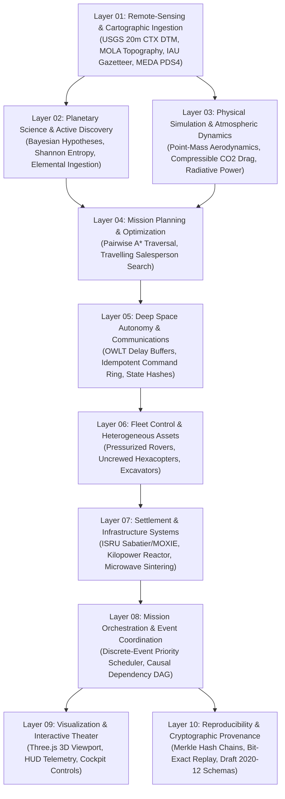

# Project Atlas: Research Architecture Overview

**Document ID:** `ATLAS-DOC-ARCH-001`  
**Classification:** Research Simulation Software Framework  
**Target Audience:** Planetary Scientists, Robotics Researchers, Software Engineers  
**Repository:** [`E:/Python/NASA-Spaceapps/Marswalk`](file:///e:/Python/NASA-Spaceapps/Marswalk)

---

## 1. Executive Architecture Summary

Project Atlas / MarsWalk 2.0 is an integrated, modular research simulation ecosystem designed to model autonomous surface exploration and long-duration settlement campaigns on Mars. The architecture is organized into ten distinct functional layers, ensuring loose coupling, strict interface contracts, and bit-exact reproducibility.

---

## 2. Comprehensive Layer Definitions

### Layer 01: Remote-Sensing & Cartographic Ingestion
- **Authoritative Assets:** Authentic USGS Jezero Crater 20 m/pixel Digital Terrain Model (`jezero_ready_20m.tif`), MRO CTX orthorectified imagery, IAU Gazetteer (2,061 features), and Mars 2020 Perseverance MEDA atmospheric telemetry.
- **Role:** Establishes the real spatial and physical coordinate frame. No synthetic topography is generated.

### Layer 02: Planetary Science & Active Discovery
- **Modules:** [`atlas_scientific_operations.py`](file:///e:/Python/NASA-Spaceapps/Marswalk/src/marswalk/core/atlas_scientific_operations.py).
- **Role:** Implements Bayesian hypothesis testing on mineralogical, geochemical, and geological targets. Computes Shannon information entropy $H(p)$ in bits and enforces an 8-tier epistemic taxonomy.

### Layer 03: Physical Simulation & Environmental Dynamics
- **Modules:** [`mars_rotor_aerodynamics.py`](file:///e:/Python/NASA-Spaceapps/Marswalk/src/marswalk/core/mars_rotor_aerodynamics.py), [`mars_thermal_environment.py`](file:///e:/Python/NASA-Spaceapps/Marswalk/src/marswalk/core/mars_thermal_environment.py), [`terrain.py`](file:///e:/Python/NASA-Spaceapps/Marswalk/src/marswalk/core/terrain.py).
- **Role:** Calculates Horn 8-neighborhood slope rasters, barometric hypsometric profiles ($H_\rho \approx 11.1\text{ km}$), solar irradiance attenuation during dust storms ($\tau \in [0.4, 3.0]$), and rotor tip Mach numbers ($M_{\text{tip}} < 0.75$).

### Layer 04: Mission Planning & Multi-Objective Optimization
- **Modules:** [`planner.py`](file:///e:/Python/NASA-Spaceapps/Marswalk/src/marswalk/core/planner.py), [`atlas_campaign_compiler.py`](file:///e:/Python/NASA-Spaceapps/Marswalk/src/marswalk/core/atlas_campaign_compiler.py).
- **Role:** Executes terrain-constrained $A^*$ search and multi-stop TSP heuristics across candidate science targets, optimizing traversals under battery, life-support, and slope limits.

### Layer 05: Deep Space Autonomy & Communications
- **Modules:** [`atlas_autonomous_operations.py`](file:///e:/Python/NASA-Spaceapps/Marswalk/src/marswalk/core/atlas_autonomous_operations.py).
- **Role:** Simulates interplanetary radio propagation delay ($OWLT \in [3, 22]\text{ min}$), maintains command execution queues, rejects commands with stale state hashes, and deduplicates retransmitted packets.

### Layer 06: Fleet Control & Heterogeneous Assets
- **Modules:** [`atlas_unified_asset_manager.py`](file:///e:/Python/NASA-Spaceapps/Marswalk/src/marswalk/core/atlas_unified_asset_manager.py).
- **Role:** Tracks health, power state, spatial coordinates, and operational lease locks for rovers, rotorcraft, and autonomous construction machinery.

### Layer 07: Settlement & Infrastructure Systems
- **Modules:** [`atlas_resource_operations.py`](file:///e:/Python/NASA-Spaceapps/Marswalk/src/marswalk/core/atlas_resource_operations.py).
- **Role:** Balances mass and energy flows for Kilopower fission reactor generation, MOXIE $O_2$ production, Sabatier fuel methanation, and microwave regolith block sintering.

### Layer 08: Mission Orchestration & Event Coordination
- **Modules:** [`atlas_mission_event_coordinator.py`](file:///e:/Python/NASA-Spaceapps/Marswalk/src/marswalk/core/atlas_mission_event_coordinator.py), [`atlas_mission_execution_core.py`](file:///e:/Python/NASA-Spaceapps/Marswalk/src/marswalk/core/atlas_mission_execution_core.py).
- **Role:** Provides the deterministic discrete-event heart. Enforces topological task execution across multi-sol phases and manages autonomous fault detection and load-shedding.

### Layer 09: Visualization & Interactive Theater
- **Assets:** [`web/index.html`](file:///e:/Python/NASA-Spaceapps/Marswalk/web/index.html), [`web/app.js`](file:///e:/Python/NASA-Spaceapps/Marswalk/web/app.js), Three.js WebGL viewport.
- **Role:** Displays 3D draped terrain, vehicle trajectories, real-time HUD telemetry, and interactive contingency designers for mission operators.

### Layer 10: Reproducibility & Cryptographic Provenance
- **Modules:** [`atlas_mission_state.py`](file:///e:/Python/NASA-Spaceapps/Marswalk/src/marswalk/core/atlas_mission_state.py), [`atlas_mission_replay.py`](file:///e:/Python/NASA-Spaceapps/Marswalk/src/marswalk/core/atlas_mission_replay.py).
- **Role:** Generates SHA-256 Merkle hash chains over timeline snapshots, produces auditable Decision Packs, and verifies bit-exact deterministic replay.
