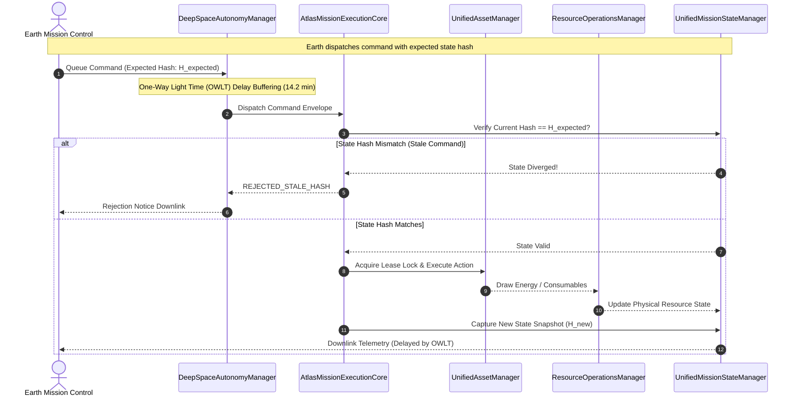

# Project Atlas: Data Flow & Inter-Subsystem Telemetry Pipelines

**Document ID:** `ATLAS-DOC-FLOW-001`  
**Classification:** Software Data Engineering  
**Repository:** [`E:/Python/NASA-Spaceapps/Marswalk`](file:///e:/Python/NASA-Spaceapps/Marswalk)

---

## 1. End-to-End Mission Telemetry & Control Loops

In Project Atlas / MarsWalk 2.0, data flows through two major paths:
1. **The Mars Surface Closed-Loop Autonomy Cycle:** High-rate, local telemetry feedback among sensors, resources, and vehicles.
2. **The Interplanetary Ground-to-Space Control Loop:** High-latency, delayed command dispatching and telemetry downlink across deep-space distances ($OWLT \approx 3\text{ to }22\text{ minutes}$).

---

## 2. Telemetry Packet Schema & Verification Pipeline

All telemetry exchanged between modules conforms to strict JSON data contracts:
- **Observation Packet:** Includes `observation_id`, `source_asset_id`, `sol`, `sol_time`, `location` (latitude, longitude, elevation), `instrument_type`, `modality`, `data` dictionary, and quantitative `uncertainty` metrics.
- **Resource Ledger Step:** Captures generation rates (kW, kg/sol), consumption loads, current storage levels, battery state of charge (SOC %), and the net mass discrepancy:
  $$\Delta M = M_{\text{final}} - (M_{\text{initial}} + M_{\text{in}} - M_{\text{out}})$$
  Enforcing $|\Delta M| \le 10^{-4}\text{ kg}$.

---

## 3. Closed-Loop Environmental Hazard Feedback

When an environmental disruption occurs (such as a convective regional dust storm with $\tau = 2.80$):
1. **Physical Environment Update:** `atmospheric_dust_tau` is updated; solar insolation drops from $480\text{ W/m}^2 \to 120\text{ W/m}^2$.
2. **Resource Operations Impact:** Solar PV generation drops by $\sim 78\%$, creating an electrical deficit.
3. **Resilience Coordinator Intervention:** Fault Detection, Isolation, and Recovery (FDIR) identifies the deficit and issues automated load-shedding orders.
4. **Execution Core Response:** Non-essential microwave sintering ($28.0\text{ kWe}$) is suspended immediately, preserving base thermal life support ($294.15\text{ K}$).
5. **DAG Rescheduling:** Downstream construction tasks requiring regolith blocks are automatically transitioned to `PAUSED_CONTINGENCY` until the dust clears and optical depth normalizes ($\tau \le 0.50$).
