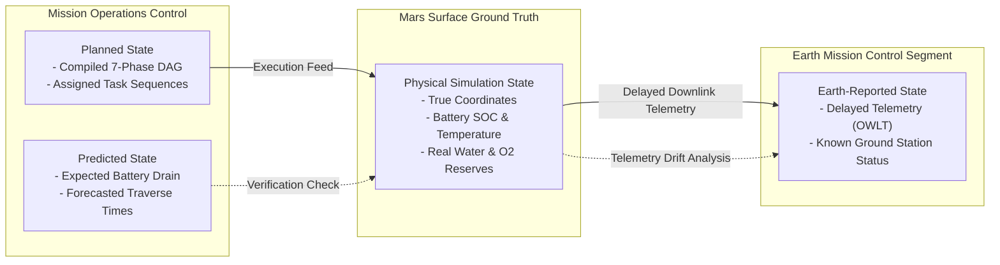

# Project Atlas: Multi-Tier Mission State Model & Cryptographic Provenance

**Document ID:** `ATLAS-DOC-STATE-001`  
**Classification:** State Architecture & Data Integrity  
**Repository:** [`E:/Python/NASA-Spaceapps/Marswalk`](file:///e:/Python/NASA-Spaceapps/Marswalk)

---

## 1. Four-Tier State Architecture

To model the operational reality of deep-space missions, Project Atlas maintains four concurrent state representations within [`UnifiedMissionStateManager`](file:///e:/Python/NASA-Spaceapps/Marswalk/src/marswalk/core/atlas_mission_state.py):



1. **Physical Simulation State (`PhysicalSimulationState`):**  
   The true ground reality on Mars (actual vehicle positions, true battery SOC %, actual atmospheric opacity $\tau$, real habitat pressure $101.3\text{ kPa}$).
2. **Earth-Reported State (`EarthReportedState`):**  
   The delayed telemetry model available at Earth Mission Control. Because of interplanetary light-time delays, Earth's picture is always $3\text{ to }22\text{ minutes}$ in the past.
3. **Predicted State (`PredictedState`):**  
   Forward numerical projections computed by planners prior to task dispatch.
4. **Planned State (`PlannedState`):**  
   The active task sequence and milestone requirements defined by the compiled mission DAG.

---

## 2. Telemetry Drift Detection

Drift occurs when Mars ground truth diverges from Earth's delayed awareness. The state manager computes:
$$\text{power\_drift} = |P_{\text{true}} - P_{\text{reported}}|$$
$$\text{water\_drift} = |M_{\text{water, true}} - M_{\text{water, reported}}|$$
$$\text{position\_drift}_i = \text{EuclideanDistance}(\mathbf{x}_{\text{true}, i}, \mathbf{x}_{\text{reported}, i})$$

If $\text{power\_drift} > 0.0\text{ kWe}$, $\text{water\_drift} > 0.0\text{ kg}$, or any $\text{position\_drift} > 0.0\text{ m}$, the system marks:
$$\text{is\_synchronized} = \text{False}$$
This triggers an automatic audit flag in the cockpit HUD.

---

## 3. Cryptographic Merkle State Hashing

At every discrete step $k$, an immutable state snapshot is captured:
$$H_k = \text{SHA-256}\Big(\text{CanonicalJSON}(S_k) \mathbin{\Vert} H_{k-1}\Big)$$
Where $S_k$ is the canonical serialized dictionary of physical and operational state variables.

```
Snapshot k=00: H_00 = 8f72a1... (Genesis Hash)
Snapshot k=01: H_01 = SHA256(S_01 || H_00)
...
Snapshot k=60: H_60 = f9d124cfac3738ddb403be883ba273c2c9bc4af96b75f71a6ca66a96cb65bd14 (Root Hash)
```

Any retrospective alteration of vehicle trajectories, resource inventories, or incident responses immediately invalidates downstream hashes, guaranteeing tamper-evident auditability.
