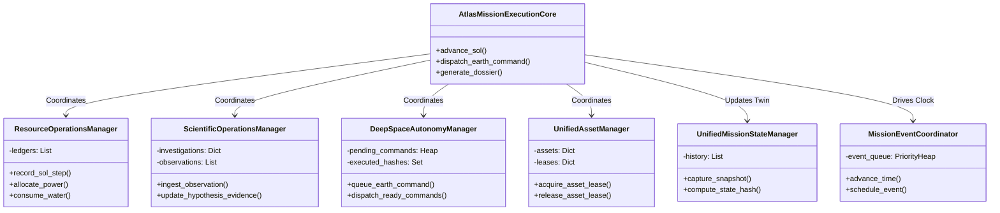

# Project Atlas: Subsystem Ownership & Computational Authority

**Document ID:** `ATLAS-DOC-OWN-001`  
**Classification:** Software Systems Architecture  
**Repository:** [`E:/Python/NASA-Spaceapps/Marswalk`](file:///e:/Python/NASA-Spaceapps/Marswalk)

---

## 1. Domain Ownership Manifesto

In Project Atlas / MarsWalk 2.0, state mutation authority is strictly partitioned. No module may directly overwrite or mutate state belonging to another subsystem domain. All inter-subsystem coordination is mediated via formal interfaces, lease locks, or event envelopes.

---

## 2. Subsystem Ownership Matrix

| Subsystem Domain | Authoritative Module | State Owned & Managed | Forbidden Cross-Mutations |
|:---|:---|:---|:---|
| **Resource Operations** | [`atlas_resource_operations.py`](file:///e:/Python/NASA-Spaceapps/Marswalk/src/marswalk/core/atlas_resource_operations.py) | Kilopower electrical output, battery SOC %, water storage, oxygen storage, regolith sintered blocks, mass/energy ledgers. | Other modules cannot alter water or power reserves directly. Must request via resource API. |
| **Scientific Operations** | [`atlas_scientific_operations.py`](file:///e:/Python/NASA-Spaceapps/Marswalk/src/marswalk/core/atlas_scientific_operations.py) | Observation registry, Bayesian hypothesis records, prior/posterior probabilities, Shannon entropy bits. | Other modules cannot mark hypotheses as validated or invent fake observation records. |
| **Deep Space Autonomy** | [`atlas_autonomous_operations.py`](file:///e:/Python/NASA-Spaceapps/Marswalk/src/marswalk/core/atlas_autonomous_operations.py) | Interplanetary OWLT delay buffers, inbound/outbound command queues, cryptographic hash rings for deduplication. | No subsystem may bypass the light-time delay or dispatch commands without state-hash verification. |
| **Fleet Asset Management** | [`atlas_unified_asset_manager.py`](file:///e:/Python/NASA-Spaceapps/Marswalk/src/marswalk/core/atlas_unified_asset_manager.py) | Fleet registry (`ATLAS-ROVER-01`, `HEXACOPTER-SURVEYOR-02`, etc.), coordinates, operational status, lease locks. | Assets cannot be assigned simultaneously to conflicting tasks without formal lease release. |
| **Mission State Twin** | [`atlas_mission_state.py`](file:///e:/Python/NASA-Spaceapps/Marswalk/src/marswalk/core/atlas_mission_state.py) | Immutable state snapshots, 4-tier state twins (Physical, Earth-Reported, Predicted, Planned), Merkle hash chain. | Snapshots once captured are strictly immutable (`frozen=True`). History cannot be truncated. |
| **Discrete Event Engine** | [`atlas_mission_event_coordinator.py`](file:///e:/Python/NASA-Spaceapps/Marswalk/src/marswalk/core/atlas_mission_event_coordinator.py) | Simulation clock ($MET$, Sol, $L_s$), min-heap event priority queue, causal dispatch log. | Clock cannot run backwards. Events cannot be popped out of topological priority order. |
| **Campaign Compilation** | [`atlas_campaign_compiler.py`](file:///e:/Python/NASA-Spaceapps/Marswalk/src/marswalk/core/atlas_campaign_compiler.py) | High-level objective parsing, 7-phase mission DAG generation, task dependency trees. | Compilation occurs prior to execution. DAG structures must be strictly acyclic. |

---

## 3. Orchestration vs Calculation Modules

To maintain architectural transparency for external reviewers, modules are classified as either **Orchestration Components** or **Computational Engines**:

### Computational Engines (Perform Direct Numerical Calculations)
- [`terrain.py`](file:///e:/Python/NASA-Spaceapps/Marswalk/src/marswalk/core/terrain.py): Executes Horn convolution kernel for spatial slopes.
- [`planner.py`](file:///e:/Python/NASA-Spaceapps/Marswalk/src/marswalk/core/planner.py): Runs $A^*$ priority queue traversal and 2-Opt local search TSP.
- [`mars_rotor_aerodynamics.py`](file:///e:/Python/NASA-Spaceapps/Marswalk/src/marswalk/core/mars_rotor_aerodynamics.py): Computes momentum-theory thrust, blade profile drag, and compressible Mach corrections.
- [`atlas_scientific_operations.py`](file:///e:/Python/NASA-Spaceapps/Marswalk/src/marswalk/core/atlas_scientific_operations.py): Computes Bayesian likelihood odds updating and Shannon binary entropy $H(p)$.

### Orchestration Components (Coordinate Data Flow & Enforce Rules)
- [`atlas_mission_execution_core.py`](file:///e:/Python/NASA-Spaceapps/Marswalk/src/marswalk/core/atlas_mission_execution_core.py): Orchestrates phase progression, handles contingency branch switching, and calls domain engines.
- [`atlas_mission_event_coordinator.py`](file:///e:/Python/NASA-Spaceapps/Marswalk/src/marswalk/core/atlas_mission_event_coordinator.py): Manages causal time progression and event dispatching.
- [`atlas_mission_replay.py`](file:///e:/Python/NASA-Spaceapps/Marswalk/src/marswalk/core/atlas_mission_replay.py): Audits cryptographic state hashes across sequential snapshots to verify bit-exact determinism.
