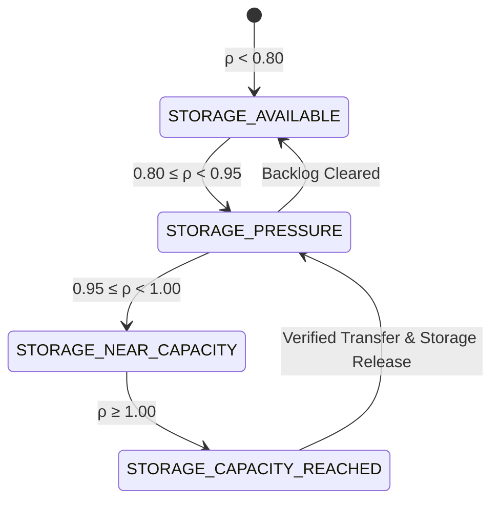

# Science Data Logistics & Transfer Accounting Methods
## Byte Conservation Invariant, Buffer Pressure State Machine & Simulated Contact Windows

**System Component:** `src/marswalk/core/mission_data_ledger.py`  
**Milestone:** 13G-R Release Qualification  
**Project:** MarsWalk 2.0 / Project Atlas  
**Classification:** Planetary Onboard Data Logistics & Local Surface Communications  

---

## 1. First Law of Mission Storage (Byte Conservation Invariant)

In MarsWalk 2.0, onboard storage is treated with rigorous mass-conservation rigor. Not a single byte is generated, transferred, or purged without an immutable audit entry.

### The Storage Identity
At any mission epoch $t$:

\[
S_{\text{used}}(t) = S_{\text{used}}(0) + \sum_{i=1}^N S_{\text{gen}, i}(t) - \sum_{j=1}^M S_{\text{rel}, j}(t)
\]

where:
- $S_{\text{used}}(t)$: Instantaneous storage occupied in bytes.
- $S_{\text{gen}, i}(t)$: Bytes generated by observation $i$ and stored in onboard flash memory.
- $S_{\text{rel}, j}(t)$: Bytes released from flash storage following verified transfer acknowledgment.

### The Backlog Accounting Identity
The transfer backlog $D_{\text{backlog}}(t)$ represents all collected data bytes that have not yet been successfully acknowledged at the surface base station:

\[
D_{\text{backlog}}(t) = D_{\text{collected}}(t) - D_{\text{transferred}}(t) - D_{\text{purged}}(t)
\]

Every byte generated remains in $D_{\text{backlog}}$ until receipt acknowledgment is logged (`status == TRANSFER_VERIFIED`).

---

## 2. Storage Pressure State Machine

To anticipate buffer overflows before mission failure occurs, `MissionDataLedger` evaluates storage utilization ratio:

\[
\rho_{\text{storage}} = \frac{S_{\text{used}}}{S_{\text{capacity}}}
\]

### Operational States
- `STORAGE_AVAILABLE`: Nominal condition ($\rho < 80\%$). New observations accepted immediately.
- `STORAGE_PRESSURE`: Warning condition ($80\% \le \rho < 95\%$). Storage gauge glows amber. Transfer queue prioritizing high-priority products.
- `STORAGE_NEAR_CAPACITY`: Critical threshold ($95\% \le \rho < 100\%$). Storage gauge glows red. Observations without protected permanent tags risk queue stalling.
- `STORAGE_CAPACITY_REACHED`: Buffer saturated ($\rho = 100\%$). Any further observation generation without transfer release raises `StorageCapacityExceededError`.
- `TRANSFER_QUEUE_BACKLOG`: Triggered when untransferred backlog exceeds available simulated transfer bandwidth.
- `HIGH_PRIORITY_DATA_PENDING`: Un-downlinked data products with priority $>80.0$ waiting in queue.

---

## 3. Communications-Aware Simulated Data Transfer Model

### Explicit Boundary Disclosure
MarsWalk strictly simulates local tactical line-of-sight data transfer between the exploration rover and the local Surface Base Station (either directly or multi-hop via RelayNet masts). It explicitly makes NO claim of Direct-To-Earth (DTE) radio downlink via the NASA Deep Space Network (DSN).

### Deterministic Transfer Integration
During an active contact window $\Delta t$ with configured link data rate $R_{\text{configured}}$ (bps):

\[
D_{\text{transferred}} = \min\left( D_{\text{queued}}, \frac{R_{\text{configured}} \cdot \Delta t}{8} \right) \quad [\text{bytes}]
\]

### Transfer Precondition & Release Policy
Storage bytes are **NEVER** released upon scheduling or during transmission. Storage release occurs only after complete packet delivery is confirmed:
- `TRANSFER_THEN_RELEASE`: Released immediately upon verified receipt at Base Station (`TRANSFER_VERIFIED`).
- `PROTECTED_PERMANENT`: Never released from onboard flash memory regardless of transfer status.
- `TRANSFER_THEN_RETAIN`: Kept in flash memory as local backup until explicit mission clearance.
- `VOLATILE_SCRATCH`: Cleared at the end of the local processing window.
