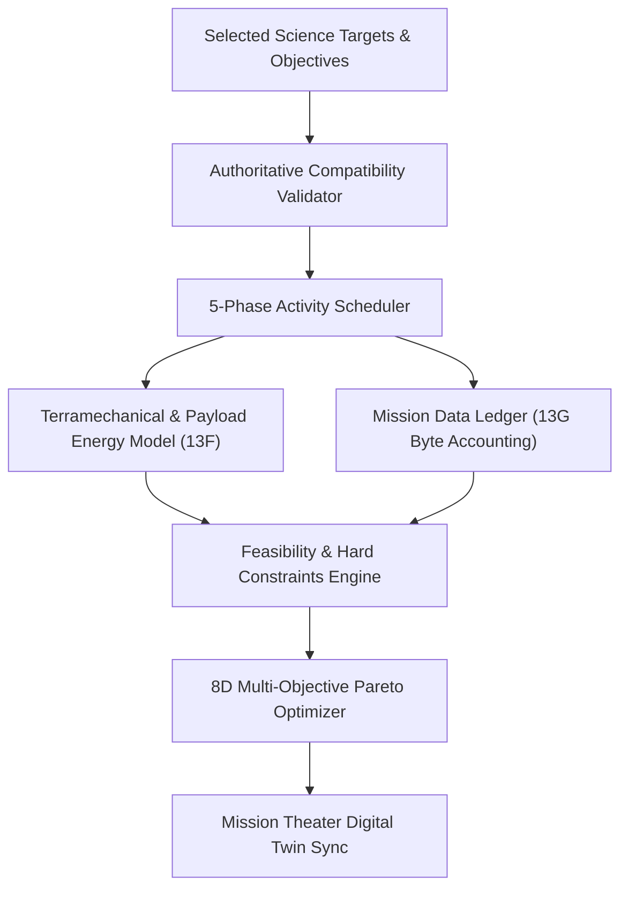
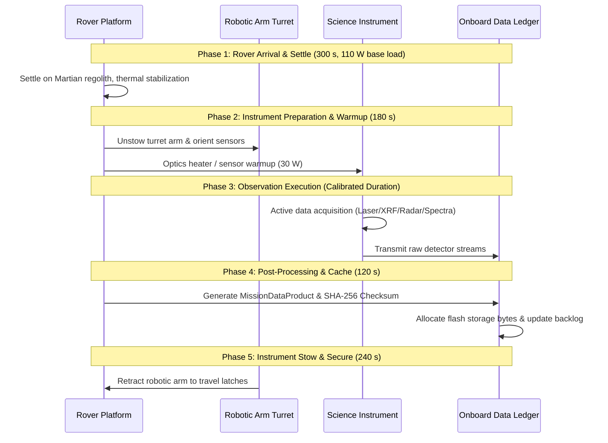

# Atlas Science Mission Planner Architecture
## Multi-Instrument Observation Scheduling, Target Prioritization & Resource Integration

**System Component:** `src/marswalk/core/science_mission_planner.py`  
**Milestone:** 13G-R Release Qualification  
**Project:** MarsWalk 2.0 / Project Atlas  
**Architecture Classification:** Planetary In-Situ Science Observation & Traverse Co-Design  

---

## 1. Architectural Overview

The Science Mission Planner integrates surface science observations with traverse kinematics, energy budgeting, and onboard data accounting. It transforms a spatial rover route from a passive point-to-point traverse into an active scientific exploration mission.

---

## 2. Science Target Prioritization & Tri-State Provenance

Targets are modeled via `ScienceTargetConfig`:

### Priority Provenance Classification
To ensure scientific integrity and prevent operator preference from being misrepresented as empirical truth, every target priority carries an explicit provenance tag:
1. `USER_ASSIGNED_PRIORITY`: Priority explicitly input by an astronaut, science team lead, or human operator.
2. `SOURCE_DERIVED_PRIORITY`: Priority derived from peer-reviewed mission literature (e.g., Farley et al. 2020, Mangold et al. 2021).
3. `UNASSESSED_PRIORITY`: Default score when no specific evaluation exists; never treated as high-confidence discovery value.

### Multi-Objective Preference Utility
Mission science utility is calculated as a normalized linear preference utility:

\[
U_{\text{science}} = \sum_{k=1}^K w_{\text{target}, k} \cdot S(T_k) \cdot \mathbb{I}_{\text{completed}}(T_k)
\]

where $S(T_k) \in [0, 100]$ is the configured priority score, $w_{\text{target}, k}$ is the relative target weight, and $\mathbb{I}_{\text{completed}}(T_k) = 1$ only if all scheduled observation phases finish within mission time and energy limits.

---

## 3. Chronological 5-Phase Observation Scheduling

At every scheduled target stop, the planner decomposes scientific activities into 5 discrete phases to capture realistic mechanical and electrical overheads:

### Cumulative Energy Cost for Target Stop
For target $T_k$ with instruments $M(T_k)$:

\[
E_{\text{target}}(T_k) = P_{\text{base}} \cdot \Delta t_{\text{settle}} + \sum_{m \in M(T_k)} \left[ (P_{\text{base}} + P_{\text{warmup}}) \cdot \Delta t_{\text{warmup}} + (P_{\text{base}} + P_m) \cdot \Delta t_m + (P_{\text{base}} + P_{\text{cache}}) \cdot \Delta t_{\text{cache}} \right] + P_{\text{base}} \cdot \Delta t_{\text{stow}}
\]

This energy is integrated into the battery state-of-charge (SOC) accounting from Milestone 13F. If battery SOC drops below the configured `reserve_margin_pct`, an `ENERGY_CONSTRAINT_VIOLATION` is flagged.
