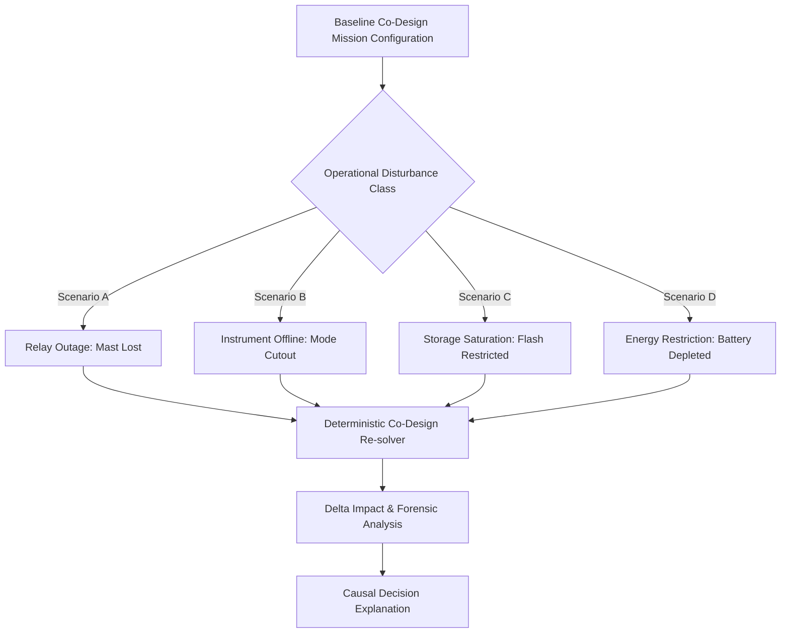

# Atlas Science Return Recovery Lab
## Deterministic Operational Disturbance Simulation, Causal Re-planning & Forensic Dossier

**System Component:** `src/marswalk/api/service.py::science_mission_recovery_lab_api`  
**Endpoint:** `POST /api/science-mission/recovery-lab`  
**Milestone:** 13G-R Release Qualification  
**Project:** MarsWalk 2.0 / Project Atlas  

---

## 1. Vision & Purpose

The **Atlas Science Return Recovery Lab** is the flagship decision-support capability introduced in Milestone 13G-R. 

In real planetary surface missions, exploration campaigns are subject to unexpected disturbances: surface relay hardware can fail, an instrument spectrometer can suffer thermal cutouts, flash memory can saturate due to transfer link dropouts, and batteries can degrade faster than nominal predictions.

The Recovery Lab allows flight planners to introduce **controlled, deterministic disturbances** to an active baseline mission configuration and evaluate how the co-design system replans its science return, energy allocation, and data logistics.

---

## 2. Four High-Value Disturbance Scenarios



### Scenario A — Relay Outage
- **Disturbance**: Field surface relay masts are disabled (`relay_budget = 0`), forcing communication to rely solely on direct line-of-sight to the Surface Base Station.
- **Metrics Evaluated**:
  - Reduction in line-of-sight communications coverage ($\Delta \text{Coverage}\% \le 0$).
  - Increase in simulated transfer queue backlog ($\Delta D_{\text{backlog}} \ge 0$).
  - Storage buffer pressure transitions (e.g. `STORAGE_AVAILABLE` $\to$ `TRANSFER_QUEUE_BACKLOG`).

### Scenario B — Instrument Unavailable
- **Disturbance**: A specific primary instrument (e.g. `SUPERCAM_LIBS`) is flagged offline.
- **Metrics Evaluated**:
  - Targets replanned using surviving compatible instruments (e.g. falling back to Mastcam-Z or PIXL).
  - Lost science utility points ($\Delta \text{Points} \le 0$).
  - Energy and time saved from skipped instrument operation ($\Delta E < 0$, $\Delta t < 0$).

### Scenario C — Storage Saturation
- **Disturbance**: Onboard flash capacity is severely restricted (e.g., reduced to 12.5% of baseline or 500 MB).
- **Metrics Evaluated**:
  - Buffer saturation threshold ($\rho_{\text{storage}} \to 100\%$).
  - Storage pressure transition to `STORAGE_CAPACITY_REACHED`.
  - Queue priority ordering: high-priority products retained, lower-priority observations deferred.

### Scenario D — Energy Restriction
- **Disturbance**: Usable rover battery capacity is reduced to 20% of nominal (e.g. 960 Wh) with an increased reserve margin floor of 35%.
- **Metrics Evaluated**:
  - Dominance of hard feasibility constraints: plans that deplete battery below the reserve margin are disqualified regardless of science utility.
  - Number of constraint violations logged.
  - Surviving achievable science utility under strict survival mode.

---

## 3. Forensic Decision Dossier & API Contract

### Request Payload (`POST /api/science-mission/recovery-lab`)
```json
{
  "scenario_type": "relay_outage",
  "base_payload": {
    "start_rc": [117, 157],
    "goal_rc": [138, 114],
    "base_station": {"name": "Octavia Butler Base", "row": 117, "col": 157, "antenna_height_m": 10.0},
    "relay_budget": 2,
    "weights": {"distance": 0.15, "gap_duration": 0.20, "relay_cost": 0.15, "metabolic_energy": 0.10, "science": 0.40},
    "science_targets": [
      {
        "target_id": "three_forks",
        "target_name": "Three Forks Sample Depot",
        "grid_coord": [138, 114],
        "priority_score": 75.0,
        "primary_objective": "GEOLOGICAL_CHARACTERIZATION",
        "selected_modes": ["SUPERCAM_LIBS", "PIXL_XRF_GRID"]
      }
    ],
    "storage_capacity_bytes": 17179869184,
    "simulated_transfer_rate_bps": 2000000.0,
    "retention_policy": "TRANSFER_THEN_RELEASE"
  }
}
```

### Response Schema
```json
{
  "status": "success",
  "schema_version": "1.0.0",
  "scenario_type": "relay_outage",
  "baseline_configuration_id": "TRV_01_SHORTEST",
  "disturbed_configuration_id": "TRV_01_SHORTEST",
  "baseline_summary": {
    "science_points_total": 75.0,
    "total_energy_wh": 182.4,
    "comms_coverage_pct": 84.2,
    "data_transferred_mb": 52.0,
    "storage_peak_mb": 52.0,
    "storage_pressure_state": "STORAGE_AVAILABLE",
    "is_pareto": true,
    "feasibility": "FEASIBLE"
  },
  "disturbed_summary": {
    "science_points_total": 75.0,
    "total_energy_wh": 182.4,
    "comms_coverage_pct": 42.1,
    "data_transferred_mb": 26.0,
    "storage_peak_mb": 52.0,
    "storage_pressure_state": "TRANSFER_QUEUE_BACKLOG",
    "is_pareto": false,
    "feasibility": "FEASIBLE"
  },
  "delta_metrics": {
    "delta_science_points": 0.0,
    "delta_energy_wh": 0.0,
    "delta_coverage_pct": -42.1,
    "delta_data_transferred_mb": -26.0,
    "delta_backlog_mb": 26.0
  },
  "forensic_narrative": "SCENARIO A: Field relay mast lost. Communication depends exclusively on direct LOS to Base Station. Connectivity dropped by 42.1%, simulated transfer backlog increased by 26.0 MB."
}
```
