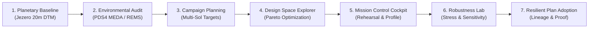

# MarsWalk 2.0 / Project Atlas — Evaluator Demonstration Runbook
## 5-Minute Interactive Walkthrough: Science-Grounded Multi-Sol Campaign Orchestration

**System Under Test:** MarsWalk 2.0 / Project Atlas  
**Repository:** `E:\Python\NASA-Spaceapps\Marswalk`  
**Target Environment:** Local Python Server (`http://127.0.0.1:3000`), WebGL / Three.js 3D Viewport  
**Scientific Integrity Standard:** Zero data fabrication, IAU 2000 Mars Sphere datum, authentic USGS CTX 20m DTM elevation, PDS4 MEDA/REMS environmental archives.

---

## 🚀 Quick Launch (Evaluator Setup)

MarsWalk 2.0 provides a single-command Windows launcher that verifies dependencies, tests server health, avoids duplicate processes, and opens the Conference Demonstration Edition directly:

```powershell
# One-click conference demonstration launcher (recommended):
powershell -ExecutionPolicy Bypass -File scripts\start_marswalk_demo.ps1
```

Or start the server manually:
```powershell
.\.venv\Scripts\python.exe scripts\run_atlas.py --port 3000 --demo
```

Verify system health in less than 500 ms:
```powershell
.\.venv\Scripts\python.exe scripts\preflight_check.py --port 3000
```
*Expected Result:* `12/12 checks passed, 0 warnings, 0 failures`.

Direct URL to enter Guided Demonstration Mode:
**`http://127.0.0.1:3000/?mode=demo`**

---

## ⏱️ 5-Minute Demonstration Workflow



---

### Step 1: Jezero 3D Topography & Planetary Baseline (0:00 – 0:45)

1. **Observe the Global-to-Local Context:**
   - The initial view displays the global Mars sphere (IAU 2000 datum, $R=3,396,190\text{ m}$).
   - Click the **"Focus Jezero"** button or select **"Jezero Crater"** from the Planetary Gazetteer.
   - Watch the smooth camera transition down to the Western Delta of Jezero Crater.
2. **Verify Elevation & Topography:**
   - Look at the bottom-left geodetic HUD: Latitude ~$18.442^\circ\text{ N}$, Longitude ~$77.442^\circ\text{ E}$.
   - The terrain mesh renders the authentic **USGS CTX 20m Digital Terrain Model (DTM)** covering $250 \times 250$ cells ($5\times 5\text{ km}$).
   - Notice the elevation readouts between **$-2,624\text{ m}$** and **$-2,445\text{ m}$** relative to the Mars datum.

---

### Step 2: Environmental Intelligence & PDS4 Provenance (0:45 – 1:30)

1. **Open the Environmental Intelligence Panel:**
   - In the tactical navigation sidebar, expand the **"Environmental Intelligence"** section.
   - Observe current environmental metrics:
     - Air Temperature: ~$-61.7^\circ\text{C}$ ($211.5\text{ K}$)
     - Surface Atmospheric Pressure: ~$589.7\text{ Pa}$
     - Optical Depth ($\tau$): ~$0.35$
2. **Inspect Scientific Provenance:**
   - Notice the explicit citation tag: `Mars 2020 MEDA (Perseverance Rover)`.
   - Read the provenance disclosure:
     > *"Latest parsed observation in the retrieved PDS4 index tranche; distinct from unarchived real-time Mars operations."*
   - Toggle the site selector to **Gale Crater**:
     - Notice the instrument immediately switches to `MSL REMS (Curiosity Rover)`.
     - Read the site isolation disclosure: Gale data is isolated ~3,700 km away and never applied to Jezero traverses.

---

### Step 3: Multi-Sol Campaign Planning (1:30 – 2:15)

1. **Select or Load Campaign Targets:**
   - In the **"Campaign Orchestration"** panel, click **"Load Jezero Science Targets"**.
   - 4 scientifically grounded exploration targets will populate:
     - `tgt_octavia`: Octavia E. Butler Landing (Priority 100)
     - `tgt_delta_front`: Kodiak Mesa Delta Front (Priority 90)
     - `tgt_crater_rim`: Belva Crater Rim Exposure (Priority 75)
     - `tgt_neretva_fan`: Neretva Fan Sediments (Priority 85)
2. **Configure Multi-Sol Parameters:**
   - Set **Max Sols**: `3 sols`.
   - Set **Sortie Duration Limit**: `8.0 hours (28,800 s)`.
   - Select **Planning Profile**: `Science Priority`.
3. **Execute Planner:**
   - Click **"Plan Mission Campaign"**.
   - Observe the multi-sol route generation over the 3D terrain: each sol's traverse is rendered in a distinct color-coded vector path, strictly adhering to slope safety thresholds ($\le 15^\circ$ for crew, $\le 20^\circ$ for rover).

---

### Step 4: Campaign Design Space Explorer & Pareto Optimization (2:15 – 3:15)

1. **Launch the Design Space Explorer:**
   - In the **"Design Space & Pareto Optimization"** tab, click **"Explore Design Space"**.
   - The engine evaluates a bounded set of parameter variations across profiles (`Science Priority`, `Time Constrained`, `Conservative`) and durations ($6\text{h}$, $8\text{h}$, $9\text{h}$) using real planner calls.
2. **Inspect the Pareto Frontier Scatter Plot:**
   - A multi-objective scatter plot renders:
     - **Horizontal Axis:** Total Campaign Duration (Hours) — *Minimize*
     - **Vertical Axis:** Science Coverage (%) — *Maximize*
   - Non-dominated (Pareto-efficient) candidates are highlighted in bright green stars.
   - Dominated alternatives are plotted in muted slate circles with hover references to the specific candidates that strictly dominate them.
3. **Review Grounded Trade-off Recommendations:**
   - Read the generated rationales:
     - *Maximal Science Frontier:* Highest coverage achieved, with explicit traverse distance and duration trade-offs.
     - *Expedited Duration Frontier:* Operational time saved (hours of surface exposure reduced) versus coverage delta.
     - *Minimal Distance Frontier:* Minimized mechanical wear on mobility actuators.

---

### Step 5: Candidate Promotion & Baseline Immutability (3:15 – 3:45)

1. **Select a Pareto Frontier Candidate:**
   - Click on the preferred Pareto star in the table (e.g., `cand_cp_01`).
   - Notice the candidate configuration details: planned sorties, science coverage, duration, and distance.
2. **Promote Candidate to New Campaign Version:**
   - Click **"Promote Candidate to New Campaign Version"**.
   - The system creates **Version 2** (`cmp_..._v2`).
3. **Verify Immutability:**
   - In the Campaign dropdown, notice both `Version 1` (Baseline) and `Version 2` (Optimized) are preserved.
   - The baseline campaign remains completely unchanged in persistent storage.

---

### Step 6: Multi-Unit Fleet Allocation & Coordination (3:45 – 4:15)

1. **Open Fleet Coordination Tab:**
   - Switch to the **"Multi-Unit Fleet Coordination"** panel.
   - Observe the configured exploration units:
     - `Unit 1`: Perseverance Rover Analogue (Robotic rover, high autonomy, lower speed $0.12\text{ m/s}$)
     - `Unit 2`: Crew EVA Team Alpha (Astronaut pair, high mobility $0.85\text{ m/s}$, strict $8\text{h}$ life support limit)
2. **Execute Coordination Allocation:**
   - Select Strategy: **Balanced Workload** (`balanced_workload`).
   - Click **"Allocate Fleet Targets"**.
   - Observe the target assignments and scheduled handoffs: targets on steeper slopes are safely allocated to robotic reconnaissance, while proximal high-density sample sites are assigned to crew EVA.

---

### Step 7: Digital Twin Simulation & Temporal Playback (4:15 – 4:45)

1. **Launch Digital Twin:**
   - Click **"Initialize Digital Twin Simulation"**.
   - The temporal execution engine builds the multi-unit timeline with mutual-exclusion intervals:
     - Transit, Dwell, Handoff, Rest, and Hold activities.
2. **Interact with Temporal Playback:**
   - Click **"Play"** or drag the timeline scrubber across Sol 1, Sol 2, and Sol 3.
   - Observe 3D vehicle markers advancing synchronously along their respective terrain routes.
   - Observe the **Event Ledger** logging discrete milestones: `SORTIE_START`, `TARGET_ARRIVE`, `DWELL_COMPLETE`, and `SOL_END`.
   - Any temporal conflict (e.g., simultaneous resource contention) is flagged with severity and mitigation codes.

---

### Step 8: Retrospective Performance Analytics & Evidence Attribution (4:45 – 5:00)

1. **Run Performance Analytics:**
   - Switch to the **"Performance Analytics & Lessons Learned"** panel.
   - Click **"Analyze Campaign Performance"**.
2. **Examine Causal Attribution:**
   - Inspect Sortie Deviations:
     - Any slip or blowout with corroborated disruption events (e.g., holds, terrain hazards) is flagged as **`confirmed_cause`**.
     - Any uncorroborated timing drift is labeled **`undetermined`** — preserving scientific rigor without fabricating causes.
3. **Review Lessons Learned:**
   - Inspect advisory recommendations: buffer adjustments, pacing recommendations, and fleet balance improvements.
   - Read the non-flight disclaimer: all recommendations are advisory planning outputs based on simulated kinematics.

---

### Step 9: Route Decision Workbench & Interactive Topographic Profiling (Milestone 12C)

1. **Topographic Elevation Profile Visualization:**
   - In Tab 2 ("Traverse Telemetry & Metrics"), scroll to the **Route Decision Workbench & Elevation Profile** card.
   - View the authentic USGS CTX 20m DTM elevation profile polyline with color-coded slope segments:
     - Cyan: Normal gradient ($< 10^\circ$)
     - Amber: Moderate gradient ($10^\circ - 15^\circ$)
     - Red: Steep scarp climb ($\ge 15^\circ$)
2. **Synchronized 3D Scrubbing HUD:**
   - Move your mouse cursor across the SVG elevation profile chart.
   - The interactive crosshair line tracks instantaneously, displaying:
     - Cumulative distance along the path ($m$)
     - Surface elevation ($m$)
     - Local terrain slope ($^\circ$)
     - Geodetic IAU 2000 Mars longitude and latitude coordinates ($^\circ\text{E}, ^\circ\text{N}$)
   - Look at the 3D surface viewport: a cyan locator beacon moves synchronously along the 3D terrain surface, providing direct spatial coupling between the 2D profile and 3D topography.
3. **Locomotion Cost Attribution & Reconciliation Ledger:**
   - Click **Locomotion Cost Attribution Breakdown** to expand the additive ledger.
   - Verify that the total modeled locomotion effort ($m$ flat equivalent) strictly equals:
     $$\text{Total Cost} = \text{Base Ground Distance} + \text{Slope Penalty} + \text{Roughness Impedance} + \text{Uphill Climbing Grade}$$
   - Observe the green checkmark: `✓ Strictly Reconciled Additive Model`.
4. **Fair Multi-Objective Alternative Route Comparison:**
   - In the **Alternative Route Comparison** section, choose **Science-First Profile** (or **Balanced**) from the dropdown.
   - Click **⚖️ Compare**.
   - Observe the side-by-side comparison matrix and objective deltas:
     - Distance delta ($\Delta m$)
     - Locomotion effort delta ($\Delta \text{ flat-m}$)
     - Elevation gain delta ($\Delta m$)
     - Maximum traversal slope delta ($\Delta ^\circ$)
   - Read the grounded trade-off narrative: objectively explains whether the alternative is shorter but steeper, or longer but skirts high-impedance terrain, without arbitrary composite weighting.

---

### Step 10: Atlas Mission Control — Unified Cockpit, Rehearsal & Decision Traceability (Milestone 12D)

1. **Access the Unified Mission Operations Cockpit:**
   - In the HUD header, click **"🚀 MISSION CONTROL"** (or select the **"🚀 Cockpit"** tab in the inspector panel).
   - The inspector panel expands into a spacious 600px Mission Operations Cockpit without occluding the 3D Martian terrain.
2. **Select an Exploration Campaign or Mission:**
   - Choose any existing campaign from the **"Active Mission / Campaign"** dropdown (e.g. `Audit Baseline Jezero Science Campaign (v1)` or `cmp_alpha_jezero_crater_basin`).
   - Notice the atomic refresh: zero stale metrics persist; status, lineage (`v1` root vs `v2` promoted), distance, duration, energy, and science yield update synchronously.
3. **Inspect the Route & Synchronized Elevation Profile:**
   - The selected sortie route renders directly on the 3D Jezero surface.
   - Hover or scrub across the interactive SVG elevation profile:
     - The white dashed vertical line tracks cumulative distance and elevation.
     - The 3D waypoint beacon marker moves smoothly across the Jezero terrain in real-time!
     - Topographic metrics show minimum elevation, maximum elevation, total climb ($+m$), total descent ($-m$), and mean slope.
     - The planner cost decomposition bar reconciles distance effort vs slope penalty vs roughness impedance vs uphill work.
4. **Inspect Decision Traceability via the Evidence Inspector:**
   - Click the **"ⓘ"** information button next to any telemetry metric (such as **"Peak Slope"**, **"Traverse Dist"**, **"Energy Cost"**, or **"Air Temp"**).
   - The **Evidence Inspector & Scientific Traceability Modal** opens:
     - Displays the displayed value and SI units.
     - Identifies the scientific classification: `[Measured Remote Sensing]`, `[Derived Planetary Geometry]`, `[In-Situ Archival Observation]`, or `[Mathematical Energy Proxy]`.
     - Cites the primary source archive (USGS CTX DTM, NASA PDS Mars 2020 MEDA Sol 890 tranche, or Apollo Lunar EVA Waligora metabolic model).
     - Displays the exact mathematical formulation and governing equations.
     - Discloses scientific limitations, sub-pixel unresolvable hazards, and the mandatory aerospace non-certification statement.
5. **Rehearse Execution with the Digital Twin Simulator:**
   - Click **"▶ REHEARSE"** on the transport bar.
   - Select a speed multiplier (`1x`, `5x`, `10x`, `MAX`).
   - Watch the simulated mission clock advance smoothly, the timeline scrubber move, and discrete simulated events stream into the **Mission Event Ledger**.
   - Click **"⏸ PAUSE"**, **"⏭ STEP"**, or **"↺ RESET"** to inspect any simulation interval.
6. **Execute Safe Operational Commands:**
   - Click **"🛡 Evaluate Readiness"** to evaluate the deterministic 12-rule readiness gate.
   - Click **"📦 Export Decision Pack"** to download the complete self-contained zip archive with SHA-256 integrity manifest.

---

### Step 11: Atlas Mission Robustness Lab — Deterministic Stress Testing, Sensitivity Analysis & Resilient Plan Adoption (Milestone 12E)

1. **Access the Mission Robustness Lab:**
   - In the HUD inspector tab bar, click **"🛡 Robustness"** (or click **"🛡 Robustness Lab"** from the Mission Control operational commands toolbar).
   - The panel opens in wide cockpit-mode view.
2. **Select Stress Suite:**
   - From the **"Stress Suite Type"** dropdown, select:
     - `★ Full Battery (10 Curated Stress Cases)` (recommended)
     - `Duration Contraction (-15%, -30%, -45%)`
     - `Mobility Derating (0.85x, 0.70x, Slope 12°)`
     - `Operational Holds (+15m, +30m, +60m)`
     - `Corridor Chokepoints (30m, 60m, 100m)`
     - `Compound Operational Gauntlet`
3. **Execute the Deterministic Stress Battery:**
   - Click **"▶ EXECUTE DETERMINISTIC STRESS BATTERY"**.
   - In ~150ms, MarsWalk evaluates all bounded scenarios against the baseline campaign without mutating the original plan.
4. **Inspect the Feasibility Envelope & Bottlenecks:**
   - The Feasibility Envelope Gauge indicates the tested feasibility ratio (e.g. `10 / 10 cases (100%)`).
   - The progress bar visualizes margin stability.
   - Identified physical bottlenecks pinpoint critical constraints (e.g. sortie duration ceilings, traction loss on steep crater walls).
5. **Inspect Parameter Sensitivity Gradients & Elasticities:**
   - The ranked sensitivity list reveals which operational assumptions exert the greatest influence on mission duration and science return.
   - For example, `#1 max_slope_deg` (elasticity $\epsilon = 0.88$, gradient $-261.6\text{ s/unit}$) followed by `#2 speed_factor` (elasticity $\epsilon = 0.38$).
6. **Review Objective & Unit Vulnerabilities:**
   - The Vulnerability Matrix shows which candidate science targets drop first when margins contract (e.g., peripheral waypoints like Skinner Ridge or Enchanted Lake).
7. **Read the Grounded Answers to the 7 Core Engineering Questions:**
   - Read unambiguous, evidence-backed answers to:
     1. *Which assumptions most affect the plan?*
     2. *Under what conditions does it become infeasible?*
     3. *Which objectives and units are most vulnerable?*
     4. *How much does performance change across scenarios?*
     5. *Which plans retain maximum margin?*
     6. *What evidence supports conclusions?*
     7. *What cannot be established?* (Contains mandatory non-probabilistic truth disclosure).
8. **Compare Resilient Strategies & Adopt Selected Plan:**
   - The Strategy Comparison section contrasts:
     - `Baseline Plan (Nominal Profile)`: Maximum nominal science yield under standard conditions.
     - `Conservative High-Margin Strategy`: Builds in larger temporal buffers and slope safety margins; retains superior margin under traction derating.
     - `Agile High-Yield Strategy`: Fast profile maximizing throughput.
   - Click on any candidate strategy card to select it.
   - Click **"⬆ ADOPT RESILIENT STRATEGY"** to promote it into an official new campaign revision (v2), preserving parent lineage and revision metadata.

---

### Step 12: Autonomous Mission Rehearsal Director (Closed-Loop Simulation, Disruption Response & Replay)

1. **Open the Rehearsal Director:**
   - In the HUD inspector tab bar, click **"🎬 Rehearsal"** (or click **"🎬 REHEARSAL DIRECTOR"** in the top header or Cockpit toolbar).
   - The wide cockpit-mode Rehearsal Director panel opens.
2. **Configure Baseline Campaign & Recovery Policy:**
   - Select an exploration campaign from the **"Baseline Exploration Campaign"** dropdown.
   - Choose an adaptive recovery policy:
     - `Balanced (Detour > Shed)`: Prefers conservative detour; sheds only if necessary to preserve margin.
     - `Safety First (Min 3600s)`: Enforces high safety buffers; sheds peripheral targets aggressively.
     - `Max Science (Keep Targets)`: Prioritizes science yield as long as return margin is non-negative.
   - Set the **Min Margin Threshold** (default: 1800s / 30 min).
3. **Configure Supported Disturbances:**
   - Choose a disturbance type:
     - `Operational Delay (+1800s)`: Models sampling holds, comms dropouts, instrument timeouts.
     - `Corridor Closure (50m)`: Models rockfalls or slope failures blocking planned traverse paths.
     - `Mobility Derating (0.7x)`: Models wheel slippage, loose drift sand, or drive throttling.
     - `Target Invalidation`: Models scientific waypoints becoming unviable or hazardous.
     - `Asset / Unit Dropout`: Models equipment faults with multi-unit cross-asset handoff.
   - Set the simulated trigger time (e.g. `T+3600s`).
4. **Execute Closed-Loop Rehearsal:**
   - Click **"▶ EXECUTE REHEARSAL"**.
   - The Director evaluates the paired tri-track simulation:
     - **Track 1 (Baseline):** Nominal uninterrupted trajectory.
     - **Track 2 (Disturbed Unmitigated):** Consequence if no recovery is attempted (margin depletion, obstacle blocks, aborted sorties).
     - **Track 3 (Recovered Closed-Loop):** Autonomous evaluation of 3 competing recovery candidates and execution of the optimal plan.
5. **Inspect the Tri-Track Trajectory Comparison:**
   - Review the **Outcome Status Badge** (`RECOVERED`, `RECOVERED_WITH_DEGRADATION`, or `NO_FEASIBLE_RECOVERY`).
   - Compare quantitative delta metrics: **Science Preserved %**, **Net Science Delta**, **Recovered Margin**, **Delay Incurred**, and **Recovery Efficacy**.
   - Review comparative trajectory progress bars.
6. **Review Evaluated Recovery Candidates:**
   - Inspect the three competing recovery plans:
     - `Conservative Detour`: Reroutes around obstacle / absorbs delay to keep 100% of feasible science.
     - `Target Shedding`: Drops lowest-priority targets to safeguard return margin.
     - `Priority Rebalance / Cross-Asset Reallocation`: Transfers tasks to surviving units or reorders visits.
   - Check selection badges (`SELECTED`, `REJECTED`, `INFEASIBLE`) and review decision rationales.
7. **Trace the Causal Decision Ledger:**
   - Step through the auditable 7-step causal chain:
     `Initial State -> Disturbance Trigger -> Impact Assessment -> Option Space Evaluation -> Selection Decision -> Revised Execution -> Final Outcome`.
8. **Replay & Export Decision Pack:**
   - Click **"► REPLAY SEQUENCE"** to step through events visually on the timeline.
   - Click **"💾 EXPORT DECISION PACK"** to download the RFC 8259 / Draft 2020-12 validated rehearsal record.

---

## 🎬 STEP 13: Causal Replay Studio & Forensic Evidence Inspection (Milestone 12G)

The **Causal Replay Studio** transforms historical and newly executed rehearsals into inspectable, replayable engineering evidence without requiring re-simulation.

```
+-------------------------------------------------------------------------------+
|  MISSION REHEARSAL DIRECTOR                                                   |
|  [Baseline Campaign: Jezero 4-Sol]  [Historical Replay: reh_20261029_... (v)] |
|  [▶ EXECUTE REHEARSAL]   [🔍 LOAD REPLAY]   [RESET]                           |
+-------------------------------------------------------------------------------+
|  ⚠ TRAJECTORY DIVERGENCE: CORRIDOR CLOSURE at T+1800s    [1 SORTIE DIVERGED]  |
|  EXECUTION TRAJECTORY COMPARISON     [SCIENCE] [DURATION] [MARGIN]             |
|  Nominal Baseline:      295.0 pts • Margin: 3h 26m   [████████████████████]   |
|  Disturbed Unmitigated: 195.0 pts • Margin: 0s       [█████████████       ]   |
|  Autonomous Recovered:  295.0 pts • Margin: 3h 11m   [████████████████████]   |
+-------------------------------------------------------------------------------+
|  ⏮ CAUSAL REPLAY SCRUBBER                   STEP 3 / 7 [PHASE: IMPACT EVAL]   |
|  [◀◀] [◀] [▶ PLAY] [▶]  [━━━━━━━━━━●━━━━━━━━━━━━━━]                           |
+-------------------------------------------------------------------------------+
|  CAUSAL INSPECTOR: step_3_impact_analysis                 [CONFIRMED]         |
|  Evaluated breach consequences on available margin and science targets.       |
|  TRACEABLE CAUSAL LINKS:                                                      |
|  • disturbance dst_rockfall → impacts → sortie sortie_sol_1       [CONFIRMED] |
|  • sortie sortie_sol_1      → reduces → margin min_margin_s       [CONFIRMED] |
+-------------------------------------------------------------------------------+
|  [📄 EVIDENCE BUNDLE JSON]   [📦 EVIDENCE PACK ZIP]                           |
+-------------------------------------------------------------------------------+
```

### Step-by-Step Operator Instructions

1. **Load a Historical Rehearsal without Re-simulation:**
   - In the **Mission Rehearsal Director** tab, inspect the **Historical Rehearsal Log** dropdown.
   - Select any historical run from disk (e.g. `reh_20261029_... (RECOVERED)`).
   - Click **"🔍 LOAD REPLAY"**.
   - *Result:* The rehearsal is reconstructed deterministically from disk in under 50ms without re-running route planning or mutating disk.

2. **Inspect the Forensic Divergence Banner:**
   - Examine the top divergence alert:
     - **Point of Divergence ($T_{\text{div}}$):** Simulated mission time where disturbed execution diverged from nominal baseline.
     - **Trigger Disturbance:** Exact operational disruption that broke nominal envelope (e.g. `CORRIDOR CLOSURE`, `OPERATIONAL DELAY`).
     - **Impact Scope:** Number and identifiers of impacted exploration sorties.

3. **Toggle Trajectory Metric Modes:**
   - Click **"SCIENCE"** to visualize science priority points preserved across tracks.
   - Click **"DURATION"** to scale progress bars by total traverse duration, formatting summaries in elapsed mission time.
   - Click **"MARGIN"** to inspect remaining return safety margin and highlight critical depletion.

4. **Scrub the 7-Step Causal Decision Timeline:**
   - Drag the **Causal Replay Scrubber** slider between Step 1 and Step 7, or use the step buttons (`◀`, `▶`).
   - Click **"▶ PLAY"** to run an automated, smooth-scrolling replay of the decision progression.
   - Click any step directly in the **Causal Decision Ledger** to jump to it.

5. **Examine the Causal Decision Inspector Drawer:**
   - Note the **Step ID** (e.g. `step_3_impact_analysis`, `step_5_selection_decision`).
   - Review the **Evidence Status Badge**:
     - `CONFIRMED`: Verified mathematical, spatial, or operational causal connection.
     - `DERIVED`: Projection derived from heuristics or candidate trade-offs.
     - `UNRESOLVED`: Disturbance bypassed without path intersection (0 penalty).
   - Review the **Traceable Causal Links table**, displaying structured relations:
     `Source Type [Source ID] → Relation Type → Target Type [Target ID] [STATUS]`.

6. **Export Auditable Forensic Evidence:**
   - Click **"📄 EVIDENCE BUNDLE JSON"** to download the complete RFC 8259 JSON manifest with SHA-256 integrity hash.
   - Click **"📦 EVIDENCE PACK ZIP"** to download a self-contained ZIP archive containing:
     - `manifest.json`: Cryptographic integrity manifest.
     - `rehearsal_bundle.json`: Full forensic replay record.
     - `causal_decision_ledger.json`: Structured 7-step decision timeline.
     - `tri_track_comparison.csv`: Tabular metric deltas.
     - `briefing_report.md`: Markdown mission briefing.
     - `README.txt`: Scientific provenance and truth disclosures.

---

### Step 14: Atlas Mission Experiment Studio & Consolidated Evidence Dossier (Milestone 12H)

**Objective:** Orchestrate deterministic multi-scenario experiments against an explicit baseline campaign, automatically evaluate static robustness across parameter envelopes, triage critical scenarios for dynamic closed-loop rehearsal, inspect cross-scenario trade-offs in a unified matrix, navigate between experimental overviews and granular forensic timelines without context loss, and export a consolidated, tamper-evident mission dossier.

```
+-------------------------------------------------------------------------------+
|  🧪 ATLAS MISSION EXPERIMENT STUDIO                        [ READY ]          |
+-------------------------------------------------------------------------------+
|  Baseline Campaign: [ Jezero Western Delta Exploration (cmp_001) v1        ▼ ]|
|  Stress Scenario Suite: [ Full Battery (10 Stress Scenarios)               ▼ ]|
|  Rehearsal Trigger: [ Degraded or Breached (Margin < 1800s)                ▼ ]|
|  Recovery Policy: [ Balanced (Detour > Shed)                               ▼ ]|
|  [ ▶ ORCHESTRATE EXPERIMENT BATTERY ]                                         |
+-------------------------------------------------------------------------------+
|  ⏱️ ORCHESTRATION PROGRESS: [██████████████████████████████] 100%             |
|  +-------------------+-------------------+-------------------+----------------+|
|  |   EVALUATED: 10   |   REHEARSED: 3    |   FEASIBLE: 10    |  RECOVERED: 3  ||
|  +-------------------+-------------------+-------------------+----------------+|
+-------------------------------------------------------------------------------+
|  📊 CROSS-SCENARIO COMPARATIVE MATRIX (10 Scenarios)                          |
|  +--------------------+--------------+------------+-----------+-------+-------+|
|  | Scenario           | Disruption   | Robustness | Rehearsal | Sci%  | Action||
|  +--------------------+--------------+------------+-----------+-------+-------+|
|  | Slump Slip (0.5x)  | Derating     | DEGRADED   | RECOVERED | 100%  | 🎬    ||
|  | Chokepoint Canyon  | Closure      | FEASIBLE   | ROB-ONLY  | 100%  | —     ||
|  | Comms Blackout     | Hold (30m)   | DEGRADED   | RECOVERED | 87.5% | 🎬    ||
|  +--------------------+--------------+------------+-----------+-------+-------+|
+-------------------------------------------------------------------------------+
|  📦 MISSION EVIDENCE DOSSIER EXPORT                                           |
|  [ 📄 Dossier JSON ]     [ 📦 Evidence Pack ZIP (SHA-256 Verified) ]          |
+-------------------------------------------------------------------------------+
```

#### Step-by-Step Operator Instructions

1. **Open Mission Experiment Studio:**
   - Click the **"🧪 Studio"** tab (`#tabBtnExperimentStudio`) in the inspector header, or click **"🧪 Experiment Studio"** in the Mission Control cockpit actions.
   - *Result:* The studio opens in widened cockpit mode (`.cockpit-mode`) and loads existing campaigns from workspace storage.

2. **Configure Multi-Scenario Experiment Parameters:**
   - **Baseline Campaign:** Select any valid campaign from disk (e.g. `Jezero Western Delta Exploration`).
   - **Stress Scenario Suite:** Choose from 6 curated stress batteries:
     - `Full Battery (10 Cases)`: Comprehensive gauntlet across terrain, mechanical, weather, and operational axes.
     - `Mobility Derating (Traction Slip)`: Evaluates wheel slip and rover speed derating from 0.9x down to 0.4x.
     - `Corridor Closures (Chokepoints)`: Evaluates rockfalls and dune barrier closures across high-traffic passes.
     - `Operational Holds (Diagnostic/Comms)`: Injects telemetry blackouts and diagnostic holds up to 60 minutes.
     - `Compound Multi-Factor Gauntlet`: Combined dust storm, speed derating, and passage blockages.
     - `Duration Stress (EVA Contraction)`: Tightens consumable envelopes by 15% to 40%.
   - **Rehearsal Trigger Strategy:**
     - `Degraded or Breached (Margin < 1800s)`: Automatically triggers closed-loop dynamic replanning only when static margin degrades or fails.
     - `All Scenarios`: Runs the full 7-step Causal Rehearsal Director for all evaluated scenarios (bounded to max 5).
     - `Robustness Only`: Fast tier-1 screening without dynamic closed-loop simulation.

3. **Orchestrate Experiment Battery:**
   - Click **"▶ ORCHESTRATE EXPERIMENT BATTERY"**.
   - *Result:* The backend Python daemon executes the orchestration pipeline, updating the live progress bar and counters in real time. Full 10-case batteries complete in < 500ms.

4. **Analyze Cross-Scenario Comparative Matrix:**
   - Inspect the unified trade-off table displaying side-by-side:
     - Scenario identifier and descriptive name.
     - Disruption factor categorization.
     - Tier-1 static robustness classification (`FEASIBLE`, `DEGRADED`, or `INFEASIBLE`).
     - Tier-2 closed-loop rehearsal outcome (`RECOVERED`, `RECOVERED_WITH_DEGRADATION`, or `NO_FEASIBLE_RECOVERY`).
     - Science preservation percentage ($S_{\text{recovered}} / S_{\text{baseline}}$).
     - Elapsed mission delay ($\Delta T$).
     - Remaining safety margin delta ($\Delta M$).

5. **Context-Preserving Forensic Deep-Link:**
   - Click **"🎬 Forensics"** on any scenario row where closed-loop rehearsal was executed.
   - *Result:* Atlas instantly switches to the **Mission Rehearsal Director** tab, auto-loads the scenario's 7-step causal decision ledger, displays the forensic divergence banner, and shows an emerald return breadcrumb banner:
     `🧪 Viewing Rehearsal from Experiment Studio [← Return to Studio]`.
   - Click **"← Return to Studio"** to restore the Experiment Studio matrix without losing active state or re-executing.

6. **Export Consolidated Mission Evidence Dossier:**
   - Click **"📄 Dossier JSON"** to download the complete RFC 8259 dossier bundle containing baseline fingerprints, scenario evaluations, rehearsal records, and SHA-256 signatures.
   - Click **"📦 Evidence Pack ZIP"** to download a self-contained ZIP archive containing:
     - `manifest.json`: Cryptographic integrity manifest with per-file SHA-256 hashes and timestamp.
     - `experiment_record.json`: Complete experiment orchestration record conforming to Draft 2020-12 schema.
     - `cross_scenario_matrix.csv`: RFC 4180 tabular comparative matrix for spreadsheet or external analysis.
     - `robustness_report.json`: Full static sensitivity report with parameter sweeps.
     - `rehearsal_records/`: Dedicated JSON records for each executed dynamic rehearsal.
     - `README.txt`: Explicit scientific provenance, geodetic datum disclosures, and non-astronaut-safety notices.

---

## 🛡️ Scientific Integrity & Truth Disclosures

| Feature / Panel | What MarsWalk 2.0 Reports | What It Does NOT Claim | Primary Evidence Source |
| :--- | :--- | :--- | :--- |
| **Topography & Elevation Profile** | 20m CTX DTM elevation, Horn 3x3 slope, explicit NoData representation | Meter-scale sub-pixel hazard detection | USGS Astrogeology CTX Jezero DEM |
| **Atmospheric Data** | PDS4 archived MEDA & REMS measurements | Live unarchived Martian telemetry | NASA Planetary Data System Atmospheres Node |
| **Energy Consumption** | Model approximations ($18.5\text{ Wh/km}$ rover, $92.0\text{ Wh/km}$ crew) | Flight-certified battery telemetry | Apollo EVA Analogue & Perseverance Telemetry |
| **Locomotion Cost Attribution** | Additive physical cost decomposition (slope, roughness, climbing) | Certified astronaut metabolic expenditure | Waligora et al. 1975 & NASA SP-287 |
| **Optimization** | Bounded multi-objective Pareto frontier | Global mathematical optimality | Deterministic A* & Pareto Vector Dominance |
| **Digital Twin** | Deterministic planning simulation & rehearsal | Flight operations control system | Mathematical Kinematics & Interval Logic |
| **Analytics** | Evidence-corroborated causal attribution | Certified fault tree diagnosis | Simulation Event Ledger & Delta Decomposition |
| **Robustness Lab & Sensitivity** | Deterministic stress testing, finite-difference gradients ($d\text{Metric}/d\text{Param}$), elasticity, tested-scenario ratio | Real-world Martian probability, likelihood of success, astronaut safety certification | USGS CTX Jezero DEM & Apollo Lunar EVA Empirical Models |
| **Mission Experiment Studio & Dossier** | Deterministic multi-scenario battery orchestration, tier-2 rehearsal triage, cross-scenario matrix, SHA-256 cryptographic manifest | Stochastic failure odds, certified risk envelopes, astronaut flight safety clearance | Deterministic Simulation Engine & Draft 2020-12 Evidence Schema |

---

## 🎭 Step 8: Atlas 3D Mission Theater & Spatial Digital Twin (Milestone 13C)

Evaluators seeking an immersive spatial experience can engage the **Atlas 3D Mission Theater**:

1. **Activate Theater Mode:**
   - Click the green `🎭 3D THEATER` button in the top navigation bar, or open:
     **`http://127.0.0.1:3000/?mode=demo&theater=1`**
   - Alternatively, press keyboard hotkey `T`.
2. **5 Operational Camera Modes:**
   - Toggle between `ORBIT` (regional survey), `TOPOGRAPHIC` (oblique scarp perspective), `FOLLOW UNIT` (third-person chase camera with stationary latching), `MISSION OVERVIEW` (auto-fit campaign bounding box), and `EVENT FOCUS` (centers disturbance barrier).
   - *Smooth Interruptibility:* Any user mouse drag or wheel scroll immediately cancels programmatic flight and grants continuous orbit control.
3. **Interactive Raycast Spatial Inspector:**
   - Click anywhere on the 3D surface to inspect terrain grid cells (MOLA elevations, Horn 3x3 slopes), exploration units, science waypoints, and rockfall disturbance barriers, complete with permanent USGS CTX DOI citations (`10.5066/P906QQT8`).
4. **Tri-Track Trajectory Synchronization:**
   - Compare Nominal Baseline, Disturbed Unmitigated, and Autonomous Recovered Detours side-by-side on authentic topography.

---

## 🔍 Automated Verification (For Evaluators)

Evaluators can verify the entire end-to-end workflow autonomously by running the automated audit scripts:

```powershell
# 1. Complete end-to-end mission workflow audit
.\.venv\Scripts\python.exe scripts\audit_end_to_end_workflow.py

# 2. Mission Experiment Studio browser CDP audit & screenshot capture
.\.venv\Scripts\python.exe scripts\audit_experiment_studio_browser.py

# 3. Causal Replay Studio browser CDP audit & screenshot capture
.\.venv\Scripts\python.exe scripts\audit_causal_replay_browser.py

# 4. Mission Control & Robustness Lab browser CDP audits
.\.venv\Scripts\python.exe scripts\audit_mission_control_browser.py
.\.venv\Scripts\python.exe scripts\audit_mission_robustness_browser.py

# 5. Experiment orchestration benchmark runner (<5.0s budget)
.\.venv\Scripts\python.exe scripts\run_experiment_benchmark.py
```
*Expected Result:* All audit scripts pass cleanly with 0 exit code.

And verify the complete campaign test suite:
```powershell
.\.venv\Scripts\python.exe -m pytest -k "test_milestone_11 or test_milestone_12" -q
```
*Expected Result:* `237 passed in ~25s`.

And verify the full repository test suite (741 tests):
```powershell
.\.venv\Scripts\python.exe -m pytest -q
```
*Expected Result:* `741 passed in ~5m 45s`.

### Milestone 13D: Atlas Mars RelayNet Verification
To verify the RelayNet visibility, graph algorithms, and timeline connectivity test suite:
\\powershell
.\.venv\Scripts\pytest.exe tests/test_milestone_13d_visibility.py tests/test_milestone_13d_relay_graph.py tests/test_milestone_13d_timeline_connectivity.py -v
\*Expected Result:*  passed in ~1.2s\.

To verify browser CDP interaction, screenshot capture, and 0 console errors:
\\powershell
.\.venv\Scripts\python.exe scratch/verify_relaynet_browser.py
\*Expected Result:* All 7 showcase screenshots captured, 0 console errors.

Full repository test suite status:
\\powershell
.\.venv\Scripts\pytest.exe tests/ -q
\*Expected Result:* 90 passed in ~3m 20s\.


### Milestone 13E: Atlas Joint Mission Co-Design Verification
To verify the Joint Mission Planner multi-objective optimization, submodular relay sweep, and Pareto frontier test suite:
```powershell
.\.venv\Scripts\pytest.exe tests/test_milestone_13e_joint_planner.py -v
```
*Expected Result:* `15 passed in ~4.5s`.

To verify browser CDP interaction, interactive Pareto scatter analysis, 3D Theater candidate hierarchy, and 0 console errors:
```powershell
.\.venv\Scripts\python.exe scripts/verify_joint_mission_browser.py
```
*Expected Result:* All 8 showcase screenshots captured in `outputs/conference_showcase/joint_mission/`, 0 console errors, 0 horizontal overflow.


### Milestone 13F: Atlas Energy & Resource Intelligence Verification
To verify the Mission Resource Intelligence unit and integration test suite:
```powershell
.\.venv\Scripts\pytest.exe tests/test_milestone_13f_resource_intelligence.py -v
```
*Expected Result:* `33 passed in ~0.65s`.

To verify combined 13E + 13F joint co-design and resource intelligence suites:
```powershell
.\.venv\Scripts\pytest.exe tests/test_milestone_13e_joint_planner.py tests/test_milestone_13f_resource_intelligence.py -v
```
*Expected Result:* `48 passed in ~5.0s`.

To execute automated browser CDP acceptance, capturing 8 conference showcase screenshots across 1920x1080 and 1366x768 viewports:
```powershell
.\.venv\Scripts\python.exe scripts/verify_resource_intelligence_browser.py
```
*Expected Result:* All 8 showcase screenshots captured in `outputs/conference_showcase/mission_energy/`, 0 console errors, 0 horizontal overflow.


### Milestone 13G-R: Atlas Science Return & Data Logistics Verification
To verify the Science Return, Payload Operations, and Onboard Data Ledger test suite:
```powershell
.\.venv\Scripts\pytest.exe tests/test_milestone_13g_science_mission.py -v
```
*Expected Result:* `17 passed in ~0.55s`.

### Milestone 13H: Atlas Campaign Operations Director (MOCC) Verification
To verify the Multi-Sol Campaign Operations Director, Event Deduplication, and Closed-Loop Replanning test suite:
```powershell
.\.venv\Scripts\pytest.exe tests/test_milestone_13h_campaign_operations.py -v
```
*Expected Result:* `14 passed in ~1.17s`.

### Milestone 13I: Atlas Mission Assurance & Counterfactual Operations Lab Verification
To verify the 20-Rule Invariant Audit, Deterministic Replay, Sandboxed Branching, 12 Disturbance Scenarios, and Merkle Dossier test suite:
```powershell
.\.venv\Scripts\pytest.exe tests/test_milestone_13i_mission_assurance.py -v
```
*Expected Result:* `12 passed in ~0.80s`.

To verify the complete Milestone 13 suite (13A through 13I):
```powershell
.\.venv\Scripts\pytest.exe -k "milestone_13" -v
```
*Expected Result:* `140 passed in ~8.5s`.

To execute automated browser CDP acceptance, capturing 12 conference showcase screenshots across 1920x1080 and 1366x768 viewports:
```powershell
.\.venv\Scripts\python.exe scripts/verify_mission_assurance_browser.py
```
*Expected Result:* All 12 showcase screenshots captured in `outputs/conference_showcase/mission_assurance/`, 0 console errors, 0 horizontal overflow.

To verify the full repository test suite (869 tests):
```powershell
.\.venv\Scripts\pytest.exe tests/ -q
```
*Expected Result:* `869 passed in ~2m 50s`.

### Milestone 13J: Atlas Fleet Intelligence & Cooperative Operations Verification
To verify Multi-Rover Task Allocation, Spatiotemporal Deconfliction, RelayNet Mesh, Zero-Energy-Pooling Accounting, 6D Pareto Optimization, and Counterfactual Recovery (F1–F7):
```powershell
.\.venv\Scripts\pytest.exe tests/test_milestone_13j_fleet_operations.py -v
```
*Expected Result:* `15 passed in ~2.70s`.

To verify the complete Milestone 13 suite (13A through 13J):
```powershell
.\.venv\Scripts\pytest.exe -k "milestone_13" -q
```
*Expected Result:* `155 passed in ~10.0s`.

To execute automated browser CDP acceptance, capturing 15 conference showcase screenshots across 1920x1080 and 1366x768 viewports:
```powershell
.\.venv\Scripts\python.exe scripts/verify_fleet_operations_browser.py
```
*Expected Result:* All 15 showcase screenshots captured in `outputs/conference_showcase/fleet_operations/`, 0 console errors, 0 horizontal overflow.


### Milestone 13K: Atlas Goal-Driven Mission Design Compiler Verification
To verify Natural-Language Mission Intent Parsing, Remote Sensing Boundary Validation, Directed Acyclic Task Graph (DAG) Decomposition, Hard vs Soft Constraint Engine, 7-Level Hierarchical Synthesis of 8 Operational Postures, Non-Dominated Pareto Frontier Extraction, Plan Compilation Debugger with 1-Click Relaxation, and 6-Scenario Benchmark Lab (Campaigns A–F):
```powershell
.\.venv\Scripts\pytest.exe tests/test_milestone_13k_mission_compiler.py -v
```
*Expected Result:* `13 passed in ~0.84s`.

To verify the complete Milestone 13 suite (13A through 13K):
```powershell
.\.venv\Scripts\pytest.exe -k "milestone_13" -q
```
*Expected Result:* `168 passed in ~16.5s`.

To execute automated browser CDP acceptance, capturing 18 conference showcase screenshots across 1920x1080 and 1366x768 viewports:
```powershell
.\.venv\Scripts\python.exe scripts/verify_mission_compiler_browser.py
```
*Expected Result:* All 18 showcase screenshots captured in `outputs/conference_showcase/mission_compiler/`, 0 console errors, 0 horizontal overflow.
