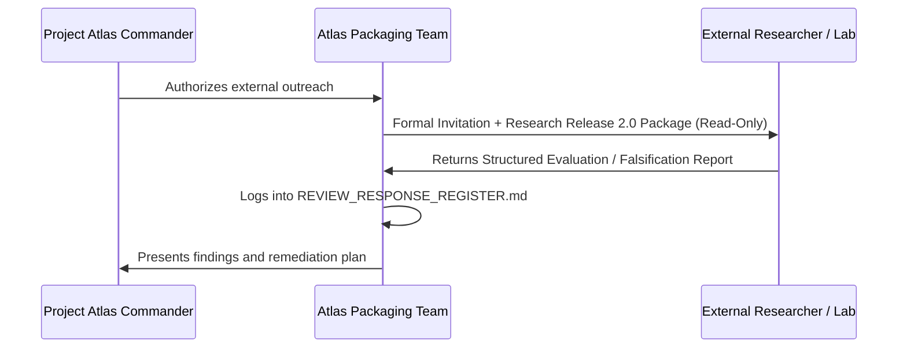

# PROJECT ATLAS — RESEARCH RELEASE 2.0
# EXTERNAL RESEARCH REVIEW TARGETS & CANDIDATE REGISTRY
## Public Research Groups, Laboratories, and Institutional Contacts for Peer Evaluation

**Document Designation:** `ATLAS-EXTERNAL-REVIEW-TARGETS-2.0`  
**Milestone:** `13AG`  
**Parent:** `13AF`  
**Date:** 2026-11-07  
**System:** Project Atlas / MarsWalk 2.0  

---

## Strict Disclaimers & Ethics Protocol

> [!CAUTION]
> **Mandatory Review Disclosures:**
> 1. **No Endorsement:** Listing an individual, institution, or laboratory in this document does **NOT** imply that they have endorsed, collaborated with, or evaluated Project Atlas.
> 2. **No Agreement to Review:** None of the listed researchers have agreed to review Project Atlas. These candidates represent an objective, curated target list of world-leading domain authorities whose published literature aligns with Atlas simulation models.
> 3. **No Unsolicited Submissions:** Antigravity and the Atlas development team will **never** transmit unsolicited files, emails, or submission packages to any entity without explicit, affirmative user authorization.
> 4. **Public Sources Only:** All listed affiliations, publications, and submission routes are derived strictly from public scientific literature and official institutional websites.

---

## Prioritized Target List: Track A — Planetary Atmosphere & Optical Propagation

### Target A-1: Dr. Mark T. Lemmon & Atmospheric Science Group
- **Affiliation:** Space Science Institute (SSI), Boulder, Colorado, USA.
- **Specialization:** Martian atmospheric aerosol scattering, optical depth measurements, Pancam/Mastcam solar photometry.
- **Relevant Published Work:**
  - Lemmon et al. (2004), *Atmospheric Imaging Results from the Mars Exploration Rovers: Spirit and Opportunity*, Science.
  - Lemmon et al. (2014), *Dust aerosol, clouds, and variations on Mars seen by the Mars Exploration Rover Opportunity Pancam*, Icarus.
- **Relevance to Atlas:** Direct author of the Opportunity $H_{\text{dust}} = 10.0\text{ km}$ and $19.2\text{ km}$ observations implemented in `atlas_mars_atmospheric_model.py`.
- **Public Contact / Official Route:** Space Science Institute Public Staff Directory (`https://www.spacescience.org`).

### Target A-2: Dr. Luca Montabone & OpenMARS Climatology Group
- **Affiliation:** Laboratoire de Météorologie Dynamique (LMD / Sorbonne Université), Paris, France / Space Science Institute (SSI).
- **Specialization:** Martian dust storm climatology, multi-year reanalysis datasets, global optical depth mapping.
- **Relevant Published Work:**
  - Montabone et al. (2015), *The Mars Dust Climatology Database*, Icarus.
  - Montabone et al. (2020), *Global dust storms on Mars: A 20-year climatology*, J. Geophys. Res. Planets.
- **Relevance to Atlas:** Ideal authority to evaluate the spatial and seasonal dynamic range of column optical depth used in Atlas mission scenarios.
- **Public Contact / Official Route:** LMD / Sorbonne Université Directory / OpenMARS Project Page.

### Target A-3: Optical Communications Research Group (Dr. Inmaculada Fernández-Rodríguez et al.)
- **Affiliation:** Department of Signal Theory and Communications, University of Vigo, Spain / INTA.
- **Specialization:** Free-space optical communications through the Martian atmosphere, near-IR dust scattering.
- **Relevant Published Work:**
  - Fernández-Rodríguez et al. (2024 / arXiv:2504.16955), *Mars atmospheric dust effects on optical communications: Spectral attenuation and link availability*.
- **Relevance to Atlas:** Direct source of the Ångström exponent $\alpha = -0.082$ and 1550 nm optical laser communication link models.
- **Public Contact / Official Route:** University of Vigo Public Academic Directory.

### Target A-4: Mars Climate Sounder (MCS) Science Team (Dr. Nicholas G. Heavens / Dr. David Kass)
- **Affiliation:** NASA Jet Propulsion Laboratory (JPL) / California Institute of Technology / Space Science Institute.
- **Specialization:** Vertical sounding of atmospheric aerosols, detached dust layers, water-ice cloud distributions.
- **Relevant Published Work:**
  - Heavens et al. (2011, 2019), *Extreme vertical aerosol lofting during the 2018 global dust storm on Mars*, Nature Astronomy.
- **Relevance to Atlas:** Essential peer authority to audit the physical validity of Atlas's exponential scale-height assumption versus detached aloft dust layers.
- **Public Contact / Official Route:** JPL Public Staff Profiles (`https://science.jpl.nasa.gov`).

---

## Prioritized Target List: Track B — RF & Space Communications Engineering

### Target B-1: NASA JPL Deep Space Communications and Navigation Center of Excellence (DESCANSO)
- **Affiliation:** Jet Propulsion Laboratory, California Institute of Technology, Pasadena, CA, USA.
- **Specialization:** Deep space RF and optical link budgets, planetary radio science, microwave dust attenuation.
- **Relevant Published Work:**
  - Ho & Golshan (2000), *Mars Communications Beam Attenuation and Noise at Microwave Frequencies*, JPL DESCANSO Monograph.
  - Yuen (1983) / Cheung et al., *Deep Space Telecommunications Systems Engineering*, JPL Monograph Series.
- **Relevance to Atlas:** The foundational institutional author of Mars microwave link budget architectures and Ka-band propagation reference data.
- **Public Contact / Official Route:** JPL DESCANSO Public Portal (`https://descanso.jpl.nasa.gov`).

### Target B-2: European Space Operations Centre (ESA ESOC) Ground Systems Engineering
- **Affiliation:** European Space Agency (ESA), Darmstadt, Germany.
- **Specialization:** Interplanetary tracking stations (Estrack 35 m network), deep space link margin evaluation, Ka-band tracking.
- **Relevant Published Work:**
  - ESA Deep Space Communications Standards (ECSS-E-ST-50-05C).
  - Mars Express / ExoMars Trace Gas Orbiter proximity and surface relay telemetry operations.
- **Relevance to Atlas:** Authoritative engineering team to evaluate orbiter-to-ground contact scheduling and UHF/Ka-band dual-link handoffs.
- **Public Contact / Official Route:** ESA ESOC Telecommunications Systems Division Public Portal.

### Target B-3: NASA Glenn Research Center SCaN Advanced Communications Group
- **Affiliation:** NASA Glenn Research Center, Cleveland, Ohio, USA.
- **Specialization:** Space Communications and Navigation (SCaN), lunar and Martian surface mesh networking, delay-tolerant networking (DTN).
- **Relevant Published Work:**
  - NASA SCaN Space Communications Architecture Working Group Technical Reports.
  - Delay-Tolerant Networking (DTN) Bundle Protocol specifications for planetary exploration.
- **Relevance to Atlas:** Directly matches Atlas DTN engine architecture and multi-settlement communications mesh topology.
- **Public Contact / Official Route:** NASA GRC Public Communications Office.

### Target B-4: Johns Hopkins University Applied Physics Laboratory (JHU-APL) Space Communications Group
- **Affiliation:** JHU Applied Physics Laboratory, Laurel, Maryland, USA.
- **Specialization:** Planetary telecommunications, radio wave propagation, radar cross-sections.
- **Relevant Published Work:**
  - Goldhirsh (2000), *A Parameterized Model for Dust Attenuation and Noise at Microwave Frequencies on Mars*, IEEE TAP.
- **Relevance to Atlas:** Primary repository of Dr. Julius Goldhirsh's historical Martian dust attenuation algorithms and regolith dielectric models.
- **Public Contact / Official Route:** JHU-APL Space Exploration Sector Public Portal.

---

## Prioritized Target List: Track C — Software Verification & Scientific Computing

### Target C-1: NASA Ames Research Center Formal Methods & Robust Software Engineering Group
- **Affiliation:** NASA Ames Research Center, Moffett Field, California, USA.
- **Specialization:** Automated verification, model checking, numerical safety assurance for autonomous spacecraft software.
- **Relevant Published Work:**
  - Brat et al., *Verification of Autonomous Systems in Aerospace Missions*, NASA Technical Reports.
  - Java Pathfinder / Symbolic Execution and Mutation Analysis for Planetary Autonomy.
- **Relevance to Atlas:** Uniquely qualified to evaluate Atlas's mutation testing campaign and out-of-domain physical boundary guards.
- **Public Contact / Official Route:** NASA Ames Robust Software Engineering Public Portal (`https://ti.arc.nasa.gov/tech/rse`).

### Target C-2: The Journal of Open Source Software (JOSS) Editorial Board
- **Affiliation:** Open Journals / NumFOCUS affiliate.
- **Specialization:** Research software engineering, open science reproducibility, documentation integrity, computational testing.
- **Relevant Published Work:**
  - Smith et al. (2018), *Journal of Open Source Software (JOSS): design and first-year review*, PeerJ Computer Science.
- **Relevance to Atlas:** Ideal formal publication and peer review venue for standalone computational simulation libraries.
- **Public Contact / Official Route:** JOSS Official Submission Portal (`https://joss.theoj.org`).

### Target C-3: ACM Transactions on Mathematical Software (TOMS)
- **Affiliation:** Association for Computing Machinery (ACM).
- **Specialization:** Verifiable mathematical algorithms, floating-point robustness, numerical software reproducibility.
- **Relevant Published Work:**
  - ACM TOMS Replicated Computational Results (RCR) Certification Standard.
- **Relevance to Atlas:** The gold standard for certifying that independent benchmarks replicate claimed analytical theorems and numerical bounds.
- **Public Contact / Official Route:** ACM TOMS Editorial Submission System.

---

## Submission Protocol & Review Intake Pipeline

When authorized by the user, contact with external reviewers will follow a four-step professional protocol:

