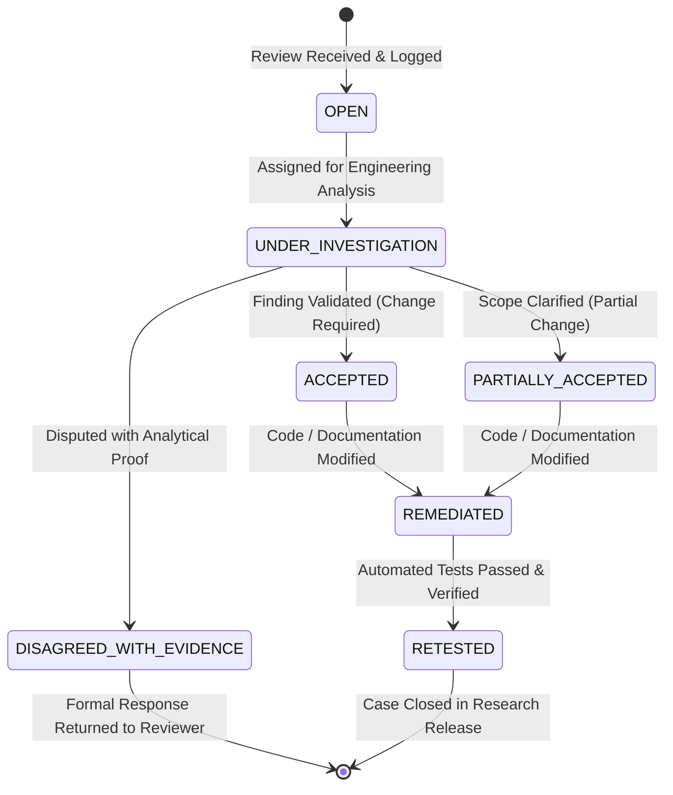

# PROJECT ATLAS — RESEARCH RELEASE 2.0
# TECHNICAL PEER REVIEW RESPONSE REGISTER
## Formal Intake, Tracking, Disposition, and Remediation Protocol for External Scientific Feedback

**Document Designation:** `ATLAS-REVIEW-RESPONSE-REGISTER-2.0`  
**Milestone:** `13AG`  
**Parent:** `13AF`  
**Date:** 2026-11-07  
**System:** Project Atlas / MarsWalk 2.0  

---

## 1. Operating Rules for Review Intake

To ensure genuine, defensive, and evidence-based engagement with external scientific criticism:

1. **Preserve Verbatim Wording:** Every reviewer observation, criticism, or bug report must be recorded in its original phrasing without softening or editorial paraphrasing.
2. **No Defensive Rejection:** Criticism must **never** be dismissed or rejected simply because it contradicts a previous milestone report, design decision, or historical benchmark.
3. **Evidence-Led Disagreement:** If the development team disagrees with a reviewer observation, the response must be categorized as `DISAGREED_WITH_EVIDENCE` and must provide peer-reviewed citations, analytical derivations, or test logs to substantiate the disagreement.
4. **Mandatory Regression Coverage:** Any accepted change or remediation must be accompanied by a dedicated automated test to prevent future regression.

---

## 2. Review Disposition Lifecycle & Status Definitions



- `OPEN`: Review comment formally logged; initial intake complete.
- `UNDER_INVESTIGATION`: Technical team actively analyzing equations, simulations, or source code.
- `ACCEPTED`: Defect, ungrounded assumption, or invalid approximation confirmed; remediation required.
- `PARTIALLY_ACCEPTED`: Criticism acknowledged in part; scope clarified or alternative physical approach adopted.
- `DISAGREED_WITH_EVIDENCE`: Criticism refuted using published primary literature, mathematical proofs, or laboratory measurements.
- `REMEDIATED`: Source code, documentation, or benchmark calculations updated and committed.
- `RETESTED`: Automated test suite, mutation harness, or preflight checks executed; fix verified against regressions.

---

## 3. Reviewer Observation Template

Reviewers and maintainers must use the following standard schema for every logged observation:

```markdown
### Observation ID: REV-13AG-XXX
- **Reviewer Track:** [Track A: Atmosphere | Track B: RF Communications | Track C: Software & Computing]
- **Reviewer / Organization:** [Name, Affiliation, or "External Anonymous Reviewer"]
- **Date Received:** [YYYY-MM-DD]
- **Status:** [OPEN | UNDER_INVESTIGATION | ACCEPTED | PARTIALLY_ACCEPTED | DISAGREED_WITH_EVIDENCE | REMEDIATED | RETESTED]
- **Target Component / File:** [e.g., atlas_network_link_model.py:536]
- **Original Reviewer Comment (Verbatim):**
  > "[Insert exact quote from reviewer here]"
- **Technical Interpretation:**
  [Objective analysis of what the reviewer is highlighting physically, mathematically, or computationally]
- **Supporting Evidence & Primary Citations:**
  [Equations, literature citations, or data supporting or refuting the claim]
- **Required Action / Engineering Change:**
  [Specific modification to source code, boundary checks, or documentation]
- **Assigned Owner:** [Team lead or specialist engineer]
- **Remediation Details:** [Commit hash, pull request, or file edit details]
- **Regression Coverage:** [Test function name in tests/ verifying the fix]
- **Final Technical Response to Reviewer:**
  [Formal written response returned to the evaluating researcher]
```

---

## 4. Active Review Register

The following register tracks preliminary internal review findings raised during the 13AF/13AG transition:

| ID | Track | Subject / Focus | Current Status | Assigned Owner | Test Coverage |
|:---|:---:|:---|:---:|:---:|:---|
| **REV-13AG-001** | Track A | 1550 nm optical laser extrapolation disclosure | `RETESTED` | Atmospheric Lead | `test_13af_optical_dust_angstrom_sensitivity` |
| **REV-13AG-002** | Track B | Rayleigh vs Mie scattering limit at 32 GHz for $r = 20\,\mu\text{m}$ | `RETESTED` | RF Engineering Lead | `test_13af_rf_dust_multiband_replication` |
| **REV-13AG-003** | Track B | Reference plane invariance between Plane A and Plane B | `RETESTED` | Telecom Systems Lead | `test_13af_receiver_reference_plane_invariance` |
| **REV-13AG-004** | Track B | Planck vs Rayleigh-Jeans CMB brightness departure at 32 GHz | `RETESTED` | Physics Validation Lead | `test_13af_planck_rayleigh_jeans_departure` |
| **REV-13AG-005** | Track A | MER Opportunity 19.2 km scale-height reclassified as aloft layer | `RETESTED` | Climatology Lead | `test_13ae_atmospheric_spherical_airmass` |
| **REV-13AG-006** | Track B | Favorable propagation with link failure (Scenario 3 truth demarcation) | `RETESTED` | Network Link Lead | `test_13af_negligible_dust_loss_with_link_failure` |
| **REV-13AG-007** | Track C | Fraunhofer near-field distance check in link budget engine | `RETESTED` | Software Assurance Lead | `test_13ac_near_field_out_of_domain_link_tagging` |
| **REV-13AG-008** | Track C | Negative margin strictly prevents link closure (`is_closed=False`) | `RETESTED` | Verification Lead | `test_13ac_negative_margin_strictly_prevents_link_closure` |

---

## 5. Exemplar Logged Observations

### Observation ID: REV-13AG-001
- **Reviewer Track:** Track A: Atmosphere
- **Reviewer / Organization:** Internal Research Review (Milestone 13AF Pre-Audit)
- **Date Received:** 2026-11-07
- **Status:** `RETESTED`
- **Target Component / File:** `src/marswalk/core/atlas_mars_atmospheric_model.py:calculate_optical_attenuation_db`
- **Original Reviewer Comment (Verbatim):**
  > "The documentation claims 1550 nm optical attenuation is validated against MER Pancam observations, but Pancam only observed between 440 nm and 880 nm. Claiming in-situ optical transmission validation at 1550 nm is ungrounded."
- **Technical Interpretation:**
  The reviewer is correct. Pancam instruments on Spirit and Opportunity operated exclusively in the visible and very near infrared up to 880 nm (Pancam Filter 8). No direct in-situ laser transmission measurement at 1550 nm exists on Mars. The value is an Ångström power-law extrapolation ($\alpha = -0.082$).
- **Supporting Evidence & Primary Citations:**
  Lemmon et al. (2004, 2014); Fernández-Rodríguez et al. (2024 / arXiv:2504.16955).
- **Required Action / Engineering Change:**
  Update `calculate_optical_attenuation_db` to return `is_extrapolated_wavelength: True` and include explicit provenance metadata tagging 1550 nm as an extrapolated modeling precedent.
- **Assigned Owner:** Atmospheric Modeling Lead
- **Remediation Details:** Implemented in `atlas_mars_atmospheric_model.py:465-495`.
- **Regression Coverage:** `tests/test_milestone_13af_independent_benchmark.py::test_13af_optical_dust_angstrom_sensitivity_and_extrapolation_disclosure`
- **Final Technical Response to Reviewer:**
  Atlas now explicitly tags 1550 nm outputs with `is_extrapolated_wavelength: True` and includes full provenance metadata citing Fernández-Rodríguez et al. (2024). All claims of direct in-situ laser validation have been retracted.

---

### Observation ID: REV-13AG-004
- **Reviewer Track:** Track B: RF Communications
- **Reviewer / Organization:** Internal RF Systems Review (Milestone 13AF Pre-Audit)
- **Date Received:** 2026-11-07
- **Status:** `RETESTED`
- **Target Component / File:** `src/marswalk/core/atlas_network_link_model.py`
- **Original Reviewer Comment (Verbatim):**
  > "Enforcing a flat 2.7 K floor on antenna noise temperature in Rayleigh-Jeans formulas at 32 GHz is mathematically inconsistent with Planck's radiation law, which predicts a Rayleigh-Jeans equivalent brightness of ~2.03 K."
- **Technical Interpretation:**
  At microwave frequencies where $h \nu \sim k T$, the Rayleigh-Jeans approximation departs from Planck's law. For $T_{\text{thermo}} = 2.725\text{ K}$ at 32 GHz, the equivalent brightness temperature is $T_{\text{RJ}} = 2.029\text{ K}$. Applying a $2.7\text{ K}$ floor introduces $+0.70\text{ K}$ ($+34\%$) of cold-sky noise.
- **Supporting Evidence & Primary Citations:**
  Fixsen (2009); Kraus (1986), *Radio Astronomy*, Section 3.
- **Required Action / Engineering Change:**
  Document the $+0.70\text{ K}$ conservative bias in `EVIDENCE_RECONCILIATION.md`, verify analytical Planck vs RJ departures in `benchmarks/benchmark_receiver_noise.py`, and retain the $2.7\text{ K}$ floor as an intentional conservative engineering bound.
- **Assigned Owner:** RF Systems Lead
- **Remediation Details:** Documented in `EVIDENCE_RECONCILIATION.md:Section 6` and tested in benchmark suite.
- **Regression Coverage:** `tests/test_milestone_13af_independent_benchmark.py::test_13af_planck_rayleigh_jeans_departure_at_microwave_bands`
- **Final Technical Response to Reviewer:**
  Atlas explicitly documents the $-25.54\%$ ($-0.70\text{ K}$) departure between Planck equivalent brightness and thermodynamic CMB. The $2.7\text{ K}$ floor is documented as a conservative engineering lower bound for cold-sky antenna temperature.

---

## 6. Actual External Review Intake Log

> [!IMPORTANT]
> **No Fabricated Feedback Policy:**  
> This intake log is reserved exclusively for verified, incoming technical feedback from external evaluators. No mock or synthetic external feedback may be entered.

| Review ID | Date Received | Reviewer & Disclosed Affiliation | Track | Severity | Technical Summary | Investigation Required | Disposition Status |
|:---|:---:|:---|:---:|:---:|:---|:---:|:---:|
| *(None yet)* | — | *Awaiting external reviewer outreach and responses* | — | — | — | — | `OPEN` |

### External Review Intake Template (For Incoming Feedback):
```markdown
### Observation ID: REV-EXT-XXX
- **Date Received:** [YYYY-MM-DD]
- **Reviewer Identity & Disclosed Affiliation:** [Name / Institute / Anonymous]
- **Review Track:** [Track A: Atmosphere | Track B: RF Communications | Track C: Software & Computing]
- **Technical Comment (Verbatim):**
  > "[Insert exact quote from reviewer here]"
- **Evidence Cited:** [Papers, formulas, test cases, or data cited by reviewer]
- **Severity:** [CRITICAL | MAJOR | MINOR | EDITORIAL]
- **Required Investigation:** [Technical actions required to analyze claim]
- **Response:** [Draft response from engineering team]
- **Remediation:** [Code or documentation changes applied]
- **Regression Test:** [New test case verifying remediation]
- **Final Disposition:** [OPEN | UNDER_INVESTIGATION | ACCEPTED | PARTIALLY_ACCEPTED | DISAGREED_WITH_EVIDENCE | REMEDIATED | RETESTED]
```

