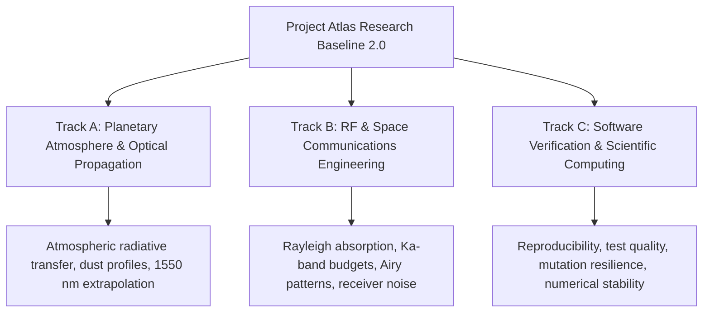

# PROJECT ATLAS — RESEARCH RELEASE 2.0
# TECHNICAL PEER REVIEW TRACKS
## Domain Dossiers, Methodological Frameworks & Scientific Evaluation Scope

**Document Designation:** `ATLAS-REVIEW-TRACKS-2.0`  
**Milestone:** `13AG`  
**Parent:** `13AF`  
**Date:** 2026-11-07  
**System:** Project Atlas / MarsWalk 2.0  

---

## Overview

Project Atlas partitions its external technical evaluation into three distinct, specialized review tracks to enable subject matter experts to interrogate the codebase and scientific models within their specific domain of expertise:

---

## Review Track A: Planetary Atmosphere & Optical Propagation

### 1. Domain Scope & Target Expertise
- **Target Reviewers:** Planetary atmospheric physicists, radiative transfer specialists, Martian climatologists, optical space telecommunications researchers.
- **Key Modules Under Audit:**
  - `src/marswalk/core/atlas_mars_atmospheric_model.py`
  - `research/Atlas_Research_Release_2.0/benchmarks/benchmark_optical_dust.py`
  - `research/Atlas_Research_Release_2.0/data/optical_angstrom_sensitivity_table.csv`

### 2. Methodological Framework & Physics Equations
1. **Spherical Curved Atmospheric Integration:**  
   Atlas models the Martian atmosphere as a curved spherical shell over an ellipsoidal planetary radius $R_M = 3,389.5\text{ km}$, replacing flat-earth plane-parallel $\sec(z)$ approximations with numerical path integrals that remain well-behaved down to $0^\circ$ elevation:
   $$m(\theta) = \int_0^{z_{\text{top}}} \frac{\exp(-z / H)}{\sqrt{\sin^2(\theta) + 2 \frac{z}{R_M} + \left(\frac{z}{R_M}\right)^2}} dz$$
2. **Ångström Spectral Optical Extinction:**  
   Spectral dust optical depth $\tau(\lambda)$ scales from the reference Pancam wavelength $\lambda_0 = 880\text{ nm}$ via the power-law:
   $$\tau(\lambda) = \tau(880\text{ nm}) \cdot \left(\frac{\lambda}{880\text{ nm}}\right)^{-\alpha}$$
   Atlas adopts the baseline exponent $\alpha = -0.082$ derived from MER Pancam observations (Fernández-Rodríguez et al. 2024 / 2025 preprint arXiv:2504.16955).
3. **Explicit 1550 nm Extrapolation Disclosure:**  
   Reviewers must verify that Atlas explicitly declares 1550 nm laser communications opacity as an **extrapolated modeling precedent** rather than a measured in-situ optical transmission.
4. **Dust Vertical Scale Heights:**  
   Well-mixed tropospheric dust is modeled with $H_{\text{dust}} = 10.0\text{ km}$ (Lemmon et al. 2004, 2014). An expanded sensitivity profile with $H = 19.2\text{ km}$ is retained strictly as an aloft dust layer stress test case.

### 3. Key Primary Literature References
- **Lemmon et al. (2004, 2014):** MER Pancam optical depth measurements and scale height inversions.
- **Fernández-Rodríguez et al. (2024 / arXiv:2504.16955):** Feasibility of optical communications on Mars under atmospheric dust conditions.
- **Montabone et al. (2015, 2020):** Global Martian dust storm climatology and optical depth database.
- **Guzewich et al. (2019):** Vertical distribution of dust during the 2018 global dust storm from Mars Climate Sounder (MCS).

---

## Review Track B: RF & Space Communications Engineering

### 1. Domain Scope & Target Expertise
- **Target Reviewers:** Space telecommunications engineers, deep-space network architects, RF propagation engineers, antenna design specialists.
- **Key Modules Under Audit:**
  - `src/marswalk/core/atlas_network_link_model.py`
  - `src/marswalk/core/atlas_antenna_model.py`
  - `research/Atlas_Research_Release_2.0/benchmarks/benchmark_rf_dust.py`
  - `research/Atlas_Research_Release_2.0/benchmarks/benchmark_receiver_noise.py`
  - `research/Atlas_Research_Release_2.0/benchmarks/benchmark_antenna_patterns.py`

### 2. Methodological Framework & Physics Equations
1. **Rayleigh Dielectric Absorption in Microwave Regimes:**  
   Atlas models RF dust attenuation across UHF (401.5 MHz), S-band (2.2 GHz), X-band (8.4 GHz), and Ka-band (32.0 GHz) using Rayleigh dielectric absorption:
   $$\alpha = 4.3429 \times 10^3 \cdot \frac{6 \pi}{\lambda \rho_{\text{grain}}} \text{Im}(-K) M \quad [\text{dB/km}]$$
   where $x = 2 \pi r / \lambda \le 0.0134 \ll 1$ at 32 GHz for $r = 20\,\mu\text{m}$.
2. **Dielectric Analog Material Attribution:**  
   Permittivity is parameterized as $\epsilon_r = 2.80 - j 0.0420$ ($\tan\delta = 0.015, \text{Im}(-K) = 0.005468$) derived from dry terrestrial basalt / Apollo lunar regolith analogs (Campbell & Ulrichs 1969; Goldhirsh 2000).
3. **Antenna Field-Region Boundaries & Diffraction Patterns:**  
   Field transitions are bounded by Fraunhofer distance $R_{\text{ff}} = 2 D^2 / \lambda$. Parabolic circular apertures are modeled via Bessel diffraction $J_1(u)/u$ with first sidelobes at $-17.57\text{ dB}$, capped by a $-30\text{ dB}$ attenuation floor and a $0.1\text{ dB}$ broadbeam pointing guard for omnidirectional elements.
4. **Receiver Noise & Reference Plane Invariance:**  
   Noise temperatures are decomposed across antenna, feedline, and receiver stages. Reviewers must verify that carrier-to-noise spectral density $(C/N_0)$ is strictly invariant between Reference Plane A (antenna terminals) and Reference Plane B (LNA input):
   $$\left(\frac{C}{N_0}\right)_A = \left(\frac{C}{N_0}\right)_B$$
5. **Operational Survivability Demarcation:**  
   Reviewers must verify that Atlas strictly decouples propagation attenuation from operational link closure. Links with negative margin or sub-standard bitrates (< 8 kbps) strictly yield `is_link_closed = False` and `operational_rate_bps = 0`.

### 3. Key Primary Literature References
- **Goldhirsh (2000):** *A Parameterized Model for Dust Attenuation and Noise at Microwave Frequencies on Mars*, IEEE Trans. Antennas Propag.
- **Ho & Golshan (2000):** *Mars Communications Beam Attenuation and Noise at Microwave Frequencies*, NASA JPL DESCANSO Series.
- **ITU-R S.580-6:** *Radiation diagrams for use as design objectives for antennas of earth stations*.
- **Fixsen (2009):** *The Temperature of the Cosmic Microwave Background*, Astrophysical Journal.
- **Silver (1949) / Balanis (2016):** *Microwave Antenna Theory and Design* / *Antenna Theory: Analysis and Design*.

---

## Review Track C: Software Verification & Scientific Computing

### 1. Domain Scope & Target Expertise
- **Target Reviewers:** Scientific software engineers, computational reproducibility auditors, formal verification specialists, research software quality leads.
- **Key Modules Under Audit:**
  - `tests/test_milestone_13af_independent_benchmark.py`
  - Complete `tests/` test suite (94 test modules, 1,254 test cases)
  - `scratch/run_13af_mutations.py` and `docs/13af-mutation-results.md`
  - `research/Atlas_Research_Release_2.0/benchmarks/run_all_benchmarks.py`
  - `scripts/preflight_check.py`

### 2. Methodological Framework & Software Quality Gates
1. **Zero-Dependency Benchmark Independence:**  
   The benchmark harness in `benchmarks/` computes reference values using only standard Python (`math`, `dataclasses`, `json`). It executes completely independently of the live Atlas HTTP server, database, or simulation orchestration daemons.
2. **Controlled Adversarial Mutation Testing:**  
   Atlas implements an automated mutation harness executing 8 targeted source mutations (`MUT-13AF-01` to `MUT-13AF-08`) testing:
   - Inversion of optical spectral power laws.
   - Restoration of ungrounded terrestrial default parameters.
   - Disabling of RF dust losses.
   - Corruption of dielectric loss factors.
   - Bypassing of physical noise floors (CMB).
   - Double-counting of feedline noise.
   - Bypassing of Fraunhofer near-field guards.
   - Optimistic default link-closure on negative margin.
   All 8 mutations are actively detected and killed by the test suite (100% kill rate).
3. **Full System Regression Suite:**  
   Reviewers must execute `pytest tests -q` across all 94 test files (1,254 tests) and verify clean execution with 0 failures in 241.54 seconds.
4. **Numerical Stability & Boundary Guards:**  
   Reviewers must evaluate division-by-zero guards, NaN protections, sub-horizon elevation cutoffs, and edge-case behaviors near physical singularities.

### 3. Key Standards & Methodological References
- **NASA Software Engineering Requirements (NPR 7150.2):** Software testing, verification, and validation standards.
- **ISO/IEC/IEEE 29119:** Software Testing International Standard.
- **Jia & Harman (2011):** *An Analysis and Survey of the Development of Mutation Testing*, IEEE Trans. Softw. Eng.
- **ACM / IEEE Guidelines for Reproducible Research in Computational Science.**
