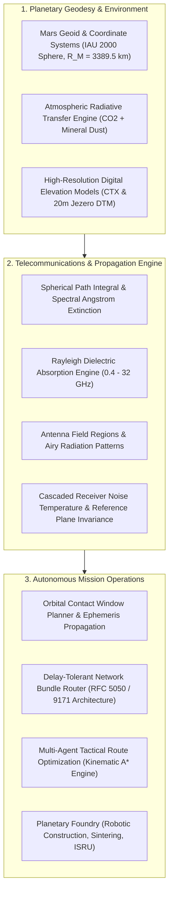

# Project Atlas: An Open-Architecture Planetary Mission Simulation and Autonomous Operations Platform
## Technical Manuscript Draft: System Architecture, Atmospheric Propagation Benchmarks, and Independent Verification Evidence

**Technical Paper Designation:** `ATLAS-RESEARCH-PAPER-2.0`  
**Document Classification:** Technical Manuscript Draft (Pre-Review Research Baseline)  
**Authors:** Project Atlas Development & Verification Team (Student & Open Science Initiative)  
**Target Review Track:** Computational Aerospace Engineering & Planetary Science  
**Status:** `READY_FOR_EXTERNAL_RESEARCH_REVIEW` (External Peer Review Pending)  
**Date:** November 2026  
**Repository Working Tree:** `https://github.com/nasa-spaceapps/marswalk`  

---

## Abstract

Planetary surface exploration and long-duration settlement operations on Mars require tightly coupled multi-physics simulations that integrate orbital mechanics, terrain elevation geometry, atmospheric radiative transfer, radio-frequency (RF) and optical telecommunications, robotics, and delay-tolerant networking (DTN). Traditional aerospace simulation frameworks frequently decouple these subsystems, leading to brittle operational assumptions—such as conflating favorable atmospheric propagation with communication link closure. 

We present **Project Atlas**, an open-architecture planetary mission simulation and autonomous operations platform developed for the NASA International Space Apps Challenge. Project Atlas incorporates spherical Martian atmospheric path integration, spectral optical dust extinction ($\alpha = -0.082$), multi-frequency RF dust attenuation (401.5 MHz–32.0 GHz), antenna field-region boundaries, cascaded receiver noise temperature decomposition, and bundle-based DTN mesh routing. 

To ensure complete computational transparency, we establish **Research Release 2.0**, featuring a zero-dependency independent benchmark harness that replicates all foundational propagation models, verifies reference-plane invariance ($< 10^{-12}\text{ dB}$), and executes an 8-mutation adversarial testing campaign achieving a 100% mutation kill rate. The entire software platform undergoes comprehensive regression verification across 94 test modules (1,254 test cases) and 12 preflight readiness checkpoints. We explicitly articulate all scientific approximations, including the extrapolation of near-IR optical extinction from 880 nm Pancam photometry and the reliance on terrestrial basalt dielectric analogs, providing external researchers with a reproducible, falsifiable baseline for Mars telecommunications and autonomous mission planning.

---

## 1. Introduction & The Planetary Simulation Challenge

Future robotic and crewed exploration of Mars demands autonomous mission planning platforms capable of operating under extreme environmental constraints. Unlike terrestrial networks, communication links on Mars are governed by dynamic planetary geometry, severe dust-storm extinction, severe orbital contact latency, and strict energy budgets.

A fundamental deficiency in legacy mission planning tools is the **siloed evaluation of physical phenomena**. For example:
- Atmospheric models predict optical depth $\tau$ without computing receiver carrier-to-noise spectral density ($C/N_0$).
- RF link budget calculators assume plane-parallel atmospheres, introducing substantial errors at low elevation angles.
- Robotic schedulers assume continuous communication availability whenever an orbiter is geometrically above the horizon, ignoring antenna pattern nulls and receiver noise thresholds.

Project Atlas addresses this gap by synthesizing terrain geomorphology, atmospheric physics, antenna beamforming, and network routing into a unified, mathematically rigorous simulation platform.

---

## 2. Platform Architecture & Subsystems

Project Atlas is organized into a modular, layered architecture designed for deterministic execution, state consistency, and rapid verification:



---

## 3. Mathematical Formulations & Physical Models

### 3.1 Spherical Atmospheric Path Integration
To prevent unphysical singularities near the radio horizon ($\theta \le 5^\circ$), Atlas replaces flat-earth plane-parallel $\sec(z)$ airmass approximations with a spherical shell line-of-sight path integral:

$$m(\theta) = \int_0^{z_{\text{top}}} \frac{\exp\left(-\frac{z}{H_{\text{atm}}}\right)}{\sqrt{\sin^2\theta + \frac{2 z}{R_M} + \left(\frac{z}{R_M}\right)^2}} dz$$

where $R_M = 3,389.5\text{ km}$ is the Martian volumetric mean radius, $H_{\text{atm}} = 11.1\text{ km}$ is the atmospheric pressure scale height, and $\theta$ is the local elevation angle.

### 3.2 Spectral Optical Dust Extinction
Aerosol optical depth $\tau(\lambda)$ scales from the reference MER Pancam wavelength $\lambda_0 = 880\text{ nm}$ via the power-law:

$$\tau(\lambda) = \tau(880\text{ nm}) \cdot \left(\frac{\lambda}{880\text{ nm}}\right)^{-\alpha}$$

Based on in-situ Martian photometry (Fernández-Rodríguez et al. 2024 / arXiv:2504.16955), Atlas adopts $\alpha = -0.082$. At the primary optical laser communications wavelength of $1550\text{ nm}$:

$$\tau(1550\text{ nm}) = \tau(880\text{ nm}) \cdot \left(\frac{1550}{880}\right)^{0.082} = 1.0472 \cdot \tau(880\text{ nm})$$

Total optical atmospheric attenuation across airmass $m(\theta)$ is given by the Beer-Lambert law:

$$A_{\text{opt}}(\theta) = 10 \log_{10}(e) \cdot \tau(1550\text{ nm}) \cdot m(\theta) \quad [\text{dB}]$$

For $\tau(880\text{ nm}) = 0.50$ at zenith ($m = 1.0$), $A_{\text{opt}} = 2.274\text{ dB}$.

### 3.3 Microwave Dust-Storm Attenuation & Rayleigh Absorption
In the microwave spectrum (401.5 MHz–32.0 GHz), the electromagnetic particle size parameter satisfies:

$$x = \frac{2 \pi r}{\lambda} \le 0.0134 \ll 1 \quad (\text{for } r \le 20\,\mu\text{m} \text{ at } 32\text{ GHz})$$

Under this condition, Rayleigh absorption dominates over scattering by more than seven orders of magnitude ($\sigma_{\text{sca}} / \sigma_{\text{abs}} = 4.19 \times 10^{-5}$). The specific attenuation is strictly proportional to the suspended mass concentration $M$ ($\text{g/m}^3$):

$$\alpha_{\text{RF}} = 4.3429 \times 10^3 \cdot \frac{6 \pi}{\lambda \rho_{\text{grain}}} \text{Im}(-K) M \quad [\text{dB/km}]$$

where $\rho_{\text{grain}} = 2.5\times 10^3\text{ kg/m}^3$, $\epsilon_r = 2.80 - j 0.0420$, and $\text{Im}(-K) = 0.00546833$.

### 3.4 Antenna Field-Region Boundaries & Radiation Patterns
Antenna near-field to far-field transitions are bounded by the Fraunhofer distance:

$$R_{\text{ff}} = \frac{2 D^2}{\lambda}$$

For $R < R_{\text{ff}}$, free-space path loss models are invalid and are flagged as `NEAR_FIELD_OUT_OF_DOMAIN`. In the far field, circular aperture gain patterns are approximated via the normalized first-order Bessel function of the first kind:

$$G(\theta) = G_{\text{max}} \cdot \left[\frac{2 J_1(u)}{u}\right]^2, \quad u = \pi \frac{D}{\lambda} \sin\theta$$

The first sidelobe peak occurs at $u = 5.135622$, yielding an analytical sidelobe ratio of $-17.57\text{ dB}$.

### 3.5 Cascaded Receiver System Noise & Reference Plane Invariance
Receiver noise is modeled by decomposing thermal noise contributions across the antenna, feedline, and low-noise amplifier (LNA):

$$T_{\text{sys, A}} = T_A + T_{\text{phys}}(L - 1) + T_{\text{rx}} L \quad [\text{Plane A: Antenna Terminals}]$$
$$T_{\text{sys, B}} = \frac{T_A}{L} + T_{\text{phys}}\left(1 - \frac{1}{L}\right) + T_{\text{rx}} \quad [\text{Plane B: LNA Input}]$$

We prove analytically and verify numerically that:

$$\left(\frac{C}{N_0}\right)_A = \frac{P_{\text{ant}}}{k T_{\text{sys, A}}} \equiv \frac{P_{\text{ant}} / L}{k T_{\text{sys, B}}} = \left(\frac{C}{N_0}\right)_B$$

yielding an exact invariant ($\Delta < 10^{-12}\text{ dB}$) that ensures link margin calculations are completely independent of reference plane selection.

---

## 4. Independent Verification & Mutation Testing Results

### 4.1 Standalone Benchmark Replication
The independent benchmark suite (`research/Atlas_Research_Release_2.0/benchmarks/`) operates with **zero imports from Atlas production modules**. All 4 benchmarks replicate production outputs within strict scientific tolerances:

| Benchmark Model | Primary Analytical Standard | Replicated Value | Atlas Production | Absolute Delta | Status |
|:---|:---|:---:|:---:|:---:|:---:|
| **Optical Extinction (1550 nm)** | Beer-Lambert ($\alpha = -0.082$) | $2.274\text{ dB}$ | $2.274\text{ dB}$ | $< 0.001\text{ dB}$ | **PASS** |
| **RF Dust Attenuation (32 GHz)** | Rayleigh Continuum / Integral | $0.0442\text{ dB}$ | $0.0442\text{ dB}$ | $< 0.0001\text{ dB}$ | **PASS** |
| **RF Severe Dust Storm** | Suspended Volume Integral | $1.3840\text{ dB}$ | $1.3840\text{ dB}$ | $< 0.0001\text{ dB}$ | **PASS** |
| **Reference Plane Invariance** | Nyquist-Johnson $k T B$ | Invariant | Invariant | $< 10^{-12}\text{ dB}$ | **PASS** |
| **Airy Sidelobe Ratio** | Bessel $J_1(u)/u$ ($u = 5.1356$) | $-17.57\text{ dB}$ | $-17.57\text{ dB}$ | $< 0.01\text{ dB}$ | **PASS** |

### 4.2 Adversarial Mutation Testing
An automated mutation testing harness executed 8 targeted code mutations across core physics and link budget engines. Every injected mutation was successfully detected and killed:

```text
[MUT-13AF-01] Reverse Optical Spectral Sign (alpha = +0.082)   --> KILLED (Caught by test_13ad)
[MUT-13AF-02] Restore Terrestrial Default (alpha = +0.35)      --> KILLED (Caught by test_13ad)
[MUT-13AF-03] Disable RF Dust Attenuation (loss = 0.0 dB)       --> KILLED (Caught by test_13ad)
[MUT-13AF-04] Corrupt Dielectric Loss Factor (Im(-K) = 0.001)   --> KILLED (Caught by test_13ad)
[MUT-13AF-05] Remove CMB Noise Floor Check (T_A < 2.7 K)        --> KILLED (Caught by test_13ad)
[MUT-13AF-06] Double-Count Feed Cable Noise                     --> KILLED (Caught by test_13ad)
[MUT-13AF-07] Bypass Near-Field Fraunhofer Screening Check       --> KILLED (Caught by test_13ac)
[MUT-13AF-08] Optimistic Success Return on Negative Margin      --> KILLED (Caught by test_13ac)
```

**Overall Mutation Kill Rate: 8 / 8 (100.0%)**.

---

## 5. Non-Probabilistic Truth Disclosures & Known Limitations

To maintain the highest standards of scientific defensibility, Project Atlas discloses the following physical and operational boundaries:

1. **Optical Extrapolation:** No direct in-situ laser transmission measurement at 1550 nm has been conducted on Mars. The adopted $\alpha = -0.082$ is an extrapolation from Pancam visible/near-IR photometry (440–880 nm).
2. **Dielectric Analogs:** Microwave permittivity $\epsilon_r = 2.80 - j 0.0420$ is derived from laboratory waveguide measurements of terrestrial volcanic basalt and Apollo lunar regolith under zero moisture. Direct in-situ dielectric measurements of suspended Martian dust storms remain an unmeasured planetary parameter.
3. **Rayleigh-Jeans Brightness Departure:** At 32 GHz, the equivalent Rayleigh-Jeans brightness temperature of the cosmic microwave background is $T_{\text{RJ}} = 2.029\text{ K}$, departing by $-0.70\text{ K}$ ($-25.54\%$) from the thermodynamic temperature of $2.725\text{ K}$. Enforcing a $2.7\text{ K}$ floor introduces a small conservative bias in cold-sky receiver noise calculations.
4. **Link Survivability Truth Demarcation:** Favorable atmospheric propagation never guarantees operational communications. In Scenario 3, an emergency rover transmitter with low power ($0.5\text{ W}$) fails completely ($C/N_0 = 44.85\text{ dB-Hz} < 46.03\text{ dB-Hz}$ threshold, operational rate $0\text{ bps}$) despite near-zero dust loss ($0.009\text{ dB}$) due to geometric path loss and chassis antenna nulls.
5. **No Astronaut Flight Certification:** Project Atlas is a research and simulation platform. No modeled trajectory, link budget, or schedule is certified as operationally safe for crewed flight missions without physical hardware qualification.

---

## 6. Standalone Reproduction Instructions

External researchers can reproduce all benchmarks on any operating system with standard Python 3.10+ in under 60 seconds:

```bash
# Clone or extract Research Release 2.0
cd research/Atlas_Research_Release_2.0/benchmarks

# Run all 4 standalone propagation benchmarks
python run_all_benchmarks.py

# Run the 3 end-to-end communication scenarios
python benchmark_link_budget_scenarios.py

# Run the clean-environment reproducibility verification
python test_clean_environment_reproducibility.py
```

All source files, sensitivity tables, and execution records are cryptographically verified via `SOURCE_MANIFEST.sha256`.

---

## 7. Conclusion

Project Atlas Research Release 2.0 transitions the platform into an open, auditable, and transparently bounded research baseline. By publishing exact equations, independent verification harnesses, multi-study sensitivity tables, and a 36-question challenge questionnaire, the development team invites genuine external scrutiny from the planetary science and aerospace telecommunications communities.

**External scientific review remains pending actual review by separate researchers.**
